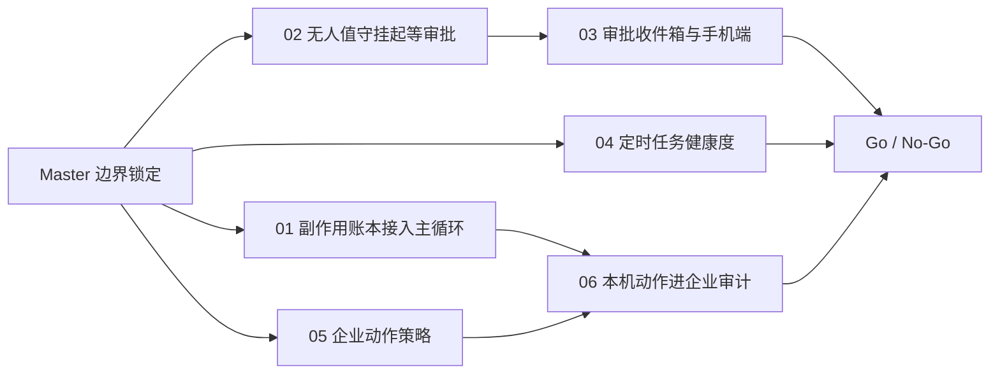

# 受治理的长程执行壁垒 Master Plan

Planned-with: claude-opus-5.5
Suggested-Impl-Model: 见第 5 节子计划表（默认 grok-4.7）
Plan-Id: 2026-10-12-governed-longrun-moat-master
Plan-File: `.cursor/plans/2026-10-12-governed-longrun-moat-master.plan.md`
Parent: 无

> **For implementer:** 本文件只做编排、证据与边界，不直接实施。每次只把**一个**子计划从 `.cursor/plans/pending/` 移到 `.cursor/plans/` 根目录后实施；可并行的子计划必须各自独立 git worktree / 分支。严守 `no-scope-creep.mdc`。不要 commit，除非用户明确要求；commit trailer 需用户提供 `Plan-Model` / `Impl-Model`。

---

## 1. 结论（先读这一节）

对 2026-10 一批开源 personal agent（Rakazo、OpenMausBot、OpenMuse、OpenDots、open-dots）做了源码级核验，判定为 **SELECTIVE_ADOPT：不引入任何上游架构或依赖，只补 6 处接线缺口**。

理由有两条，都有证据（第 2、3 节）：

1. **底层机制 AgenticX 已经更深。** 上游最硬的东西——运行租约 + 外部副作用幂等键（Rakazo）、按协议状态判断能否重放（OpenMausBot）、审稿凭据 + 乐观修订（OpenDots）——在 AgenticX 里都有对应物，而且多了上游没有的：调用身份账本 + 分层重放否决（`agenticx/reliability/`）、故障注入基准（`agenticx/evaluation/reliability_runner.py`）、Redis 协调总线 + leader 选举（`agenticx/runtime/coordination/`）、持久 ActionProposal（`agenticx/runtime/action_proposals/`）、RSI 数据飞轮与回放式策略演化（`agenticx/learning/trajectory/`、`plans/rsi/`）。上游没有一家做故障注入测试，没有一家有企业 RBAC / 审计导出。
2. **差距在「最后一公里」：这些能力没接到用户和企业看得见的路径上。** 最关键的一条：可靠性内核只接在 SDK 的 `ReActAgent` 上，Near 实际运行的 `agenticx/runtime/agent_runtime.py` 一行没接（`.cursor/plans/2026-09-12-sdk-reliability-kernel-master.plan.md` 第 165 行明确把它划出范围）。所以 Near 崩溃续跑后，防止重复发消息、重复 push 仍然靠模型读「结果未知」的提示自觉——这是概率性保证。

**壁垒论点（对外口径用中性表述）：**

> 别家证明的是「能干活」；AgenticX 要证明的是「干到一半断了不会干两遍；没人在场时会停下来等你批；企业能管它能做什么，并且事后查得到它做过什么」。

这三句分别对应：可证明的长程执行（子计划 01、04）、无人值守但可审批（02、03）、受治理的个人智能体（05、06）。上游五家没有一家同时具备后两者；企业属性上这是可以拉开代差的位置。

---

## 2. 上游源码证据（临时克隆于 `/tmp/pa/`，仅作调研，不进仓库）

| 仓库 | SHA | 许可 | 真实落地的机制（文件:行） | 对 AgenticX 的判断 |
|---|---|---|---|---|
| Rakazo | `2d666c4e` | Apache-2.0 | Run 租约 + fence CAS（`packages/adapters/src/executor.ts:3253-3272`）；`ExternalEffect.idempotencyKey` UNIQUE，intended 未完成走 uncertain（`executor.ts:8235-8367`、`schema.prisma:744-764`）；审批 `waiting_input` 暂停 + 4h 提醒 / 24h 过期（`packages/db/src/events.ts:832-902`、`packages/core/src/stuck-work.ts:4-9`）；例程失败**不会**自动暂停 | 幂等副作用思路已有对应物（CallLedger），缺的是接到产品主循环（→01）；「等审批而不是直接失败」值得做（→02） |
| OpenMausBot | `83c10b39` | Apache-2.0 | RuntimeEvent 归一化 + 原始协议双 NDJSON（`shared/runtime-events.ts:26-194`、`server/harness/bus.ts`）；只信协议状态的 resume 判定（`server/resume-recovery.ts:43-54`）；宿主操控 session 级放行被关掉（`drivers/claude.ts:1927`）；例程错过 12h 标 missed、`failureStreak`（`server/routines.ts:341,1557`）；团队包导入擦密钥、routine 默认暂停（`shared/package-format.ts:926-947`、`server/package-import.ts:484-499`）；约 552 个测试 | 事件账本 AgenticX 已有（`runtime/replay_ledger/`）；例程健康度值得做（→04）；团队包导入已有 AGX Bundle，不另做 |
| OpenMuse | `d0b3a6b3` | — | 已于 2026-10-01 研究并选择性内化（`.cursor/plans/2026-10-01-openmuse-selective-adopt-master.plan.md`） | 不重复 |
| OpenDots | `625452e0` | MIT（Alpha） | 审稿凭据 `(threadId, toolCallId)` + 字段相等幂等（`src/server/pages.ts:156-196`）；页面 revision CAS（`pages.ts:212-223`）；后台 lease 过期标 Interrupted，**不自动重跑**，显式「复查后重试」（`src/server/store.ts:207-239`、`src/client/TaskActions.tsx:30-31`）；MCP 只认 `readOnlyHint` 自动跑，其余用服务端存档参数审批（`src/server/connections.ts:188-198`、`connection-tools.ts:29-46`）；Automatic Learning 本地只有接线，学习在托管云 | 「中断不自动重跑、复查后再跑」值得做（→04）；「审批执行服务端存档参数」AgenticX 的 ActionProposal hash/TTL 已覆盖 |
| open-dots | `fb871a15` | MIT（原型） | git 子命令分类收窄「总是允许」（`backend/app/services/github_classifier.py:45-83`）；审批 110s 超时默认拒绝；`FOR UPDATE SKIP LOCKED` 领取 + 连续 3 次失败自动暂停（`schedule_service.py:303-380`），后者**无单测** | 连续失败自动暂停值得做（→04）；分类收窄与 `command_safety.py` 重叠，暂不做 |

---

## 3. AgenticX 现状核验（本仓库 main @ `8ccfe6e7`）

| 能力 | 证据 | 状态 |
|---|---|---|
| 调用身份账本 + 重放否决 | `agenticx/reliability/call_ledger.py`、`replay_policy.py::decide_replay` | 已有，**仅 SDK 侧 `agenticx/agents/react_agent_async.py:398-788` 使用** |
| 产品主循环工具派发 | `agenticx/runtime/agent_runtime.py:7490`（`_persist_or_abort`）→ `:7545-7574`（`dispatch_tool_async`）→ `:7630`（`await dispatch_task`） | **未接账本**（缺口 G1） |
| 崩溃续跑 | `agenticx/studio/session_manager.py:1112-1212`（`resume_interrupted_sessions`，HA 模式默认开）；`interrupted_closers` 只给模型写「结果未知」 | 有，但重复副作用靠模型自觉 |
| 无人值守确认 | `agenticx/studio/server.py:1371-1382`（`_resolve_confirm_gate`，`unattended` 直接 `RiskAwareAutoConfirmGate(unattended=True)`）；`agenticx/runtime/confirm.py:306-361`（受保护操作立即 `blocked_unattended` 返回 False） | 定时任务/无人值守遇到一次需审批的操作就整轮失败（缺口 G2） |
| 手机端审批 | `agenticx/gateway/client.py:768-789`（`confirm.pending` 只读网关自己经手回合的 `_PENDING_CONFIRMS`）；`mobile/src/components/ConfirmCard.tsx` | 定时任务的审批手机看不到（缺口 G3） |
| 定时任务结果记录 | Electron `desktop/electron/main.ts:1286-1316`（tick）、`:1360-1392`（schedule 结果）、`:11180-11190`（manual 结果）；服务端 `agenticx/studio/automation_scheduler.py:336-351`（`_record_run_result`） | 只有 success/error，无连续失败计数、无自动暂停、无「中断」态（缺口 G4） |
| 企业下发到桌面 | `enterprise/apps/web-portal/src/app/api/desktop/bootstrap/route.ts`（models + capabilities + `policy.capabilities` 三个安装开关）；`desktop/electron/main.ts:2235-2276`（只消费 `capabilities`） | 企业**管不了**智能体能执行哪些工具（缺口 G5） |
| 企业审计 | Go 网关 `enterprise/apps/gateway/internal/audit/`（Blake2b 链 + JSONL 主写 + PG 双写，`ON CONFLICT (id) DO NOTHING`）；只记录经网关的 LLM / MCP 代理调用 | 员工本机 Near 的工具执行、审批决定**一条都不进企业审计**（缺口 G6） |
| RSI 飞轮 | `plans/rsi/MASTER-PLAN.md`；`RewardRecord` 预留 `user` 来源 | 已有，`user` 来源暂无数据 |

---

## 4. 缺口与优先级

| ID | 缺口 | 用户/企业可感知的后果 | 优先级 | 子计划 |
|---|---|---|---|---|
| G1 | 产品主循环未接副作用账本 | 崩溃或关窗后点「继续」，可能把已发出的消息 / push / 外部写再做一遍 | P0 | 01 |
| G2 | 无人值守遇受保护操作直接失败 | 「每天 9 点帮我发周报」只要一步需要批准就永远失败；用户只能关掉审批，安全倒退 | P0 | 02 |
| G3 | 停下来等审批没有统一入口 | 后端停住了也没人看得见；手机审批卡看不到定时任务 | P1 | 03 |
| G4 | 定时任务无健康度 | 失效的登录、过期的 key 每天失败一遍；进程被杀的那次被当成成功或无记录 | P1 | 04 |
| G5 | 企业无法管控本机智能体动作 | 企业只能管模型和装什么，管不了「能不能 push、能不能调某个 MCP 写操作」 | P0（企业） | 05 |
| G6 | 本机智能体动作不进企业审计 | 出事后企业答不出「谁的 Near 在什么时候批准了什么」 | P0（企业） | 06 |

---

## 5. 子计划与推荐模型

所有子计划初始位于 `.cursor/plans/pending/`，`Parent-Plan` 指向本 master。

| # | 文件 | 交付 | 依赖 | Wave | Suggested-Impl-Model | 理由 |
|---|---|---|---|---|---|---|
| 01 | `2026-10-12-moat-01-runtime-effect-guard.plan.md` | 产品主循环接副作用账本：崩溃孤儿调用首次重发时拦截，中断前已完成的复用结果 | 无 | A | grok-4.7（卡住即升强推理档） | 动 8000 行主循环，但只在两个锚点各插一小段；需求和测试写全后中档可做 |
| 02 | `2026-10-12-moat-02-unattended-approval-parking.plan.md` | 无人值守受保护操作改为「挂起等审批」，带超时；新增待审批列表 API | 无 | A | grok-4.7 | 纯后端，确认链路已有，新增一个 gate 类 |
| 03 | `2026-10-12-moat-03-approval-inbox-surfaces.plan.md` | Desktop 待审批收件箱 + 手机端 `confirm.pending` 合并挂起项 | **02** | B | grok-4.7 | 一个前端组件 + 网关客户端两个函数 |
| 04 | `2026-10-12-moat-04-automation-run-health.plan.md` | 定时任务连续失败自动暂停、需人工处理类错误立即暂停、进程中断标「已中断·复查后再跑」 | 无 | A | grok-4.7 | TS / Python 双份纯函数 + 表驱动测试 |
| 05 | `2026-10-12-moat-05-enterprise-agent-action-policy.plan.md` | 企业下发「禁止的工具 / 必须确认的工具 / 禁用会话级放行」，Near 强制执行 | 无 | A | grok-4.7 | 跨 enterprise / electron / python，但每段都是已有模式的照抄 |
| 06 | `2026-10-12-moat-06-desktop-action-audit.plan.md` | Near 本机审批决定、策略拦截、外部写结果进企业网关审计链 | **01、05** | B | grok-4.7 | 复用网关现有审计写入器，不新建表 |

### 文件冲突矩阵（Wave A 并行时）

| 子计划 | 主要触碰 | 与谁冲突 | 规则 |
|---|---|---|---|
| 01 | `agenticx/reliability/call_ledger.py`、新建 `agenticx/runtime/effect_guard.py`、`agenticx/runtime/agent_runtime.py`（两处锚点）、`agenticx/studio/session_manager.py`（1 行） | 无 | — |
| 02 | `agenticx/runtime/confirm.py`、新建 `agenticx/runtime/parked_approvals.py`、`agenticx/studio/server.py`（`_resolve_confirm_gate` + 1 个路由） | 05 也改 `agenticx/cli/agent_tools.py`，但 02 不碰该文件 | 02 是 Wave A 里**唯一**改 `server.py` 的子计划 |
| 04 | 新建 `desktop/electron/automation-run-health.ts`、`desktop/electron/main.ts`（automation 段）、新建 `agenticx/runtime/automation_run_health.py`、`agenticx/studio/automation_scheduler.py`、`desktop/src/components/automation/*` | 05 改 `main.ts` 的 enterprise sync 段（不同函数） | 合并时 3-way |
| 05 | `enterprise/**`、`desktop/electron/main.ts::scheduleEnterpriseCapabilitySync`、新建 `agenticx/runtime/enterprise_agent_policy.py`、`agenticx/cli/agent_tools.py`（`dispatch_tool_async` 顶部 + `_confirm`） | 04（main.ts 不同函数） | 合并时 3-way |

`agenticx/studio/server.py` 每次改动后必须按 AGENTS.md 冷启动验证：`agx serve --host 127.0.0.1 --port 8765`，确认 `/api/session`、`/api/avatars`、`/api/sessions` 返回 200。

---

## 6. 交互与 UI 上值得吸收的点（已落到对应子计划）

| 上游做法 | 为什么好 | 落点 |
|---|---|---|
| 后台任务中断后显示「已中断」并给「复查后再跑」按钮，不自动重跑（OpenDots `TaskActions.tsx`） | 用户知道这次可能做了一半，决定权在他 | 04 的任务列表状态 + 按钮 |
| 停下来等人时有一个能看见的地方（Rakazo `waiting_input`、OpenMausBot 行内审批卡） | 无人值守才敢开受保护操作 | 03 的顶栏收件箱 |
| 失败连续 N 次自动暂停并说明原因（open-dots） | 不再每天静默失败一遍 | 04 |
| 宿主操控类操作不允许「本会话不再询问」（OpenMausBot `allowSession=false`） | AgenticX 的 `NEVER_AUTO_APPROVED_CATEGORIES` 已覆盖；企业可进一步全局关闭会话级放行 | 05 的 `disableSessionAllow` |

**看过但不吸收：** Rakazo / OpenMausBot 的云电脑市场（E2B、Daytona、Boat）、Composio 大目录、OpenDots 的 CopilotKit 托管会话存储、OpenMausBot 的 Jev 路由（AgenticX 已有 `JevRouteChip` 与 `group_jev_decision`）、团队包 Markdown 格式（AGX Bundle 已覆盖）、通话与计算分离（Focus 模式已有语音入口，等 02 落地后再评估）。

---

## 7. 第二阶段（本轮不出子计划，原因写明）

| 方向 | 为什么现在不做 | 前置条件 |
|---|---|---|
| **组织级学习闭环（RSI × 企业）**：06 产出的「人批准 / 人拒绝 / 结果未知」作为 `RewardRecord(source="user")` 进入 `agenticx/learning/trajectory/`；本机自进化技能经企业 `skill-registry` 扫描、管理员审核后进能力包下发给部门 | 06 上线前没有数据；凭空设计 schema 属于过度设计 | 06 在至少一个租户跑满 2 周，有真实审批事件 |
| **可靠性成绩单**：把 `agenticx/evaluation/reliability_runner.py` 扩到产品主循环，输出「N 个故障点下重复副作用数 = 0」的可复现报告，作为企业验收材料 | 01 未落地时只能测 SDK，测不到用户实际路径 | 01 合并 |
| 预算配置行覆盖问题（见第 9 节） | 不属于本 master 需求，需用户确认是否另开修复 | 用户确认 |

---

## 8. 全局 In / Out of Scope

### In scope

- 01–06 各自 In scope 段落列出的文件与函数。

### Out of scope（全部子计划共同遵守）

- 不重写 `agenticx/runtime/agent_runtime.py` 主循环结构；只允许在 01 指定的两个锚点插入。
- 不引入任何上游仓库代码、依赖或品牌资产；commit / PR 文案不得出现上游项目名。
- 不做云电脑 / 沙箱提供方接入；不做多副本分布式账本（账本仍是单机 per-session）。
- 不改 Enterprise 网关已有审计 schema（06 复用 `gateway_audit_events` 现有列）。
- 不改个人微信 / 飞书 IM 的审批链路（03 只合并手机端 `confirm.pending`）。

---

## 9. 调研中发现、但不在本 master 范围内的问题（需用户决定）

**管理台保存计量预算会冲掉桌面策略。** `enterprise/apps/admin-console/src/lib/db-stores/postgresql/budget-store.ts:60-72` 的 `normalizeBudget` 只保留 `defaults / tenants / departments / users`，然后 `setBudgetConfig` 整行覆盖 `enterprise_runtime_budgets.config`。而 `enterprise/apps/web-portal/src/lib/desktop-token-policy.ts:95-103` 从同一行读 `sessionTokenLimits` 和 `desktopCapabilityPolicy`。所以管理员在「计量 → 预算」点一次保存，桌面的会话 token 上限和三个安装开关就回落成默认值。05 因此把新策略放进独立表，不碰这一行。是否另开修复由用户决定。

---

## 10. Go / No-Go

| 子计划 | 验收（详见各子计划 AC） |
|---|---|
| 01 | 模拟「上一进程派发未返回」后，新进程同参数调用第一次被拦截、第二次放行；中断会话里已完成调用复用结果；非外部写工具零行为变化 |
| 02 | 无人值守受保护操作出现在 `GET /api/approvals/pending`；`POST /api/confirm` 批准后原回合继续；超时拒绝且文案为「无人值守等待审批超时」 |
| 03 | Desktop 顶栏收件箱能批准挂起项；手机 `confirm.pending` 能看到并批准同一项 |
| 04 | 连续 3 次失败或命中需人工处理类错误后任务 `enabled=false` 并显示原因；进程中断的那次显示「已中断」，不自动重跑 |
| 05 | 管理台配置 `git push` 必须确认 → Near「全部自动执行」下仍弹确认；配置禁止 `mcp:send_*` → 工具直接返回企业策略拒绝 |
| 06 | Near 上一次批准 / 拒绝 / 策略拦截在管理台审计页可按事件类型筛出，链校验通过 |

任一项失败：该子计划修复或回滚，不带病启动依赖它的子计划。
