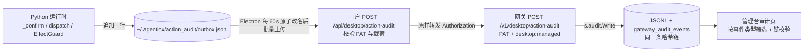

# Moat-06 · 本机智能体动作进入企业审计链

Planned-with: claude-opus-5.5
Suggested-Impl-Model: grok-4.7
Plan-Id: 2026-10-12-moat-06-desktop-action-audit
Plan-File: `.cursor/plans/2026-10-12-moat-06-desktop-action-audit.plan.md`
Parent-Plan: `2026-10-12-governed-longrun-moat-master`
Depends-On: `2026-10-12-moat-01-runtime-effect-guard`、`2026-10-12-moat-05-enterprise-agent-action-policy`（两者都必须已合并）

> **For implementer:** 独立 worktree，分支 `feat/moat-06-action-audit`。不要 commit。**不新增数据库表**：事件写入 Go 网关已有的审计写入器，它负责 Blake2b 链、JSONL 主写和 PG 双写。改了 `desktop/electron/main.ts` 后必须完全重启 `npm run dev`。

## 1. 要解决的问题

企业审计现在只覆盖经过网关的请求：LLM 调用、MCP 代理调用、连接器执行。写入点是 `enterprise/apps/gateway/internal/audit/`，例如 MCP 代理在 `internal/mcp/handler.go:205-235` 写 `event_type = "mcp_tool_call"`。

员工本机 Near 上发生的事——人批准了哪一步、策略拦下了什么、哪次外部写在崩溃后被拦截——一条都不进企业审计。出了问题，企业答不出「谁的 Near 在什么时候批准了什么」。

## 2. 数据流



为什么不在门户直接写 PG：哈希链的 `prev_checksum` 由网关写入器串行维护（`internal/audit/pg_writer.go:88`、`writer.go:131`）。门户另写一套会产生两条交错的链，链校验会失败。

## 3. 事件格式（outbox 每行一个 JSON，全部字段名固定）

```json
{
  "v": 1,
  "event_id": "32 位小写 hex（uuid4().hex）",
  "ts": "2026-10-12T08:00:00Z",
  "kind": "confirm_resolved | policy_denied | effect_intercepted | external_effect",
  "session_id": "…",
  "agent_id": "meta",
  "tool_name": "bash_exec",
  "subject": "git:push",
  "outcome": "见下表",
  "decision_source": "见下表，可为空串",
  "risk": "high",
  "args_digest": "sha256 hex",
  "summary": "≤200 字符，已脱敏"
}
```

| kind | 产生位置 | outcome 取值 | decision_source 取值 |
|---|---|---|---|
| `confirm_resolved` | `agenticx/cli/agent_tools.py::_confirm` 各返回点 | `approved` / `denied` | `human` / `timeout` / `blocked_unattended` / `parked_timeout` / `allow_rule` / `workspace_script` / `session_allow` |
| `policy_denied` | `dispatch_tool_async` 中 05 加的企业拒绝分支 | `denied` | `enterprise_policy` |
| `effect_intercepted` | `agenticx/runtime/effect_guard.py::EffectGuard.before_dispatch` 情形 A / B | `orphan_blocked` / `completed_reused` | 空串 |
| `external_effect` | `EffectGuard.after_result` | `completed` / `failed` | 空串 |

**`confirm_resolved` 只记两类**：受保护请求（`is_protected_confirm(context)` 为 True），或带 `enterprise_policy` 标记的请求。低风险的自动批准不记，避免把每次 `file_write` 都刷进审计。05 的「企业预确认后工具自身确认被一次性跳过」那条返回路径**不记**（外层那次已经记过）。

`decision_source` 的判定（最终返回点）：`approved` 为 True → `human`。为 False 时读 `gate.last_request`：`decision == "blocked_unattended"` → `blocked_unattended`；`decision == "parked_timeout"` → `parked_timeout`；`gate.last_timeout_info.request_id == request_id` → `timeout`；否则 `human`。

**args_digest**：`hashlib.sha256(canonical_payload(x).encode()).hexdigest()`，`canonical_payload` 来自 `agenticx/reliability/call_identity.py:36`。`_confirm` 里 `x` 是去掉 `request_id`、`protected_reason` 后的 context；EffectGuard 里 `x` 是剔除 runtime 键后的参数。

**summary 脱敏**：先截到 400 字符，再按顺序替换，最后截到 200：

| 正则 | 替换为 |
|---|---|
| `agx-pat-[A-Za-z0-9_\-]+` | `agx-pat-***` |
| `sk-[A-Za-z0-9_\-]{12,}` | `sk-***` |
| `gh[pousr]_[A-Za-z0-9]{20,}` | `gh*_***` |
| `(?i)bearer\s+[A-Za-z0-9._\-]+` | `Bearer ***` |
| `(?i)\b(api[_-]?key|token|secret|password|passwd)\b\s*[=:]\s*\S+` | `\1=***` |

`confirm_resolved` 的 summary 用确认问题文本；`policy_denied` 用 subject；`effect_*` 用空串（参数只留摘要）。

## 4. In scope / Out of scope

**In scope**

1. 新建 `agenticx/runtime/action_audit.py`：`emit_action_audit(event: dict) -> None`、`redact_summary(text: str) -> str`、`audit_enabled() -> bool`。
2. `agenticx/cli/agent_tools.py`：`_confirm` 各返回点、`dispatch_tool_async` 的企业拒绝分支。
3. `agenticx/runtime/effect_guard.py`：情形 A / B 与 `after_result` 各一处调用。
4. 新建 `desktop/electron/action-audit-uploader.ts`；`desktop/electron/main.ts` 两处接线（启动、退出）。
5. 新建 `enterprise/apps/web-portal/src/app/api/desktop/action-audit/route.ts`。
6. 新建 `enterprise/apps/gateway/internal/server/desktop_audit_handlers.go`；`server.go` 路由注册一行。
7. 管理台审计筛选：`enterprise/packages/core-api/src/audit.ts` 的 `AuditQueryInput` 加 `event_type?: string`；`enterprise/features/audit/src/services/{pg-store,mysql-store,local-store}.ts` 照 `policy_hit` 的写法加等值过滤；`enterprise/apps/admin-console/src/app/api/audit/query/route.ts` 与 `export/route.ts` 透传 `event_type`；`src/app/audit/page.tsx` 增加事件类型下拉（全部 / `desktop_agent_action` / `mcp_tool_call`），并把 `desktop_agent_action` 显示为「桌面智能体操作」。
8. 测试见 §6。

**Out of scope**

- 不新增 PG / MySQL 表或列；不改 `gateway_audit_events` schema。
- 不改网关现有审计写入器、链校验或回灌逻辑。
- 不上传工具完整参数或输出（只上传摘要与脱敏后的短文本）。
- 不做「管理员可配置是否上传 summary」开关（后续需要再加）。
- 不改未登录企业的个人用户行为：`audit_enabled()` 为 False 时零写盘。

## 5. 具体改动

### 5.1 `agenticx/runtime/action_audit.py`

- `audit_enabled()`：逻辑与 05 的 `load_enterprise_agent_policy` 前置判断相同（`enterprise.enabled is True` 且 `enterprise.token` 非空），异常返回 False。
- `emit_action_audit(event)`：`if not audit_enabled(): return`；补齐 `v`、`event_id`、`ts`（UTC，`%Y-%m-%dT%H:%M:%SZ`）；对 `summary` 调 `redact_summary`；所有字符串字段截到 256 字符（`summary` 200）；目录 `agx_home() / "action_audit"`（`agenticx.utils.agx_home`），`mkdir(parents=True, exist_ok=True)`；`open(path, "a", encoding="utf-8")` 写一行后 `flush`（不 fsync，审计不阻塞主流程）。整个函数 `try/except Exception` 只 `logger.debug`，**绝不抛出**。
- outbox 文件超过 20 MB 时不再写入，改为每 100 次调用 `logger.warning` 一次（防止 Electron 长期离线把磁盘写满）。

### 5.2 Python 埋点

**`_confirm`**：在函数开头（`payload_context` 构造之后）定义闭包：

```python
    def _audit(approved: bool, source: str) -> None:
        if not (is_protected_confirm(payload_context) or payload_context.get("enterprise_policy")):
            return
        from agenticx.reliability.call_identity import canonical_payload
        from agenticx.runtime.action_audit import emit_action_audit

        digest_src = {
            k: v for k, v in payload_context.items() if k not in {"request_id", "protected_reason"}
        }
        emit_action_audit({
            "kind": "confirm_resolved",
            "session_id": str(getattr(session, "_session_id", "") or getattr(session, "session_id", "") or ""),
            "agent_id": str(payload_context.get("agent_id") or "meta"),
            "tool_name": str(payload_context.get("tool") or ""),
            "subject": str(payload_context.get("policy_subject") or payload_context.get("tool") or ""),
            "outcome": "approved" if approved else "denied",
            "decision_source": source,
            "risk": str(payload_context.get("risk") or ""),
            "args_digest": hashlib.sha256(canonical_payload(digest_src).encode("utf-8")).hexdigest(),
            "summary": question,
        })
```

（`hashlib` 若该文件顶部未导入，放在闭包内 import，不改文件 import 区。）

在以下返回点前各调一次：允许规则分支 `return True` 前 `_audit(True, "allow_rule")`；无人值守脚本分支 `_audit(True, "workspace_script")`；会话放行分支 `_audit(True, "session_allow")`；最终 `return approved` 前按 §3 规则算 `source` 后 `_audit(approved, source)`。05 的「企业预确认」返回点**不调**。

**`dispatch_tool_async`** 企业拒绝分支（05 §4.6 (a) 的 `if denied_subject:`）：在 `return` 前调用 `emit_action_audit({"kind": "policy_denied", "session_id": ..., "tool_name": name, "subject": denied_subject, "outcome": "denied", "decision_source": "enterprise_policy", "args_digest": <参数 digest>, "summary": denied_subject})`。

**`EffectGuard`**：
- `__init__` 增加 `self._pending_meta: dict[str, tuple[str, str]] = {}`（ledger_call_id → (tool_name, args_digest)）。
- 情形 A / B 返回前：`emit_action_audit({"kind": "effect_intercepted", "outcome": "orphan_blocked" | "completed_reused", "tool_name": ..., "args_digest": ..., "session_id": self.session_id})`。
- 情形 C 记录 `_pending_meta[ledger_call_id]`；`after_result` 中取出并 `emit_action_audit({"kind": "external_effect", "outcome": "failed" if is_error else "completed", ...})`。

### 5.3 Desktop 上传器 `desktop/electron/action-audit-uploader.ts`

导出 `startActionAuditUploader(deps)` 与 `flushActionAuditOnce(deps): Promise<FlushResult>`。`deps` 注入 `loadConfig`、`fetchImpl`（传 `proxyAwareFetch`）、`homeDir`、`now`，便于测试。

`flushActionAuditOnce` 流程：

1. 读配置；无企业 PAT 或 `enterprise.base_url` → 返回 `{ skipped: true }`。
2. 目录 `~/.agenticx/action_audit/`。若 `outbox.jsonl` 存在且非空，`fs.renameSync` 为 `sending-<now>.jsonl`（原子操作；Python 下一次写会新建 `outbox.jsonl`，不会丢行）。
3. 按文件名排序处理所有 `sending-*.jsonl`：逐行 `JSON.parse`，跳过坏行；每 200 条一批 `POST ${base}/api/desktop/action-audit`，header `Authorization: Bearer <token>`、`Content-Type: application/json`，body `{ "events": [...] }`，超时 15s。
4. 响应 2xx：该批视为完成。整份文件全部成功后删除文件。
5. 响应 400：记 `console.warn`，**丢弃该批**继续下一批（坏数据不能卡住队列）。
6. 响应 401 / 403：停止本次 flush，文件保留。
7. 网络错误或 5xx：停止本次 flush，文件保留，下次重试。中途失败时，用剩余未发送的行重写该文件（写 `.tmp` 后 rename）。
8. 返回 `{ sent, dropped, pending }`。

`startActionAuditUploader`：立即 flush 一次，之后每 60s 一次（`setInterval`，`unref()`）；返回 `stop()`。

**main.ts 接线：** 在 `notifyRendererStudioReady()`（约 :2188-2194）中 `scheduleEnterpriseCapabilitySync()` 调用之后加 `ensureActionAuditUploader();`。新建模块级函数 `ensureActionAuditUploader()`，用模块变量保证只启动一次。在已有 `app.on("before-quit", ...)`（约 :13920 那一处）回调内追加一次 `void flushActionAuditOnce(deps).catch(() => null)`，不 await，不阻塞退出。import 只新增一行。

### 5.4 门户 `enterprise/apps/web-portal/src/app/api/desktop/action-audit/route.ts`

- `POST`：`resolveDesktopIdentity(request)`（`src/lib/desktop-auth.ts`）；为空返回 401 `{ code: "40101" }`；`identity.scopes` 不含 `desktop:managed` 返回 403 `{ code: "40301" }`。
- 校验 body：`events` 必须是数组，1–200 条；每条按 §3 字段校验类型与长度（字符串 ≤256，summary ≤200，`kind` 必须在四个枚举内，`event_id` 必须匹配 `^[0-9a-f]{32}$`）；任一条不合法则整批 400，返回第一个错误的下标与原因。
- 转发：`const base = process.env.GATEWAY_BASE_URL?.trim() || new URL(process.env.GATEWAY_COMPLETIONS_URL ?? "http://127.0.0.1:8088/v1/chat/completions").origin;`，`fetch(\`${base}/v1/desktop/action-audit\`, { method: "POST", headers: { authorization: <原请求 Authorization>, "content-type": "application/json" }, body: JSON.stringify({ events }) })`，超时 15s。网关 2xx 返回 `{ code: "00000", data: { accepted } }`；网关非 2xx 原样透传状态码与 message；网关不可达返回 502 `{ code: "50201" }`。
- 测试 `__tests__/route.test.ts`：401、403、事件数 0 / 201、坏 `kind`、坏 `event_id`、网关 502 透传、成功转发时 Authorization 原样带上。

### 5.5 网关 `internal/server/desktop_audit_handlers.go`

```go
type desktopActionEvent struct {
	EventID        string `json:"event_id"`
	TS             string `json:"ts"`
	Kind           string `json:"kind"`
	SessionID      string `json:"session_id"`
	AgentID        string `json:"agent_id"`
	ToolName       string `json:"tool_name"`
	Subject        string `json:"subject"`
	Outcome        string `json:"outcome"`
	DecisionSource string `json:"decision_source"`
	Risk           string `json:"risk"`
	ArgsDigest     string `json:"args_digest"`
	Summary        string `json:"summary"`
}

func (s *Server) handleDesktopActionAudit(w http.ResponseWriter, r *http.Request)
```

- 身份：`identity, err := s.identityFromRequest(r)`；失败 401。要求 `identity.AuthViaPAT && hasScope(identity.Scopes, "desktop:managed")`，否则 403。
- body 上限 `http.MaxBytesReader(w, r.Body, 512*1024)`；解析 `{ "events": [...] }`；数量 1–200，否则 400。
- 每条事件转成 `audit.Event`（字段见 `internal/audit/writer.go:23-85`）：

| audit.Event 字段 | 取值 |
|---|---|
| `ID` | `"dsk_" + EventID[:22]`（列宽 26，见 `enterprise/packages/db-schema/src/schema/_shared.ts:4`；PG 写入 `ON CONFLICT (id) DO NOTHING`，客户端重传自动去重） |
| `TenantID` / `UserID` / `DepartmentID` / `APITokenID` | 取自 `identity` |
| `EventTime` | `TS` 能按 RFC3339 解析且距现在不超过 7 天则用它，否则用当前 UTC |
| `EventType` | `"desktop_agent_action"` |
| `SessionID` | `SessionID` |
| `ClientType` | `"near-desktop"` |
| `Route` | `"desktop-agent"` |
| `MCPToolName` | `Subject` 非空用 `Subject`，否则 `ToolName` |
| `ToolsCalled` | `[]string{ToolName}` |
| `MCPInputHash` | `ArgsDigest` |
| `MCPStatus` | `Kind + ":" + Outcome` |
| `PoliciesHit` | `DecisionSource == "enterprise_policy"` 时 `[]audit.PolicyHit{{PolicyID: "desktop-agent-policy", Action: "block", MatchedRule: Subject}}`；`Risk == "policy"` 时 `Action: "ask"`；否则 nil |
| `Digest` | `&audit.Digest{PromptHash: ArgsDigest, PromptSummary: Summary, ResponseSummary: DecisionSource}` |

- 逐条 `s.audit.Write(&ev)`；任一条写失败返回 500 并带已写入条数（JSONL 是必须成功的主写，失败就是真失败）。全部成功返回 200 `{"accepted": N}`。
- `server.go` 约 :676 `r.Post("/v1/embeddings", s.handleEmbeddings)` 之后加一行 `r.Post("/v1/desktop/action-audit", s.handleDesktopActionAudit)`。
- 测试 `desktop_audit_handlers_test.go`：参照同目录 `connector_handlers_test.go` 构造 Server 与 fake `audit.EventWriter`。覆盖：非 PAT 403、缺 scope 403、201 条 400、正常 2 条写入 2 个 Event，断言 `EventType`、`ClientType`、`ID` 前缀与长度 26、`MCPStatus`、企业拒绝时 `PoliciesHit` 非空。

## 6. 验收标准（AC）

| AC | 测试 | 断言 |
|---|---|---|
| AC-1 | `tests/test_action_audit.py` | 未登录企业 → `emit_action_audit` 不创建目录；登录后写一行，字段齐全、`event_id` 32 位 hex |
| AC-2 | 同上 | `redact_summary` 对 §3 五条规则各一个样例，输出不含原始密钥；输出 ≤200 字符 |
| AC-3 | 同上 | outbox 超 20 MB 时不再增长 |
| AC-4 | `tests/test_action_audit_confirm_points.py` | 受保护请求经人批准 → 1 条 `confirm_resolved/approved/human`；低风险自动批准 → 0 条；无人值守拦截 → `denied/blocked_unattended`；05 企业预确认跳过路径 → 不额外产生事件 |
| AC-5 | 同上 | 企业拒绝 → 1 条 `policy_denied` |
| AC-6 | `tests/test_effect_guard.py`（追加） | 情形 A → `effect_intercepted/orphan_blocked`；情形 C 完成 → `external_effect/completed` |
| AC-7 | `desktop/tests/action-audit-uploader.test.ts` | 2xx 删除文件；400 丢批继续；401 停止且文件保留；网络错误中途失败时剩余行被保留；`rename` 后新写入不丢 |
| AC-8 | 门户 route 测试 | §5.4 列出的用例 |
| AC-9 | 网关 handler 测试 | §5.5 列出的用例 |
| AC-10 | `enterprise/features/audit` 现有测试 + 新增一条 | `event_type: "desktop_agent_action"` 只返回该类事件 |

运行：

```bash
pytest tests/test_action_audit.py tests/test_action_audit_confirm_points.py tests/test_effect_guard.py -q
cd desktop && npx vitest run tests/action-audit-uploader.test.ts && cd ..
cd enterprise/apps/gateway && go test ./internal/server/ -run DesktopActionAudit && go test ./internal/audit/... && cd -
pnpm -C enterprise typecheck
pnpm -C enterprise --filter web-portal test -- action-audit
```

端到端：起企业栈（`bash enterprise/scripts/start-dev-with-infra.sh`）+ 网关；Near 登录企业账号；05 配置 `git:push` 必须确认；在临时仓库让模型 push 并批准一次、拒绝一次；60s 内管理台「审计」选「桌面智能体操作」能看到两条，`MCPStatus` 分别为 `confirm_resolved:approved` 与 `confirm_resolved:denied`；页面链校验结果为通过。
