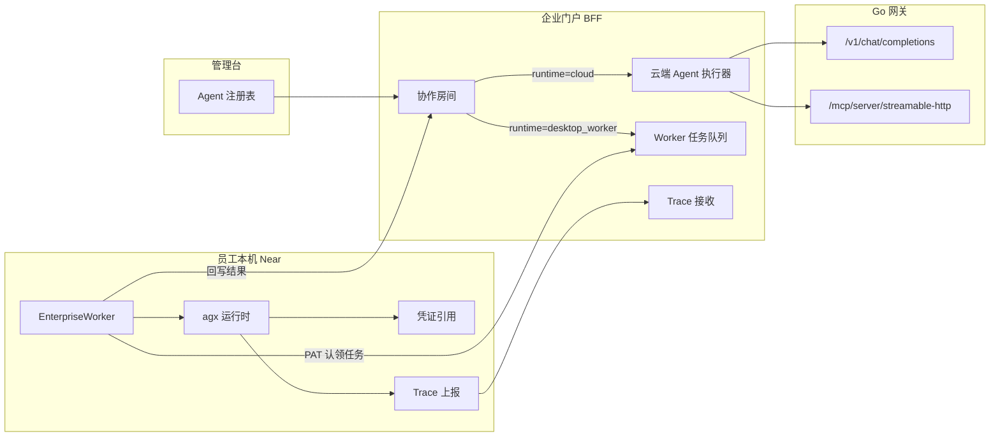
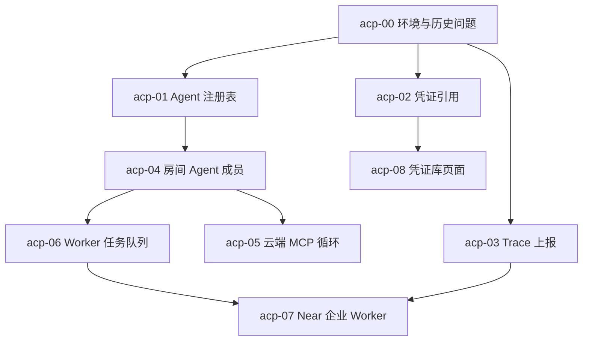

# Agent 控制面主计划

Planned-with: Claude Opus 5.5
Suggested-Impl-Model: Grok 4.7（各子计划同）

上游差距分析是本地调研笔记，不入库。本计划把其中前三个阶段拆成可执行子计划，后续阶段留在文末待办。

## 1. 现状证据（2026-10-14 代码核对）

企业端：

- 没有 Agent 实体。`enterprise/features/agents/src/index.ts` 只有 `TODO: implement`。63 张表里没有 agent 注册表；最接近的是能力包 `enterprise_capability_packs`（Skill/MCP 打包分配给人）。
- 协作房间 `enterprise_collab_rooms*` 已可用，类型 `CollabMemberType = "human" | "meta" | "agent"`（`apps/web-portal/src/lib/collab-room/types.ts`），但写入路径从不写 `agent`。`@meta` 由 `triggerMetaReply()`（`apps/web-portal/src/lib/collab-room/meta-reply.ts`）非流式调网关 `/v1/chat/completions`，无工具。
- 门户聊天 `POST /api/chat/completions` 经 Go 网关，网关上游是 Go 标准库 HTTP，不是 Python 运行时。网关另有带授权的 MCP 端点 `POST /mcp/{server}/streamable-http`（`apps/gateway/internal/server/mcp_handlers.go`）。
- 桌面集成：设备码登录、PAT、`GET /api/desktop/bootstrap`、`/api/desktop/rooms/**`（PAT 版房间）、动作审计。没有 heartbeat，没有任务派发。
- `agent_token_traces` 只由网关写 model span；`POST /api/agent-traces/ingest` 需要管理员权限，桌面无调用方。
- 配额到租户/部门/用户，无 Agent 维度。

框架与 Near：

- 密钥明文：`~/.agenticx/config.yaml` 的 `providers.*.api_key`，`~/.agenticx/mcp.json` 的 `env`/`headers`。MCP stdio 在 `agenticx/tools/remote_v2.py` 约 293 行把 `server_config.env` 合进环境。没有凭证引用，`messages.json` 原样落盘。
- 回合记录是 replay ledger（`agenticx/runtime/replay_ledger/recorder.py`，`ReplayLedgerRecorder.finish()`），可选 OTel，不上报企业。
- 企业配置键：`enterprise.enabled`、`enterprise.token`（PAT，`agx-pat-` 前缀）、`enterprise.base_url`（门户地址）。
- 群任务板 `WorkItemStore`（`agenticx/runtime/work_items.py`）已有 `submit()/accept()`。
- Near 设置无凭证页；企业登录在 `desktop/src/components/AccountTab.tsx`。

## 2. 目标架构

两条执行路径：

- `cloud`：门户 BFF 内的有界工具循环。模型与 MCP 都走网关，网关继续负责策略、审计、配额。不在 Go 网关里写 Agent Loop。
- `desktop_worker`：任务入队，员工本机 Near 用 PAT 认领，用本地 agx 运行时在本地工作区执行，结果回写房间。

## 3. 子计划与依赖

| 子计划 | 文件 | 依赖 | 范围 |
| --- | --- | --- | --- |
| acp-00 | `2026-10-14-acp-00-env-hygiene.plan.md` | 无 | admin-console 兜底端口、README |
| acp-01 | `2026-10-14-acp-01-enterprise-agent-registry.plan.md` | 00 | db-schema、iam-core、admin-console |
| acp-02 | `2026-10-14-acp-02-credential-refs-runtime.plan.md` | 00 | `agenticx/` |
| acp-03 | `2026-10-14-acp-03-turn-trace-upload.plan.md` | 00 | `agenticx/` + web-portal 新路由 |
| acp-04 | `2026-10-14-acp-04-room-agent-members.plan.md` | 01 | web-portal |
| acp-05 | `2026-10-14-acp-05-cloud-agent-mcp-loop.plan.md` | 04 | web-portal |
| acp-06 | `2026-10-14-acp-06-worker-task-queue.plan.md` | 04 | db-schema + web-portal |
| acp-07 | `2026-10-14-acp-07-near-enterprise-worker.plan.md` | 06, 03 | `agenticx/` + desktop |
| acp-08 | `2026-10-14-acp-08-desktop-credentials-tab.plan.md` | 02 | desktop + studio API |

并行波次：

1. 波次 0：acp-00（主控直接做）
2. 波次 1：acp-01、acp-02、acp-03 并行（改动目录不重叠；acp-03 只新增门户路由，不改 db-schema）
3. 波次 2：acp-04、acp-08 并行
4. 波次 3：acp-05、acp-06 并行（都改 web-portal，但文件不重叠：05 动 `lib/collab-room/agent-executor*`，06 动 `lib/worker-tasks*` 与 `api/desktop/worker/**`；两者都要改 `agent-reply.ts` 的分支点，06 只加 `desktop_worker` 分支）
5. 波次 4：acp-07

## 4. 执行与验收规则

- 子代理不提交 git。主控在每个子计划验收通过后，只 `git add` 该子计划改动的文件，按功能点提交，trailer 带 `Plan-Id`/`Plan-File`/`Plan-Model`/`Impl-Model`/`Made-with: Damon Li`。
- 每个子计划的 AC 至少包含：单元测试命令、类型检查命令、一条端到端路径。端到端由主控用浏览器（管理台 `http://localhost:3001`、门户 `http://localhost:3000`）或 HTTP 实际调用复核。
- 本地企业栈：`bash enterprise/scripts/start-dev-with-infra.sh --infra-only` 起 Postgres/Redis，`bash enterprise/scripts/start-dev.sh --ui=stream` 起应用。迁移：`pnpm -C enterprise --filter @agenticx/db-schema db:migrate`。
- 改 `agenticx/studio/server.py` 时遵守 AGENTS.md：只精确增删目标行，提交前冷启动 `agx serve --host 127.0.0.1 --port <临时端口>` 并验证 `/api/session`、`/api/avatars`、`/api/sessions` 返回 200。
- 开发中发现的历史问题：小的随子计划修并写进该子计划「附带修复」；复杂的写进本文件第 6 节待办。

## 5. In scope / Out of scope

In scope：上表 9 个子计划。

Out of scope（本轮不做）：Go 网关内的 Agent Loop；Agent 级配额执行；企业知识库与记忆服务化；评估；会话容器隔离与出站域名策略；纳管第三方编程 Agent 运行时；手机端；MySQL 以外的新方言。

## 6. 待办（需单独开计划）

- Agent 级 Token 配额：网关 `quota.Tracker` 增加 agent 维度，门户把 `x-agenticx-agent-id` 透传给网关。
- 用户级配额套餐不进共享池（`poolScopeForAssignment` 在 `scopeType === "user"` 时直接 return）。
- `GET /api/metering/quota` 返回的 `file` 仍指向遗留 `quotas.json`。
- context-service 接入门户，做成 Agent 可绑定的知识库连接。
- 模型能力目录统一（Python `is_vision_capable` 与 Desktop `model-vision.ts` 两份启发式）。
- 会话级工作目录隔离与出站域名白名单。
- 设置页 `email`、`workspace` 两个 tab 有渲染分支但左侧导航点不到（`SETTINGS_TAB_IDS` 与 `TAB_DEFS` 不一致）。
