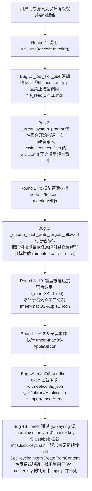

# 原生连接器 CLI 沙箱放行、Skill 激活注入与提示词修复

Planned-with: Gemini 4 Argon
Suggested-Impl-Model: gpt-5.6-sol-medium

> 目标：彻底解决会话 `1577ede8-50ac-4ad3-957e-e56186cf973b` 中用户已扫码授权「腾讯会议」原生连接器后，Agent 仍无法通过官方 CLI 建会、反复报错（`cli.js` 只读拦截、`SKILL.md` 当轮未进系统提示、`open ~/.tmeet/config.json: operation not permitted`、`open ~/Library/Application Support/tmeet/*.enc: operation not permitted`、以及沙箱内调用 macOS Keychain 触发系统弹窗「找不到用于储存“master.key”的钥匙串“login”」）的 4 个产品级缺陷。

---

## Suggested-Impl-Model（子规划 → 推荐模型）

| 子任务 | 推荐模型 | 理由 |
|---|---|---|
| S1 原生连接器受控 CLI 沙箱豁免/凭证与 Keychain 通道放行 (`command_sandbox.py` + `agent_tools.py` + `command_safety.py`) | `gpt-5.6-sol-medium` | 涉及 OS 沙箱边界、macOS Seatbelt / Keychain 与命令拆段校验，属于跨模块安全敏感改动 |
| S2 `skill_use` 激活后当轮即时可见与返回文案去误导 (`agent_tools.py`) | `gpt-5.6-sol-medium` | 涉及 ReAct 循环内 `SKILL.md` 当轮注入与 `_ensure_bash_write_targets_allowed` 只读挂载误拦修复 |
| S3 腾讯会议托管 `SKILL.md` 模板补齐常用命令示例 (`desktop/electron/main.ts`) | `composer-2.5-fast` | 模板文案与参数示例增补，逻辑直观 |
| S4 回归单测与冒烟验证 (`tests/test_agent_tools.py`、`tests/test_command_sandbox.py`、`tests/test_workspace_root_enforcement.py`) | `gpt-5.6-sol-medium` | 覆盖沙箱白名单边界与 `skill_use` 当轮可见性断言 |

---

## 背景与根因（完整证据链，源自会话 `1577ede8-50ac-4ad3-957e-e56186cf973b`）

用户在会话 `1577ede8-50ac-4ad3-957e-e56186cf973b` 第一轮提出「帮我定一个腾讯会议，明天晚上 9 点」，按引导前往「设置 → 连接器 → 腾讯会议」完成扫码授权后，第二轮发送「授权了，搞定了，你建会吧。会议的标题是“AI原生研发云平台事项”」。随后 Agent 连续执行 21 次工具调用（错误率 57%），最终宣告失败。逐轮回溯 `runs/8c7d19ebf1b5415c97d010a73ff31c86/events.jsonl` 与 `runs/a107c67d34254a8d86783b739f123f89/events.jsonl`，定位到 **4 个环环相扣的产品级 Bug**：



### 根因 1：`skill_use` 成功后当轮 LLM 看不到 `SKILL.md` 正文，且返回文案硬编码误导 `node .../cli.js`
- **代码落点 1**：`agenticx/runtime/agent_runtime.py` L4172、L4319
  - `current_system_prompt` 在 `run_turn_stream` 启动时（Round 1 之前）一次性构造并放入 `messages[0]`。
  - 当模型在 Round 1 调用 `skill_use(name="tencent-meeting")` 时，`studio_skill_use` 将 `SKILL.md` 写入 `session.context_files["skill:tencent-meeting"]`，但 **同回合后续 Round 2..N 并未重建 `messages[0]`，也未把 `SKILL.md` 正文放进 `skill_use` 的 tool result**。
- **代码落点 2**：`agenticx/cli/agent_tools.py` L8980–8998 (`_tool_skill_use`)
  - 返回给模型的文本写死为：
    `OK: activated skill 'tencent-meeting'. 正文已注入本轮上下文（context_files 键 skill:tencent-meeting），不要再用 file_read 读取 SKILL.md。... 技能目录本会话只读可用：脚本请用绝对路径运行（如 node /Users/damon/.agenticx/skills/near-connectors/tencent-meeting/cli.js ...）`
  - 结果：模型当轮既看不到 `SKILL.md` 里的 `tmeet-macOS-AppleSilicon` 路径，又被明确禁止调用 `file_read(SKILL.md)`，只能照着提示里的示例去跑根本不存在的 `node .../tencent-meeting/cli.js`，白白浪费 9 轮工具调用。

### 根因 2：`_ensure_bash_write_targets_allowed` 把只读挂载目录下的普通命令行参数误判为「写目标」
- **代码落点**：`agenticx/cli/agent_tools.py` L5583–5648 (`_ensure_bash_write_targets_allowed`)
  - 当命令包含管道 `| head -50` 或 `2>&1` 时，`_bash_exec_is_read_only` 因复合命令或非白名单命令返回 `False`，且 `_extract_bash_write_target_paths(command)` 返回空列表 `targets = []`。
  - 此时走到 L5643–5647：
    ```python
    if not targets:
        for match in _BASH_ABS_PATH_TOKEN_RE.finditer(command or ""):
            err = _deny_if_readonly(match.group(0))
            if err is not None and "read-only" in err:
                return err
    ```
  - 这段逻辑原本是为了防 `python -c "open('/ref/a.txt', 'w')"`，但它**无差别拦截了命令中出现的任何位于只读挂载目录（含已激活技能目录 `_activated_skill_dirs`）下的绝对路径**！

### 根因 3（致命阻塞 + 钥匙串弹窗根源）：macOS `sandbox-exec` 拦截原生连接器 CLI 访问本机凭据目录、Go `os.UserConfigDir()` 与登录钥匙串（Keychain）
- **代码落点**：`agenticx/runtime/command_sandbox.py` L270–320、L913–980
  - `bash_exec`、`bash_bg_start` 与 `spawn_subagent` 全部强制经过 `build_command_sandbox_plan()` 生成 macOS `sandbox-exec` 策略 `(deny file-read-data file-write*)`。
  - 原生连接器 CLI（均为 Go/Rust 编译二进制：`tmeet`、`lark-cli`、`agently-cli`、`wecom-cli`、`gh`）在运行时需要访问三处本机存储：
    1. **Home 点目录**：`~/.tmeet`、`~/.lark-cli`、`~/.agently-cli`、`~/.config/wecom`、`~/.config/gh`
    2. **Go `os.UserConfigDir()`（macOS 下为 `~/Library/Application Support/<app>`，Linux 下为 `~/.config/<app>`）**：
       - `~/Library/Application Support/tmeet`（存放加密凭据 `cli_<openid>.enc`）
       - `~/Library/Application Support/lark-cli`
       - `~/Library/Application Support/agently-cli`
    3. **macOS Keychain（`Security.framework` / `/usr/bin/security -i`）**：
       - `tmeet` 与 `agently-cli` 使用 `zalando/go-keyring` 将主密钥 `master.key` 存在 macOS `login.keychain-db`。
       - 在 `sandbox-exec` 内，如果未放行 `~/Library/Keychains`、`~/Library/Preferences` 与 `/private/var/folders`（Darwin User Cache `C/mds/mds.lock`），`/usr/bin/security find-generic-password` 会因无法读取 `mds.lock` / `login.keychain-db` 而失败；
       - `tmeet` 见读取失败，便误判「钥匙串里还没有 `master.key`」，随即调用 `keyring.Set`（`SecKeychainItemCreateFromContent`）试图新建 `master.key`；而新建同样打不开 `login` 钥匙串，导致 macOS `Security.framework` 直接在用户桌面弹出：**「找不到钥匙串：找不到用于储存“master.key”的钥匙串“login”。[取消] [还原为默认]」** 并挂起进程！

### 根因 4：腾讯会议托管 `SKILL.md` 过于简略，模型不知道子命令是 `meeting`（单数）且需 `--start` / `--end`
- **代码落点**：`desktop/electron/main.ts` L3608–3622 (`ensureTmeetSkill`)
  - 当前生成的 `SKILL.md` 仅写了一行泛化占位 `"..." --format json <command> [arguments]`，未说明子命令是 `meeting`（单数，非 `meetings`），也未说明 `meeting create` 必填参数是 `--subject`、`--start`、`--end`（ISO 8601，而非 `--duration`）。

---

## 改动设计与精确落点

### FR-1：已安装的 Near 原生连接器 CLI 在沙箱中自动获得其专属凭据目录与 macOS Keychain 访问能力

#### 落点 1：`agenticx/runtime/command_sandbox.py`
1. 新增受信任原生连接器 CLI 识别与沙箱授权辅助函数 `_native_connector_sandbox_grants(argv, environ, host=host)`：
   - 从 `argv` 提取被执行的实际可执行文件路径（支持直接调用 `argv[0]` 或经 `/bin/sh -c`、`/bin/zsh -c`、环境变量前缀包装后的简单命令段中的可执行文件）。
   - 判定该可执行文件是否属于 Near 原生连接器 CLI：
     - 路径位于 `~/.agenticx/connectors/<connector_id>/` 下；或
     - 二进制文件名为 `tmeet-macOS-AppleSilicon` / `tmeet-macOS-Intel` / `tmeet-Linux-ARM64` / `tmeet-Linux-x86_64` / `tmeet-Windows-x86_64.exe` / `lark-cli` / `wecom-cli` / `agently-cli`（以及位于 `~/.agenticx/connectors/github/` 下的 `gh` 或当 `native-status.json` 中 `github.connected` 为真时的系统 `gh`）。
   - 按识别到的连接器类型，精确授予对应的可写目录（若目录尚不存在则自动创建或加入父级存在的专属子目录）与 macOS Keychain 所需路径：
     - `tencent-meeting`：`~/.tmeet`、`~/Library/Application Support/tmeet`、`~/.config/tmeet`
     - `feishu`：`~/.lark-cli`、`~/Library/Application Support/lark-cli`、`~/.config/lark-cli`
     - `qqmail`：`~/.agently-cli`、`~/Library/Application Support/agently-cli`、`~/.config/agently-cli`
     - `wecom`：`~/.config/wecom`、`~/Library/Application Support/wecom`
     - `github`：`~/.config/gh`、`~/Library/Application Support/gh`
     - 当 `host == "darwin"` 且命中任意原生连接器 CLI 时：
       - `writable_roots` 追加 `~/Library/Keychains`、`/private/var/folders`（供 `Security.framework` 读写 `mds.lock` 与刷新钥匙串 token）
       - `readable_roots` 追加 `~/Library/Preferences`
   - **安全不退化保证**：普通 shell 命令（如 `/bin/cat ~/.tmeet/config.json`、`python script.py`、`ls ~/Library/Keychains`）不命中原生连接器 CLI，仍完全无法读取 `~/.tmeet`、`~/Library/Keychains` 或 `~/Library/Application Support/tmeet`。

#### 落点 2：`agenticx/runtime/command_safety.py` 与 `agenticx/cli/agent_tools.py`
- 在 `agenticx/runtime/command_safety.py` 中：识别原生连接器 CLI（`tmeet*`、`lark-cli`、`wecom-cli`、`agently-cli`）的只读操作（包含 `--help`、`-h`、`--version`、`-V`、`auth status`、`meeting list`、`meeting list-ended`、`meeting get`、`contact`、`record` 查询、`+me`、`schema` 等）为 contained/read-only，免去每次 `--help` 弹窗询问。
- 在 `agenticx/cli/agent_tools.py` L6078：用 `_peel_to_inner_command(parts)` 提取真实命令名作为确认弹窗的 `command_name`，修复 `HOME=/Users/damon "/path/to/tmeet"` 把 `command_name` 算成 `"damon"` 的问题。

### FR-2：`skill_use` 激活技能后当轮立即可见 `SKILL.md` 正文，并消除 `node .../cli.js` 误导

#### 落点：`agenticx/cli/agent_tools.py` L8936–8999 (`_tool_skill_use`)
- 在 `_tool_skill_use` 返回值中直接内联注入 `<skill_content name="{name}">\n{skill_body}\n</skill_content>`，保证模型在调用 `skill_use` 的当轮即可读到 `SKILL.md` 全文（解决 `current_system_prompt` 仅在 turn 起始构建一次导致的当轮盲区）。
- 检查 `base_dir` 下是否存在脚本文件（`.js/.mjs/.cjs/.ts/.py/.sh`）：
  - 若存在脚本，才提示实际脚本文件名；
  - 若无脚本（如原生连接器技能只含 `SKILL.md`），提示「请直接严格按照上方 `<skill_content>` 中的命令与参数格式执行，不要调用不存在的 `cli.js`」。

### FR-3：修复 `_ensure_bash_write_targets_allowed` 对只读挂载路径的误杀

#### 落点：`agenticx/cli/agent_tools.py` L5583–5648 (`_ensure_bash_write_targets_allowed`)
- 当 `not targets`（命令中无 `>` / `>>` / `tee` 重定向）时，不再盲目把命令里的所有绝对路径 token 当成写目标。
- 仅提取真正会产生文件写入的目标路径进行 `_deny_if_readonly` 校验：
  - `cp` / `mv` / `ln` / `install` 的最后一个路径参数（目标路径）；
  - `rm` / `rmdir` / `touch` / `mkdir` / `chmod` / `chown` / `truncate` 的路径参数，以及 `sed -i` 的文件参数；
  - `python -c` / `node -e` 等内联代码字符串中若包含写文件信号（`open(` 且含 `'w'`/`'a'`、`write_text`、`write_bytes`、`writeFileSync`、`appendFileSync`）时的绝对路径。
- 从而让 `node /readonly_skill/cli.js --help | head -50` 与 `cp /readonly_skill/cli.js ./local.js` 正常放行，同时继续拦截 `echo x >> /readonly_skill/cli.js`、`cp ./a.js /readonly_skill/b.js`、`rm /readonly_skill/cli.js`。

### FR-4：升级腾讯会议托管 `SKILL.md` 模板并同步更新本机技能文件

#### 落点：`desktop/electron/main.ts` L3600–3625 (`ensureTmeetSkill`)
- 在生成的 `SKILL.md` 中明确列出 `tmeet` 常用子命令与必填参数示例：
  - `meeting list`（查询待开始/进行中会议）
  - `meeting get --meeting-id <id>` 或 `--meeting-code <code>`
  - `meeting create --subject "<主题>" --start "<2026-10-17T21:00:00+08:00>" --end "<2026-10-17T22:00:00+08:00>"`（明确标注子命令为单数 `meeting`，且必须传 `--start` 与 `--end` ISO 8601 时间，无 `--duration` 参数）
  - `meeting update` / `meeting cancel`
- 同步更新本机 `~/.agenticx/skills/near-connectors/tencent-meeting/SKILL.md`。

---

## 验收标准（AC）

- **AC-1**：`pytest tests/test_command_sandbox.py` 通过，且在 macOS 下 `build_command_sandbox_plan` 包装 `tmeet-macOS-AppleSilicon auth status` 及 `meeting list` 均返回 `rc=0`、无弹窗、无 `operation not permitted`；普通命令（如 `cat ~/.tmeet/config.json`）在沙箱内仍被拒。
- **AC-2**：`pytest tests/test_agent_tools.py` 通过，`_tool_skill_use` 返回包含 `<skill_content>`，且无脚本目录不出现 `cli.js` 误导。
- **AC-3**：`pytest tests/test_workspace_root_enforcement.py` 通过，只读挂载/技能目录下的脚本带管道执行或作为 `cp` 源文件不被误拦，向只读挂载重定向或作为 `cp` 目标仍被拦截。
- **AC-4**：带环境变量前缀的命令（如 `HOME=/Users/damon /path/to/cmd`）确认文案提取真实命令名而非环境变量值。

---

## In Scope / Out of Scope

### In Scope
- `agenticx/runtime/command_sandbox.py`
- `agenticx/runtime/command_safety.py`
- `agenticx/cli/agent_tools.py`
- `desktop/electron/main.ts`
- `tests/test_command_sandbox.py`、`tests/test_agent_tools.py`、`tests/test_workspace_root_enforcement.py`

### Out of Scope
- 不修改普通命令的 `workspace-write` 读隔离边界
- 不修改连接器扫码登录 UI
