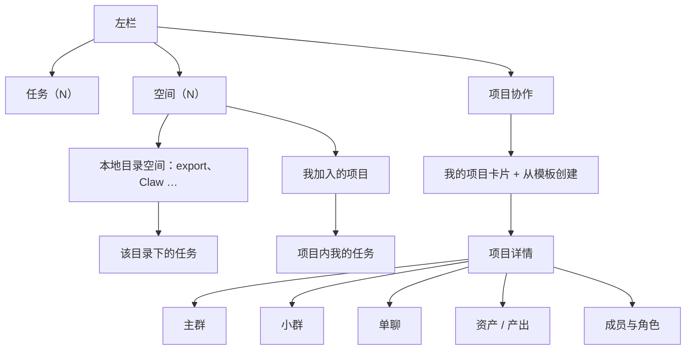
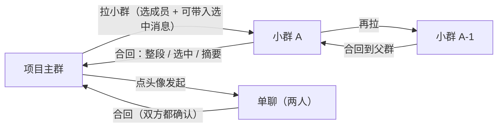
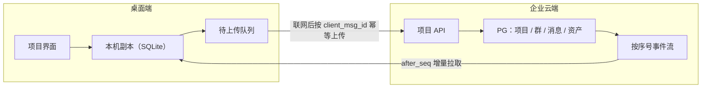
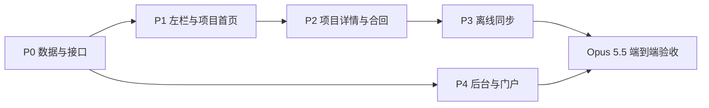

# 项目协作空间：任务 / 项目分离、个人与团队空间、云端为主的多人项目群

Planned-with: Opus 5.5
Suggested-Impl-Model: Grok 4.7（全部子计划）
Acceptance-Model: Opus 5.5（端到端验收）

## 0. 一句话目标

把 Near 里「一个人跟 AI 干活」和「一群人围绕一个项目干活」分开：前者叫**任务**，后者叫**项目**。项目从创建起就在企业云端，桌面端本地留一份可离线读写的副本；项目里有一个主群，可以人对人单聊、拉小群，小群的结论能整段、部分或以摘要形式合回主群。企业后台能看到每个项目的成员、对话、产出和过程资产。

## 1. 现状与证据（实施者不必再查）

| 能力 | 现在在哪里 | 现状 |
|---|---|---|
| 左栏导航 | `desktop/src/components/AvatarSidebar.tsx` 的 `NAV_ENTRY_DEFS` | 新建任务 / 数字专家 / 专家群聊 / 多人协作 / 定时任务 / Wiki / 插件市场；文案在 `desktop/locales/zh/sidebar.json`（`nav.newTask`、`nav.groups`、`nav.collab`） |
| 左栏会话列表 | `desktop/src/components/sidebar/SidebarSessionHistory.tsx`、`sidebar-session-history.ts` | 只分「置顶 / 今天 / 更早」与派生树（`nestContinueSessionRows`），按 `avatar_id` 过滤；**没有空间、目录或项目分组** |
| 专家群聊 | 后端 `agenticx/avatar/group_chat.py`（`GroupChatConfig`：`id, name, avatar_ids, human_members, routing`），落盘 `~/.agenticx/groups/<id>/group.yaml`；会话 `avatar_id = "group:<id>"`；前端 `ProjectsView` + `GroupEditorInline` | 纯本机；成员以数字专家为主，`human_members` 只承接飞书/微信等 IM 人类发言，前端侧栏不映射该字段 |
| 工作目录 | `SessionManager._taskspaces_root` = `~/.agenticx/taskspaces/<session_id>/default`，`.agx-mounts.json` 记录挂载 | 会话级目录挂载，不是可共享的空间 |
| 会话存储 | `~/.agenticx/sessions/<id>/messages.json` + `~/.agenticx/memory/sessions.sqlite` | 只在本机，不同步到企业 |
| 企业云房间（多人协作） | 表 `enterprise_collab_rooms` / `enterprise_collab_room_members`（`memberType, memberId, roomRole`）/ `enterprise_collab_room_messages`（`seq, senderType, content, metadata`）；`enterprise_agent_tasks.roomId` 外键；桌面端 `CollabRoomPanel` + `collab-room-client.ts` 调 `/api/desktop/rooms*`；事件流 `GET /api/desktop/rooms/:id/events?after_seq=` | 已有「云端房间 + 按序号增量拉取」雏形；成员 3 秒轮询，无在线状态；没有项目、子群、单聊、合并回主群 |
| 企业身份 | `tenants → organizations → departments → users`；桌面端设备码登录 `enterprise-device-login.ts`，令牌写 `~/.agenticx/config.yaml` 的 `enterprise.token` | 可直接复用为项目成员身份 |
| 转发与派生 | 多选转发 `ForwardPicker` + `message_forward.build_forward_entry`（`forwarded_history`）；派生 `fork_session`、从某条继续 `continue_session_from_message` | 可复用为「部分合回主群」与「从主群拉小群」的底层动作 |
| 案例库 | `enterprise_cases`（submitted → reviewing → archived → published） | 项目产出发布到案例库时复用 |

结论：**云端底座有一半**（云房间 + 按序号的消息流 + 企业身份），缺的是「项目」这一层容器、群的层级关系、合并回主群、本地副本与离线同步、左栏的信息架构。

## 2. 概念定义（产品口径，全端统一）

| 概念 | 定义 | 存储 | 谁能看见 |
|---|---|---|---|
| **任务** | 一个人发起的一段 AI 对话，可选指定本地目录 | 本机为主（现有会话） | 仅本人 |
| **空间** | 任务的归类容器。分两种：**本地目录空间**（指定已有目录后在其中新建任务）和**项目** | 本地目录空间在本机；项目在云端 | 本地空间仅本人；项目按成员 |
| **个人空间** | 登录企业后每人自动拥有的私人云端区域，存放本人愿意上云的任务、草稿和产出 | 云端 + 本机副本 | 仅本人；企业管理员按审计权限可见 |
| **团队空间** | 企业内全部项目的集合视图 | 云端 | 按项目成员与部门权限 |
| **项目** | 多人（人类 + 数字专家）围绕一个目标协作的容器：指令、成员、连接器、专家、技能、资产、对话 | 云端为主，本机副本 | 项目成员；企业后台 |
| **项目主群** | 项目创建时自动生成的唯一群，所有成员默认在内 | 云端 | 全体项目成员 |
| **小群** | 从主群或其他小群拉出的子群，只含部分成员 | 云端，挂在父群下 | 小群成员；项目所有者 |
| **单聊** | 项目内两名人类成员之间的点对点对话 | 云端，归属项目 | 两人；项目所有者按设置可见 |
| **合回** | 把小群或单聊的内容送回主群：整段、选中若干条、或生成的摘要 | 主群新增一条合回卡片 | 主群全员 |

「专家群聊」不再作为独立导航入口，它的能力（数字专家进群、智能路由、@ 指派）成为项目群的内置能力。只有数字专家、没有其他人类成员的本机群聊继续留在本机，从项目协作首页进入，见 §8 D1。

## 3. 信息架构

### 3.1 左栏（桌面端）

- 顶部保留「新建任务」。
- 「任务（N）」：不属于任何空间的独立任务，沿用现有会话列表（置顶 / 今天 / 更早）。
- 「空间（N）」：可折叠分组，右侧两个图标为「全部收起」与「新建空间」。每个空间下列出其中的任务（标题 + 日期），点击空间名展开 / 收起。
  - 本地目录空间：文件夹图标。
  - 项目：项目图标，与本地目录空间同级列出。
- 「项目协作」替代原「多人协作」入口；「专家群聊」入口移除（迁移见 §7 P1）。

### 3.2 项目协作首页

- 标题区：「项目」+ 副标题 + 「新建项目」主按钮。
- 「我的项目」：卡片网格（名称、添加时间、更多菜单），右上搜索。
- 「从模板创建」：产品需求、项目交付、Bug 跟踪 / 测试验收、团队知识库等。模板只预填指令、专家和技能，不预设客户行业词库。

### 3.3 新建项目弹窗

| 字段 | 必填 | 说明 |
|---|---|---|
| 项目名称 | 是 | ≤ 15 字，计数显示 `0/15` |
| 指令 | 否 | 项目背景、目标、团队习惯、输出约束；右上「选择模板」，底部提示「切换模板会覆盖当前编辑内容」 |
| 连接器 | 否 | 选已配置的 MCP / 外部连接 |
| 专家 | 否 | 选数字专家（复用现有分身） |
| 技能 | 否 | 选技能（复用全局技能开关语义） |
| 成员 | 否 | 按企业通讯录（部门树 + 搜索）邀请人类成员；默认创建者为所有者 |
| 本地目录 | 否 | 可绑定一个本机目录作为该成员本地工作区（只对本人生效，不上云路径） |

底部「取消」紧靠「确定」左侧；名称为空时「确定」置灰。

### 3.4 项目详情

- 面包屑：「项目 / 项目名 / 当前群或任务名」。
- 顶栏右侧：搜索、同步状态（「协作中」绿点 / 「离线，已缓存」灰点 / 「同步中」）、刷新、成员按钮（`头像 · N`）。
- 成员弹层：「任务协作成员 · N」，列出人类与数字专家、角色（所有者 / 协作者 / 只读），右上复制邀请链接，底部说明计费归属（如「任务中的所有对话，消耗所有者额度」）。
- 左侧群列表：主群置顶；其下树形列出小群；单聊单独分组。
- 右侧工作台沿用现有 `WorkPanel`（任务摘要、浏览器、画布、工作区……）。

## 4. 对话拓扑与合回

### 4.1 拉小群

- 入口：主群（或小群）顶栏「拉小群」；或多选消息后「带着这些消息拉小群」。
- 选择成员（人类 + 专家，只能是父群成员的子集），可选带入选中消息作为开场上下文（复用 `forwarded_history` 卡片）。
- 小群记录 `parent_room_id`，在左侧群列表中挂在父群下。

### 4.2 单聊

- 入口：点主群里某位人类成员头像 →「单聊」。同一项目内同一对人只有一个单聊。
- 单聊属于项目（出现在项目内、进入企业审计），与个人 IM 无关。
- 数字专家不参与单聊；需要 AI 时在单聊里 @ 专家，转为双人 + 专家的小群（提示后再转）。

### 4.3 合回主群（三种方式）

| 方式 | 动作 | 主群呈现 |
|---|---|---|
| 整段合回 | 小群顶栏「合回主群」→「全部」 | 一张合回卡片：来源小群、参与者、时间范围、条数；点开看原始记录 |
| 选中合回 | 多选消息 →「合回主群」 | 同样的卡片，只含选中条目 |
| 摘要合回 | 「合回主群」→「生成摘要」；Meta 生成结论 / 决策 / 待办，作者确认或修改后发出 | 一条摘要消息 + 可展开的原始记录链接 |

规则：

- 合回是**复制并引用**，不移动原消息；小群仍可继续聊。
- 合回卡片对主群的 AI 上下文生效：之后在主群提问，AI 能读到合回内容。
- 单聊合回需双方都点确认，避免一方把私聊公开。
- 合回到父群逐级进行；跨级合回（小群 A-1 直接到主群）提供，但默认目标为直接父群。

## 5. 存储与同步（云端为主，本机副本）

- **云端是唯一权威**：每条消息由服务端分配单调 `seq`（复用 `enterprise_collab_room_messages.seq` 的做法）。
- **本机副本**：桌面主进程没有 SQLite 依赖（Electron 34 内置 Node 20，无 `node:sqlite`），因此用 JSON 文件：`~/.agenticx/collab-cache/` 下存项目列表、项目详情、每个群的消息（`rooms/<room_id>.jsonl`）与待发送队列（`outbox.jsonl`）。离线可读全部已同步内容，可写新消息。细节见 P3。
- **离线写**：新消息先写本地，状态「待发送」，带客户端生成的 `client_msg_id`；联网后按顺序上传，服务端按 `client_msg_id` 去重，回写正式 `seq`。冲突只可能出现在「编辑 / 撤回」上，按服务端时间先到先得，失败的一方提示「对方已修改」。
- **增量拉取**：按 `after_seq` 拉取并订阅事件流；断线重连从本地最大 `seq` 续拉。
- **资产**：文件存企业对象存储（自建为主线，可接客户现有存储，作为可选项），本机按需下载并缓存；本地目录绑定只记录本人路径，不上传路径本身。
- **与现有本机会话的关系**：项目内任务的 AI 运行仍在本机 `agx serve` 执行（工具、文件在本人机器上），但对话消息和产出元数据以云端为准；本机 `~/.agenticx/sessions/<id>` 只作为执行缓存。

## 6. 企业端可见与沉淀

- 管理后台新增「项目」页：项目列表（所有者、部门、成员数、最近活动）、项目详情（成员、群树、消息量、产出清单），只读为主。
- 权限：所有者 / 协作者 / 只读三档；部门管理员看本部门项目；审计权限可查看全部消息（沿用 `audit:read:all` / `audit:read:dept` 语义）。
- 审计：成员变更、拉小群、合回、导出、删除都记审计事件。
- 沉淀：项目产出可一键「发布到案例库」（复用 `enterprise_cases` 流程）；项目归档后只读保留。
- 门户（web-portal）：用户在网页也能查看自己参与的项目与群（只读起步）。

## 7. 分期

| 期 | 范围 | 可验收结果 |
|---|---|---|
| P0 数据与接口 | PG 新增 `enterprise_projects`、`enterprise_project_members`；`enterprise_collab_rooms` 增加 `project_id`、`parent_room_id`、`room_kind`（`main` / `sub` / `direct`）；消息增加 `client_msg_id` 唯一约束与合回元数据；门户提供 `/api/desktop/projects*` | 接口测试：建项目自动生成主群；拉小群、建单聊、合回三种方式；`client_msg_id` 重复上传不产生重复消息 |
| P1 桌面端信息架构 | 左栏「任务 / 空间」分组、本地目录空间；「项目协作」替代「多人协作」；「专家群聊」迁入（见 D1）；项目首页与新建弹窗 | 能新建本地目录空间并在其中建任务；能新建项目并在左栏看到；旧专家群聊可在新入口找到 |
| P2 项目详情与群拓扑 | 主群 / 小群树 / 单聊；成员弹层；拉小群；合回卡片 | 三种合回在主群正确呈现，主群 AI 能读到合回内容 |
| P3 本机副本与离线 | 本地 SQLite、待上传队列、断线续拉、同步状态指示 | 断网发 3 条、恢复后云端恰好 3 条且顺序正确；离线可浏览已同步历史 |
| P4 企业后台与沉淀 | 后台「项目」页、审计、发布到案例库、门户只读视图 | 后台能看到项目成员、群树与产出；发布后出现在案例库 |

### 子计划与执行顺序

| 子计划 | 文件 | 依赖 | 实施模型 |
|---|---|---|---|
| P0 数据与接口 | `.cursor/plans/2026-10-19-project-collab-p0-data-api.plan.md` | — | Grok 4.7 |
| P1 桌面端信息架构 | `.cursor/plans/2026-10-19-project-collab-p1-desktop-ia.plan.md` | P0（项目接口；本地空间部分可并行） | Grok 4.7 |
| P2 项目详情与合回 | `.cursor/plans/2026-10-19-project-collab-p2-project-detail.plan.md` | P0、P1 | Grok 4.7 |
| P3 本机副本与离线 | `.cursor/plans/2026-10-19-project-collab-p3-offline-sync.plan.md` | P0、P2 | Grok 4.7 |
| P4 后台与门户 | `.cursor/plans/2026-10-19-project-collab-p4-admin-portal.plan.md` | P0 | Grok 4.7 |

每个子计划完成后先跑本计划的单测与类型检查，再提交一次；全部完成后由 Opus 5.5 按 §10 与各子计划的手工验收项逐条验收。

本轮把总规划 §7 的「P4 后台与沉淀」拆成两部分：后台与门户在 P4 做；「从项目一键发布到案例库」不在本轮，继续沿用桌面端画布的「回流到企业」。

## 8. 已定事项（按默认方案执行，可随时改）

- **D1 专家群聊**：只有数字专家的本机群聊保留在本机，不上云；主导航不再单列，从项目协作首页「本机专家群」进入，功能不变。
- **D2 个人空间**：本轮不做个人云端空间；个人任务继续留在本机，「空间」里先放本地目录空间和项目。
- **D3 单聊可见性**：拥有全量审计权限（`audit:read:all` / `audit:manage`）的人可查看；项目所有者与部门级审计员只能看到单聊存在及条数，看不到内容。
- **D4 额度归属**：项目里 @Meta 等 AI 调用计在发起提问的人名下。
- **D5 外部成员**：本轮不支持邀请企业外人员。

## 9. 范围边界

- In scope：任务 / 空间 / 项目概念与左栏；项目协作首页、新建、详情；主群 / 小群 / 单聊；三种合回；云端为主 + 本机副本 + 离线同步；企业后台项目页与审计；发布到案例库。
- Out of scope：音视频通话；企业外 IM（飞书 / 微信）与项目群的双向打通；跨企业项目；端到端加密；移动端原生应用。
- no-scope-creep：不改现有单人任务的执行链路、工具权限与会话落盘格式；`agenticx/studio/server.py` 只新增接口，不动既有导入与启动逻辑。

## 10. 验收（端到端）

- AC-1：A 新建项目「评标系统」并邀请 B；B 桌面端左栏「空间」下出现该项目。
- AC-2：A 从主群拉小群（A、B、一位数字专家），讨论后「摘要合回」；主群出现摘要卡片，随后在主群提问，AI 回答引用了摘要内容。
- AC-3：A 断网后在主群发 3 条消息，恢复网络后 B 看到恰好 3 条、顺序与发送顺序一致。
- AC-4：企业后台「项目」页能看到该项目的成员、群树、消息量与产出清单；审计记录里有拉小群与合回事件。
- AC-5：把项目产出发布到案例库后，其他未加入项目的员工能在案例库获取。
