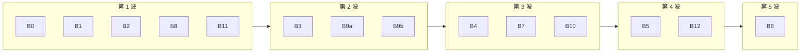

# Enterprise 能力回流：把交付分支里已验证的通用能力收回主产品

Planned-with: Opus 5.5
Suggested-Impl-Model: Grok 4.7（全部子计划）
Acceptance-Model: Opus 5.5（逐份端到端验收）

## 0. 一句话目标

Enterprise 交付分支从 2026-07-26 起独立演进，期间在真实客户环境里磨出了一批与客户无关的通用能力：分层额度、搜索与研究次数、长回答断点续写、深度研究恢复、公开检索与用户输入隔离、反馈记忆、门户安全基线，以及更简洁的「组织与成员」管理界面。本计划把这些能力**逐块移植**回主仓 `enterprise/`，不带回任何客户专属流程、品牌和部署假设。

## 1. 背景与证据（实施者不必再查）

### 1.1 两个仓库的关系

- 交付仓（下称 `$DELIVERY_REPO`，本机路径由执行者从任务指令获知，**不得写进代码、注释、提交信息**）与主仓同根（root `6e2d022c`），分叉点 `f44415a7`（2026-07-26）。
- 分叉后主仓 978 个提交、交付仓 1267 个提交；两边对同一文件都有大改（如 `features/chat/src/store.ts` 主仓 2745 行 / 交付仓 5344 行；`web-portal/src/lib/deep-research/orchestrator.ts` 主仓 2629 / 交付仓 4180）。
- **结论：不能 merge、不能整文件覆盖。** 一律按函数 / 文件「摘取 + 适配」，以主仓现状为准。

### 1.2 迁移编号（硬约束）

两边迁移从 PG `0046`、MySQL `0020` 起全段撞号（例：两边都有 `0057`，主仓是 `enterprise_projects`，交付仓是 `enterprise_skill_scan_result`）。主仓测试把编号写死：

- `enterprise/packages/db-schema/src/__tests__/migration-inventory.test.ts` L16–28：PG journal 条数、`idx` 连续、最后三条 tag。
- `enterprise/packages/db-schema/src/__tests__/schema-parity.test.ts` L57–59（PG/MySQL 表数各 68 且同名）、L116–151（MySQL 文件清单写死到 `0031_enterprise_projects.sql`）、L167–199（MySQL journal 32 条）、L207–221（MySQL `>=0020` 多语句须 `--> statement-breakpoint`）、L224–231（MySQL 禁止表级 `CHARSET` / `COLLATE`）。
- 两种方言都**禁止**出现 `enterprise_feature_assignments`、`enterprise_capability_opt_outs`（`migration-inventory.test.ts` L51–66）。

本计划**预分配**新迁移编号，子计划不得自行挑号：

| 编号（PG / MySQL） | 子计划 | 表 |
|---|---|---|
| `0058_chat_message_feedback` / `0032_chat_message_feedback` | B8 | `chat_message_feedback` |
| `0059_gateway_budget_ledger` / `0033_gateway_budget_ledger` | B9a | `gateway_budget_usage`、`gateway_budget_reservations` |
| `0060_enterprise_feature_usage` / `0034_enterprise_feature_usage` | B10 | `enterprise_feature_usage_daily`、`enterprise_feature_usage_shared_daily` |

每加一条迁移，同一提交里同步改：`drizzle/meta/_journal.json`（PG）/ `drizzle-mysql/meta/_journal.json`、两份测试里写死的条数 / 文件清单 / 最后 tag / 表数（每份子计划写明改成多少）、`src/schema/index.ts` 与 `src/mysql-schema/index.ts` 的导出。

### 1.3 基线（`main` @ `e7c63c3e`，2026-10-20 实测）

| 包 | 结果 |
|---|---|
| `apps/admin-console` | 48 文件 / 193 测试全过 |
| `packages/iam-core` | 53 全过 |
| `packages/db-schema` | 16 全过 |
| `packages/policy-engine`（go） | 通过 |
| `apps/web-portal` | 878 中 **10 个原本就失败**（见下） |
| `apps/gateway`（go） | `adaptor` `cache` `channel` `inbound` `relay` 五个包**测试编译失败**；`mcphost` 1 个用例失败 |

web-portal 原有失败（验收只看「有无新增失败」，这些不算回流引入）：

1. `src/lib/__tests__/capability-packs-reader.feature-auth.test.ts` › allows deep research when it shares an assigned pack with a skill
2. `src/lib/chat-history/contract.test.ts` › dispatches postgresql to its adapter
3. `src/lib/deep-research/orchestrator.budget.test.ts` › uses DEEP_RESEARCH_TOTAL_BUDGET_MS when set
4. 同上 › falls back to 1_200_000 when env unset
5. `src/lib/deep-research/orchestrator.test.ts` › refreshes gateway bearer before synthesize so section writes use the new token
6. `src/lib/deep-research/run-wait.test.ts` › timeoutMs<=0 never auto-times-out
7. `src/app/api/chat/completions/__tests__/platform-features.test.ts` › rejects web search when the user is not assigned the feature
8. 同上 › rejects deep research when the user is not assigned the feature
9. `src/app/api/desktop/capabilities/__tests__/route.test.ts` › lists capabilities the user turned off
10. `src/app/api/auth/sso/saml/__tests__/start-cookie-policy.test.ts` › uses SameSite=None and Secure in production

另有两项原有问题（2026-10-20 在 `e7c63c3e` 的独立工作区复核，与回流无关）：

- `pnpm -C enterprise/apps/web-portal typecheck` 原本就有 **26 条**类型错误，分布在 `features/chat/src/components/molecules/{deep-research-artifact-tree,zip-store}.ts`、`features/chat/src/store.ts`（L1029）、`src/lib/deep-research/{citation-verifier,evidence-pack}.ts`、`src/lib/video-probe{,.test}.ts`、`src/components/ComposerPlusMenu.tsx` 及若干测试文件。验收口径：**不新增类型错误**（按「文件 + 行 + 错误码」比对），不要求这条命令退出码为 0。
- `pnpm -C enterprise/features/chat test` 原本就有 **2 条**失败：`store.interrupt.test.ts › retains partial assistant content and persists on user cancel`、`store.multi-session.test.ts › does not enqueue send on idle session B while session A streams`。B3 改造停止与落盘逻辑时若让第一条转绿，记入验收记录。
- `packages/sdk-ts`、`packages/config`、`apps/admin-console typecheck` 原本全过。

网关测试编译失败的原因已核实：`openai.ChatMessage.Content` 已改为 `json.RawMessage`，这五个包的 `*_test.go` 还在用字符串字面量。生产代码能编译。由 B0 修复（仅测试文件）。

## 2. 产品决策（已定，子计划按此执行）

| # | 决策 | 理由 |
|---|---|---|
| D1 | 预算后端：`GATEWAY_BUDGET_BACKEND=database` 时走数据库账本，配置或账本不可读一律**拒绝**；未设置时沿用现有文件账本，失败行为保持现状（放行 + `warn` 日志） | 主仓单机 / 文件部署不能因为升级被直接 503；共享池要防超卖只能在数据库模式下保证 |
| D2 | 个人层默认动作沿用主仓 `warn`；部门共享上限、公司共享上限、公司月度硬顶**强制 `block`** | 共享池就是硬顶；个人层的提醒语义不变 |
| D3 | 预算配置升级为 v2：`companyLimits` = 公司月度硬顶；`defaults` = **每人兜底**。读取到无 `version: 2` 的旧配置时，把旧 `defaults` 解释为公司共享上限（等价于 v2 的 `tenants[tenantId]`），保存时写 v2 | 主仓旧 `defaults` 按租户维度记账（`gateway/internal/quota/budget.go` L234–239），实际是全租户共享上限；直接换语义会把「公司上限」变成「每人上限」 |
| D4 | 保留主仓独有的智能体月度配额（`cfg.Agents` / `RequestContext.AgentID`）与套餐页 `/metering/plans` | 交付仓删掉了它们，主仓仍在用 |
| D5 | Token 窗口配额默认保持关闭（`GATEWAY_TOKEN_WINDOW_QUOTA=on` 才开） | 不改主仓现网默认 |
| D6 | 网关单次请求超时改为可配 `GATEWAY_REQUEST_TIMEOUT`（Go duration，默认 `10m`），超时发生在流已开始之后时写一条 SSE 错误再写 `data: [DONE]` | 主仓默认 10 分钟不变，只把「被掐断却当成功」修掉 |
| D7 | 管理台新入口 `/iam/members`「组织与成员」；`/iam/roles` 继续是角色与权限范围编辑，不挪作他用；`/iam/users` `/iam/departments` `/iam/user-groups` `/iam/bulk-import` 改为重定向 | 交付仓把 `/iam/roles` 挪作名册并删了权限矩阵；主仓的权限矩阵仍有用 |
| D8 | 公开检索签名只包深度研究的纯文本公开管线；**不**把普通联网搜索的证据从系统消息挪到最后一条用户消息 | 主仓普通搜索证据本来就在系统消息里，request 阶段不会被当用户输入扫；挪过去反而更容易误拦 |
| D9 | 搜索次数准入**不**引入租户日调用配额表（交付仓 `enterprise_web_search_daily_quota`）；只做个人 / 部门 / 公司三层次数 | 那张表是交付环境的上游供应商配额管理，主仓暂无此需求 |

## 3. 不回流（明确排除）

- PDF 水印助手、名单、批次下载、独立渲染服务及其能力开关。
- 附件公网 / 私网路由（`attachment_public_override` 等）。
- 部署地址参数化、nginx 边缘模板、生产 compose 双副本、部署脱敏日志工具、密钥扫描基线与 githooks 规则。
- 语义轮次规划器（`chat-routing/`、`turn-plan-schema.ts`、`planner_model` 列）。
- 交付仓 e2e harness（`enterprise/e2e/**`）：本轮不搬，见 §8 待办。
- 品牌壳层：`EnterpriseBrandMark`、`ENTERPRISE_ORG_NAME`、登录页客户文案、客户 logo。
- 任何客户名称、客户组织名、客户机器地址。

## 4. 子计划总览

| ID | 子计划文件 | 内容 | 依赖 | 推荐模型 |
|---|---|---|---|---|
| B0 | `2026-10-20-backflow-b0-gateway-test-compile.plan.md` | 网关五个包测试随 `json.RawMessage` 更新 | — | Grok 4.7 |
| B1 | `2026-10-20-backflow-b1-portal-security-headers.plan.md` | 门户安全响应头 + 可选 HSTS | — | Grok 4.7 |
| B2 | `2026-10-20-backflow-b2-chat-stream-transport.plan.md` | SDK 把未完成流当错误；网关超时写 SSE 错误 | — | Grok 4.7 |
| B3 | `2026-10-20-backflow-b3-chat-continue.plan.md` | 中断标记、流式落盘、刷新后继续、空回复与中断推理、历史剔除失败提示、流式合批 | B2 | Grok 4.7 |
| B4 | `2026-10-20-backflow-b4-chat-history-hydration.plan.md` | 会话列表分页、加载未完成也能落库草稿、防重复首发 | B3 | Grok 4.7 |
| B5 | `2026-10-20-backflow-b5-research-recovery.plan.md` | 活跃研究轻量摘要、按 runId 精确恢复且不重复阶段、显式续期登录、上游限流与租户额度分开 | B3 | Grok 4.7 |
| B6 | `2026-10-20-backflow-b6-research-report-continue.plan.md` | 报告断点、继续完成报告、截断保留已完成章节、章节传输重试、恢复时保留原始输入 | B5 | Grok 4.7 |
| B7 | `2026-10-20-backflow-b7-trusted-retrieval.plan.md` | 签名标记公开检索证据，网关对其 PII 降为提醒并审计 | — | Grok 4.7 |
| B8 | `2026-10-20-backflow-b8-feedback-memory.plan.md` | 赞踩落库 + 下一轮带回最多 3 条示例 | — | Grok 4.7 |
| B9a | `2026-10-20-backflow-b9a-layered-budget-gateway.plan.md` | 网关：公司 / 组织 / 部门 / 个人分层预算，数据库账本一次事务预留，收据结算 | B0 | Grok 4.7 |
| B9b | `2026-10-20-backflow-b9b-layered-budget-admin.plan.md` | 管理台：v2 预算配置、旧配置兼容、冲突检测、快照带用户组，`/metering/quota` 预算区最小改动 | —（与 B9a 共用契约） | Grok 4.7 |
| B10 | `2026-10-20-backflow-b10-feature-usage-limits.plan.md` | 联网搜索、深度研究的个人 / 部门 / 公司次数上限 | B9a B9b | Grok 4.7 |
| B11 | `2026-10-20-backflow-b11-org-members-ia.plan.md` | 「组织与成员」页（现有接口），旧入口重定向 | — | Grok 4.7 |
| B12 | `2026-10-20-backflow-b12-org-members-limits.plan.md` | 组织与成员页里的用量环、额度来源、组 / 个人 / 全员默认上限编辑 | B9a B9b B10 B11 | Grok 4.7 |

## 5. 执行波次（按文件冲突排）

同一波内的子计划改的文件互不重叠，可以并行；跨波有依赖或有同一热点文件。

热点文件与归属（同一时刻只允许一份子计划改）：

| 文件 | 归属顺序 |
|---|---|
| `enterprise/features/chat/src/store.ts` | B3 → B4 → B5 → B6 |
| `enterprise/apps/web-portal/src/lib/deep-research/orchestrator.ts` | B7 → B5 → B6 |
| `enterprise/apps/web-portal/src/app/api/chat/completions/route.ts` | B8 → B10 → B5 → B6 |
| `enterprise/apps/web-portal/src/components/MachiChatView.tsx` | B8 → B3 →（B4 与 B10 同波，各自只做定点插入）→ B6 |
| `enterprise/apps/web-portal/src/lib/deep-research/run-store.ts` | B10 → B5 |
| `enterprise/apps/gateway/internal/server/server.go` | B2 → B9a → B7 → B5 |
| `enterprise/packages/db-schema/**` | B8 → B9a → B10 |
| `enterprise/packages/config/src/index.ts` | B9b → B10 |
| `enterprise/apps/web-portal/messages/{zh,en}.json` | 同一波内只用定点插入（StrReplace），不得整文件重写 |
| `enterprise/apps/admin-console/messages/{zh,en}.json` | 同上 |

## 6. 通用实施规则（每份子计划都适用）

1. 以主仓现有代码为准，从 `$DELIVERY_REPO` 对应文件**摘取**所需函数、类型和测试，再按主仓命名、导入路径、方言抽象适配。禁止整文件覆盖主仓已有文件。
2. 每个新文件、每段搬来的逻辑都要能对上一条 FR；不顺手重构周边代码（`no-scope-creep.mdc`）。
3. 剥离：水印、附件公网路由、租户日调用配额、规划器、客户品牌与组织名、客户机器地址。搬测试时同样剥离对应用例。
4. 界面文案用户可见处中文化，且不出现表名、文件路径、环境变量等实现细节。
5. 不改 `agenticx/studio/server.py`、`desktop/`（本计划只动 `enterprise/`）。
6. 每份子计划完成时必须跑完其 AC 里的命令，并对照 §1.3 基线：不得新增失败。
7. 实施者不提交 git，由验收方在验收通过后按子计划分别提交（`Plan-Id` / `Plan-File` / `Plan-Model: claude opus 5.5` / `Impl-Model: grok 4.7` / `Made-with: Damon Li`）。

## 7. 端到端验收（Opus 执行）

每份子计划除自身 AC 外，验收方在本机起完整环境（`bash enterprise/scripts/start-dev-with-infra.sh` 或已运行的 `start-dev.sh` + 网关）做一次手工走查，结论写回该子计划末尾「验收记录」。全部完成后再跑一遍：

- `pnpm -C enterprise/apps/web-portal test`、`pnpm -C enterprise/apps/admin-console test`、`pnpm -C enterprise/packages/iam-core test`、`pnpm -C enterprise/packages/db-schema test`、`pnpm -C enterprise/packages/config test`、`pnpm -C enterprise/packages/sdk-ts test`、`pnpm -C enterprise/features/chat test`
- 上述包的 `typecheck`
- `cd enterprise/apps/gateway && go test ./...`、`cd enterprise/packages/policy-engine && go test ./...`

## 8. 待办（实施中发现、本轮不做）

- 公开检索签名的 nonce 只在进程内去重，多副本网关会各自接受同一 nonce；需要共享存储（Redis / 数据库）。
- `enterprise/deploy/docker-compose/prod.yml` 的 `web-portal` 未显式设置 `AUTH_COOKIE_SECURE`，叠加 `portal.yml` 后为 `false`。
- 交付仓的轻量 e2e harness（嵌入式 PG + 网关 + 门户 + Playwright）值得单独评估回流。
- 管理台 `next.config.ts` 是否也加同一组安全响应头。
- 运维监控分组里额度 / 套餐 / 分账与观测混放（与 B12 收敛额度入口相关，视 B12 结果再定）。

## 9. 验收记录

（验收方填写）
