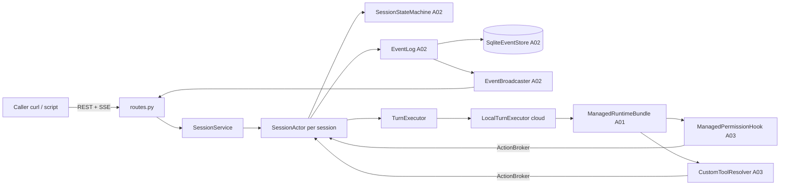

# MA-A04 托管宿主 `agx ma serve`（会话面 API、SSE 续流、自定义工具回路、中断）

Planned-with: Claude Opus 5.5
Suggested-Impl-Model: Grok 4.7
Parent: .cursor/plans/2026-10-25-managed-agents-master.plan.md（W1）
Depends-on: MA-00、MA-A01、MA-A02、MA-A03

> 风险等级：高。合入前建议强推理档只读审查。**本子规划不得修改 `agenticx/studio/server.py`（一行都不改）。**

---

## 1. 目标

在框架内提供一个独立进程的托管宿主 `agx ma serve --dev`（FastAPI，默认端口 8092）：

1. 会话面 API（总规划 6.3 会话侧各行）：创建 / 查询会话、批量提交客户端事件、按 `after_seq` 分页读事件、SSE 订阅（`Last-Event-ID` / `after_seq` 续流，15 秒 ping，可选预览帧）、归档。
2. 云端执行（`cloud` 环境，W1 = 宿主进程内直接跑 `AgentRuntime`，工具在宿主本机执行）：`user.message` → 运行一轮 → 事件落库与推送；`always_ask` → `requires_action` → `user.tool_confirmation`；自定义工具 → `agent.custom_tool_use` → `user.custom_tool_result`；`user.interrupt`（宽限 3 秒后强杀）。
3. 开发模式：Agent 定义从本地 YAML 加载；鉴权用静态 Bearer token。
4. 为 MA-A05 预留插槽：按环境类型注册执行器（`desktop_worker` 由 MA-A05 注册），宿主启动 / 关闭钩子。
5. 交付 W1 验收门的演示：可复制运行的命令 + Python 演示脚本 + pytest 端到端用例。

## 2. 根因 / 动机与证据链

- 总规划第 7 节 W1 门：「`agx ma serve --port 8092 --dev`，curl 创建带 `bash_exec: always_ask` 与一个自定义工具的 Agent（开发模式从本地 YAML 加载）、创建会话、订阅 SSE、发送消息；`requires_action` 后回 `allow`，再看到 `agent.custom_tool_use` 后回结果，会话以 `end_turn` 结束；断开 SSE 后用 `Last-Event-ID` 重连，不丢不重；Near 个人模式与 `agx serve` 行为无变化」。
- 总规划第 4 节决策 1：托管运行时是 Python，复用框架；MA-E03 的 `enterprise/apps/agent-runtime` 会「复用 MA-A04 宿主」+ PG 存储 + PAT 内省 + 网关 LLM。所以宿主必须是**可注入**的 app 工厂：存储（`EventStore`）、Agent 注册表、鉴权器、LLM 工厂都能替换。
- 为什么不改 Studio：`agenticx/studio/server.py` 是本机后端唯一入口，import 区极敏感（AGENTS.md 有 2026-07-06 事故记录）。托管宿主是**独立 FastAPI app、独立进程、独立端口、独立数据目录**（默认 `~/.agenticx/ma/`），与 `agx serve` 无共享内存状态。
- CLI 注册方式：`agenticx/cli/main.py:185` 定义 `app = typer.Typer(...)`，子命令组在 `:419-497` 用 `app.add_typer(...)` 注册，惰性模块用 `try: from ... import x_app; app.add_typer(x_app) except Exception: pass`（例：`:492-497` volcengine）。`agx serve` 的命令体内惰性 import 重模块（`main.py:852-857`）。
- SSE 语义参考 `agenticx/studio/session_event_hub.py`：先订阅再回放、按 seq 去重（`subscribe` `:169-179`，`replay_since` `:184-190`）；我们的回放来自 MA-A02 持久化存储，不受 400 条环形缓冲限制。
- 中断：`AgentRuntime.run_turn(..., should_stop=...)` 在每轮开头（`agent_runtime.py:4796-4798`）、每个工具调用前（`:6998-7000`）、工具执行等待中（`:7796-7813`，会 `cancel_turn_scoped_dispatch`）检查 `should_stop`，命中后 yield `ERROR{text: STOP_MESSAGE}` 并结束。总规划 6.1：中断宽限 3 秒后强杀。
- 已有依赖：FastAPI 0.128.5、httpx 0.28.1、uvicorn 0.40.0、Python 3.13（2026-10-25 本机实测）。pytest `asyncio_mode = "auto"`、`--import-mode=importlib`（`pyproject.toml:293-311`）。

## 3. In scope / Out of scope

**In scope（只能创建或修改这些文件）：**
- 新建 `agenticx/managed/sse.py`
- 新建 `agenticx/managed/host/__init__.py`
- 新建 `agenticx/managed/host/config.py`
- 新建 `agenticx/managed/host/auth.py`
- 新建 `agenticx/managed/host/registry.py`
- 新建 `agenticx/managed/host/models.py`
- 新建 `agenticx/managed/host/actor.py`
- 新建 `agenticx/managed/host/service.py`
- 新建 `agenticx/managed/host/routes.py`
- 新建 `agenticx/managed/host/app.py`
- 新建 `agenticx/cli/ma_commands.py`
- 修改 `agenticx/cli/main.py`：**只**在 volcengine 注册块（`main.py:492-497`）之后插入一个 6 行的 `ma` 注册块（见 §5.10），其他行不动
- 新建 `examples/managed/agents.dev.yaml`
- 新建 `examples/managed/w1_fake_script.json`
- 新建 `scripts/managed/w1_gate_demo.py`
- 修改 `tests/managed/conftest.py`（MA-A01 创建）：**追加** `ma_live_server` fixture 与辅助类（§6.1），不改已有 fixture
- 新建 `tests/managed/test_sse_helpers.py`
- 新建 `tests/managed/test_host_config.py`
- 新建 `tests/managed/test_host_api.py`
- 新建 `tests/managed/test_host_sse.py`
- 新建 `tests/managed/test_w1_gate_e2e.py`
- 新建 `tests/managed/test_ma_cli.py`

**Out of scope：**
- `agenticx/studio/**`（包括 `server.py`）零改动。
- `desktop_worker` 执行器、Work Queue 接口、`events:ingest`、`inbox/stream`：MA-A05。
- Vault / 凭证（`vault_ids` 非空直接 400）：MA-A06；Memory Store 挂载（`resources` 非空直接 400）：MA-A07。
- 图片 / 文件型内容块送入模型：W1 忽略并记一条 `session.error`（见 §5.6）。
- PG 存储、PAT 内省、网关 LLM、docker 沙箱：MA-E03。W1 的 `cloud` 环境 = 宿主进程直接执行工具（`sandbox_backend` 字段只做记录）。
- 会话列表接口、删除 / 终止接口：不在 W1。
- MCP 连接：MA-A06。

## 4. 架构



`SessionActor` 实现 MA-A03 的 `ActionBroker`：权限 hook 与自定义工具 resolver 通过它落库 tool use 事件并挂起等待 resolution。

## 5. 精确落点

文件头、英文注释、绝对 import、import 置顶（同 MA-A01 §4）。唯一例外见 §5.9（CLI 命令体内惰性 import，与 `main.py:852-857` 的 `agx serve` 同一惯例，须写一行英文注释说明原因）。

### 5.1 `agenticx/managed/sse.py`（服务端格式化 + 客户端解析，MA-A05 复用）

```python
PING_FRAME = ": ping\n\n"

def format_sse(*, event: str, data: Mapping[str, Any], id: int | str | None = None) -> str:
    """'id: <id>\\n' (optional) + 'event: <event>\\n' + 'data: <compact json>\\n\\n'.
    JSON: json.dumps(data, ensure_ascii=False, separators=(",", ":"))."""

@dataclass(frozen=True)
class SseMessage:
    id: str | None
    event: str
    data: str
    def json(self) -> Any: return json.loads(self.data)

async def aiter_sse(lines: AsyncIterator[str]) -> AsyncIterator[SseMessage]:
    """Parse text/event-stream lines (e.g. httpx Response.aiter_lines()).
    - line starting with ':' -> comment/ping, ignored
    - 'id:' / 'event:' / 'data:' fields; one optional space after ':' is stripped
    - multiple data lines are joined with '\\n'
    - blank line dispatches a message if any data line was seen; event defaults to 'message'
    - id persists only for the message it appears in (no carry-over)"""
```

### 5.2 `agenticx/managed/host/config.py`

```python
@dataclass(frozen=True)
class Principal:
    tenant_id: str
    user_id: str
    scopes: frozenset[str]

@dataclass(frozen=True)
class AgentDefinition:
    record: AgentRecord                          # agenticx.managed.protocol.AgentRecord
    versions: Mapping[int, AgentVersionRecord]

class HostConfigError(ValueError): ...

DEV_ID_RE = re.compile(r"^[A-Za-z0-9][A-Za-z0-9_-]{0,63}$")
DEFAULT_TENANT_ID = "dev"
DEFAULT_PORT = 8092

@dataclass
class HostConfig:
    data_dir: Path
    tenant_id: str = DEFAULT_TENANT_ID
    tokens: Mapping[str, Principal] = field(default_factory=dict)
    agents: Mapping[str, AgentDefinition] = field(default_factory=dict)
    environments: Mapping[str, EnvironmentRecord] = field(default_factory=dict)
    enterprise_policy: EnterpriseAgentPolicy = field(default_factory=EnterpriseAgentPolicy)
    dev: bool = True
    interrupt_grace_seconds: float = 3.0
    sse_ping_seconds: float = float(SSE_PING_INTERVAL_SECONDS)
    @property
    def db_path(self) -> Path: return self.data_dir / "ma.sqlite3"
    @property
    def workdir_root(self) -> Path: return self.data_dir / "sessions"

def default_environments(tenant_id: str) -> dict[str, EnvironmentRecord]: ...
def dev_principal(tenant_id: str) -> Principal: ...      # user_id "dev-user", scopes = frozenset(PAT_SCOPES)
def load_agents_file(path: Path) -> tuple[str, dict[str, AgentDefinition], dict[str, EnvironmentRecord], EnterpriseAgentPolicy]: ...
def build_dev_config(*, agents_file: Path, data_dir: Path, token: str) -> HostConfig: ...
```

`default_environments(tenant)` 返回两个环境（`EnvironmentRecord`，status `active`）：
- `local`：`name="Local host (subprocess)"`、`type="cloud"`、`config={"type":"cloud","sandbox_backend":"subprocess"}`
- `worker`：`name="Desktop worker"`、`type="desktop_worker"`、`config={"type":"desktop_worker"}`

**Agent 定义 YAML 格式**（`yaml.safe_load`；仓库已依赖 PyYAML）：

```yaml
tenant_id: dev                    # optional, default "dev"
environments:                     # optional; merged over default_environments (same id overrides)
  - id: local
    name: Local host
    type: cloud
    config: {type: cloud, sandbox_backend: subprocess}
enterprise_agent_policy:          # optional; parsed with policy_from_mapping()
  denied_tools: []
  always_ask_tools: []
agents:
  - id: demo                      # required, DEV_ID_RE (ULIDs also match)
    slug: demo                    # optional, default = id
    display_name: W1 Demo         # optional, default = slug
    description: null             # optional
    default_environment_id: local # optional, default "local"
    versions:                     # either `versions` (list) or `manifest` (single -> version 1)
      - version: 1
        manifest: { ... agx.agent/v1 ... }
```

校验（任一失败 → `HostConfigError(message)`，message 格式 `"<path>: <reason>"`，path 例 `agents[0].versions[1].manifest`）：
- 文件不存在 → `"{path}: file not found"`；顶层不是 mapping → `"{path}: must be a mapping"`。
- `agents` 缺失或非列表 → `"agents: must be a list"`；空列表允许（宿主照常启动，只是没有 Agent）。
- `id` 不匹配 `DEV_ID_RE` → `"agents[i].id: invalid id"`；重复 → `"agents[i].id: duplicate agent id"`。
- 同时给 `versions` 与 `manifest`，或两者都没给 → `"agents[i]: exactly one of versions/manifest is required"`。
- `version` 非正整数或重复 → `"agents[i].versions[j].version: must be a unique integer >= 1"`。
- manifest：`validate_manifest(m)`；失败 → `"agents[i].versions[j].manifest: " + "; ".join(result.errors)`；另外用 `compile_spec(id, version, m)` 做语义校验，`MAError` → 同样前缀 + `"; ".join(err.details["errors"])`。
- `default_environment_id` 不在合并后的环境表 → `"agents[i].default_environment_id: unknown environment"`。
- 环境条目必须能 `EnvironmentRecord.model_validate({...,"tenant_id": tenant, "status": "active"})`，否则 `"environments[k]: invalid"`。

构造的 `AgentRecord`：`tenant_id=tenant`、`latest_version=max(versions)`、`status="active"`、`lifecycle="published"`、`origin="enterprise"`、`assignment_keys=[]`、`worker_keys=[]`。`AgentVersionRecord`：`manifest=result.normalized`、`manifest_hash=result.manifest_hash`、`created_by=None`、`created_at=utc_now_iso()`、`note=None`。

`build_dev_config(agents_file, data_dir, token)`：`tenant, agents, envs, policy = load_agents_file(agents_file)`；`tokens={token: dev_principal(tenant)}`；`data_dir` 做 `expanduser().resolve()` 并 `mkdir(parents=True, exist_ok=True)`；`dev=True`。

### 5.3 `agenticx/managed/host/auth.py`

```python
class TokenAuthenticator(Protocol):
    async def authenticate(self, token: str) -> Principal | None: ...

class StaticTokenAuthenticator:
    def __init__(self, tokens: Mapping[str, Principal]) -> None: ...
    async def authenticate(self, token: str) -> Principal | None:
        """Iterate all configured tokens and compare with hmac.compare_digest (no early exit on first byte)."""

def bearer_token(authorization_header: str | None) -> str | None:
    """'Bearer <token>' (case-insensitive scheme) -> token; anything else -> None."""

def require_scope(principal: Principal, scope: str) -> None:
    """OK if scope in principal.scopes or 'ma:admin' in principal.scopes;
    else raise MAError(FORBIDDEN_SCOPE, f"missing scope {scope}", details={"scope": scope})."""
```

路由层依赖（在 `routes.py` 里定义）：缺 / 坏 token → `MAError(UNAUTHORIZED, "missing or invalid bearer token")`（401）。

作用域：创建会话、提交事件、归档 → `ma:sessions:write`；读会话、读事件、SSE → `ma:sessions:read`。

### 5.4 `agenticx/managed/host/registry.py`

```python
class AgentRegistry(Protocol):
    async def get_agent(self, tenant_id: str, agent_id: str) -> AgentRecord | None: ...
    async def get_version(self, tenant_id: str, agent_id: str, version: int | None) -> AgentVersionRecord | None:
        """version None -> latest_version."""
    async def get_environment(self, tenant_id: str, environment_id: str) -> EnvironmentRecord | None: ...

class StaticAgentRegistry:
    def __init__(self, config: HostConfig) -> None: ...
```

`StaticAgentRegistry` 只返回 `tenant_id == config.tenant_id` 的数据；其他租户一律 None。MA-E03 会提供经 admin-console `/api/internal/ma/*` 拉取的实现。

### 5.5 `agenticx/managed/host/models.py`

```python
class CreateSessionRequest(BaseModel):
    model_config = ConfigDict(extra="forbid")
    agent_id: str = Field(min_length=1, max_length=64)
    agent_version: int | None = Field(default=None, ge=1)
    environment_id: str | None = Field(default=None, min_length=1, max_length=64)
    vault_ids: list[str] = Field(default_factory=list)
    resources: list[dict[str, Any]] = Field(default_factory=list)
    title: str | None = Field(default=None, max_length=200)
    source: SessionSource = "api"

def session_to_wire(record: SessionRecord) -> dict[str, Any]:
    return record.model_dump(mode="json")      # keeps explicit nulls
```

### 5.6 `agenticx/managed/host/actor.py`

```python
class TurnExecutor(Protocol):
    async def submit_message(self, message: StoredEvent) -> None:
        """Called with actor.lock held, once per accepted user.message (SubmitMessage effect)."""
    async def on_resolved(self, resolutions: Mapping[str, ClientEvent]) -> None:
        """Called with actor.lock held after a requires_action batch is fully resolved."""
    async def interrupt(self, dropped_pending: Sequence[str]) -> None:
        """Called with actor.lock held for every InterruptTurn effect."""
    async def close(self) -> None: ...


class SessionActor:                                   # structurally implements agenticx.managed.actions.ActionBroker
    def __init__(self, *, service: "SessionService", record: SessionRecord, spec: AgentSpec,
                 environment: EnvironmentRecord, sm: SessionStateMachine) -> None: ...
    # public attributes
    tenant_id: str; session_id: str; record: SessionRecord; spec: AgentSpec
    environment: EnvironmentRecord; sm: SessionStateMachine; lock: asyncio.Lock
    adapter: RuntimeEventAdapter; executor: TurnExecutor   # executor set by SessionService right after construction

    @property
    def event_log(self) -> EventLog: ...
    async def append(self, events: Sequence[Mapping[str, Any]]) -> list[StoredEvent]: ...
    async def sync_record(self, *, usage: Usage | None = None) -> None: ...
    async def handle_client_batch(self, raw: Any) -> list[StoredEvent]: ...
    async def begin_turn_locked(self) -> None: ...
    async def finish_turn_locked(self, outcome: TurnOutcome) -> None: ...
    def resolve_waiters(self, resolutions: Mapping[str, ClientEvent]) -> None: ...
    def void_waiters(self) -> None: ...
    def reset_waiters(self) -> None: ...
    # ActionBroker
    async def announce_tool_use(self, *, kind, name, input, evaluated_policy, mcp_server=None) -> str: ...
    async def request_action(self, event_id: str, kind: ActionKind) -> ClientEvent | None: ...
    def custom_tool_use_id(self, name: str) -> str | None: ...


class LocalTurnExecutor:
    def __init__(self, actor: SessionActor) -> None: ...
    async def submit_message(self, message: StoredEvent) -> None: ...
    async def on_resolved(self, resolutions: Mapping[str, ClientEvent]) -> None: ...
    async def interrupt(self, dropped_pending: Sequence[str]) -> None: ...
    async def close(self) -> None: ...


def content_to_model_text(content: Sequence[Mapping[str, Any]]) -> tuple[str, bool]:
    """Wire content blocks -> (model input text, had_unsupported_blocks). Reused by MA-A05 worker."""


def message_text(message: StoredEvent) -> tuple[str, bool]:
    """content_to_model_text(message.payload.get("content") or [])."""
```

`adapter = RuntimeEventAdapter(model_ref=spec.model_ref, kind_of=spec.kind_of)`。

**`append(events)`** = `await self.event_log.append(self.tenant_id, self.session_id, events)`。

**`sync_record(usage=None)`**：`changes = {"status": sm.status, "stop_reason": sm.stop_reason.model_dump(mode="json") if sm.stop_reason else None}`；`usage` 非 None 时加 `"usage": usage.model_dump(mode="json")`；`self.record = await store.update_session(...)`。

**`handle_client_batch(raw)`**：

```python
events = parse_client_events(raw)                         # MA-00; raises MAError 400 on bad batch
async with self.lock:
    ref_ids = [e.tool_use_id for e in events if e.type == "user.tool_confirmation"] + \
              [e.custom_tool_use_id for e in events if e.type == "user.custom_tool_result"]
    known = {}
    for rid in ref_ids:
        stored = await store.get_event(self.tenant_id, self.session_id, rid)
        if stored is not None:
            known[rid] = stored.type
    plan = self.sm.plan_client_events(events, known)       # raises -> nothing written
    wire = [_strip_envelope(event_to_wire(e)) for e in plan.events]   # drop id/session_id/seq/created_at/processed_at sent by caller
    stored = await self.append(wire)
    server_events = self.sm.commit(plan)
    if server_events:
        await self.append(server_events)
    await self.sync_record()
    now = utc_now_iso()
    non_message_ids = [s.id for s in stored if s.type != "user.message"]
    if non_message_ids:
        await store.mark_processed(self.tenant_id, self.session_id, non_message_ids, now)
    for effect in plan.effects:
        if isinstance(effect, SubmitMessage):
            await self.executor.submit_message(stored[effect.index])
        elif isinstance(effect, ResolveActions):
            await self.executor.on_resolved(effect.resolutions)
        elif isinstance(effect, InterruptTurn):
            await self.executor.interrupt(effect.dropped_pending)
return stored
```

**`begin_turn_locked()`**：`await self.append(self.sm.turn_started()); await self.sync_record()`。

**`finish_turn_locked(outcome)`**：`await self.append(outcome.events)`；`await self.append(self.sm.turn_finished(outcome.stop_type))`；`await self.sync_record(usage=outcome.usage)`。

**ActionBroker 实现：**
- `announce_tool_use(...)`：`events = self.adapter.build_tool_use(kind=kind, name=name, input=input, evaluated_policy=evaluated_policy, mcp_server=mcp_server)`；`await self.append(events)`；`return events[-1]["id"]`。（不拿 lock：它只在本会话的回合任务里被调用，`append` 本身原子。）
- `request_action(event_id, kind)`：

```python
loop = asyncio.get_running_loop()
async with self.lock:
    if self._voided:                        # interrupt arrived before the hook asked: do not park
        return None
    events = self.sm.action_required([PendingAction(event_id, kind)])
    fut = loop.create_future()
    self._waiters[event_id] = fut
    await self.append(events)
    await self.sync_record()
try:
    return await fut                        # ClientEvent or None (voided by interrupt)
finally:
    self._waiters.pop(event_id, None)
```

- `custom_tool_use_id(name)`：`return self.adapter.ledger.inflight_custom(name)`。
- `resolve_waiters(res)`：对每个 `id, ev`：`fut = self._waiters.get(id)`，未完成则 `fut.set_result(ev)`。
- `void_waiters()`：置 `self._voided = True`，并对所有未完成 future `set_result(None)`。
- `reset_waiters()`：置 `self._voided = False`（每个新回合开始时由执行器调用）。`_voided` 初始为 False。

**`content_to_model_text(content)`**（`message_text` 只是对它的包装）：遍历内容块 dict：`text` 块的 `text`；`document` 块 source 为 `text` → `f"[document: {title}]\n{text}"`（无 title 写 `[document]`）；`image` 块、source 为 `file` 的 `document` 块 → 标记 unsupported 并跳过。各段以 `"\n\n"` 连接。

**`LocalTurnExecutor`**（内部字段：`_queue: collections.deque[StoredEvent]`、`_task: asyncio.Task | None`、`_stop_requested: bool`、`_bundle: ManagedRuntimeBundle | None`、`_grace_task: asyncio.Task | None`）：

```python
async def submit_message(self, message):                 # lock held
    if self._task is None or self._task.done():
        await self._start_locked(message)
    else:
        self._queue.append(message)

async def _start_locked(self, message):
    await self.actor.begin_turn_locked()                  # session.status_running
    await store.mark_processed(tenant, sid, [message.id], utc_now_iso())
    self._stop_requested = False
    self.actor.reset_waiters()
    self._task = asyncio.create_task(self._run(message), name=f"ma-turn-{sid}")

async def _run(self, message):
    actor = self.actor
    try:
        bundle = await self._ensure_bundle(before_seq=message.seq)
        text, unsupported = message_text(message)
        if unsupported:
            await actor.append([session_error_event(
                "unsupported_content", "image and file content blocks are ignored by this host", "exhausted")])
        actor.adapter.begin_turn(actor.record.usage)
        async for ev in bundle.run_turn(text, should_stop=lambda: self._stop_requested):
            out = actor.adapter.convert(ev)
            if out.events:
                await actor.append(out.events)
            for frame in out.previews:
                actor.event_log.publish_preview(actor.session_id, frame)
        outcome = actor.adapter.finish_turn()
    except asyncio.CancelledError:
        actor.adapter.mark_interrupted()
        outcome = actor.adapter.finish_turn()
    except Exception as exc:                              # model resolution errors land here too
        logger.exception("managed turn failed session=%s", actor.session_id)
        outcome = actor.adapter.finish_turn(error=exc)
    async with actor.lock:
        await actor.finish_turn_locked(outcome)
        self._task = None
        if self._queue:
            await self._start_locked(self._queue.popleft())

async def on_resolved(self, resolutions):
    self.actor.resolve_waiters(resolutions)

async def interrupt(self, dropped_pending):
    self._stop_requested = True
    self.actor.void_waiters()
    task = self._task
    if task is not None and not task.done():
        self._grace_task = asyncio.create_task(self._grace_kill(task))

async def _grace_kill(self, task):
    await asyncio.sleep(self.actor.service.config.interrupt_grace_seconds)
    if not task.done():
        task.cancel()

async def close(self):
    self._queue.clear()
    for t in (self._grace_task, self._task):
        if t is not None and not t.done():
            t.cancel()
```

`_ensure_bundle(before_seq)`（只在第一次调用时构建，之后复用同一个 bundle 以保留多轮上下文）：

```python
if self._bundle is not None:
    return self._bundle
prior = []
cursor = 0
while True:
    rows = await store.list_events(tenant, sid, after_seq=cursor, limit=500, types=["user.message", "agent.message"])
    prior.extend(r.to_wire() for r in rows if r.seq < before_seq)
    if len(rows) < 500: break
    cursor = rows[-1].seq
auth = ToolAuthorization()
engine = PermissionEngine(actor.spec, actor.service.config.enterprise_policy)
hook = ManagedPermissionHook(engine=engine, broker=actor, authorization=auth)
resolver = CustomToolResolver(broker=actor, custom_tool_names=actor.spec.custom_tool_names)
context = LLMCallContext(tenant_id=tenant, session_id=sid, agent_id=actor.record.agent_id,
                         agent_version=actor.record.agent_version, user_id=actor.record.created_by_user_id)
self._bundle = actor.service.builder.build(actor.spec, context=context, confirm_gate=ManagedConfirmGate(auth),
                                           hooks=[hook], custom_tool_resolver=resolver,
                                           history=rehydrate_agent_messages(prior))
return self._bundle
```

**中断时序（说明，实施者据此自测）：**
- running 中收到 `user.interrupt`：`_stop_requested=True` → runtime 在下一个检查点 yield `ERROR{STOP_MESSAGE}` → 适配器 `stop_type=end_turn` → `session.status_idle(end_turn)`；若 3 秒内没结束则 `task.cancel()`，`_run` 捕获 `CancelledError` 后同样以 `end_turn` 收尾。
- requires_action 中收到 `user.interrupt`：状态机把状态置为 running（不发事件，MA-A02 §4.5），`void_waiters()` 让 hook 返回 `CANCELLED: interrupted...`，runtime 产出 `agent.tool_result{is_error:true}`，然后在下一检查点停下 → `status_idle(end_turn)`。

### 5.7 `agenticx/managed/host/service.py`

```python
ExecutorFactory = Callable[[SessionActor], TurnExecutor]

class SessionService:
    def __init__(self, *, config: HostConfig, event_log: EventLog, registry: AgentRegistry,
                 builder: ManagedAgentBuilder) -> None: ...
    config: HostConfig; event_log: EventLog; registry: AgentRegistry; builder: ManagedAgentBuilder
    @property
    def store(self) -> EventStore: ...
    def register_executor_factory(self, env_type: EnvironmentType, factory: ExecutorFactory) -> None: ...
    def supports_environment(self, env_type: EnvironmentType) -> bool: ...
    async def startup(self) -> None: ...
    async def shutdown(self) -> None: ...
    async def create_session(self, principal: Principal, req: CreateSessionRequest) -> SessionRecord: ...
    async def get_session(self, principal: Principal, session_id: str) -> SessionRecord: ...
    async def post_events(self, principal: Principal, session_id: str, raw: Any) -> list[StoredEvent]: ...
    async def list_events(self, principal: Principal, session_id: str, *, after_seq: int, limit: int,
                          types: Sequence[str]) -> tuple[list[StoredEvent], bool]: ...
    async def archive(self, principal: Principal, session_id: str) -> SessionRecord: ...
    async def actor_for(self, tenant_id: str, session_id: str) -> SessionActor: ...
```

构造时 `register_executor_factory("cloud", LocalTurnExecutor)`。

- `startup()`：`for rec in await store.list_unsettled_sessions(): sm = SessionStateMachine(rec.status, rec.stop_reason); evs = sm.recover_after_restart(); if evs: await event_log.append(rec.tenant_id, rec.id, evs); await store.update_session(rec.tenant_id, rec.id, {"status": sm.status, "stop_reason": sm.stop_reason.model_dump(mode="json")})`。
- `shutdown()`：对所有 actor `await actor.executor.close()`；清空 actor 表；`await store.close()`。
- `create_session`（按顺序，先错先返回）：
  1. `vault_ids` 非空 → `MAError(INVALID_REQUEST, "vault_ids are not supported by this host yet")`；`resources` 非空 → `MAError(INVALID_REQUEST, "resources are not supported by this host yet")`。
  2. `agent = await registry.get_agent(tenant, req.agent_id)` → None → `MAError(AGENT_NOT_FOUND, "agent not found")`；`agent.status != "active"` → `MAError(INVALID_REQUEST, "agent is disabled")`。
  3. `ver = await registry.get_version(tenant, agent.id, req.agent_version)` → None → `MAError(AGENT_VERSION_NOT_FOUND, "agent version not found")`。
  4. `env_id = req.environment_id or agent.default_environment_id or "local"`；`env = await registry.get_environment(...)` → None 或 `status != "active"` → `MAError(ENVIRONMENT_NOT_FOUND, "environment not found")`。
  5. `not supports_environment(env.type)` → `MAError(INVALID_REQUEST, f'environment type "{env.type}" is not available on this host')`。
  6. `compile_spec(agent.id, ver.version, ver.manifest)`（失败透传 `MAError(MANIFEST_INVALID)`）。
  7. `now = utc_now_iso()`；`record = SessionRecord(id=new_ulid(), tenant_id=tenant, agent_id=agent.id, agent_version=ver.version, environment_id=env.id, created_by_user_id=principal.user_id, source=req.source, status="idle", stop_reason=None, title=req.title, vault_ids=[], resources=[], usage=Usage(), created_at=now, updated_at=now, archived_at=None)`；`await store.create_session(record)`；返回。会话创建不产生任何事件（seq 从第一个事件开始为 1）。
- `get_session`：`store.get_session(principal.tenant_id, id)` → None → `MAError(SESSION_NOT_FOUND, "session not found")`。
- `post_events`：`actor = await actor_for(principal.tenant_id, id)`；`return await actor.handle_client_batch(raw)`。
- `list_events`：先 `get_session` 确认存在；`types` 中每项必须 ∈ `SERVER_EVENT_TYPES ∪ CLIENT_EVENT_TYPES`，否则 `MAError(INVALID_REQUEST, f"unknown event type {t}")`；`rows = await store.list_events(..., after_seq, limit, types or None)`；`has_more = len(rows) == limit`。
- `archive`：`actor = await actor_for(...)`；`async with actor.lock: actor.sm.archive()`（非 idle 抛 400）；`await store.update_session(tenant, id, {"status": "archived", "archived_at": utc_now_iso()})`；`event_log.broadcaster.close_session(id)`；`await actor.executor.close()`；从 actor 表移除；返回最新记录。已归档会话再次归档 → 状态机 `archive()` 前置不满足 → 400。
- `actor_for(tenant, id)`：表内命中直接返回（key 为 `(tenant, id)`）；否则：`rec = store.get_session` → None → `SESSION_NOT_FOUND`；`ver = registry.get_version(tenant, rec.agent_id, rec.agent_version)` → None → `AGENT_VERSION_NOT_FOUND`；`spec = compile_spec(...)`；`env = registry.get_environment(tenant, rec.environment_id or "local")` → None → `ENVIRONMENT_NOT_FOUND`；`pending = ()`；若 `rec.status == "idle" and rec.stop_reason and rec.stop_reason.type == "requires_action"`：对每个 id 查 `store.get_event` 得到 kind（`KIND_BY_EVENT_TYPE`）组 `PendingAction`；`sm = SessionStateMachine(rec.status, rec.stop_reason, pending)`；`actor = SessionActor(...)`；`actor.executor = factory_for(env.type)(actor)`；放入表。并发创建用一个 `asyncio.Lock`（`self._actors_lock`）保护。

### 5.8 `agenticx/managed/host/routes.py` 与 `app.py`

**接口（全部前缀 `/ma/v1`；错误体统一为 `MAError.to_dict()`，即 `{"error": {"code", "message", "details"}}`）：**

| 方法 | 路径 | scope | 请求 | 成功响应 |
|------|------|-------|------|---------|
| GET | `/ma/v1/health` | 无 | — | 200 `{"ok": true, "protocol_version": "agx-ma/2026-11", "dev": true}` |
| POST | `/ma/v1/sessions` | `ma:sessions:write` | `CreateSessionRequest` | 201 `session_to_wire(record)` |
| GET | `/ma/v1/sessions/{session_id}` | `ma:sessions:read` | — | 200 `session_to_wire(record)` |
| POST | `/ma/v1/sessions/{session_id}/events` | `ma:sessions:write` | `{"events": [ClientEvent, ...]}`（1–10 条） | 200 `{"events": [stored.to_wire(), ...]}` |
| GET | `/ma/v1/sessions/{session_id}/events` | `ma:sessions:read` | query `after_seq`（int ≥0，默认 0）、`limit`（1..500，默认 100）、`types`（可重复） | 200 `{"data": [...wire], "has_more": bool, "next_after_seq": <最后一条 seq 或请求的 after_seq>}` |
| GET | `/ma/v1/sessions/{session_id}/events/stream` | `ma:sessions:read` | header `Last-Event-ID`（可选）、query `after_seq`（可选）、query `event_deltas[]`（可重复） | 200 `text/event-stream` |
| POST | `/ma/v1/sessions/{session_id}/archive` | `ma:sessions:write` | — | 200 `session_to_wire(record)` |

`POST .../events` 的请求体用 `body: Any = Body(...)` 原样交给 `parse_client_events`（**不要**用 pydantic 请求模型，以保证错误码是 `invalid_event_batch` 而不是 FastAPI 的 422）。

异常处理器（在 `app.py` 注册）：
- `MAError` → `JSONResponse(status_code=err.http_status, content=err.to_dict())`
- `RequestValidationError` → 400 `MAError(INVALID_REQUEST, "invalid request", details={"errors": jsonable_encoder(exc.errors())}).to_dict()`
- 其他 `Exception` → 500 `MAError(INTERNAL, "internal error").to_dict()`（日志记录堆栈，响应不含堆栈）

**SSE 端点算法（`events/stream`）：**

```python
cursor = 0
if after_seq is not None: cursor = max(cursor, after_seq)
if last_event_id header present:
    if not header.strip().isdigit(): raise MAError(INVALID_REQUEST, "Last-Event-ID must be an integer seq")
    cursor = max(cursor, int(header))
want = {"agent.message"} & set(event_deltas)             # W1 only agent.message deltas exist
record = await service.get_session(principal, session_id)  # 404 before streaming starts
sub = event_log.broadcaster.subscribe(session_id)        # subscribe BEFORE replay
async def gen():
    nonlocal cursor
    try:
        while True:                                       # replay persisted events
            rows = await store.list_events(tenant, sid, after_seq=cursor, limit=500)
            for r in rows:
                yield format_sse(id=r.seq, event=r.type, data=r.to_wire()); cursor = r.seq
            if len(rows) < 500: break
        if record.status == "archived": return
        while True:                                       # live
            if sub.overflowed or await request.is_disconnected(): return
            try:
                item = await asyncio.wait_for(sub.queue.get(), timeout=config.sse_ping_seconds)
            except asyncio.TimeoutError:
                yield PING_FRAME; continue
            if item.kind == "close": return
            if item.kind == "preview":
                f = item.frame
                kind = f.get("event_type") or (f.get("event") or {}).get("type")
                if kind in want: yield format_sse(event=f["type"], data=f)
                continue
            ev = item.event
            if ev.seq <= cursor: continue                 # already replayed
            if ev.seq > cursor + 1:                       # defensive gap backfill from store
                for r in await store.list_events(tenant, sid, after_seq=cursor, limit=500):
                    if r.seq >= ev.seq: break
                    yield format_sse(id=r.seq, event=r.type, data=r.to_wire()); cursor = r.seq
            yield format_sse(id=ev.seq, event=ev.type, data=ev.to_wire()); cursor = ev.seq
    finally:
        sub.close()
return StreamingResponse(gen(), media_type="text/event-stream",
                         headers={"Cache-Control": "no-cache", "X-Accel-Buffering": "no"})
```

`event_deltas[]` 用 `Query(default=[], alias="event_deltas[]")` 声明。预览帧没有 `id:` 行，不影响 `Last-Event-ID`。

**`app.py`：**

```python
@dataclass
class MAHostState:
    config: HostConfig
    store: EventStore
    event_log: EventLog
    registry: AgentRegistry
    service: SessionService
    authenticator: TokenAuthenticator
    startup_hooks: list[Callable[[], Awaitable[None]]] = field(default_factory=list)
    shutdown_hooks: list[Callable[[], Awaitable[None]]] = field(default_factory=list)
    extras: dict[str, Any] = field(default_factory=dict)   # MA-A05 stores its work queue here
    async def startup(self) -> None:   # service.startup() then each startup hook in order
    async def shutdown(self) -> None:  # each shutdown hook in reverse order, then service.shutdown()

def create_ma_app(config: HostConfig, *, llm_factory: LLMFactory | None = None,
                  store: EventStore | None = None, registry: AgentRegistry | None = None,
                  authenticator: TokenAuthenticator | None = None) -> FastAPI:
    store = store or SqliteEventStore(config.db_path)
    event_log = EventLog(store, EventBroadcaster())
    registry = registry or StaticAgentRegistry(config)
    builder = ManagedAgentBuilder(llm_factory=llm_factory or LocalConfigLLMFactory(), workdir_root=config.workdir_root)
    service = SessionService(config=config, event_log=event_log, registry=registry, builder=builder)
    state = MAHostState(config, store, event_log, registry, service, authenticator or StaticTokenAuthenticator(config.tokens))

    @asynccontextmanager
    async def lifespan(_app):
        await state.startup()
        try:
            yield
        finally:
            await state.shutdown()

    app = FastAPI(title="AgenticX Managed Agents Host", lifespan=lifespan)
    app.state.ma = state
    register_exception_handlers(app)
    app.include_router(build_session_router(state))
    return app
```

所有状态在 `create_ma_app` 里**同步**创建（不放进 lifespan），所以用 `httpx.ASGITransport`（不跑 lifespan）测试时只需在测试里手动 `await app.state.ma.startup()` / `shutdown()`。

### 5.9 `agenticx/cli/ma_commands.py`

```python
ma_app = typer.Typer(name="ma", help="Managed Agents host commands", no_args_is_help=True)

@ma_app.command("serve")
def serve(
    host: str = typer.Option("127.0.0.1", "--host"),
    port: int = typer.Option(8092, "--port", "-p"),
    dev: bool = typer.Option(False, "--dev", help="Run the single-tenant development host"),
    agents_file: Path = typer.Option(Path("agents.yaml"), "--agents-file"),
    data_dir: Optional[Path] = typer.Option(None, "--data-dir", help="Default: ~/.agenticx/ma"),
    token: str = typer.Option("", "--token", help="Static bearer token; default $AGX_MA_DEV_TOKEN or random"),
    fake_llm: Optional[Path] = typer.Option(None, "--fake-llm", help="JSON script for a scripted LLM (demo/testing)"),
    log_level: str = typer.Option("info", "--log-level"),
) -> None: ...

def load_fake_llm_script(path: Path) -> tuple[list[ScriptStep], str]: ...
```

`serve` 逻辑：
1. `if not dev`: 打印 `"Only --dev mode is available in this version."` 并 `raise typer.Exit(2)`。
2. `token = token or os.environ.get("AGX_MA_DEV_TOKEN", "").strip() or secrets.token_urlsafe(24)`；打印一行 `MA dev token: <token>`（开发模式本地输出，允许）。
3. `data_dir = (data_dir or agx_home() / "ma")`；`config = build_dev_config(agents_file=agents_file, data_dir=data_dir, token=token)`；`HostConfigError` → 打印错误、`raise typer.Exit(2)`。
4. `llm_factory = PerSessionScriptFactory(steps, fallback_text=fb)`（`--fake-llm` 时）否则 `LocalConfigLLMFactory()`。
5. `uvicorn.run(create_ma_app(config, llm_factory=llm_factory), host=host, port=port, log_level=log_level)`。

模块顶部只 import `typer`、`os`、`secrets`、`json`、`pathlib`、`typing`、`agenticx.utils.agx_home`；`agenticx.managed.*` 与 `uvicorn` 在 `serve()` 内 import，并加一行英文注释：`# Deferred: keeps `agx --help` from importing the agent runtime (same convention as `agx serve`).`

`load_fake_llm_script(path)`：JSON `{"steps": [{"content": str, "tool_calls": [{"id": str, "name": str, "arguments": object}]}], "fallback_text": str?}` → `[ScriptStep(content, [tool_call(name, arguments, id) ...])]`、`fallback_text` 默认 `"done"`；格式错误 → `HostConfigError(f"{path}: invalid fake llm script")`。

### 5.10 `agenticx/cli/main.py` 唯一改动

在 `main.py:492-497`（volcengine 注册块）之后、`console = Console()`（`:499`）之前插入，**只增不改**：

```python
# 注册 ma 子命令 (延迟加载)
try:
    from agenticx.cli.ma_commands import ma_app
    app.add_typer(ma_app)
except Exception:
    pass
```

Before：`agx ma` 不存在。After：`agx ma serve --help` 可用；其他命令行为不变。

### 5.11 演示资产

`examples/managed/agents.dev.yaml`：

```yaml
tenant_id: dev
agents:
  - id: demo
    display_name: W1 Demo
    default_environment_id: local
    manifest:
      schema: agx.agent/v1
      model: openai/gpt-4o-mini          # replace with a provider/model from ~/.agenticx/config.yaml when not using --fake-llm
      system: >-
        You are a test agent. First run bash_exec with the command `echo ma-w1-ok`.
        Then call lookup_order with order_id "A-1". Finally summarize both results in one sentence.
      tools:
        - type: agx_builtin
          default_policy: always_allow
          configs:
            - {name: bash_exec, policy: always_ask}
        - type: custom
          name: lookup_order
          description: Look up an order status in the caller's system.
          input_schema:
            type: object
            properties: {order_id: {type: string}}
            required: [order_id]
      runtime: {max_tool_rounds: 8}
```

`examples/managed/w1_fake_script.json`：

```json
{
  "steps": [
    {"content": "Running the check.", "tool_calls": [{"id": "call-1", "name": "bash_exec", "arguments": {"command": "echo ma-w1-ok"}}]},
    {"content": "Looking up the order.", "tool_calls": [{"id": "call-2", "name": "lookup_order", "arguments": {"order_id": "A-1"}}]},
    {"content": "Order A-1 is shipped and the check printed ma-w1-ok."}
  ],
  "fallback_text": "done"
}
```

`scripts/managed/w1_gate_demo.py`（可执行 Python 脚本，`argparse`：`--base-url`（默认 `http://127.0.0.1:8092`）、`--token`（必填）、`--agent-id`（默认 `demo`）、`--timeout`（默认 120 秒））。用 `httpx.AsyncClient` + `agenticx.managed.sse.aiter_sse`。步骤（每步打印一行 `[step N] ...`，任何断言失败 `sys.exit(1)`）：

1. `POST /ma/v1/sessions` `{"agent_id": demo}` → 记下 `session_id`。
2. 后台任务 A：打开 `GET .../events/stream`（无续流参数），把收到的每条消息 `(seq, type, data)` 放进列表 A；收到第一条 `session.status_idle` 且 `stop_reason.type == "requires_action"` 后**主动关闭连接**（模拟断线）。
3. `POST .../events` `{"events": [{"type": "user.message", "content": [{"type": "text", "text": "start"}]}]}`。
4. 等任务 A 结束；从该 idle 事件取 `event_ids[0]`，断言列表 A 中存在同 id 的 `agent.tool_use`，`name == "bash_exec"`、`evaluated_policy == "always_ask"`。
5. 后台任务 B：`GET .../events/stream`，header `Last-Event-ID: <列表 A 最大 seq>`，收集到列表 B，直到收到 `session.status_idle` 且 `stop_reason.type == "end_turn"`。
6. `POST .../events` `user.tool_confirmation`（`tool_use_id`=上一步 id，`result: "allow"`）。
7. 轮询 `GET .../events?types=session.status_idle&after_seq=<A 最大 seq>` 直到出现第二个 requires_action；取其 `event_ids[0]`，断言对应事件类型为 `agent.custom_tool_use`、`name == "lookup_order"`。
8. `POST .../events` `user.custom_tool_result`（`custom_tool_use_id`=该 id，`content: [{"type":"text","text":"shipped"}]`）。
9. 等任务 B 结束。断言：`agent.tool_result`（对应 bash）文本含 `ma-w1-ok`；最后一个 `session.status_idle.stop_reason.type == "end_turn"`。
10. 续流断言：`seqs = [A 的 seq] + [B 的 seq]`；`len(seqs) == len(set(seqs))`（不重）；`sorted(seqs) == list(range(1, max(seqs) + 1))`（不丢）；并与 `GET .../events?limit=500` 返回的 seq 列表完全相等。
11. 打印 `W1 GATE PASSED`。

## 6. 测试

### 6.1 `tests/managed/conftest.py` 追加的 live server fixture

```python
@dataclass
class LiveServer:
    base_url: str
    token: str
    app: Any

@pytest.fixture
def ma_live_server() -> Iterator[Callable[..., LiveServer]]:
    """Factory: start(config, llm_factory) -> LiveServer running uvicorn in a daemon thread on a free port."""
```

实现：`socket.socket()` 绑定 `("127.0.0.1", 0)` 取空闲端口后关闭；`uvicorn.Config(app, host="127.0.0.1", port=port, log_level="warning", lifespan="on")`；`server = uvicorn.Server(cfg)`；`threading.Thread(target=server.run, daemon=True).start()`；轮询 `server.started` 最多 10 秒；teardown 时 `server.should_exit = True` 并 `thread.join(timeout=10)`。可在同一测试里多次调用工厂（例如模拟重启），teardown 逐个停止。客户端使用 `httpx.AsyncClient(base_url=..., headers={"Authorization": f"Bearer {token}"}, timeout=30, trust_env=False)`（`trust_env=False` 避免本机代理干扰 127.0.0.1）。

辅助（同文件，普通函数）：`demo_manifest()` 返回 §5.11 的 manifest（model 改为 `"fake/scripted"`）；`make_config(tmp_path, *, manifest=None, tokens=None, policy=None) -> HostConfig`（agent id `demo`，环境用 `default_environments("dev")`，token `"test-token"` → `dev_principal("dev")`）。

### 6.2 FR / NFR / AC

| ID | 内容 | AC（文件 :: 函数 → 断言） |
|----|------|------|
| FR-1 | SSE 格式与解析 | `test_sse_helpers.py::test_format_and_parse_roundtrip`：`format_sse(event="agent.message", data={"a":1}, id=3)` == `'id: 3\nevent: agent.message\ndata: {"a":1}\n\n'`；把它与 `PING_FRAME`、多行 data 帧拼接后逐行喂 `aiter_sse` → 得到 2 条消息，第一条 `id == "3"`、`json() == {"a": 1}`，ping 被忽略 |
| FR-2 | YAML 加载 | `test_host_config.py::test_load_agents_file_ok`：写入 §5.11 YAML（model `fake/scripted`）→ `agents["demo"].record.latest_version == 1`；`versions[1].manifest_hash.startswith("sha256:")`；环境含 `local`（cloud）与 `worker`（desktop_worker） |
| FR-3 | YAML 错误信息 | `test_host_config.py::test_load_agents_file_errors`：参数化：缺 `agents` → `"agents: must be a list"`；id `"bad id"` → `"agents[0].id: invalid id"`；manifest 缺 model → 消息以 `"agents[0].versions[0].manifest: "` 开头且含 `manifest.model: is required`；custom name `bash_exec` → 含 `conflicts with builtin tool`；未知环境 → `"agents[0].default_environment_id: unknown environment"` |
| FR-4 | 鉴权 | `test_host_api.py::test_auth_401_and_403`：无 header → 401 `error.code == "unauthorized"`；错误 token → 401；只有 `ma:sessions:read` 的 token `POST /sessions` → 403 `forbidden_scope`；`/ma/v1/health` 无 token → 200 |
| FR-5 | 创建与查询会话 | `test_host_api.py::test_create_and_get_session`：201，`status == "idle"`、`agent_version == 1`、`environment_id == "local"`、`id` 为 ULID、`usage.input_tokens == 0`；GET 同 id 一致；未知 agent → 404 `agent_not_found`；`agent_version: 9` → 404 `agent_version_not_found`；`environment_id: "nope"` → 404 `environment_not_found`；`environment_id: "worker"` → 400 `invalid_request`（A05 前）；`vault_ids: ["x"]` → 400；多余字段 → 400 `invalid_request` |
| FR-6 | 简单一轮 | `test_host_api.py::test_message_runs_turn_to_end_turn`（ASGITransport + 手动 startup）：manifest 无工具，`PerSessionScriptFactory([ScriptStep("hi there")])`；POST user.message → 200，返回 1 条 `user.message` 且 `seq == 1`；轮询会话直到 `status == "idle"` 且 `stop_reason.type == "end_turn"`（≤10 秒）；持久化事件类型序列 == `["user.message","session.status_running","span.model_request_start","span.model_request_end","agent.message","session.usage","session.status_idle"]`（若实施时 runtime 额外产出可重试告警导致多出 `session.error`，先查明来源再决定是否放宽断言，不得直接删断言）；`agent.message` 文本 `"hi there"` |
| FR-7 | 批量校验 | `test_host_api.py::test_event_batch_validation`：`{"events": []}` → 400 `invalid_event_batch`；11 条 → 400；未知 type → 400 且 `details.index` 正确；两条同 `tool_use_id` 的确认 → 400 `duplicate_resolution`；任一失败后 `GET events` 为空 |
| FR-8 | requires_action 规则 | `test_host_api.py::test_requires_action_rules`：bash always_ask 脚本；POST message 后等到 idle(requires_action)；此时 POST user.message → 409 `session_requires_action` 且 `details.event_ids == [tool_use_id]`；POST 确认随机 ULID → 404 `resolution_not_found`；POST `user.custom_tool_result` 指向该 tool_use → 400 `invalid_request`；POST 正确确认 → 200，随后出现 `session.status_running`；最终 end_turn |
| FR-9 | 拒绝工具 | `test_host_api.py::test_tool_confirmation_deny`：deny + `deny_message:"no"` → `agent.tool_result.is_error is True` 且文本含 `"CANCELLED: tool use denied by user: no"`；工作目录中不存在 bash 输出副作用文件（脚本命令为 `touch marker.txt`，断言 `(config.workdir_root / sid / "work" / "marker.txt").exists() is False`） |
| FR-10 | 自定义工具回路 | `test_host_api.py::test_custom_tool_roundtrip`：manifest 只有 custom `lookup_order`；等到 idle(requires_action)，其 `event_ids[0]` 对应事件 `type == "agent.custom_tool_use"`、`input == {"order_id": "A-1"}`；回 `user.custom_tool_result` 文本 `shipped` → end_turn；脚本 LLM 第二次调用的 messages 中有 role `tool` 且 content == `"shipped"` |
| FR-11 | 中断 requires_action | `test_host_api.py::test_interrupt_during_requires_action`：等到 requires_action → POST `user.interrupt` → 最终 `stop_reason.type == "end_turn"`；`agent.tool_result` 文本以 `"CANCELLED: interrupted"` 开头；状态机不再 requires_action（此后 POST user.message 被接受） |
| FR-12 | 中断运行中工具 | `test_host_api.py::test_interrupt_running_tool_within_grace`：`bash_exec` always_allow 执行 `sleep 30`；等到出现 `agent.tool_use` 后 POST interrupt，记录时间；会话在 10 秒内到达 idle `end_turn` |
| FR-13 | 消息排队 | `test_host_api.py::test_two_messages_queue_sequentially`：一批两条 `user.message`（脚本 `["a1","a2"]`）→ 最终出现 2 个 `session.status_running`、2 个 `session.status_idle(end_turn)`，且第二个 running 的 seq 大于第一个 idle 的 seq；LLM 第二次调用的 messages 含 `a1` |
| FR-14 | 事件分页 | `test_host_api.py::test_list_events_pagination`：跑完 FR-6 后 `limit=3` → 3 条且 `has_more is True`、`next_after_seq == 3`；`after_seq=3&types=agent.message` 只含 agent.message；`types=bogus` → 400；`limit=0` → 400 |
| FR-15 | 归档 | `test_host_api.py::test_archive`：idle 会话 archive → 200 `status == "archived"` 且 `archived_at` 非空；再 POST user.message → 409 `session_terminated`；再次 archive → 400；运行中 archive → 400 |
| FR-16 | 重启恢复 | `test_host_api.py::test_startup_recovers_unsettled_sessions`：直接用 `SqliteEventStore` 建一个 `status="running"` 的会话 → 新建 app 并 `startup()` → 会话 `status == "idle"`、`stop_reason.type == "retries_exhausted"`，事件含 `session.error`（`error.type == "host_restarted"`） |
| FR-17 | 重启后上下文回填 | `test_host_api.py::test_history_rehydrated_after_restart`：app1 跑一轮（问 `q1`，答 `a1`）→ shutdown → 同 data_dir 新 app2 → 同会话再发 `q2` → app2 的脚本 LLM 第一次调用 messages 中依次含 `q1`、`a1`、`q2` |
| FR-18 | SSE 回放 + 实时 + ping | `test_host_sse.py::test_stream_replay_then_live`（live server）：先跑完一轮；打开流（`after_seq=0`）收到全部历史，`id` 与 seq 一致；再发第二条消息，流中继续收到新事件；把 `sse_ping_seconds` 设为 0.5 时 2 秒内至少收到一次 ping（用原始 `aiter_lines` 检查以 `:` 开头的行） |
| FR-19 | Last-Event-ID 续流不丢不重 | `test_host_sse.py::test_last_event_id_resume_no_loss_no_dup`：流 1 读到 seq=k 后断开；期间继续产生事件；流 2 带 `Last-Event-ID: k` → 收到的第一条 `id == k+1`；两段合并后 seq 连续无重复，并与 `GET events` 一致；`after_seq` query 与 header 同时给时取较大值 |
| FR-20 | 预览帧 | `test_host_sse.py::test_event_deltas_opt_in`：为保证确定性（不依赖 runtime 是否把 invoke 文本切成 TOKEN），此用例在空闲会话上直接 `state.event_log.publish_preview(sid, {"type":"event_delta","event_type":"agent.message","content_delta":"x"})`：带 `event_deltas[]=agent.message` 的流收到 `event: event_delta` 且无 `id:` 行；不带该参数的流收不到 |
| FR-21 | 归档关闭流 | `test_host_sse.py::test_archive_closes_stream`：打开流后归档 → 流在 5 秒内结束 |
| FR-22 | 坏 Last-Event-ID | `test_host_sse.py::test_bad_last_event_id`：`Last-Event-ID: abc` → 400 `invalid_request`；不存在的会话 → 404 |
| FR-23 | **W1 验收门（pytest 版）** | `test_w1_gate_e2e.py::test_w1_gate_cloud`：live server + `examples/managed/agents.dev.yaml` 的 manifest（model 换成 `fake/scripted`）+ `PerSessionScriptFactory` 加载 `examples/managed/w1_fake_script.json`；按 §5.11 演示脚本第 1–10 步逐条断言（**真实执行** `bash_exec echo ma-w1-ok`，`agent.tool_result` 文本含 `ma-w1-ok`）；续流断言同第 10 步 |
| FR-24 | CLI | `test_ma_cli.py::test_ma_group_registered`：`typer.testing.CliRunner().invoke(agenticx.cli.main.app, ["ma", "serve", "--help"])` exit 0 且输出含 `--agents-file`；`["ma", "serve", "--agents-file", str(yaml)]`（不带 `--dev`）exit code 2；`steps, fallback = load_fake_llm_script(Path("examples/managed/w1_fake_script.json"))` → `len(steps) == 3`、`steps[0].tool_calls[0]["function"]["name"] == "bash_exec"`、`fallback == "done"` |
| NFR-1 | `server.py` 零改动 | `git diff --quiet -- agenticx/studio/server.py` 退出码 0 |
| NFR-2 | Studio / 个人模式不回归 | `pytest tests/test_studio_server.py tests/test_smoke_session_event_hub.py tests/test_enterprise_worker.py tests/test_enterprise_worker_routes.py -q --no-cov` 全绿 |
| NFR-3 | `agx` 入口可用 | `agx --help` 输出含 `ma`；`agx serve --help` exit 0 |
| NFR-4 | 宿主不 import Studio server | `test_ma_cli.py::test_host_does_not_load_studio_server`：子进程 `python -c "import sys, agenticx.managed.host.app; assert 'agenticx.studio.server' not in sys.modules"` 成功 |

所有 HTTP 用例的 `HostConfig.data_dir` 用 `tmp_path`；`interrupt_grace_seconds` 在 FR-12 保持默认 3.0；轮询等待统一用一个辅助 `wait_for_session(client, sid, predicate, timeout=15)`（定义在测试文件内，每 0.1 秒 GET 一次会话）。

## 7. 验证命令

```bash
cd /Users/damon/myWork/AgenticX
pytest tests/managed -q --no-cov
pytest tests/test_studio_server.py tests/test_smoke_session_event_hub.py tests/test_enterprise_worker.py tests/test_enterprise_worker_routes.py -q --no-cov
git diff --quiet -- agenticx/studio/server.py && echo "server.py untouched"
agx --help | grep -w ma
agx ma serve --help
agx serve --help >/dev/null && echo "agx serve entry ok"
```

**W1 验收门手动演示（两个终端）：**

```bash
# terminal 1 (deterministic: scripted LLM, real bash_exec)
agx ma serve --dev --port 8092 \
  --agents-file examples/managed/agents.dev.yaml \
  --fake-llm examples/managed/w1_fake_script.json \
  --data-dir /tmp/agx-ma-w1 --token dev-token

# terminal 2
python scripts/managed/w1_gate_demo.py --base-url http://127.0.0.1:8092 --token dev-token
# expect: last line "W1 GATE PASSED"
```

**等价 curl（逐步手动）：**

```bash
B=http://127.0.0.1:8092/ma/v1; H="Authorization: Bearer dev-token"
SID=$(curl -s -X POST $B/sessions -H "$H" -H 'content-type: application/json' -d '{"agent_id":"demo"}' | python -c 'import sys,json;print(json.load(sys.stdin)["id"])')
curl -N -s $B/sessions/$SID/events/stream -H "$H" &          # live stream in background
curl -s -X POST $B/sessions/$SID/events -H "$H" -H 'content-type: application/json' \
  -d '{"events":[{"type":"user.message","content":[{"type":"text","text":"start"}]}]}'
# read tool_use id from the stream's session.status_idle(requires_action).stop_reason.event_ids[0] -> $TU
curl -s -X POST $B/sessions/$SID/events -H "$H" -H 'content-type: application/json' \
  -d "{\"events\":[{\"type\":\"user.tool_confirmation\",\"tool_use_id\":\"$TU\",\"result\":\"allow\"}]}"
# read custom tool use id from the next requires_action -> $CU
curl -s -X POST $B/sessions/$SID/events -H "$H" -H 'content-type: application/json' \
  -d "{\"events\":[{\"type\":\"user.custom_tool_result\",\"custom_tool_use_id\":\"$CU\",\"content\":[{\"type\":\"text\",\"text\":\"shipped\"}]}]}"
# resume after disconnect:
curl -N -s $B/sessions/$SID/events/stream -H "$H" -H 'Last-Event-ID: 5'
```

用真实模型演示时去掉 `--fake-llm`，并把 `agents.dev.yaml` 的 `model` 改成本机 `~/.agenticx/config.yaml` 中存在的 `<provider>/<model>`；真实模型是否按提示调用工具不保证，验收以 pytest 版（FR-23）为准。

## 8. 回滚

- 删除第 3 节新建文件；`git checkout agenticx/cli/main.py tests/managed/conftest.py`。
- 运行时开关：无需。宿主是独立进程，不启动 `agx ma serve` 即对任何现有路径零影响。

## 9. 不变量

- `agenticx/studio/**` 零改动；`agx serve` 的启动、端口文件（`~/.agenticx/serve.port` / `serve.token`）、所有 `/api/*` 行为不变。
- 托管宿主默认数据目录 `~/.agenticx/ma/`，不读写 `~/.agenticx/sessions/` 下的个人会话 `messages.json`（EffectGuard 账本例外，见 MA-A01 §10.2）。
- 同一会话的事件 seq 连续、单调；SSE 每帧 `id:` 等于 seq；预览帧无 `id:`。
- 任何被拒绝的 `POST .../events` 请求零写入。
- `requires_action` 期间 `user.message` 一律 409。
- 状态权威来源是 `session.status_*` 事件；`GET /sessions/:id` 的 `status` / `stop_reason` 与最后一条状态事件一致。

## 10. 风险与已知限制

1. 宿主进程内执行工具（W1 `cloud` = subprocess）：`bash_exec` 以宿主用户身份运行，仅限本机开发；生产隔离在 MA-E03（docker / remote 沙箱）。
2. 宿主重启会把运行中 / 等待审批的会话收尾为 `retries_exhausted`（不续跑）；断点续跑不在 W1。
3. 运行时仍读宿主 `~/.agenticx/config.yaml` 的若干全局开关（见 MA-A01 §10.2）。MA-E03 部署须使用独立 HOME。
4. `has_more` 用「本页满」判断，最后一页恰好满时会多一次空请求，属预期。
