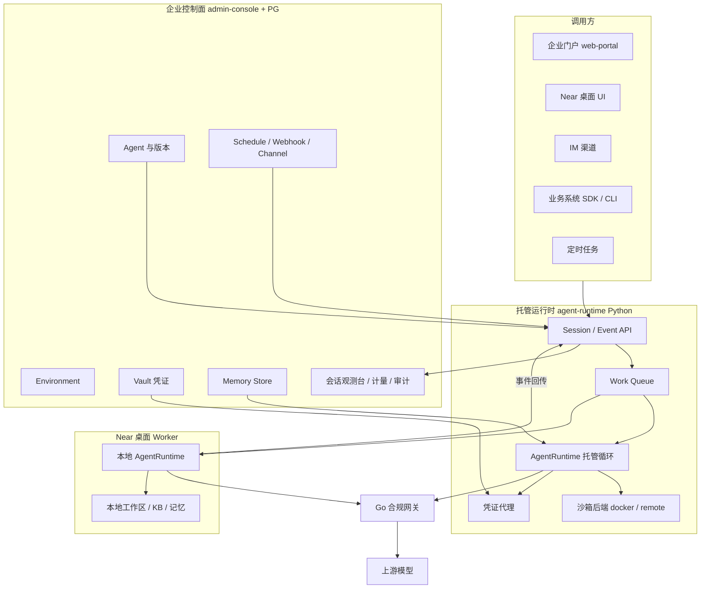
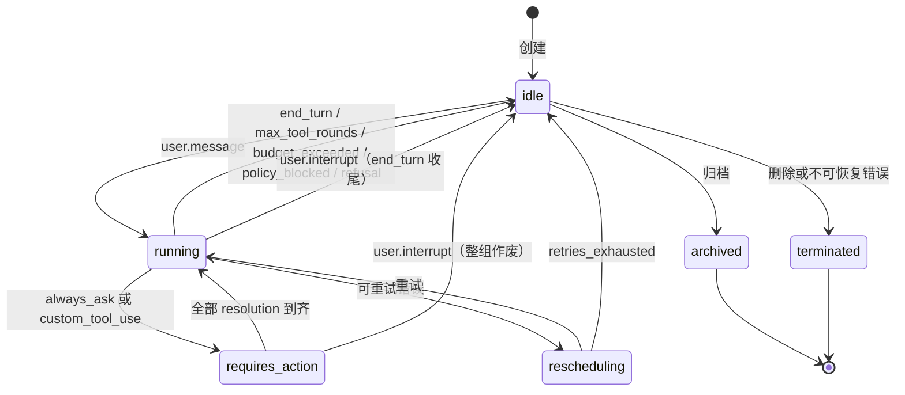
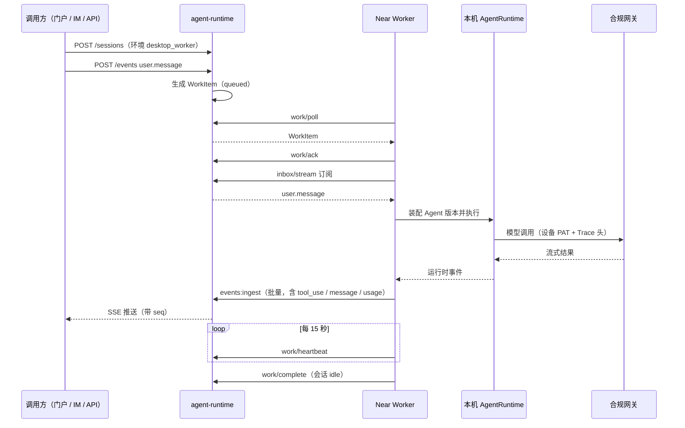
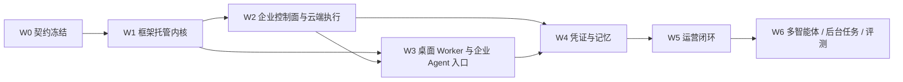

# Managed Agents（MA）总规划：框架 · 企业控制面 · Near 桌面

Planned-with: Claude Opus 5.5
Suggested-Impl-Model: 本文件是 Master Plan，不直接实施。所有子规划的目标实施模型为 Grok 4.7（见第 9 节表格）。

**文档类型：** Master Plan。只定北极星、资源模型、冻结契约、分层职责、波次、验收门和子规划清单。
**不是：** 实施清单。每个子规划开工前，必须按第 10 节模板单独成文，落盘 `.cursor/plans/pending/`，达到「Grok 4.7 不看本次对话也能无歧义落地」的门槛后，再移到 `.cursor/plans/` 根目录开分支实施。

**Supersedes：** `.cursor/plans/pending/2026-10-13-agentcore-gap-roadmap.plan.md`。该路线图的五个阶段已全部吸收进本文件（映射见第 11 节），后续不再按它拆子规划。

**依据：**
- 调研快照 `research/managed-agents/`：智谱（`zhipu/`）、阿里云百炼（`bailian/`）、火山方舟（`volcengine/`）、WorkBuddy（`workbuddy/`），抓取于 2026-10-23/24。
- 现状：`conclusions/`（框架）、`enterprise/conclusions/`（企业）、`desktop/conclusions/`（桌面），基线为 2026-10-25 各自 checkpoint。
- 现有代码锚点在第 3 节逐条列出，均已于 2026-10-25 在仓库中核对存在。

---

## 0. 本文件怎么用

| 角色 | 用法 |
|------|------|
| 产品 / 架构 | 读第 1、2、4 节，对齐「做什么、不做什么、和四家的差异」 |
| 规划模型 | 读第 5、6 节的冻结契约，再按第 9 节清单与第 10 节模板写子规划 |
| 实施模型 | 不拿本文件改代码，只执行已拆出并移到 `.cursor/plans/` 根目录的子规划 |

**衍生规则（强制）：**
1. 一个子规划只跨一个技术栈，最多两个（例如「Python 运行时 + 其 PG 迁移」）。跨三栈的需求必须拆开。
2. 子规划不得修改第 5、6 节的冻结契约。确需修改时，先改本文件并在第 12 节变更记录里写明原因，再改子规划。
3. 子规划标题、正文、文件名、commit 文案不得出现客户名或客户路径。commit / PR 文案不得出现第三方厂商名或「对标 X」措辞（内部调研文档与本 plan 可保留厂商名）。
4. 触碰 `agenticx/studio/server.py` 的子规划必须写明「只精确增删目标行」，并把 `agx serve` 冷启动 smoke 列为 AC。
5. 任何「顺手改一下」都视为越界，回到本文件确认。

---

## 1. 北极星与非目标

### 1.1 一句话

> 同一个 Agent 定义，在企业控制面一次构建、按版本发布；它可以跑在企业自托管的云端运行时里，也可以跑在员工的 Near 桌面上；无论跑在哪，会话、事件、审批、凭证、记忆、计量和审计都走同一套协议，回到同一个控制面。

### 1.2 四家调研给出的共识（我们必须对齐的部分）

四家的资源模型几乎一致，可以视为行业事实标准：

| 资源 | 含义 | 四家共识 |
|------|------|---------|
| Agent | 模型 + 系统提示 + 工具 + MCP + Skills 的可复用定义 | 每次更新产生不可变版本；Session 创建时锁定版本 |
| Environment | 会话在哪里执行、沙箱长什么样 | 云沙箱为主；火山另有 self_hosted（企业 Worker 轮询执行） |
| Session | 一次运行实例 | 服务端持久化，可中断、可续接、可归档 |
| Event | 应用与 Agent 之间的唯一通道 | 只追加；SSE 推送 + 历史分页；`session.status_idle` 带 `stop_reason` |
| Vault / Credential | 凭证集合 | 只写不读；运行时在出站边界注入；Agent 与沙箱拿不到明文 |
| Memory Store | 跨会话长期记忆 | 以文件挂载进沙箱；每次写入产生版本，可审计 |
| Schedule / Deployment | 定时触发 | 每次触发创建独立 Session，留痕 |
| Webhook / Channel | 结果外推、IM 接入 | 渠道可「跟随最新版本」或「固定版本」 |
| Eval | 评测与自迭代 | 固定版本 + 评测集 + 评分标准，比较前后版本 |

共同的交互语义：
- 工具权限只有两档：`always_allow` / `always_ask`；彻底移除用 `enabled: false`。无人值守场景不能依赖 `always_ask`。
- 自定义工具由调用方执行：平台发 `agent.custom_tool_use`，会话停在 `requires_action`，调用方回 `user.custom_tool_result`。
- `requires_action` 期间普通 `user.message` 被拒，只接受 resolution 事件或 `user.interrupt`。
- 中断不算错误；以 `session.status_idle(end_turn)` 收尾。

### 1.3 我们的差异化（四家做不到或不做的部分，必须保住）

| 差异点 | 现状依据 | 规划要求 |
|-------|---------|---------|
| **全栈私有化** | 企业端整套可自托管（`enterprise/deploy/`）；桌面本地运行 | 控制面、运行时、沙箱都能在客户机房跑，不依赖任何公有云 |
| **桌面作为全回路 Worker** | `agenticx/runtime/enterprise_worker.py` 已能领取任务并在本地分身会话里跑完整 `AgentRuntime` | 火山的 self_hosted 只把 bash/文件工具下放，推理仍在云端；我们让推理、工具、数据都留在员工机器上，只把事件回传。这是「数据不出域」的最强形态 |
| **每次模型调用都过合规网关** | Go 网关三通道策略评估、Blake2b 审计链（`enterprise/apps/gateway`） | 托管运行时的所有模型调用必须走网关，不允许绕过 |
| **可回放的事件流** | `agenticx/studio/session_event_hub.py` 已有单调 `seq` 与环形缓冲回放 | 四家的 SSE 都是 live-only，断线要靠时间戳 `gte` 补拉再去重。我们以持久化 `seq` + `Last-Event-ID` 直接续流 |
| **人在回路的桌面体验** | Near 的审批收件箱、打断续问、多窗格、子智能体透明 | 托管会话在 Near 里渲染时复用这套体验 |
| **知识库与长期记忆已在本地成熟** | Stage-1 KB、`WorkspaceMemoryStore`、FTS 跨会话检索 | 企业侧做「连接与挂载」，不另起向量库 |

### 1.4 非目标（明确不做）

- 不自研或托管基座模型；模型统一经企业网关路由。
- 不在 Go 网关里实现 Agent Loop（企业 README 已划定边界）。
- 不复刻云厂商的 CU 计费、多地域、PrivateLink、百万级并发、毫秒级休眠唤醒、CoW Fork 等基础设施指标。隔离第一档是「每 Session 一个工作目录 + 可选每 Session 一个容器」。
- 不把 Near 的个人会话（未绑定企业 Agent 的分身/Meta 会话）迁到云端或改用新协议。个人模式行为保持不变。
- 不做「记住本次审批」之外的新审批形态；托管模式下不提供会话级 sticky allow（与企业策略 `disable_session_allow` 一致）。
- 第一版不做客户自带密钥的事件落库加密、A2A 对外暴露、跨企业 Agent 授权引用。这些列入第 8 节「后续候选」。
- 第一版 Desktop Worker 只纳管 AgenticX 自己的运行时。Claude Code / CodeBuddy 等外部运行时（`cc_bridge` / `wb_bridge`）不进 Worker 协议。

---

## 2. 目标形态

### 2.1 总体架构



### 2.2 三块的职责边界

| 层 | 拥有 | 不拥有 |
|----|------|-------|
| **框架 `agenticx/`** | MA 协议模型（Python 侧单一事实来源）、Agent 定义装配、事件存储抽象与状态机、工具权限引擎、凭证提供者抽象、记忆挂载、托管宿主 `agx ma serve`、Worker SDK | 租户、组织、计费、UI |
| **企业 `enterprise/`** | 控制面资源（Agent / 版本 / Environment / Vault / Memory Store / Schedule / Channel）的唯一写入方；`apps/agent-runtime` 托管运行时（Session / Event / Work 的唯一写入方）；观测台、计量、配额、审计；TS 侧协议类型与 SDK | Agent Loop 的实现本体（复用框架） |
| **桌面 `desktop/`** | 企业 Agent 的入口与渲染、Worker 状态面板、本地分身发布为企业 Agent 草稿、托管会话在 ChatPane 中的呈现 | 运行时与凭证的权威存储（属本机 Python 后端或企业控制面） |

### 2.3 单一写入方原则

每张表只有一个写入进程，其他方经接口读：

| 数据 | 唯一写入方 | 其他方读取方式 |
|------|-----------|--------------|
| `enterprise_agents`、`enterprise_agent_versions`、`ma_environments`、`ma_vaults`、`ma_credentials`、`ma_memory_stores`、`ma_schedules`、`ma_channels` | admin-console（TS，经 `packages/iam-core` repos） | agent-runtime 调 admin-console 的 `/api/internal/ma/*` 快照与解析接口（Bearer `MA_INTERNAL_TOKEN`），沿用网关拉 `/api/internal/*` 的模式 |
| `ma_sessions`、`ma_session_events`、`ma_work_items`、`ma_session_usage` | agent-runtime（Python） | admin-console 观测台只读查询 PG；门户经 agent-runtime 公共 API |
| `ma_memories`、`ma_memory_versions` | agent-runtime（会话内写入）与 admin-console（管理员编辑）**例外双写**，必须走乐观锁（`version` 列 CAS），子规划须写冲突用例 | — |

PG / MySQL 迁移仍以 `enterprise/packages/db-schema` 为唯一来源（双方言 + `schema-parity` 测试）。Python 侧用 SQLAlchemy Core 手写表映射，并新增一个 parity 测试比对列名与类型。

---

## 3. 现状盘点（2026-10-25 核对）

### 3.1 已经有、可以直接复用的

| 能力 | 落点 | MA 中的角色 |
|------|------|-----------|
| 企业 Agent 注册表 | `enterprise/packages/db-schema/src/schema/agents.ts`（`enterprise_agents`：`runtime` = `cloud` / `desktop_worker`，`lifecycle` = draft/published/recalled，`assignment_keys` / `worker_keys`）；`packages/iam-core` 的 `repos/agents.ts`；admin-console `/admin/agents` 与 `/api/admin/agents` | Agent 资源的雏形，缺版本与工具权限 |
| 桌面 Worker 任务队列 | `enterprise_agent_workers`（心跳，uq agent+user+device）、`enterprise_agent_tasks`（租约 `lease_expires_at`）；门户 `/api/desktop/worker/{heartbeat,tasks}` | Work Queue 雏形，只服务协作房间 |
| 桌面 Worker 执行端 | `agenticx/runtime/enterprise_worker.py`（692 行，`HEARTBEAT_INTERVAL_S=15`、`CLAIM_INTERVAL_S=3`，领取后经本机 Studio `/api/chat` SSE 在本地分身会话执行）；`agenticx/studio/enterprise_worker_routes.py` | Worker SDK 的前身 |
| 本地分身登记到企业 | `agenticx/runtime/enterprise_agent_sync.py`（`POST {base}/api/desktop/agents/register`、`fetch_published_agents`） | 「桌面构建 → 企业草稿」的通道 |
| 企业下发工具策略 | `agenticx/runtime/enterprise_agent_policy.py`（deny / always_ask / `disable_session_allow`）；`desktop/electron/enterprise-agent-policy.ts` | 工具权限引擎的企业层输入 |
| 本地凭证库与引用 | `agenticx/runtime/credential_store.py`（`~/.agenticx/credentials.yaml` + `${cred:NAME}`、`redact_text`）；`agenticx/studio/credentials_routes.py`（响应不含 secret） | 凭证提供者抽象的「本地」实现 |
| 会话私有目录与出站 allowlist | `agenticx/runtime/session_boundary.py`（`ensure_session_workdir`、`foreign_session_denial`、`egress_denial`） | Environment 网络策略与隔离第一档 |
| 可回放事件流 | `agenticx/studio/session_event_hub.py`（单调 `seq`、`buffer_maxlen=400`）；`GET /api/sessions/<sid>/stream` | 事件存储抽象的内存层 |
| 挂起审批 | `agenticx/runtime/parked_approvals.py`、`ParkedApprovalConfirmGate`、`GET /api/approvals/pending`、`POST /api/confirm` | `requires_action` 的执行基础 |
| 耐久任务 | `agenticx/runtime/durable_jobs/`（SQLite CAS 租约、`waiting_input` / `waiting_external`） | 后台工具任务 |
| 中断与恢复 | `interrupted_closers.py`、`effect_guard`、`checkpoint.py`、`continuation.py` | 会话续跑、断点恢复 |
| 沙箱三档 | `agenticx/sandbox/`（subprocess / microsandbox / docker / remote，`sandbox.mode`） | 云端 Environment 的执行后端 |
| 多租户会话服务 | `agenticx/sessions/`（`tenant_id` 过滤）；`agenticx/server/`（`AgentServer`、JWT、`tenant.py`） | 托管宿主的骨架参考 |
| 合规网关 | `enterprise/apps/gateway`（策略三通道、审计链、PAT `desktop:managed` scope） | 所有托管模型调用的必经之路 |
| 动作审计、Agent Trace | 桌面 `action-audit-uploader.ts`；admin `/api/agent-traces/ingest` | 观测台的补充数据源 |
| 定时任务 | 桌面 `AutomationScheduler`、`automation_tasks.json` | 桌面侧 Schedule 的参考实现 |

### 3.2 需要收敛的分叉

| 分叉 | 现状 | 收敛方向 |
|------|------|---------|
| 两套 Agent Loop | 门户 `apps/web-portal/src/lib/collab-room/agent-executor.ts` 的 `runCloudAgentLoop` 用 TS 自写循环（`MAX_TOOL_ROUNDS = 6`，只能调网关 MCP，无沙箱、无版本、无权限策略） | 由 agent-runtime 取代。门户在 `agent-reply.ts` 加开关切换，TS loop 保留为回退，稳定一个波次后删除（删除另起子规划） |
| 空包 | `enterprise/features/agents` 仍是一行常量 stub，真实 Agent 管理在 admin-console 与 iam-core | 本规划不复活该包；新增能力放在 admin-console 与 iam-core，避免第三处落点 |
| 空壳 edge-agent | `enterprise/apps/edge-agent` 未被桌面接线 | 不在 MA 中使用。桌面 Worker 走框架 Worker SDK |
| Worker 只服务协作房间 | `enterprise_agent_tasks.trigger_message_id` 非空约束 | 新建通用 `ma_work_items`，旧表在迁移完成后只读 |

### 3.3 缺口总表（对照四家）

| 能力 | 四家 | 框架 | 企业 | 桌面 | 子规划 |
|------|-----|------|------|------|-------|
| Agent 版本化与锁定 | 有 | 无 | 无版本表 | 无 | MA-E01、MA-E02 |
| 统一事件协议与历史 API | 有 | 内存 hub，无持久历史 API | 无 | 自有 SSE | MA-00、MA-A02 |
| 托管运行时（服务端驱动循环） | 有 | 只有单用户 Studio | TS 小循环 | — | MA-A04、MA-E03 |
| 工具级权限策略 | 有 | 全局确认门 + 企业 deny/ask | 全局桌面策略 | 审批收件箱 | MA-A03 |
| 自定义工具（调用方执行） | 有 | 无 | 无 | 无 | MA-A04 |
| Environment 资源 | 有 | 沙箱三档 | 无 | — | MA-E01、MA-E03 |
| 自托管 Worker 协议 | 火山有 | 私有协议 | 协作房间专用 | 已承接 | MA-A05、MA-D01 |
| Vault（只写不读、出站注入） | 有 | 本地 `credentials.yaml` | PAT 金库，无 Agent 凭证 | 凭证引用页 | MA-E06、MA-A06 |
| Memory Store（挂载 + 版本） | 有 | 本地 workspace 记忆 | 无 | 记忆设置 | MA-E07、MA-A07 |
| 定时任务 / Webhook | 有 | — | 无 | 桌面本地定时 | MA-E08 |
| IM 渠道 + 版本路由 | 有 | 网关适配器 | 无 | 飞书 / 微信 | MA-E09 |
| 按 Agent / Session 计量配额 | 有 | token SSE | 租户级 | Context chip | MA-E10 |
| SDK / CLI | 有 | `agx` | sdk-ts 只有 Chat | — | MA-E11 |
| Multi-agent 线程 | 有 | 委派 / spawn | 无 | 子智能体透明 | MA-A08 |
| 后台工具任务 | 火山有 | durable_jobs | 无 | — | MA-A09 |
| 评测与自迭代 | 智谱、百炼有 | evaluation 框架 | 无 | — | MA-E12 |
| 记忆整理（Dream） | 火山有 | learning 子系统 | 无 | — | MA-A10 |
| 自然语言构建 Agent | 智谱有 | skill_manage | 无 | — | MA-D05 |

---

## 4. 关键设计决策（已定，子规划不得改）

1. **托管运行时是 Python，复用框架。** 新建 `enterprise/apps/agent-runtime`（FastAPI，默认端口 8092，同 `apps/context-service` 的 Python 服务先例），依赖本仓 `agenticx` 包的 `agenticx/managed/`。不在 TS 或 Go 里再写循环。
2. **两种执行位置，一套协议。** Environment `type` 只有 `cloud` 与 `desktop_worker` 两种（与 `enterprise_agents.runtime` 现有取值一致）。
   - `cloud`：agent-runtime 自己跑循环，工具在其沙箱后端执行。
   - `desktop_worker`：**全回路自托管**。Worker 领取 Work Item 后在本机跑完整 `AgentRuntime`，把事件批量回传；agent-runtime 只做会话状态、事件持久化、排队用户消息与分发。这与火山 self_hosted 只下放 bash/文件工具不同，是刻意的选择。
3. **模型调用一律经企业网关。** agent-runtime 用服务 PAT，桌面 Worker 用设备 PAT（`desktop:managed`），请求头携带 `X-AgenticX-Trace-Id`、tenant / user / session / agent 四主体，保证策略、审计、配额生效。
4. **公共 API 一个前缀，两个后端。** 对外统一 `/ma/v1/*`，由 nginx 按前缀分发：控制面资源（agents / environments / vaults / memory_stores / schedules / channels）→ admin-console 的 `/api/ma/v1/*`；会话面（sessions / events / work）→ agent-runtime。两边用同一种调用凭证：iam-core PAT，新增 scope 前缀 `ma:`（`ma:agents:write`、`ma:sessions:write`、`ma:worker` 等，完整清单在 MA-00 冻结）。agent-runtime 校验 PAT 走 admin-console 内省接口，本地缓存 30 秒，吊销快照沿用 `pat-revocation-snapshot`。
5. **ID 一律 26 位 ULID**，与 enterprise 现有表一致，不加类型前缀。事件 id 也是 ULID；排序与续流用每会话单调整数 `seq`。
6. **事件续流以 `seq` 为准。** SSE 每帧 `id: <seq>`；客户端带 `Last-Event-ID` 或 `?after_seq=` 重连即续流，服务端先回放持久化事件再接实时。增量预览帧（`event_start` / `event_delta`）不落库、不占 `seq`。
7. **版本锁定。** 每次更新 Agent 产生新的不可变 `version`（从 1 递增）。Session 创建时锁定版本；渠道与桌面分发可选「跟随最新」或「固定版本」。回滚即发布一个与旧版本等价的新版本，或把路由改回固定版本。
8. **Manifest 严格校验、整体拒绝。** 任何字段非法则整份拒绝，错误格式 `manifest.<path>: <message>`。未知顶层键**拒绝**（不静默丢弃），便于排错。Manifest 内不得出现任何密钥；MCP 条目不得携带 `headers` / `env` 明文，凭证只经 Vault 匹配注入。
9. **个人模式不变。** Near 未登录企业、或使用个人分身时，所有现有路径（`/api/chat`、`messages.json`、确认门、本地凭证）保持原样，MA 代码只在显式开关或企业 Agent 会话中生效。

---

## 5. 冻结契约 A：资源模型与 Manifest

以下字段由 MA-00 落成 Python（`agenticx/managed/protocol.py`，pydantic v2）与 TS（`enterprise/packages/core-api/src/managed-agents.ts`）两份，并用共享 JSON fixture（`tests/fixtures/managed_agents/*.json`）做双端 parity 测试。

### 5.1 Agent Manifest `agx.agent/v1`

```json
{
  "schema": "agx.agent/v1",
  "model": "<providerId>/<modelName>",
  "system": "string，<= 64 KiB",
  "tools": [
    {
      "type": "agx_builtin",
      "default_policy": "always_allow",
      "configs": [{ "name": "bash_exec", "policy": "always_ask", "enabled": true }]
    },
    {
      "type": "mcp",
      "server": "github",
      "default_policy": "always_ask",
      "configs": [{ "name": "get_issue", "policy": "always_allow" }]
    },
    {
      "type": "custom",
      "name": "lookup_order",
      "description": "string",
      "input_schema": { "type": "object" }
    }
  ],
  "mcp_servers": [
    { "name": "github", "url": "https://mcp.example.com/", "transport": "http" }
  ],
  "skills": [{ "source": "tenant", "id": "<ulid>", "version": "1.2.0" }],
  "multiagent": null,
  "runtime": { "max_tool_rounds": 40, "max_session_tokens": null },
  "metadata": { "welcome_message": "string", "suggested_questions": ["string"] }
}
```

约束：
- 序列化后 ≤ 256 KiB；顶层必须是 object；`schema` 必须为 `agx.agent/v1`。
- `tools[].type` ∈ `agx_builtin` / `mcp` / `custom`。`policy` ∈ `always_allow` / `always_ask`。`enabled: false` 表示从会话工具表中移除。
- 继承：`configs[].policy` 缺省继承 `default_policy`；`default_policy` 缺省为 `always_allow`。
- `mcp_servers[].transport` ∈ `http` / `sse`；`streamable-http`、`streamable_http` 在保存时归一为 `http`。出现 `headers` / `env` 即拒绝。
- `skills[].source` ∈ `builtin` / `tenant`；`version` 缺省为保存时的最新版本并**固化写入**（保存后 manifest 中一定有具体版本号）。
- `multiagent` 为 `null`，或 `{type:"coordinator", agents:[…]}`。`agents` 为 1–20 项：`{type:"self"}`（至多一个）、`{type:"agent", id, version?}`（id 不重复；省略 `version` 时由企业保存路径固化为该 Agent 当时最新版本；成员不得自身为协调者；不得引用自身，自身用 `self`）、`{type:"advisor", model, instructions?}`（至多一个，instructions ≤ 8 KiB）。至少有一个 `self` 或 `agent`。校验规则与错误串见 MA-A08。JSON 示例里的 `"multiagent": null` 也可以换成上述对象。v1 带 `multiagent` 的会话拒绝 `vault_ids` 与记忆挂载，成员线程拒绝需审批工具和自定义工具。
- `metadata` 的 `model` / `description` / `agentName` 键由系统管理，提交时剥离。

### 5.2 资源字段（最小集）

| 资源 | 关键字段 |
|------|---------|
| Agent | `id`、`tenant_id`、`slug`、`display_name`、`description`、`latest_version`、`status`（active/disabled）、`lifecycle`（draft/published/recalled）、`origin`（enterprise/employee）、`assignment_keys`、`worker_keys`、`default_environment_id` |
| AgentVersion | `agent_id`、`version`（int）、`manifest`（jsonb）、`manifest_hash`（sha256）、`created_by`、`created_at`、`note`；`(agent_id, version)` 唯一，行不可更新 |
| Environment | `id`、`tenant_id`、`name`、`type`（cloud/desktop_worker）、`config`（cloud：`sandbox_backend`、`image`、`egress_allow_domains`、`idle_ttl_seconds`；desktop_worker：`worker_keys`）、`status` |
| Session | `id`、`tenant_id`、`agent_id`、`agent_version`、`environment_id`、`created_by_user_id`、`source`（portal/desktop/api/schedule/channel/eval）、`status`、`stop_reason`、`title`、`vault_ids`、`resources`、`usage`、`archived_at` |
| Event | `id`、`session_id`、`seq`、`thread_id`（主线程为 null）、`type`、`payload`、`created_at`、`processed_at` |
| WorkItem | `id`、`session_id`、`environment_id`、`status`（queued/claimed/running/completed/failed/stopped）、`claimed_by_device`、`lease_expires_at`、`attempts`、`last_heartbeat_at` |

---

## 6. 冻结契约 B：事件协议与会话状态机

### 6.1 事件类型

客户端 → 运行时：

| 类型 | 关键字段 | 说明 |
|------|---------|------|
| `user.message` | `content[]`（text / image / document） | `requires_action` 期间被拒（409，错误码 `session_requires_action`） |
| `user.interrupt` | `thread_id?` | 停止当前模型响应与运行中命令（宽限 3 秒后强杀） |
| `user.tool_confirmation` | `tool_use_id`、`result`（allow/deny）、`deny_message?` | 对应 `always_ask` |
| `user.custom_tool_result` | `custom_tool_use_id`、`content[]?`、`is_error?` | 对应自定义工具 |

运行时 → 客户端（全部落库，占 `seq`）：

| 类型 | 说明 |
|------|------|
| `agent.message` | 最终文本回复（内容块数组） |
| `agent.thinking` | 推理文本；Near 渲染为 ReasoningBlock |
| `agent.tool_use` / `agent.tool_result` | 内置工具；`tool_use` 带 `evaluated_policy` |
| `agent.mcp_tool_use` / `agent.mcp_tool_result` | 额外带 `mcp_server` |
| `agent.custom_tool_use` | 请调用方执行 |
| `session.status_running` / `session.status_idle` / `session.status_terminated` | 状态权威来源 |
| `session.error` | `error{type, message, retry_status: retrying/exhausted/terminal}` |
| `session.usage` | 累计 `input_tokens` / `output_tokens` / `cache_read_input_tokens` / `tool_calls` / `runtime_ms` |
| `span.model_request_start` / `span.model_request_end` | 单次模型请求区间，end 带 `model_usage` 与 `is_error` |
| `session.thread_*`、`agent.thread_message_sent/received` | 由 MA-A08 启用 |
| `session.task_*` | 由 MA-A09 启用 |

`session.status_idle.stop_reason.type` 枚举：`end_turn` / `requires_action`（带 `event_ids[]`）/ `retries_exhausted` / `refusal` / `max_tool_rounds` / `budget_exceeded` / `policy_blocked`。后三项是我们相对四家新增的，用于把现有的轮次上限、token 预算和网关拦截映射成明确的停止原因，而不是混在错误里。

### 6.2 会话状态机



`requires_action` 在数据上是 `status=idle` 且 `stop_reason.type=requires_action`，图中单独画出只为表达约束。

### 6.3 接口（会话面，agent-runtime）

| 方法 | 路径 | 说明 |
|------|------|------|
| POST | `/ma/v1/sessions` | `{agent_id, agent_version?, environment_id?, vault_ids?, resources?, title?}`，缺省锁定最新版本与 Agent 默认环境 |
| GET | `/ma/v1/sessions/:id` | 含 `status`、`stop_reason`、`usage` |
| POST | `/ma/v1/sessions/:id/events` | 1–10 条一批，整批原子校验，任一非法则零写入 |
| GET | `/ma/v1/sessions/:id/events` | `after_seq`、`limit`（默认 100，最大 500）、`types` |
| GET | `/ma/v1/sessions/:id/events/stream` | SSE；`Last-Event-ID` 或 `after_seq` 续流；15 秒 `: ping`；`event_deltas[]=agent.message` 订阅预览帧 |
| POST | `/ma/v1/sessions/:id/archive` | 归档 |
| POST | `/ma/v1/environments/:id/work/poll` | Worker 长轮询（最长 25 秒） |
| POST | `/ma/v1/work/:id/ack` / `heartbeat` / `complete` / `fail` | 租约 TTL 120 秒，心跳间隔 15 秒；心跳中断 TTL + 60 秒宽限后置 `stopped`，不自动转派 |
| POST | `/ma/v1/sessions/:id/events:ingest` | 仅 `ma:worker` scope；Worker 批量回传本地产生的事件，服务端分配 `seq` |
| GET | `/ma/v1/sessions/:id/inbox/stream` | 仅 `ma:worker`；Worker 订阅待处理的用户事件 |

### 6.4 桌面 Worker 一次任务的时序



---

## 7. 波次与验收门

一个波次的全部子规划合入后，按「演示脚本」验收；未过门不开下一波次的高风险子规划（标「可并行」的除外）。



### W0 契约冻结

- 子规划：MA-00。
- 门：Python 与 TS 两份协议类型对同一组 fixture 校验结果一致；威胁模型文档评审通过（凭证、跨会话、跨租户、出站、提示注入经工具结果回流五类）。

### W1 框架托管内核（个人开发者可在本机用）

- 子规划：MA-A01、MA-A02、MA-A03、MA-A04、MA-A05。
- 门（演示脚本）：在本机执行 `agx ma serve --port 8092 --dev`，用 curl 依次创建一个带 `bash_exec: always_ask` 与一个自定义工具的 Agent 定义（开发模式下从本地 YAML 加载）、创建会话、订阅 SSE、发送消息；看到 `requires_action` 后回 `allow`，再看到 `agent.custom_tool_use` 后回结果，会话以 `end_turn` 结束。断开 SSE 后用 `Last-Event-ID` 重连，不丢、不重。整个过程 Near 个人模式与 `agx serve` 行为无变化（跑现有 Studio 测试集）。

### W2 企业控制面与云端执行

- 子规划：MA-E01、MA-E02、MA-E03、MA-E04、MA-E05。
- 门：管理员在 admin-console 创建 Agent 并发布 v1、v2；门户协作房间 @ 该 Agent，开关开启时由 agent-runtime 在云端环境执行，`bash_exec` 经命令沙箱只能写本会话工作目录（见第 12 节），模型调用在网关审计里可查到 session_id 与 agent_id；把路由固定回 v1 后新会话使用 v1；管理台日志中心「托管会话」tab 能按 Agent 打开该会话并按 seq 回放全部事件。开关关闭时回到 TS loop，行为与现在一致。

### W3 桌面 Worker 与企业 Agent 入口

- 子规划：MA-D01、MA-D02、MA-D03、MA-D04（MA-D04 可与 W2 并行）。
- 门：员工 Near 登录企业账号并开启 Worker，在 Worker 面板看到所属环境；门户里对一个 `desktop_worker` 环境的 Agent 发起任务，任务在员工本机工作区执行，门户实时看到流式事件；员工在 Near 侧栏能看到被分发的企业 Agent（带企业标记与版本号），直接对话；`always_ask` 工具在 Near 审批收件箱里出现并可批准。未登录企业时 Near 行为与现在一致。

### W4 凭证与记忆

- 子规划：MA-E06、MA-A06、MA-E07、MA-A07。
- 门：管理员在 Vault 里登记一个 MCP Bearer 和一个 `environment_variable` 凭证（限定 `allowed_hosts`）；会话引用该 Vault 后 MCP 调用成功、沙箱内 `env` 只看到占位值、事件历史与日志全文检索不到密钥；向非 allowlist 主机发请求失败并留下 `session.error`。Memory Store 以 read_write 挂载后，Agent 写入的笔记在下一个会话可读，管理员能看到每次变更的版本与来源会话；换一个用户的会话（未挂载）读不到。

### W5 运营闭环

- 子规划：MA-E08、MA-E09、MA-E10、MA-E11。
- 门：一个定时任务每次触发生成独立会话，结果经 Webhook（HMAC 签名）推到测试接收端；飞书渠道绑定 Agent 选「跟随最新」，发布新版本后渠道立即生效，选「固定版本」则不变；把某用户在某 Agent 上的月度 token 配额调小后，下一次会话以 `budget_exceeded` 停止，门户提示与合规拦截可区分；`agx ma apply -f agent.yaml` 能创建或更新 Agent 并打印新版本号。

### W6 多智能体 / 后台任务 / 评测 / 记忆整理 / 自然语言构建

- 子规划：MA-A08、MA-A09、MA-E12、MA-A10、MA-D05。各自独立，可并行。
- 门：按各子规划 AC。

---

## 8. 后续候选（不在本轮）

- 事件落库加密（客户密钥），控制与遥测事件保持明文。
- A2A 对外暴露 Agent Card；跨企业授权引用 Skill / Agent。
- 每 Session 一个 Pod 的 K8s 执行模式（基于 `sandbox` remote 后端），以及空闲休眠计费。
- 外部编程运行时（Claude Code / CodeBuddy）作为 Worker 执行器。
- 线上 A/B 流量按版本分配（当前只支持跟随最新与固定版本两档路由）。
- 出站凭证代理（TLS 终结），让 bash 子进程里的 `environment_variable` 凭证真正可用。
- Vault 与 Memory Store 按用户 / 部门限定可见范围（v1 为租户内共享）。
- 创建凭证时的 MCP 握手探测与 `mcp_oauth_validate`（会让管理台向管理员填写的地址发起出站请求，需先做 SSRF 防护）。
- 飞书 HTTP 回调模式（v1 只做长连接）；钉钉、企业微信等其它渠道。
- A08b：多智能体会话共享 Vault 与记忆挂载、成员线程的审批升级到主线程。
- E12 扩展：XLSX 导入、AI 生成评测集、自定义工具模拟、评测公共 API。
- 评测会话（`source=eval`）强制把所有记忆挂载降级为只读的开关（v1 由评测方显式传 `read_only`）。

---

## 9. 子规划清单与推荐实施模型

所有子规划目标实施模型均为 **Grok 4.7**。「风险」一列标高的，子规划须额外写清威胁模型或回滚步骤，合入前建议用强推理档做一次只读审查（审查模型由用户指定，不写入 trailer）。

命名：`.cursor/plans/pending/YYYY-MM-DD-ma-<编号小写>-<slug>.plan.md`，例如 `2026-10-26-ma-a01-agent-spec-builder.plan.md`。

| 编号 | 波次 | 栈 | 名称 | 主要落点 | 依赖 | 风险 |
|------|-----|----|------|---------|------|------|
| MA-00 | W0 | Python + TS 类型 | 协议与 Manifest 冻结、威胁模型 | 新建 `agenticx/managed/protocol.py`、`agenticx/managed/manifest.py`；`enterprise/packages/core-api/src/managed-agents.ts`；`tests/fixtures/managed_agents/`；`docs/managed-agents/protocol.md`、`docs/managed-agents/threat-model.md` | — | 中 |
| MA-A01 | W1 | Python | Agent 定义装配（headless） | 新建 `agenticx/managed/spec.py`、`agenticx/managed/builder.py`：Manifest → 工具表、MCP 配置、系统提示、`AgentRuntime` 实例；不得 import `agenticx.studio` | MA-00 | 中 |
| MA-A02 | W1 | Python | 事件存储与会话状态机 | 新建 `agenticx/managed/events/`（`store.py` 抽象、`sqlite_store.py`、`state_machine.py`、`adapter.py` 把现有 `RuntimeEvent` 映射为 MA 事件）；参考 `agenticx/studio/session_event_hub.py` 的 seq 语义，不修改该文件 | MA-00 | 中 |
| MA-A03 | W1 | Python | 工具权限引擎 | 新建 `agenticx/managed/permissions.py`：合并 Manifest 策略与 `enterprise_agent_policy`（deny > ask > allow），对接 `ParkedApprovalConfirmGate` 产出 `requires_action`；托管模式禁用 sticky allow | MA-A01、MA-A02 | 高 |
| MA-A04 | W1 | Python | 托管宿主 `agx ma serve` | 新建 `agenticx/managed/host/`（FastAPI app 工厂、会话面路由、SSE 续流、自定义工具回路、中断）；CLI 子命令注册在 `agenticx/cli/` 中新增 `ma` 命令组；开发模式从本地 YAML 加载 Agent；不改 `agenticx/studio/server.py` | MA-A01–A03 | 高 |
| MA-A05 | W1 | Python | Worker SDK 与 Worker 迁移 | 新建 `agenticx/managed/worker/`（poll / ack / heartbeat / inbox / ingest 客户端）；`agenticx/runtime/enterprise_worker.py` 增加新协议分支，开关 `enterprise.worker.protocol: legacy|ma`，默认 `legacy` | MA-A02、MA-A04 | 高 |
| MA-E01 | W2 | TS（db-schema / iam-core） | 控制面与会话面表结构 | `enterprise/packages/db-schema/src/schema/` 新增 `agent-versions.ts`、`ma-environments.ts`、`ma-sessions.ts`（sessions / events / work_items / usage）及 MySQL 对应文件；迁移把现有 `enterprise_agents` 回填为 version 1；`iam-core` 新增 versions / environments repos | MA-00 | 中 |
| MA-E02 | W2 | TS（admin-console） | Agent 版本化管理与内部快照 | `/admin/agents` 增加 Manifest 编辑（模型 / 提示 / 工具与权限 / MCP / Skills）、版本列表与差异、发布 / 回收 / 路由；新增 `/api/ma/v1/agents*` 公共接口与 `/api/internal/ma/*` 快照接口；PAT `ma:` scopes | MA-E01 | 中 |
| MA-E03 | W2 | Python（新 app） | `apps/agent-runtime` 托管运行时 | 新建 `enterprise/apps/agent-runtime/`：复用 MA-A04 宿主，PG 事件存储实现、PAT 内省、模型经网关、云端环境沙箱（docker / remote）；接入 `enterprise/scripts/start-dev*.sh` 与 docker-compose；nginx `/ma/v1` 分流 | MA-A04、MA-E01、MA-E02 | 高 |
| MA-E04 | W2 | TS（web-portal） | 协作房间切到托管运行时 | `apps/web-portal/src/lib/collab-room/agent-reply.ts` 增加 `MA_RUNTIME_ENABLED` 分支调用 agent-runtime；保留 `runCloudAgentLoop` 回退；补测试 | MA-E03 | 中 |
| MA-E05 | W2 | TS（admin-console） | 会话观测台 | `/ops/logs` 下新增「托管会话」tab：按 Agent / 用户 / 状态 / 来源筛选，详情按 seq 回放、工具调用与耗时、用量；只读 PG | MA-E01、MA-E03 | 低 |
| MA-E04b | W3 | TS（web-portal） | 门户把 desktop_worker Agent 交给托管运行时 | `apps/web-portal/src/lib/collab-room/agent-reply.ts`：`desktop_worker` Agent 在开关开启时也经 agent-runtime 建会话，由桌面 Worker 领取执行；保留旧任务队列回退 | MA-E04、MA-D01 | 中 |
| MA-D01 | W3 | Python + Desktop | Near Worker 2.0 | 开启 MA-A05 的 `ma` 协议；设置页新增「企业 Worker」面板（状态、所属环境、运行中 Work Item、暂停）；每个 Work Item 使用 `ensure_session_workdir` 独立目录 | MA-A05、MA-E03 | 高 |
| MA-D02 | W3 | Desktop + Python | 企业 Agent 入口 | 侧栏展示已分发企业 Agent（企业标记、版本号、只读定义抽屉）；对话时按 Agent 默认环境选择云端会话或本机执行；扩展 `enterprise_agent_sync.fetch_published_agents` 返回版本与环境 | MA-E02、MA-E03 | 中 |
| MA-D03 | W3 | Desktop | 托管会话渲染适配 | 新建 `desktop/src/utils/ma-event-adapter.ts`：MA 事件 → 现有 `Message` / 工具卡 / ReasoningBlock；`requires_action` 进 `ApprovalInbox`；SSE 用 `Last-Event-ID` 续流 | MA-00、MA-D02 | 中 |
| MA-D04 | W3（可与 W2 并行） | Python + Desktop | 本地分身发布为企业草稿 | 分身设置增加「发布到企业」：导出 Manifest（剥离密钥与本地路径），技能打包上传，生成 draft 版本；复用 `POST /api/desktop/agents/register` 并扩展字段 | MA-E01、MA-E02 | 中 |
| MA-E06 | W4 | TS（admin-console / iam-core / auth） | Vault 控制面 | 新表 `ma_vaults`、`ma_credentials`（类型 `static_bearer` / `mcp_oauth` / `bearer` / `environment_variable`，信封加密复用 `packages/auth`）；只写不读接口、轮换、`referenced_by`；`/api/internal/ma/vault-resolve`（仅 agent-runtime，按会话审计） | MA-E01 | 高 |
| MA-A06 | W4 | Python | 凭证代理 | 新建 `agenticx/managed/credentials.py`：`CredentialProvider` 抽象（本地 `credential_store` 实现 + 企业 Vault 实现）；MCP 按 URL 匹配注入；`environment_variable` 在沙箱里给占位值、出站命中 `allowed_hosts` 才替换；事件与日志统一 `redact_text` | MA-E06、MA-E03 | 高 |
| MA-E07 | W4 | TS | Memory Store 控制面 | 新表 `ma_memory_stores`、`ma_memories`、`ma_memory_versions`（CAS `version` 列）；管理页查看 / 编辑 / 版本与来源会话 | MA-E01 | 中 |
| MA-A07 | W4 | Python | 记忆挂载 | 会话 `resources` 挂载 Memory Store 到工作目录 `memory/<store_name>/`（read_only / read_write）；会话内写入回写为新版本；冲突走 CAS 重试 | MA-E07、MA-A06 | 中 |
| MA-E08 | W5 | TS + Python | 定时任务与 Webhook | 新表 `ma_schedules`、`ma_webhooks`；agent-runtime 调度器按 cron 创建会话（`source=schedule`）；Webhook 事件 `session.idle` / `session.failed` / `credential.expiring`，HMAC-SHA256 签名与重试 | MA-E03 | 中 |
| MA-E09 | W5 | TS + Python | IM 渠道与版本路由 | 新表 `ma_channels`（飞书优先），路由策略 `follow_latest` / `pinned`；渠道消息创建或续接会话 | MA-E08 | 中 |
| MA-E10 | W5 | TS + Go（只读接线） | 按 Agent / Session 计量与配额 | `ma_session_usage` 汇入 metering 四维查询，新增 Agent 维度；用户 × Agent 日 / 周 / 月 token 配额，命中产出 `budget_exceeded`；网关只增加读取 Agent 维度配额快照，不改策略引擎 | MA-E03 | 高 |
| MA-E11 | W5 | TS + Python | SDK 与 CLI | `packages/sdk-ts` 新增 `ManagedAgentsClient`；`packages/sdk-py` 落实最小客户端；`agx ma apply/get/sessions/tail` | MA-E02、MA-E03 | 低 |
| MA-A08 | W6 | Python | Multi-agent 线程 | 定义 `multiagent` 结构（coordinator + `self` / `agent` / `advisor`），把现有委派映射为线程与线程事件；回写第 5.1 节 | MA-E03 | 高 |
| MA-A09 | W6 | Python | 后台工具任务 | `durable_jobs` 暴露为会话任务；`task_list` / `task_get` / `task_kill` 工具与 `session.task_*` 事件；超过 60 秒的 bash 自动转后台 | MA-E03 | 中 |
| MA-E12 | W6 | TS + Python | 评测与自迭代 | 评测集（上传 / 从会话导入）、评分标准、在固定版本上批量跑（`source=eval`，记忆只读挂载）、版本对比报告；自迭代只产出候选版本，须人工发布 | MA-E03、MA-E07 | 高 |
| MA-A10 | W6 | Python | 记忆整理任务 | 输入 Memory Store + 1–100 个历史会话 + 指令，后台产出新的 Memory Store（与输入独立），复用 `agenticx/learning/` | MA-A07 | 中 |
| MA-D05 | W6 | Desktop + Skill | 自然语言构建企业 Agent | 内置 skill：在 Near 对话中经 `ma:` API 创建 / 修改 Agent 草稿并展示版本差异；发布仍需管理员确认 | MA-E11 | 低 |

**可并行组：** W1 内 MA-A01 与 MA-A02 可并行；W2 内 MA-E01 可与 W1 并行；MA-D04 可与 W2 并行；W6 全部可并行。

---

## 10. 子规划写作模板（Grok 4.7 可独立实施的门槛）

每个子规划必须包含以下小节，缺任何一项视为不达标：

1. **头部**：标题、`Planned-with: <模型>`、`Suggested-Impl-Model: Grok 4.7`、`Parent: .cursor/plans/2026-10-25-managed-agents-master.plan.md`、所属波次与编号。
2. **根因 / 动机与证据链**：引用本 master 的哪一节、哪条契约，以及现状代码的具体文件与行号（实施前重新核对行号）。
3. **In scope / Out of scope**：逐条列出允许修改的文件；未列出的文件一律不改。
4. **精确落点**：每个改动给出文件路径 + 函数 / 类名 + 锚点代码片段；新建文件给出完整模块骨架（类名、函数签名、导出）。
5. **Before / After**：关键改动写出改动前后的代码意图或伪代码。
6. **数据与协议细节写全**：表结构（列名、类型、约束、索引、双方言）、JSON 字段、错误码、正则，全部写出，不留「按需推断」。
7. **FR / NFR / AC**：每条 FR 对应至少一条 AC；AC 写明测试文件名、测试函数名、断言点、复现数据。Python 测试放 `tests/`，enterprise 测试放对应包的 `__tests__/`，Desktop 测试放 `desktop/tests/` 或 `desktop/src/**/*.test.ts`。
8. **验证命令**：可直接复制运行的命令（`pytest ...`、`pnpm -C enterprise --filter ... test`、`npm -C desktop test`、`agx serve` 冷启动 smoke 等）。
9. **回滚**：开关名与默认值；关闭开关后的行为必须与改动前一致。
10. **不变量清单**：本子规划必须保持不变的现有行为（例如「Near 个人会话的 `/api/chat` 响应格式不变」）。

判据：把子规划交给 Grok 4.7 后，它若需要反问「改哪个文件 / 改成什么样 / 怎么验证」，就补到不需要为止。

---

## 11. 与已有规划的关系

| 已有规划 | 关系 |
|---------|------|
| `pending/2026-10-13-agentcore-gap-roadmap.plan.md` | 被本文件取代。阶段 1（控制面接运行时）→ W2；阶段 2（凭证代理与 Trace）→ W4 + MA-00 的事件即 Trace；阶段 3（桌面可纳管 Worker）→ W3；阶段 4（配额 / 知识连接 / 记忆分区 / 最小评估）→ MA-E10、MA-E07、MA-A07、MA-E12；阶段 5（会话隔离与出站策略）→ MA-E03 的环境配置 + MA-A06 |
| `pending/2026-09-06-agenticops-platform-master.plan.md` | 不重叠。MA 会话事件可作为 TelemetryQuery 的一个数据源，接入由 AgenticOps 侧子规划负责 |
| `pending/2026-09-09-near-personal-agent-control-plane-master.plan.md` | 个人控制面（Meta ACL、观察账本、个人评测等）只作用于个人模式；MA 的权限引擎在托管模式下生效，两者在 MA-A03 中明确优先级（企业策略 > Manifest > 个人设置） |
| `pending/2026-09-10-long-run-replay-branching-master.plan.md` | 回放与分支以 MA 事件历史为底座时，需复用第 6 节的 `seq` 语义，不另定义 |
| `pending/2026-08-13-cloud-project-room.plan.md` 等协作房间规划 | 房间触发 Agent 的执行改由 MA-E04 接到 agent-runtime；房间本身的消息模型不变 |

---

## 12. 变更记录

| 日期 | 变更 | 原因 |
|------|------|------|
| 2026-10-25 | 初版 | — |
| 2026-10-25 | 新增 4 个控制面扩展错误码（只在 admin-console `/api/ma/v1/*` 返回，定义于 admin-console 本地常量 `MA_CONTROL_PLANE_ERROR_CODES`，不进 MA-00 的 `ALL_ERROR_CODES`）：`agent_version_conflict` 409、`agent_slug_conflict` 409、`environment_name_conflict` 409、`environment_in_use` 409 | MA-E02 版本 CAS 与唯一约束冲突需要稳定错误码；agent-runtime 不消费这些码，冻结的会话面契约不变 |
| 2026-10-25 | MA-A03 落点由「对接 `ParkedApprovalConfirmGate`」改为 `before_tool_call` hook + `ActionBroker`（`agenticx/managed/actions.py`），托管模式使用永不弹 `confirm_required` 的 `ManagedConfirmGate` | 现有确认门只拦受保护风险、低风险自动放行，且绑定 Studio 进程级挂起表与 `/api/confirm`，无法表达「按工具名一律询问」；行为意图不变 |
| 2026-10-25 | 托管内置工具白名单 `MANAGED_BUILTIN_TOOLS` 定为 14 个：`bash_exec`、`file_read`、`file_write`、`file_edit`、`list_files`、`code_outline`、`web_fetch`、`web_search`、`get_current_datetime`、`todo_write`、`scratchpad_read`、`scratchpad_write`、`liteparse`、`tool_result_recall` | Manifest 未列出的工具一律 deny；扩充白名单需改本行 |
| 2026-10-25 | 已知限制：`AgentRuntime` 在 todo 未完成时会把 `max_tool_rounds` 自动放宽到最多 120（`agent_runtime.py` 轮次放宽逻辑），W1 不改 runtime；Manifest 的 `max_tool_rounds` 视为软上限，触顶时仍以 `stop_reason=max_tool_rounds` 收尾。硬性成本上限由 MA-E10 的 token 配额（`budget_exceeded`）承担 | 避免为托管模式改动个人模式共用的 runtime 循环 |
| 2026-10-25 | PAT scope 新增 `ma:sessions:on_behalf`（服务调用方代表指定用户建会话，配合请求头 `X-AgenticX-On-Behalf-Of`），已同步 `agenticx/managed/protocol.py`、`core-api/managed-agents.ts`、管理台 `pat-scope-options.ts` 与 `docs/managed-agents/protocol.md` | 门户服务 PAT 不应持有能改 Agent 定义的 `ma:admin`，按最小权限 |
| 2026-10-25 | W2 验收门中「工具在 docker 沙箱里跑」改为「运行时容器内执行，`bash_exec` 经命令沙箱（Linux bubblewrap / macOS sandbox-exec）逐条隔离，只可写本会话工作目录；进程 HOME 隔离使文件工具的跨会话拒绝生效」。容器部署默认 `MA_RUNTIME_COMMAND_SANDBOX=required`（需 `seccomp=unconfined`、`apparmor=unconfined`），客户环境不允许时只能用 `best_effort`（bash 无系统隔离，启动日志告警）。每会话一个容器仍在第 8 节后续候选；环境 `sandbox_backend=remote` 在 E03 中建会话返回 400 | `agenticx/sandbox` 的 docker/remote 后端未接入工具执行链路，接入需改 `agent_tools.py`，超出 W2 范围 |
| 2026-10-25 | 会话观测台落点由 `/ops/sessions` 改为 `/ops/logs?tab=managed` 与 `/ops/logs/managed/<id>`，权限 `audit:read:all` | 与现有日志中心的 tab 结构一致 |
| 2026-10-25 | 已知限制：托管会话在网关按服务 PAT 计量，用户 / 部门级网关配额与模型可见性在 MA-E10 前管不到托管会话；模型可见性由门户（E04）在建会话前校验 | 网关对 PAT 调用一律取 PAT 自身的租户与用户，不接受请求头覆盖 |
| 2026-10-25 | 第 0 节规则 1 的登记例外：MA-D01（admin-console 内部路由 `GET /api/internal/ma/worker-eligibility` + agent-runtime 授权中间件）、MA-D02（web-portal `/api/desktop/agents` 扩展字段与详情路由）、MA-D04（web-portal `POST /api/desktop/agents/publish`）各含一个小的企业端 TS 路由 | 路由与桌面改动紧耦合、体量小，拆成独立子规划反而增加跨子规划协调成本 |
| 2026-10-25 | 会话面扩展接口 `GET /ma/v1/work/environments`（Worker 列出自己可领取的环境）；桌面 Worker 协议值新增 `dual`（先走 MA 再走 legacy）；设备 PAT 的 `desktop:managed` 在 `MA_RUNTIME_DESKTOP_PAT_ENABLED=1` 时映射为 `ma:sessions:read`、`ma:sessions:write`、`ma:worker`，且只能读自己创建的会话 | MA-D01 起草时确认：设备令牌没有 `ma:` scope，Worker 需要发现可领取环境 |
| 2026-10-25 | W3 实施顺序为 D01 → D03 → D02（D02 依赖 D03 的渲染适配），D04 独立；新增子规划 **MA-E04b**（门户把 `desktop_worker` 类型 Agent 也交给 agent-runtime），在 D01 之后实施，是 W3 门「门户发起桌面任务」的前置 | E04 让 `desktop_worker` Agent 继续走旧任务队列，W3 门原文无子规划覆盖 |
| 2026-10-25 | 已知限制：分身保存时的自动登记（`_sync_enterprise` → `/api/desktop/agents/register`）仍会产生 `legacy_edit` 版本，与 MA-D04 发布的版本混在同一版本序列中；本轮不改门户现有登记行为 | 改动会影响现有门户行为，超出 W3 范围 |
| 2026-10-25 | W4 控制面扩展错误码（仅 admin-console `MA_CONTROL_PLANE_ERROR_CODES`）：Vault 7 个 `vault_not_found` 404、`credential_not_found` 404、`credential_identity_conflict` 409、`vault_credential_limit` 409、`vault_not_archived` 409、`vault_archived` 409、`vault_crypto_unavailable` 503；记忆 9 个 `memory_store_not_found` 404、`memory_not_found` 404、`memory_version_conflict` 409、`memory_path_conflict` 409、`memory_store_archived` 409、`memory_store_not_archived` 409、`memory_store_in_use` 409、`memory_version_is_head` 409、`memory_store_limit` 409 | MA-E06 / MA-E07 |
| 2026-10-25 | 新增 `session.error.type` 取值：`vault_resolution_failed`、`mcp_connection_failed`、`egress_blocked`（MA-A06）；`memory_mount_failed`、`memory_sync_failed`、`memory_write_conflict`、`memory_entry_rejected`、`memory_read_only_violation`（MA-A07） | `error.type` 是开放字符串，登记以免各子规划重名 |
| 2026-10-25 | 会话 `resources` 项形状冻结为 `{type:"memory_store", memory_store_id, access:"read_only"\|"read_write"}`（≤ 8 项），服务端补充 `name` / `mount_name` / `mount_path`；挂载目录名改为 `memory/<slug(name)>-<store_id 末 6 位>`（重名再加 `-2`…）。建会话引用 `vault_ids` 需 `ma:vaults:read`，挂载记忆需 `ma:memory:read`（read_write 还需 `ma:memory:write`）；`desktop_worker` 环境不支持 `vault_ids` 与 `resources`（400） | 原文 `memory/<store_name>/` 有同名碰撞；桌面执行面自管凭证与文件 |
| 2026-10-25 | 会话面新增扩展协议 `SessionExtension`（`agenticx/managed/extensions.py`，A06 引入、A07 复用）；托管 MCP 按会话、按回合建 `SessionMcpPool`，不复用进程单例 `GlobalMcpManager`；MCP 工具函数名 `mcp__<server>__<tool>` | 进程单例会让令牌在会话间串用，且 `StudioSession.mcp_hub` 为只读属性 |
| 2026-10-25 | 记忆表收紧为「admin-console 单一物理写入方 + CAS」，agent-runtime 经内部接口读写（取代 §2.3 的双写例外）；写冲突时把本会话内容另存为 `<path>.conflict-<会话 id 末 8 位>` 并发 `session.error`，原路径保留远端内容；限额每库 2000 条 / 20 MiB / 单条 100 KiB；Vault 解析审计写 `audit_events`（事件名 `ma.vault.resolve`），审计写入失败则不返回任何密钥；Vault 密钥最短 8 字符（否则无法脱敏）；Vault 与记忆库在租户内共享；管理台权限复用 `provider:*`（凭证库）与 `kb:*`（记忆库）；门户服务 PAT 增加 `ma:vaults:read`、`ma:memory:read`、`ma:memory:write` | MA-E06 / E07 / A06 / A07 起草时确认，按不丢数据、可审计优先 |
| 2026-10-25 | 已知残余风险：`environment_variable` 凭证在 bash 子进程中只拿到占位值 `agxsec_<hex>`，真实值仅在框架自发请求（`web_fetch` 各跳 URL、MCP 工具参数）且目标命中 `allowed_hosts` 时替换；bash 里 `curl -H "Authorization: Bearer $X"` 发出的是占位值。环境 `egress_allow_domains` 非空时 bash 断网；命令沙箱不可用时拒绝执行 bash。已写入威胁模型 | 透明替换任意 HTTPS 需 TLS 终结代理，v1 不做 |
| 2026-10-25 | W5 新增 PAT scope：`ma:schedules:read`、`ma:schedules:write`、`ma:webhooks:read`、`ma:webhooks:write`（E08）、`ma:channels:read`、`ma:channels:write`（E09），须同步 `protocol.py` / `managed-agents.ts` / 管理台 `pat-scope-options.ts` / 协议文档；新增控制面错误码 E08 四个、E09 三个（具体名见各子规划，仅 `MA_CONTROL_PLANE_ERROR_CODES`）；新增 `session.error.type` `budget_exceeded`（E10）；新增会话面接口 `GET /ma/v1/sessions`（默认只返回调用者自己的会话）与 `EventStore.list_sessions` 的筛选参数（E11） | MA-E08–E11 起草时确认 |
| 2026-10-25 | E09 例外：飞书渠道 app secret 以 Vault `environment_variable` 凭证引用，经新内部接口（先写审计、审计失败不返回密钥）解析，不要求「会话引用该 Vault」；渠道长连接在 agent-runtime 内按渠道一个子进程运行，PG advisory lock 保证单副本；新增依赖 `lark-oapi`、`setuptools<81`。E08 例外：多一处 nginx 配置（`webhooks` 路由），属第三栈登记例外。E10 的栈改为 Python + TS（不改 Go 网关），并对框架事件适配器与 `executor_factory` 读取各做一处小改 | 渠道连接无会话上下文；配额在运行时侧强制即可，不动网关策略引擎 |
| 2026-10-25 | W5 裁决：E10 配额周期按 `MA_QUOTA_TIMEZONE`（默认 `Asia/Shanghai`）切分；E08 Webhook 默认允许内网与 `http://`，始终拒绝回环 / 链路本地 / 元数据地址（`MA_WEBHOOK_ALLOW_LOOPBACK=1` 仅本机开发豁免），`MA_WEBHOOK_BLOCK_PRIVATE=1` 可收紧；E09 群聊整群一个会话、单聊按人一个会话，v1 只做长连接；E04b 桌面任务超时 10 分钟、15 秒无人领取提示「排队中」，超时未领取的会话归档 | 私有化部署的 Webhook 接收端多在内网；国内客户按本地时区理解「日配额」 |
| 2026-10-25 | W6 起草定稿：**A08 依赖 A09**（复用其唤醒循环、宿主注入工具与权限来源），W6 不再全并行，顺序 A09 → A08，E12 / A10 / D05 可并行；A09 不复用 `durable_jobs`（单机 SQLite + 进程级 bash 无法跨宿主重启），任务状态落在 `session.task_created` / `session.task_completed` 两类事件；D05 不依赖 E11，复用 D04 的员工发布接口（服务端强制新建即草稿、追加版本前先固定路由）；新增会话面错误码 `task_not_found`、`thread_not_found`，内部错误码 `eval_run_not_found`、`eval_candidate_not_found`、`eval_candidate_decided`、`memory_dream_not_found`；新增 admin-console → agent-runtime 内部接口 `/internal/ma/*`（admin-console 配置 `MA_RUNTIME_INTERNAL_URL`）、A10 三个 admin 内部接口与记忆库状态 `pending_review`、公共 `/ma/v1/memory_dreams`；A10 / D05 各含小的 TS 改动，属第 0 节规则 1 登记例外；E12 / A10 迁移号按合入先后取下一个可用号 | MA-A08 / A09 / E12 / A10 / D05 起草时确认 |
| 2026-10-25 | W6 裁决：托管会话 `bash_exec` 默认总超时 3600 秒（60 秒后转后台任务）；后台任务状态不跨 agent-runtime 副本（与单副本部署约定一致）；A08 v1 多智能体会话拒绝 `vault_ids` 与记忆挂载、成员线程拒绝需审批工具与自定义工具（放开留给后续 A08b）；E12 v1 仅管理台入口，不做 XLSX 导入、AI 生成数据集、自定义工具模拟与公共 API；A10 输入 / 输出上限各 300 条 / 200 KiB，写入归属发起用户，产出库须管理员审核后才可挂载；D05 员工只能改自己提交的 Agent，新建默认 `desktop_worker` 且只分配给本人。§5.1 的 `multiagent` 结构在 A08 实施合入时按其 §11 文本回写 | 先保证隔离与可审计，再逐步放开 |
| 2026-10-25 | 版本路由存于 `enterprise_agents` 新列 `version_routing`（`follow_latest` / `pinned`）与 `pinned_version`；`enterprise_agents.model` / `system_prompt` / `capability_ids` 定义为「最新版本的投影」，保存版本时同事务回写 | MA-E01/E02 起草时确认：放 `metadata` 会被现有编辑弹窗整包覆盖；现有读者（协作房间、`/api/desktop/agents`）继续读三列不受影响 |
