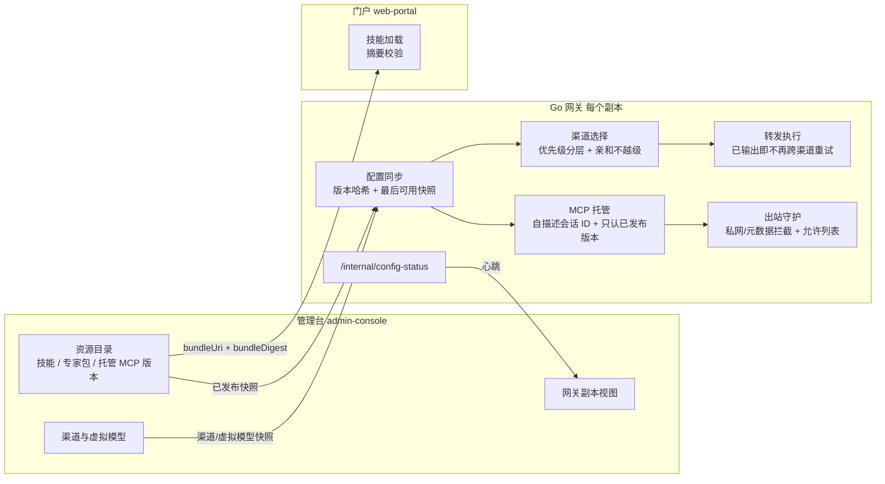
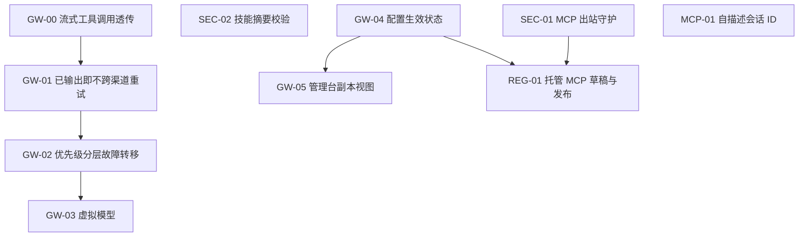

# Enterprise 网关与 AI 资源治理强化 · 主规划

Planned-with: Claude Opus 5.5
Suggested-Impl-Model: 本文件是主规划，不直接开工。每个子规划的推荐模型见「子规划与建议实施模型」表。

**Goal:** 借鉴两个上游项目的设计，补齐 Enterprise Go 网关（`enterprise/apps/gateway`）与资源目录（admin-console ECP）在**企业落地**场景下的正确性、安全、可运维和治理短板。上游项目是开源 AI 网关 agentgateway（已做源码级调研），以及 Nacos 3.3.0 的 AI 资源注册与发布治理。

**本文件不是实施计划。** 拆解者（下文称「子规划作者」）按第 6 节逐个子规划 ID 写实施 plan，落到 `.cursor/plans/pending/`，每份都必须满足 AGENTS.md 中「Composer 2.5 可独立高质量实施」的门槛。

---

## 0. 给子规划作者的规则（必读）

1. **一个子规划 ID 对应一份 plan。** 文件名为 `.cursor/plans/pending/YYYY-MM-DD-gwr-<ID小写>-<slug>.plan.md`，例如 `2026-11-10-gwr-gw01-stream-retry-commit.plan.md`。Plan-Id 用文件名去掉 `.plan.md`。
2. **开写前重新核对行号。** 本文中的行号是 2026-11-09 的快照。写子规划前先 `Read` 对应文件，确认锚点代码片段还在；锚点漂移时以代码片段为准，并在子规划里更新行号。
3. **只做本文第 6 节列出的 FR。** 第 6 节标为「不做」或「Out of scope」的条目，子规划中不得出现。发现计划外问题时，记到子规划末尾的「观察到但未处理」小节，不要顺手修。
4. **改动 schema 时必须同时改 PG 和 MySQL 两套迁移。** 目录分别是 `enterprise/packages/db-schema/drizzle/` 和 `enterprise/packages/db-schema/drizzle-mysql/`。同时更新 `enterprise/packages/db-schema/src/schema/*.ts` 的 drizzle 定义，并跑 `packages/db-schema` 的 `schema-parity.test.ts` 和 `migration-inventory.test.ts`。
5. **验收命令**（子规划的 AC 至少引用其中一条）：
   - 网关：`cd enterprise/apps/gateway && go test ./internal/<pkg>/... && go vet ./...`
   - 管理台：`pnpm -C enterprise --filter @agenticx/app-admin-console test && pnpm -C enterprise --filter @agenticx/app-admin-console typecheck`
   - 门户：`pnpm -C enterprise --filter @agenticx/app-web-portal test && pnpm -C enterprise --filter @agenticx/app-web-portal typecheck`
   - schema：`pnpm -C enterprise --filter @agenticx/db-schema test`
6. **文案约束。** 面向终端用户的 UI 文案不得暴露内部路径、环境变量名或实现细节。Plan、commit 和 PR 中不得写客户名称；commit 和 PR 中不得写第三方产品或开源项目名，一律用「渠道优先级故障转移」「技能内容完整性校验」这类产品内中性描述。
7. **每个子规划都必须包含：** 根因与证据（复制本文对应证据 ID 的内容，不能只写编号）、精确落点、before/after 意图、FR/AC、测试文件名与断言点、In/Out of scope。

---

## 1. 结论

**结论一：不引入 agentgateway 或 Nacos 作为组件或依赖，只内化它们被源码或发布说明证实、且我们确实缺的设计。**

- agentgateway 是 Rust 数据面，加上面向 K8s Gateway API 的 xDS 控制面。我们的 Go 网关在企业语义上已经覆盖或超过它的多数能力：
  - 四层预算采用事务预留，比它的内存累计、5 秒落库更严谨，它在窗口切换时还会丢弃未落库的用量。
  - 三通道内容策略 + 草稿/发布。
  - 哈希链审计。
  - Wasm 插件。
  - OpenAPI→MCP。
  - 连接器 SSRF 守护。
  - 多协议入站。
- Nacos 3.3.0 是 Java 注册与配置中心。我们的 ECP 平台目录已经有：版本、扫描结论、上架状态（draft/published）、租户授权与撤销（grant/revoke），以及审批流。
- 因此两者都不搬代码，也不加运行依赖。

**结论二：值得内化的点分为三类，按企业落地的紧迫程度排序。**

| 类别 | 内化什么 | 来源 | 我们的现状（证据） |
| --- | --- | --- | --- |
| 正确性（P0） | 流式响应一旦向客户端发出内容就不再跨上游重试 | agentgateway 只在响应头发出前重试，并且有请求体重放上限 | 跨渠道流式重试不检查是否已向客户端输出（A-01） |
| 正确性（P0） | 流式工具调用增量完整透传 | agentgateway 的 LLM 路径按协议透传 tool 增量 | 流式 `tool_calls` 在解码时被丢弃（A-02） |
| 安全（P0） | 已扫描内容与运行时加载内容一致（摘要校验） | Nacos 3.3.0 的 Skill 发布流水线（扫描后发布，发布即不可变） | 运行时按 URL 拉取技能正文，不校验 `bundle_digest`（A-03） |
| 安全（P0/P1） | MCP 出站访问策略：私网与元数据地址守护，加允许列表 | Nacos 3.3.0 的 MCP 工具导入出站策略；agentgateway 的后端策略 | 连接器后端有 SSRF 守护，OpenAPI 后端和上游 MCP 代理没有（A-04） |
| 可运维（P1） | 优先级分层故障转移，亲和不越级 | agentgateway 按优先级分桶、健康驱逐、亲和不覆盖优先级 | `Channel.Priority` 管理台可填，网关不读（A-05） |
| 可运维（P1） | 配置下发有版本、能回答「这个副本现在生效的是哪一版」 | agentgateway xDS 的 ACK/NACK 与已知资源集合 | 约 13 个独立轮询源，没有统一的生效状态（A-06） |
| 高可用（P1） | MCP 会话 ID 自描述、可跨副本校验 | agentgateway 用编码或加密的会话 ID 恢复上游会话元数据 | 旧版 SSE 会话存在单进程内存 map 中（A-07） |
| 治理（P2） | 托管 MCP 的工具面走「草稿→发布」，网关只认已发布版本 | Nacos 3.3.0 的 MCP 生命周期：draft→review→publish→online/offline | `mcp_servers` 只有 active 状态，工具变更立即生效，没有版本（A-08） |
| 治理（P2） | 虚拟模型：一个对外模型名映射多个真实模型，带权重与故障转移 | agentgateway 的 virtual model | 没有（A-09） |
| 可观测（P2） | 管理台看到每个网关副本的配置生效状态 | agentgateway xDS 的状态回报 | 没有（A-06 的延伸） |

**结论三：明确不做的内容（第 7 节有完整列表）。** 包括：xDS、K8s Gateway API、CEL 授权、A2A 代理、推理端点选择、网格隧道、Nacos 集群接入、Raft 锁、DNS 发现、ZIP 上传流水线（我们没有上传入口）、默认开启鉴权（已经是拒绝无效 token）、请求关联 ID（已有 trace_id 全链路）。

---

## 2. 上游证据（摘录，子规划不需要再去读上游）

agentgateway 的调研产物在 `research/codedeepresearch/agentgateway/`，包括 `agentgateway_source_notes.md`、`agentgateway_code_index.md` 和 `agentgateway_deepwiki.md`，上游 clone 不入库。本规划用到的结论如下：

- **U-01 重试边界。** `proxy/httpproxy.rs` 的 `should_retry` 约在第 3939 行，只在拿到上游响应、尚未向下游写出时决定重试。请求体通过 `ReplayBody` 重放，`is_capped` 指的是请求体超过缓冲上限后不可重放。结论：响应一旦开始写给客户端，就不再重试。
- **U-02 优先级与亲和。** `llm/mod.rs` 的 `AIBackend` 约在 88–130 行，按优先级把 provider 分成多个桶。桶数大于 1 时默认开启健康驱逐；同一个桶内用 power-of-two-choices 选择。亲和（affinity）只在当前可用的最高优先级桶内生效，**不会**把请求带回低优先级或不健康的端点。
- **U-03 配置下发确认。** `crates/xds/src/client.rs` 约 181–261 和 686–746 行：Delta ADS 按资源应用，合法的部分生效，非法的部分 NACK，被拒绝的资源名不进入 `known_resources`。控制面能知道每个数据面「生效了什么、拒绝了什么」。
- **U-04 会话 ID 自描述。** `mcp/session.rs` 的 `SessionManager` 约在 886–1132 行：会话 ID 以 Base64 或 AES-256-GCM 编码，携带上游会话元数据，任一副本都能解码恢复。注意它的空闲回收不会调用 `delete_session`，我们不照抄这一点。
- **U-05 虚拟模型。** `llm/model_router.rs` 的 `resolve` 在第 403 行，`resolve_virtual_model` 在第 611 行：支持 weighted、conditional、callout、failover 四种路由，failover 按优先级分组。
- **U-06（Nacos 3.3.0 发布说明，https://github.com/alibaba/nacos/releases/tag/3.3.0）**
  - AI Registry 覆盖 Agent、AgentSpec、Skill、Prompt 和 MCP，带版本管理，并保留 `latest` 标签。
  - MCP 生命周期为 draft → review → publish → online/offline，带可见性控制。
  - Skill 发布前做上传预检、ZIP 校验和解压上限，首个版本自动发布。
  - 运维侧可配置 MCP 工具导入的出站访问策略。
  - 资源发现采用关键词与向量的混合检索。
  - 客户端鉴权默认开启，无效 Bearer 被拒绝，不回落为匿名。
  - 提供 `Nacos-Request-Id` 请求关联。

---

## 3. AgenticX 现状证据（2026-11-09 快照）

所有路径都相对仓库根目录。

- **A-01 流式跨渠道重试会导致重复输出。**
  - `enterprise/apps/gateway/internal/relay/executor.go`：`Stream()` 在 176–213 行，失败后只判断 `IsChannelRetryable(err)`，满足就换渠道重试（199–211 行）。
  - `streamOnChannel()` 在 221–297 行，第 244–253 行用 `tokensSent` 记录是否已推送内容，但它**只用于同渠道换 Key**（第 286 行 `canRetryKey := ... && !tokensSent`），没有传回 `Stream()`。
  - 推送函数 `push` 在 `enterprise/apps/gateway/internal/server/server.go` 约 1170–1190 行，直接 `w.Write` 给客户端并 `Flush`，同时 `responseBuilder.WriteString` 累积审计正文。
  - 后果：上游输出到一半返回 5xx、429 或网络错误时，换渠道从头再生成一遍，客户端收到「半段 A + 完整 B」，审计正文和计量也都被累加。
  - 另外，客户端断开导致 `w.Write` 返回的错误如果属于 `net.Error`，会被 `IsChannelRetryable` 判成可重试（第 368–371 行），于是为一个已经离开的客户端再调一次上游。
- **A-02 流式工具调用被丢弃。**
  - `enterprise/apps/gateway/internal/openai/types.go` 第 84–88 行的 `StreamDelta` 只有 `Role`、`Content`、`ReasoningContent` 三个字段，没有 `tool_calls`。
  - `enterprise/apps/gateway/internal/adaptor/openai.go` 约第 322 行 `json.Unmarshal([]byte(payload), &chunk)` 解码进 `openai.StreamChunk`，`tool_calls` 字段在这里被静默丢掉。
  - 对比：请求侧 `ChatCompletionRequest.Tools/ToolChoice`（第 39–40 行）和非流式响应 `ChatMessage.ToolCalls`（第 22 行）都会保留。
  - `rg "tool_calls|ToolCalls" enterprise/apps/gateway/internal/{adaptor,server}` 没有任何命中。
  - 后果：智能体类调用方走流式 + 工具时，拿不到工具调用。
- **A-03 技能正文加载不校验摘要。**
  - `enterprise/apps/web-portal/src/lib/enterprise-skill-bundle.ts` 的 `loadSkillBody(bundleUri, fetchImpl)` 校验了 https、无凭据、主机在允许列表内、`redirect: "error"`、2.5 秒超时，然后截取前 24000 字节，**不校验摘要**。
  - 调用方是 `enterprise/apps/web-portal/src/lib/enterprise-skill-context.ts` 第 43 行 `loadSkillBody(source?.bundleUri || null)`，没有传 digest。
  - 门控只依据 `scanVerdict === "safe"`（第 40 行）。`capability-packs-reader.ts` 第 49、95、125 行已经读出 `bundleDigest`。
  - 后果：扫描通过之后，托管方修改了 URL 背后的内容，用户实际拿到的是**未经扫描的提示词**。
- **A-04 出站守护覆盖不全。**
  - `connector-runtime/internal/executor/proxy.go` 有守护：第 101–116 行 `isLocalHost`（loopback、private、link-local、unspecified），第 154–172 行 `policyProxy`，第 174 行 `forbiddenByDNS`。
  - `enterprise/apps/gateway/internal/mcphost/backend_connector.go` 第 15 行注释写明复用了这个守护。
  - 但 `enterprise/apps/gateway/internal/mcphost/backend_openapi.go` 第 66–77 行直接用 `baseURL` 构造 `http.NewRequestWithContext`，没有地址守护。
  - `enterprise/apps/gateway/internal/mcp/handler.go` 第 79–160 行用 `rec.UpstreamURL` 做反向代理，也没有守护。
  - 后果：管理员误配置，或被导入的 OpenAPI 文档把 `servers[0].url` 指向云元数据地址 `169.254.169.254` 或内网管理口时，网关会代为请求。
- **A-05 渠道优先级是「可填但不生效」的字段。**
  - `enterprise/apps/gateway/internal/channel/types.go` 第 23 行定义了 `Priority int`。
  - 管理台 `enterprise/apps/admin-console/src/app/admin/_sections/channels.tsx` 第 253、283、403、704–705 行可以编辑和展示它；中文文案在 `enterprise/apps/admin-console/messages/zh.json` 第 1671 行（`weightPriority`）和第 1689 行（`priorityLabel` = 优先级）。
  - 但 `rg "\.Priority" enterprise/apps/gateway/internal` 的非测试命中只有 `wasmhost/manager.go:76`（插件排序）。`channel/picker.go` 的 `PickWithPrefix()`（第 48–99 行）完全不看优先级。
  - 旧版 provider 转出的渠道固定为 `Priority: 0`（`channel/registry.go` 第 238 行）。
- **A-06 配置源分散，没有统一的生效状态。**
  - 网关读取约 13 个 `GATEWAY_REMOTE_*_URL` 或 `*_FILE` 配置源：providers、channels、policy snapshot、mcp servers、quota、budget、pricing、cache、compliance、PAT 吊销、session grants 等。
  - 每个源有自己的轮询器，失败语义各不相同。例如 `enterprise/apps/gateway/internal/runtimeconfig/runtimeconfig.go` 第 124–160 行：解析失败保留旧快照，但远端返回 404 时会**清空**快照（第 133–135 行）。
  - 只有策略有 `/internal/policy-status`（`server.go` 第 665 行）。
  - 管理台的拉取路由在 `enterprise/apps/admin-console/src/app/api/internal/*/route.ts`，用 `isGatewayInternalAuthorized` 校验 `GATEWAY_INTERNAL_TOKEN`；网关一侧见 `enterprise/apps/gateway/internal/gatewayinternal/http.go` 第 30–42 行。
  - 后果：长期反复出现的「规则已发布，前台还不拦」没有办法从产品内判断是哪个副本、哪个源出了问题。
- **A-07 MCP 旧版 SSE 会话绑定单进程。**
  - `enterprise/apps/gateway/internal/mcphost/transport_sse.go` 的 `sseSessionStore` 是进程内 map。
  - `transport.go` 第 72 行创建会话，第 94–97 行在 `HandleMessages` 里 `t.sessions.Valid(...)`，校验失败返回 400 `invalid session`。
  - JSON-RPC 响应直接写在 POST 的应答里（第 107–113 行），并不依赖 SSE 连接回传。所以只要会话 ID 能被任一副本校验，就可以跨副本工作。
  - 后果：多副本或滚动发布时，客户端的 `/messages` 落到另一个副本就会报错。
- **A-08 托管 MCP 没有版本和发布流程。**
  - `enterprise/packages/db-schema/drizzle/0027_mcp_hosting.sql`：`mcp_servers.status` 默认 `'active'`，`mcp_tools` 没有版本列。
  - 网关 `enterprise/apps/gateway/internal/mcphost/registry.go` 第 36–39 行只查 `status = 'active'`，第 112–117 行加载全部 `enabled = true` 的工具。
  - 对比：技能已经有 `platform_catalog_item_versions`（含 `scan_verdict`、`shelf_status`，见 `enterprise/packages/db-schema/src/schema/platform-catalog.ts` 第 36–51 行）和审批流（`enterprise/apps/admin-console/src/lib/db-stores/postgresql/ecp-approval-store.ts`）。
  - 后果：重新导入 OpenAPI 时，工具面立即对全员生效，没有审核。
- **A-09 没有虚拟模型。**
  - 模型名直接用于 `registry.ListByModel(tenantID, model)`（`picker.go` 第 61 行）和 `runtimeconfig.ResolveByModel`。

**已经具备、不需要内化的能力（防止子规划作者重复造轮子）：**

- 渠道加权、前缀缓存、延迟感知、会话亲和、冷却（`channel/picker.go`）。
- Key 池轮换（`keypool/`）。
- 事务预留式预算（`quota/budget_database.go` 第 142 行 `gateway_budget_reservations`，第 208 行 `FOR UPDATE`）。
- OpenAPI→MCP（`mcphost/openapi_loader.go`、`backend_openapi.go`）。
- 无效 token 一律拒绝（`server.go` 第 1537–1565 行 `identityFromRequest`）。
- trace_id 全链路。
- Wasm 插件热加载（`wasmhost/manager.go` 的 fsnotify）。
- 策略快照「已发布即权威，0 规则也不回落」（`server.go` 第 391–400 行）。

---

## 4. 目标形态



---

## 5. 阶段与依赖



| 阶段 | 子规划 | 进入下一阶段的门槛 |
| --- | --- | --- |
| A 正确性与安全（P0） | GW-00、GW-01、SEC-02、SEC-01（默认只审计） | 四份都合入，网关 `go test ./...` 全绿，门户测试全绿 |
| B 可运维与高可用（P1） | GW-02、GW-04、MCP-01 | 存量渠道（全部 priority=0）的行为与改动前逐项一致；`/internal/config-status` 在本地 `start-dev-with-infra.sh` 环境返回 4 个核心域 |
| C 治理（P2） | GW-05、REG-01、GW-03 | 各自开工前，用户确认第 8 节的决策点 |

阶段内的子规划没有互相依赖时，可以并行开工。GW-00 和 GW-01 同时改 `relay/executor.go`，必须串行，GW-00 先合入。

---

## 6. 子规划定义

### GW-00 流式工具调用透传（P0）

**根因：** 见 A-02。

**落点与意图：**

1. `enterprise/apps/gateway/internal/openai/types.go` 的 `StreamDelta`：

   ```go
   // before
   type StreamDelta struct {
       Role             string `json:"role,omitempty"`
       Content          string `json:"content,omitempty"`
       ReasoningContent string `json:"reasoning_content,omitempty"`
   }
   // after：新增字段，原样保留上游 JSON，不解析结构
   type StreamDelta struct {
       Role             string          `json:"role,omitempty"`
       Content          string          `json:"content,omitempty"`
       ReasoningContent string          `json:"reasoning_content,omitempty"`
       ToolCalls        json.RawMessage `json:"tool_calls,omitempty"`
   }
   ```

2. 检查 `enterprise/apps/gateway/internal/openai/stream_reasoning.go` 的 `MergeDelta`（第 29 行附近），以及 `adaptor/openai.go` 第 300–340 行的流解析循环。任何「content 为空就丢弃 chunk」的分支，都要改成「content、reasoning_content、tool_calls 三者都为空才丢弃」。子规划作者必须列出实际找到的分支和行号。
3. `server.go` 约 1150–1190 行的 `push` 闭包：内容策略只作用于 `delta.Content`，`ToolCalls` 原样透传，不做策略评估（见第 8 节决策 D-1）。
4. `streamChunks`（审计用）已经保存整个 chunk，新字段会自然进入，不需要额外处理。

**FR/AC：**

- FR-1：上游 OpenAI 兼容流中的 `delta.tool_calls` 原样到达客户端，顺序和分片不变；`finish_reason: "tool_calls"` 原样到达。
  - AC-1：新增 `enterprise/apps/gateway/internal/adaptor/openai_stream_toolcalls_test.go`。用 `httptest.NewServer` 模拟上游，依次推送 role chunk、3 个 `tool_calls` 分片 chunk（包含 `index`、`id`、`function.name` 和分段的 `function.arguments`）、`finish_reason: "tool_calls"` chunk 和 `[DONE]`。断言 push 收到的 chunk 数一致，每个 `Delta.ToolCalls` 与上游字节相同，最后一个 chunk 的 `FinishReason` 为 `"tool_calls"`。
  - AC-2：新增 `enterprise/apps/gateway/internal/server/stream_toolcalls_test.go`。走 `/v1/chat/completions` 的 `stream: true` 完整链路，断言客户端收到的 SSE `data:` 行中能解析出 `tool_calls`，三个分片的 `function.arguments` 拼接后等于上游原始参数。
- FR-2：纯文本流的行为不变。
  - AC-3：`go test ./internal/adaptor/... ./internal/server/... ./internal/relay/...` 全绿，不修改任何已有测试的断言。

**Out of scope：** Claude、Gemini 和 Bedrock 入站或出站协议的 tool_use 映射（`outbound/claude.go`、`outbound/gemini.go`、`adaptor/claude.go`、`adaptor/bedrock.go`）；对工具参数做内容策略；网关执行工具。

---

### GW-01 已向客户端输出即不再跨渠道重试（P0）

**根因：** 见 A-01；对照 U-01。

**落点与意图：** 只改 `enterprise/apps/gateway/internal/relay/executor.go` 和它的测试。

1. `streamOnChannel` 在第 244–253 行改为计算 `committed`：只要有一次 `push(chunk)` **返回 nil**，并且该 chunk 的 `Content`、`ReasoningContent`、`ToolCalls`（GW-00 新增）三者之一非空，`committed` 就为 true。
2. `channelStreamOutcome`（第 215–219 行）新增 `committed bool` 字段，在所有 return 路径上回填。
3. 同渠道换 Key 的条件（第 286 行）用 `committed` 替代 `tokensSent`，语义不变，只是把工具调用也纳入判断。
4. `Stream()` 第 205–210 行：

   ```go
   // before
   lastErr = err
   if !IsChannelRetryable(err) { return ..., err }
   e.picker.MarkFailure(ch, err.Error(), e.cooldown)
   excludeChannels[ch.ID] = struct{}{}
   // after
   lastErr = err
   if !IsChannelRetryable(err) { return ..., err }
   e.picker.MarkFailure(ch, err.Error(), e.cooldown) // 冷却照常记
   if result.committed { return StreamResult{Attempts: attempts, Channel: ch, KeyRef: result.keyRef}, err }
   excludeChannels[ch.ID] = struct{}{}
   ```

5. 客户端写失败不重试：在 `wrappedPush` 中，把 `push` 返回的错误包成包内私有类型 `clientPushError{err error}`（实现 `Error()` 和 `Unwrap()`）。`IsKeyRetryable` 和 `IsChannelRetryable` 开头先 `errors.As(err, &clientPushError{})`，命中就返回 false。`push` 因策略拦截返回的 `"policy blocked stream chunk"` 同样会被包住，结果仍是不重试，与现状一致。

**FR/AC：**

- FR-1：流式请求在向客户端推送了任何有效内容之后失败，不换渠道重试，直接把错误交给上层收尾。
  - AC-1：新增 `enterprise/apps/gateway/internal/relay/stream_commit_test.go`。上游 A 推送 2 个内容 chunk 后断开连接，上游 B 正常。断言 push 只收到 A 的 2 个 chunk，B 的请求计数为 0，返回 err 非空，并且 A 进入冷却（`picker` 的 stats 中 `InCooldown` 为 true）。
- FR-2：失败发生在推送任何内容之前时，仍然换渠道重试，与现状一致。
  - AC-2：同一测试文件中，上游 A 直接返回 503，B 正常。断言 B 被调用一次，push 收到 B 的完整内容，返回 err 为 nil。
- FR-3：客户端写失败不触发任何重试。
  - AC-3：push 第一次调用就返回 `&net.OpError{Op: "write", Err: errors.New("broken pipe")}`。断言上游只被调用一次，且 `IsChannelRetryable(返回的 err)` 为 false。
- FR-4：非流式 `Complete()` 不改。
  - AC-4：`go test ./internal/relay/...` 全绿，包括已有的 `integration_test.go`、`multi_protocol_integration_test.go` 和 `retry_test.go`。

**Out of scope：** 修改重试次数、冷却时长、`IsChannelRetryable` 对状态码的判断；在服务端补发「重试中」事件；非流式路径。

---

### SEC-02 技能内容完整性校验（P0）

**根因：** 见 A-03；对照 U-06 的「扫描后发布」。

**落点与意图：**

1. `enterprise/apps/web-portal/src/lib/enterprise-skill-bundle.ts`：
   - 签名改为 `loadSkillBody(bundleUri: string | null, expectedDigest: string | null, fetchImpl = fetch)`。
   - 读取响应时设置字节上限 `MAX_FETCH_BYTES = 256_000`：用 `response.arrayBuffer()` 读取，超过上限就返回 null 并记录日志。
   - 对**完整字节**计算 sha256（`node:crypto` 的 `createHash("sha256")`），之后再做 UTF-8 解码、截取 `MAX_BYTES` 和剥离 frontmatter，原有逻辑不变。
   - 摘要比较规则：`expectedDigest` 去掉首尾空白并转小写；如果以 `sha256:` 开头就去掉前缀；剩余部分必须是 64 位 hex。不满足格式时按「无摘要」处理。
   - 判定：
     - 有摘要且不一致：返回 null，`log("warn", { event: "chat.skill_bundle_digest_mismatch", ... })`。
     - 无摘要：按第 8 节决策 D-2 处理，默认放行并记录 `chat.skill_bundle_digest_missing`。
2. `enterprise/apps/web-portal/src/lib/enterprise-skill-context.ts` 第 43 行改为 `loadSkillBody(source?.bundleUri || null, source?.bundleDigest || null)`。子规划作者需要确认 `capabilityStatesFromView` 的返回项是否带 `bundleDigest`；没有就在 `capability-packs-reader.ts` 中透传，只加字段，不改其他逻辑。

**FR/AC：**

- FR-1：摘要不一致的技能正文不进入提示词。
  - AC-1：在 `enterprise/apps/web-portal/src/lib/__tests__/enterprise-skill-bundle.test.ts` 中追加用例。fetchImpl 返回正文 `"---\nname: a\n---\nhello"`，传入错误的 64 位 hex 摘要，断言返回 null；传入正确的 `sha256:<hex>`，断言返回 `"hello"`。
- FR-2：超过 256000 字节的响应被拒绝。
  - AC-2：fetchImpl 返回 300000 字节的正文，断言返回 null。
- FR-3：原有的 https、凭据、允许列表和 404 用例行为不变。
  - AC-3：已有用例不改断言并且全绿；门户 `typecheck` 通过。

**Out of scope：** 管理台在登记版本时自动计算摘要（列为候选 C-04）、改扫描逻辑、上传流水线、桌面端技能加载。

---

### SEC-01 MCP 出站访问守护（P0 默认只审计，P1 切换为拦截）

**根因：** 见 A-04；对照 U-06 的出站访问策略。

**落点与意图：**

1. 新建包 `enterprise/apps/gateway/internal/egress/`：
   - `guard.go`：
     - `type Mode string`，取值 `ModeOff`、`ModeAudit`、`ModeEnforce`。
     - `func ModeFromEnv() Mode` 读取 `GATEWAY_EGRESS_GUARD_MODE`，默认 `audit`。
     - `func NewHTTPClient(base *http.Client, mode Mode, allow *Allowlist, onDecision func(Decision)) *http.Client`。核心做法是自定义 `Transport.DialContext`：在**拨号时**解析出 IP，再判定是否放行。在拨号时判定是为了避免先检查 DNS、后连接带来的 DNS 重绑定问题。
   - `allowlist.go`：解析 `GATEWAY_EGRESS_ALLOWLIST`，内容是逗号分隔的 CIDR 或主机名，主机名支持 `*.corp.example` 后缀匹配。
   - 判定规则：
     - 云元数据地址**始终拦截**，不受允许列表影响，包括 `169.254.169.254/32` 和 `fd00:ec2::254/128`。只有在 `ModeOff` 下才放行。
     - 其他私网和保留地址（`ip.IsLoopback() || ip.IsPrivate() || ip.IsLinkLocalUnicast() || ip.IsUnspecified()`，参照 `connector-runtime/internal/executor/proxy.go` 第 101–116 行）：命中允许列表就放行；否则在 `audit` 模式下放行并回调 `Decision{Blocked:false, WouldBlock:true}`，在 `enforce` 模式下返回错误 `egress:forbidden`。
     - 公网地址放行。
2. 接入点只有两处：
   - `enterprise/apps/gateway/internal/mcphost/backend_openapi.go` 中发请求的 client（第 77 行附近，子规划作者需定位实际使用的 `http.Client` 来源）。
   - `enterprise/apps/gateway/internal/mcp/handler.go` 反向代理的 `Transport`（第 116–160 行附近）。
3. 审计：`onDecision` 写一条网关审计事件，复用现有 `audit.EventWriter`。`mcp_status` 字段填 `egress_would_block` 或 `egress_blocked`，不新增审计表列。
4. 连接器后端（`backend_connector.go`）已经有自己的守护，**不改**。

**FR/AC：**

- FR-1：`enforce` 模式下，访问云元数据地址和不在允许列表中的私网地址失败，错误码为 `egress:forbidden`，并留下审计记录。
  - AC-1：新增 `enterprise/apps/gateway/internal/egress/guard_test.go`，用表驱动覆盖以下情况：`127.0.0.1`、`10.0.0.5`、`169.254.169.254`、`[::1]`、命中允许列表的 `10.1.2.3`（allowlist=`10.1.0.0/16`）、公网 `93.184.216.34`，分别在三种模式下断言结果。拨号判定用可注入的 resolver 函数测试，不依赖真实 DNS。
- FR-2：默认 `audit` 模式下，现有的内网 MCP 后端照常可用，同时留下 would-block 审计。
  - AC-2：新增 `enterprise/apps/gateway/internal/mcphost/backend_openapi_egress_test.go`。用 `httptest.NewServer`（监听 127.0.0.1）作为 OpenAPI 后端：audit 模式下调用成功，回调收到 `WouldBlock=true`；enforce 模式且无允许列表时失败；enforce 模式加上 `127.0.0.1/32` 允许列表后成功。
- FR-3：上游 MCP 代理同样受守护。
  - AC-3：在 `enterprise/apps/gateway/internal/mcp/handler_test.go` 追加 enforce 模式下指向 127.0.0.1 的上游用例，断言返回 502，错误体包含 `egress:forbidden`。

**Out of scope：** 管理台允许列表 UI 和租户级允许列表（列为候选 C-03）；在导入 OpenAPI 时就校验 `servers[0].url`；改动 connector-runtime；对大模型渠道（`adaptor/*`）的出站做守护。

---

### GW-02 渠道优先级分层故障转移（P1）

**根因：** 见 A-05；对照 U-02。

**语义（写入子规划，不能更改）：** 优先级数值**越小越优先**，0 为最高。存量渠道全部是 0，属于同一层，所以行为与现状完全一致。同一层内仍然按现有策略（prefix、亲和、latency、weight）选择。

**落点与意图：** 只改 `enterprise/apps/gateway/internal/channel/picker.go`、`types.go` 和管理台文案。

1. `PickWithPrefix()`（第 48–99 行），在 `healthy := p.filterHealthy(...)` 之后插入：

   ```go
   tier := lowestPriorityTier(healthy) // 返回 healthy 中 Priority 最小值的全部渠道
   // 之后 prefix / affinity / latency / weight 全部只在 tier 内进行
   ```

2. 亲和不越级：第 76–83 行的亲和查找只在 `tier` 内匹配，命中的渠道不在 `tier` 里就忽略。这对应 U-02 的「亲和不覆盖优先级或健康状态」。
3. `filterHealthy` 在全部候选都处于冷却时会回落为全部候选（第 115–129 行）。这个行为保留，回落后同样只取最小优先级层。
4. `PickDecision`（定义在 `types.go` 或 `lb_policy.go`，子规划作者需定位）新增 `Priority int` 字段，由 `Reason` 所在分支回填，供 `routingDecisionFromStream` 和 `routingDecisionFromRelay` 写入审计时使用。只加字段，不改审计 schema。
5. 管理台文案：在 `enterprise/apps/admin-console/messages/zh.json` 和 `en.json` 的渠道区块新增 `priorityHint`，中文为「数值越小越优先；同一优先级内按权重分流，整层不可用时才使用下一层」。在 `channels.tsx` 第 704–705 行的输入框下方渲染这条提示，不改其他 UI。

**FR/AC：**

- FR-1：高优先级层存在健康渠道时，低优先级渠道不会被选中。
  - AC-1：新增 `enterprise/apps/gateway/internal/channel/picker_priority_test.go`。构造 A(p=0,w=1)、B(p=0,w=1)、C(p=1,w=100) 三个渠道，Pick 1000 次，断言 C 的命中次数为 0。
- FR-2：高优先级层整层冷却或被排除时，降到下一层。
  - AC-2：A 和 B 都 `MarkFailure` 冷却 30s 后，Pick 结果为 C；用 `exclude={A,B}` 时结果同样为 C。
- FR-3：亲和不越级。
  - AC-3：会话亲和记录为 C，但 A 健康时，Pick 结果为 A 或 B，且 `Reason != "affinity"`。
- FR-4：存量行为不变。
  - AC-4：所有渠道 p=0 时，`picker_test.go`、`picker_lb_test.go`、`lb_policy_test.go` 不改断言并且全绿。
  - AC-5：管理台渠道编辑页能看到提示文案，`typecheck` 和 `test` 通过。

**Out of scope：** 同层内改用 power-of-two-choices；修改冷却时长；改 `legacy-*` 渠道的默认优先级；虚拟模型（GW-03）。

---

### GW-04 配置生效状态统一上报（P1）

**根因：** 见 A-06；对照 U-03。

**原则：** 不重写各个 loader，只加一个统一的状态登记点，再把 4 个核心域接进来。每个核心域都要满足「解析或校验失败时保留最后可用快照」。

**落点与意图：**

1. 新建 `enterprise/apps/gateway/internal/configstatus/status.go`：

   ```go
   type Outcome struct {
       Domain      string    // "providers" | "channels" | "policy" | "mcp_servers"
       Source      string    // 文件路径或 URL（URL 去掉 query）
       ContentHash string    // sha256 hex，内容未变时不重复构建
       Version     string    // 能取到时填：policy 填各租户 publishId 拼接；其余留空
       AppliedAt   time.Time // 最近一次成功应用
       CheckedAt   time.Time // 最近一次检查
       LastError   string    // 最近一次失败原因；成功后清空
       ConsecutiveFailures int
   }
   type Registry struct{ /* sync.RWMutex + map[string]Outcome */ }
   func (r *Registry) ReportSuccess(domain, source, hash, version string)
   func (r *Registry) ReportFailure(domain, source string, err error)
   func (r *Registry) Snapshot() []Outcome // 按 Domain 排序
   ```

   同时注册两个 Prometheus 指标：`gateway_config_apply_failures_total{domain}` 和 `gateway_config_last_success_timestamp_seconds{domain}`，复用 `observability` 包现有的注册方式。
2. 接入 4 个核心域，每个只在 reload 成功或失败的分支调用 Report：
   - providers：`internal/runtimeconfig/runtimeconfig.go` 的 `reload()`（第 124–161 行）。
   - channels：`internal/channel/registry.go` 的刷新函数（子规划作者定位）。
   - policy：`internal/server/server.go` 的 `reloadPolicyIfNeeded()`（第 560 行起）。
   - mcp_servers：`internal/mcp/loader.go` 的 `reload()`（第 88 行起）。
3. 统一「失败保留最后可用快照」：逐一核对上述 4 个 reload 函数在**拉取失败**和**解析失败**时是否保留旧快照，不保留的改成保留。**远端返回 404 的语义不在本子规划中修改**，只把它登记为一次成功、内容为空的应用，并在 `LastError` 中写 `"remote 404 treated as empty"`，留给 D-3 决策。
4. 新增路由 `GET /internal/config-status`，注册在 `server.go` 第 665 行附近，与 `/internal/policy-status` 并列。返回：

   ```json
   {"instanceId":"<GATEWAY_INSTANCE_ID 或 os.Hostname()>","startedAt":"...","domains":[Outcome...]}
   ```

   鉴权方式与同组的 `/internal/*` 路由一致（子规划作者需确认现有 `/internal/*` 的保护方式，原样沿用）。`Source` 只输出路径或 URL，不输出 token。

**FR/AC：**

- FR-1：4 个核心域的生效状态可以通过一个接口查询。
  - AC-1：新增 `enterprise/apps/gateway/internal/configstatus/status_test.go`，覆盖 success → failure → success 序列下 `ConsecutiveFailures` 和 `LastError` 的变化。
  - AC-2：新增 `enterprise/apps/gateway/internal/server/config_status_test.go`，启动测试 server 后 GET `/internal/config-status`，断言 4 个 domain 都存在。
- FR-2：解析失败时保留最后可用快照。
  - AC-3：在 `enterprise/apps/gateway/internal/runtimeconfig/runtimeconfig_test.go` 追加用例：先写入合法的 providers.json 并 reload，再写入非法 JSON 并 reload，断言 `ResolveByModel` 仍命中旧数据、registry 中 `LastError` 非空。channels、policy、mcp 各补一条同类用例，文件名沿用各包现有的 `*_test.go`。
- FR-3：本地端到端可查。
  - AC-4：执行 `bash enterprise/scripts/start-dev-with-infra.sh` 后，`curl --noproxy '*' -H "Authorization: Bearer $GATEWAY_INTERNAL_TOKEN" http://127.0.0.1:<网关端口>/internal/config-status` 返回 200，并且 4 个 domain 的 `AppliedAt` 都非零。

**Out of scope：** 其余配置源（quota、budget、pricing、cache、compliance、PAT 吊销、session grants），列为候选 C-01；改 404 语义；推送式下发；改 admin 侧的快照生成。

---

### MCP-01 MCP 会话 ID 自描述（P1）

**根因：** 见 A-07；对照 U-04。

**落点与意图：** 只改 `enterprise/apps/gateway/internal/mcphost/transport_sse.go`、`transport.go` 和测试。

1. 新增 `sessionCodec`：
   - 会话 ID 的格式为 `v1.<base64url(payload)>.<base64url(hmac)>`。
   - `payload` 是 JSON `{"s":serverName,"t":tenantID,"u":userID,"iat":unix,"exp":unix}`。
   - HMAC 算法为 HMAC-SHA256，密钥来自 `gatewayinternal.SecretFromEnv("GATEWAY_MCP_SESSION_SECRET")`。
   - 默认有效期 24h，可用 `GATEWAY_MCP_SESSION_TTL` 配置，格式为 Go duration。
2. `sseSessionStore.Create()`：配置了密钥时返回编码后的 ID，**同时**仍写入本地 map，这样同进程断开时的 `Remove` 语义不变。`Valid()`：先查本地 map，未命中且配置了密钥时，再解码并校验签名、`exp`、`s == serverName`、`t/u` 与当前 identity 一致。
3. 没有配置密钥时，行为与现在完全一致（只用本地 map），启动时 `logger.Warn` 一次，提示多副本部署需要配置会话密钥。
4. 校验比较一律用 `hmac.Equal`。

**FR/AC：**

- FR-1：一个副本签发的会话，可以在另一个副本校验通过。
  - AC-1：新增 `enterprise/apps/gateway/internal/mcphost/transport_sse_session_test.go`。用两个独立的 `sseSessionStore` 实例和同一个密钥：A.Create 得到的 ID，在 B.Valid 上返回 true。
- FR-2：篡改、过期、换人、换 server 的会话都会被拒绝。
  - AC-2：同一文件中，改动 payload 1 个字节、`exp` 设为过去时间、identity 的 userID 不同、serverName 不同，四种情况下 B.Valid 都返回 false。
- FR-3：未配置密钥时行为不变。
  - AC-3：`go test ./internal/mcphost/...` 全绿，已有的 `integration_test.go` 不改断言。

**Out of scope：** Streamable HTTP 传输（已经是无状态代理）、MCP 上游会话迁移、会话吊销列表、改用 AES-GCM 加密 payload（payload 中没有机密，签名就够了）。

---

### GW-05 管理台网关副本视图（P2，依赖 GW-04）

**目标：** 管理员在管理台看到每个网关副本：最后心跳时间，以及 4 个核心域的生效哈希、版本和错误。策略域要和当前已发布的 publishId 做比对，标出「未生效」的副本。

**落点：**

- 网关：在 `configstatus` 中新增心跳发送器，每 30s 把 `/internal/config-status` 的同构 JSON POST 到 `GATEWAY_ADMIN_HEARTBEAT_URL`，Bearer 使用 `GATEWAY_INTERNAL_TOKEN`，写法参照 `gatewayinternal/http.go`。URL 未配置时不发送。
- 管理台：
  - 新建 `enterprise/apps/admin-console/src/app/api/internal/gateway-heartbeat/route.ts`，鉴权写法照抄 `api/internal/policy-snapshot/route.ts` 第 1–8 行的 `isGatewayInternalAuthorized`。
  - 新表 `gateway_instances`，字段为 `instance_id` PK、`tenant_scope`、`last_seen_at`、`status_json`、`updated_at`，PG 和 MySQL 各一份迁移。
  - 页面放在现有的网关或渠道相关 section 中，具体由子规划作者对照 `app/admin/_sections/` 选择。2 分钟内没有心跳的副本标灰。
- **D-4 决策后才能开工**（页面放在哪个菜单下，以及数据保留时长）。

**AC 要点：** 路由测试覆盖 401、200 写入、同一 instance 重复写入后只有一行；页面展示「已生效 / 未生效 / 失联」三种状态；网关心跳发送器的单测使用 `httptest`。

**Out of scope：** 推送式配置下发、跨租户聚合、告警通知。

---

### REG-01 托管 MCP 草稿与发布（P2，依赖 SEC-01、GW-04）

**目标：** 托管 MCP 的工具面（`mcp_tools` 集合和 `backend_config`）按版本管理。重新导入或编辑会生成**草稿版本**，管理员发布后网关才使用新版本。「上线/下线」沿用现有的 `mcp_servers.status`（active 或非 active），不新造状态。这对应 U-06 的 draft→publish→online/offline，但不引入 review 之外的新状态机。

**设计约束（子规划必须遵守）：**

- 新表 `mcp_server_versions`：`id`、`server_id`、`version`（从 1 递增）、`tools_json`、`backend_config_json`、`content_hash`、`shelf_status`（`draft` 或 `published`，命名沿用 `platform_catalog_item_versions.shelf_status`）、`created_by`、`created_at`、`published_at`。`mcp_servers` 新增 `published_version_id`，允许为空。
- **兼容：** `published_version_id` 为空的存量 server，网关仍按现在的方式读 `mcp_tools`。迁移时**不**自动给存量数据生成版本，免得一次迁移改变线上工具面。
- 网关 `mcphost/registry.go` 的 `GetByName` 和 `ListActive`：`published_version_id` 非空时，从该版本的 `tools_json` 构造 `Tool` 列表；为空时走现有的 `loadTools`。
- 发布是否需要走 ECP 审批（`ecp-approval-store.ts` 新增 action `mcp_publish`）由 D-5 决定。默认方案是**不接审批**，直接由有权限的管理员发布。
- PG 和 MySQL 两套迁移，并跑 schema parity 测试。

**AC 要点：**

- 网关测试：存量 server（无版本）行为不变；有 published 版本时只暴露该版本的工具；草稿版本的工具不出现在 `tools/list`。
- 管理台测试：重新导入后生成一个 draft，发布后 `published_version_id` 指向它；回滚到旧版本即把 `published_version_id` 改指旧版本。

**Out of scope：** Prompt 和 Agent 资源（Agent 已经有 `enterprise_agent_versions`）、`latest/stable` 标签体系、可见性模型改造、跨租户分发。

---

### GW-03 虚拟模型（P2，依赖 GW-02）

**目标：** 管理员定义一个对外模型名，例如「企业默认对话模型」，映射到若干 `(真实模型, 权重, 优先级)` 目标。网关先把虚拟名解析为一个真实模型，再走现有的渠道选择。计量和审计记录真实模型，并额外记录请求时用的虚拟名。

**设计约束：**

- 第一版只做 **weighted + priority failover** 两种路由，**不做**按部门或客户端类型的条件路由（列为候选 C-02），也不做外部 callout。
- 数据：新表 `enterprise_runtime_virtual_models`，PG 和 MySQL 各一份，沿用 `enterprise_runtime_*` 的命名和三端共用迁移约定（见 AGENTS.md 中「新增 runtime 配置表时必须 admin/portal/CLI 三端共用同一 migrator」）。下发方式是并入 channels 快照，或新增 `api/internal/virtual-models` 快照，由 D-6 决定。
- 网关在 `relay.Executor.Complete/Stream` 的入口之前解析：目标模型整层不可用（`Pick` 失败）时，按优先级尝试下一个目标模型。
- 门户的模型列表展示虚拟模型，具体是 `enterprise_runtime_*` 的用户可见模型配置，子规划作者需定位。

**AC 要点：** 解析器单测覆盖权重分布（容差 ±5%，10000 次）、首选目标全部渠道冷却时落到次选、审计同时记录 `requested_model` 和实际模型；门户模型下拉中出现虚拟模型。

**Out of scope：** 条件路由、callout、按虚拟模型单独设置配额（配额仍然按租户、组织、部门、个人四层，见 AGENTS.md 的配额事实，不在此承诺新维度）。

---

## 7. 明确不做

| 不做的内容 | 理由 |
| --- | --- |
| 引入 agentgateway 二进制，或以 sidecar 方式部署 | 与现有 Go 网关职能重叠，运维多一套 Rust 进程，企业语义（四层预算、内容策略、哈希链审计）都要重做 |
| xDS / K8s Gateway API 控制面 | 客户部署形态以 compose 或单集群为主；GW-04 已经能回答「生效了没有」 |
| CEL 授权 | 已有 scopes + MCP entitlement；引入表达式语言会抬高审计和解释成本 |
| A2A 代理、推理端点选择、网格隧道 | 当前没有交付需求 |
| 照搬它的预算实现 | 我们的事务预留更严谨；它在窗口切换时会丢弃未落库用量 |
| Nacos 集群作为依赖 | Java 集群运维成本高；只在客户已有 Nacos 时考虑做对接适配器（候选 C-05） |
| Raft 分布式锁、DNS 发现、动态插件管理 | 已有 PG/Redis，以及 Wasm 插件热加载 |
| Skill ZIP 上传流水线 | 我们没有上传入口，技能以 `bundleUri` 引用；SEC-02 已经覆盖完整性 |
| 默认开启鉴权、拒绝无效 token | 已经是这个行为（`identityFromRequest`） |
| 请求关联 ID | 已有 trace_id 全链路与关联键 |
| 新做一套「AI 资源注册中心」 | ECP 平台目录已具备版本、扫描、上架、授权和审批；只把托管 MCP 补进同样的语义（REG-01） |
| 网关签发 run_id、提供 `/v1/runs/{id}` 状态查询 | Go 网关处理同步的模型调用，生命周期就是一次 HTTP 请求，已有 trace_id 关联审计。智能体级的「受理→执行→终态」由托管智能体运行时的 `ma_sessions` / `ma_session_events`（带 `last_seq`）承担，见 `.cursor/plans/2026-10-25-managed-agents-master.plan.md`；路线图明确不把网关改成 Agent Loop |
| 为预算结算加 `Idempotency-Key` | 结算不是客户端可调用的端点，而是网关进程内按 receipt 完成。`quota/budget_database.go` 的 `finishBudgetDatabase` 对 receipt 行 `FOR UPDATE` 并检查 `settled` / `rolled_back` 状态，重复结算会直接报错，不存在「重试导致双结算」 |
| 跨境 `require_approval` 改成「挂起等审批」 | 现状不是「行为未定义」：`server/crossborder_integration.go` 约第 101–123 行写审计后返回 403 `cross_border:require_approval`。请求阶段的「先停、确认后继续」已经由 `.cursor/plans/pending/2026-09-23-enterprise-policy-hold.plan.md`（`hold` 动作）规划，并且那份规划明确保持跨境为硬拒绝；桌面无人值守审批已由 moat-02/03 落地 |
| 网关新增 WebSocket typed 事件协议（connect / hello / req / res / event + seq） | 网关调用方是 OpenAI / Claude / Gemini 兼容 SDK，换成自有 WS 协议没有收益。智能体侧的事件协议已经在 `agenticx/managed/protocol.py`（MA-00 协议冻结，Python/TS 共用 fixture 对齐）中定义 |
| 设备配对、挑战签名、节点能力路由 | 不属于模型网关。IM 远程网关已经按 `device_id` 校验设备令牌（`agenticx/gateway/app.py` 的 `_require_device_token`，以及移动端令牌校验）；企业侧设备登记与授权已经有 `.cursor/plans/pending/2026-09-07-mobile-edge-01-device-registry.plan.md` 和 `mobile-edge-04-admin-device-fleet`；Worker 注册见 MA-D01、ACP-07 |
| 画布托管 | 没有交付需求 |

---

## 8. 需要用户确认的决策点

子规划作者在对应子规划开工前，向用户确认以下决策，**不得自行拍板**：

- **D-1（GW-00）：** 流式工具调用参数是否需要过内容策略？默认答案是不过，只透传，因为工具参数常含结构化数据，用关键词或正则误伤率高。
- **D-2（SEC-02）：** `bundleDigest` 为空的存量技能怎么处理？默认是放行并记录日志。可选的严格模式是不加载正文，可以加环境变量 `ENTERPRISE_SKILL_REQUIRE_DIGEST=1`。
- **D-3（GW-04 之后）：** 远端快照返回 404 时，应当「清空」还是「保留最后可用快照」？当前 providers 是清空，这在管理台短暂不可用时会让网关失去全部模型。
- **D-4（GW-05）：** 副本视图放在哪个菜单下？心跳数据保留多久？
- **D-5（REG-01）：** MCP 发布是否接入 ECP 审批？
- **D-6（GW-03）：** 虚拟模型的下发是并入 channels 快照，还是独立快照？
- **D-7（SEC-01）：** 从 `audit` 切到 `enforce` 的时间点和发布说明，涉及交付环境中已有的内网 MCP 后端需要预先配置允许列表。

---

## 9. 候选（未立项，进入条件满足后再写子规划）

- **C-01** 其余配置源接入 `configstatus`。进入条件：GW-04 上线后连续两周没有回归。
- **C-02** 虚拟模型条件路由（按部门、客户端类型）。进入条件：GW-03 上线后出现明确的交付诉求。
- **C-03** 租户级出站允许列表 + 管理台 UI。进入条件：SEC-01 切换到 enforce。
- **C-04** 管理台登记技能版本时，由服务端拉取 `bundleUri` 计算摘要并写入 `bundle_digest`。进入条件：D-2 选择了严格模式。
- **C-05** 向客户已有的注册中心发布网关 MCP 端点（只做适配器，不做依赖）。进入条件：交付项目提出需求。
- **C-06** 策略「上级强制、下级不可放宽」锁，对照 agentgateway 的 `PolicyInheritance::Override`。进入条件：先调研现有策略引擎中部门级规则与租户级规则的合并语义，并形成证据。
- **C-07** 面向智能体的工具检索，对照 Nacos 的混合检索发现。进入条件：单租户托管 MCP 工具数持续超过 100。
- **C-08** 托管 MCP 写操作的幂等去重：客户端可选携带 `Idempotency-Key` 头，网关对同一身份、同一 server、同一 tool、同一键的 `tools/call` 在短窗口内（如 10 分钟，存 Redis）返回首次结果，不再次调用后端。只针对工具元数据中标记为写操作的工具，模型推理请求不纳入。来源：外部个人智能体网关的调研，对副作用请求强制幂等键。进入条件：无人值守智能体通过托管 MCP 调用写类连接器，并出现重复写入的实际案例。

---

## 10. In scope / Out of scope（全局）

**In scope：** 第 6 节 9 个子规划的定义、依赖、验收口径；第 8 节决策点清单。

**Out of scope：** 本文件不改任何代码。不改桌面端（`desktop/`）和 Python 框架（`agenticx/`），Python 侧大模型路由走 litellm，不受本规划影响。不改门户的聊天 UI。不承诺新的配额维度。第 7 节全部条目。

**no-scope-creep：** 子规划只能落在本文给出的文件和函数上；需要新增落点时，先在子规划中写明理由并经用户确认。

---

## 子规划与建议实施模型

推荐原则：够用且最省。只改协议或流式序列的、跨栈的、涉及安全边界的用强推理档；单包内改动、测试清晰的用中档；文案与样板用快档。最终的 `Impl-Model` 以实际使用为准，由用户确认。

| 子规划 | 推荐模型 | 理由 |
| --- | --- | --- |
| GW-00 流式工具调用透传 | 强推理档（如 GPT-5.6） | 流式分片顺序与多处「空 chunk 丢弃」分支容易漏，属于序列敏感改动 |
| GW-01 已输出即不跨渠道重试 | 强推理档（如 GPT-5.6） | 重试状态机与错误包装的边界条件多，影响所有流式请求 |
| SEC-02 技能摘要校验 | 代码中档（如 GLM-5.3 High） | 单文件 + 单调用点，测试明确 |
| SEC-01 MCP 出站守护 | 强推理档，并做一次安全复核 | 拨号期判定、IPv6、元数据地址都是安全边界 |
| GW-02 优先级分层 | 代码中档（如 GLM-5.3 High） | 单包算法改动，有存量回归测试兜底；管理台文案一行 |
| GW-04 配置生效状态 | 代码中档 | 新包加 4 处接线，逻辑简单但要逐个核对失败分支 |
| MCP-01 会话 ID 自描述 | 代码中档，签名部分由强推理档复核 | HMAC 格式固定，主要风险是比较方式与过期判定 |
| GW-05 管理台副本视图 | 前端部分用 Composer 2.5，接口与表用代码中档 | 页面是常规列表，接口照抄现有 internal 路由 |
| REG-01 托管 MCP 草稿与发布 | 强推理档（如 GPT-5.6） | 跨 schema（PG+MySQL）、网关读路径、管理台三处，兼容存量是高风险点 |
| GW-03 虚拟模型 | 强推理档 | 跨 runtime 配置三端迁移、网关解析、门户模型列表 |
