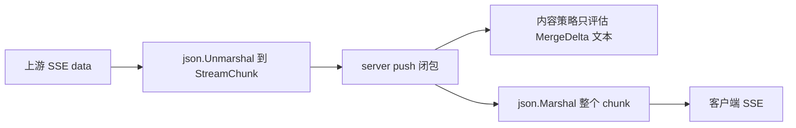

# GW-00 流式工具调用透传

Planned-with: grok-4.7-high
Suggested-Impl-Model: grok-4.7-high

**Goal:** 兼容流式对话响应里的 `delta.tool_calls` 原样到达客户端，分片顺序不变，结束原因原样保留。

**Architecture:** `StreamDelta` 增加 `json.RawMessage` 字段承接上游 JSON，不解析结构。流解析已经会把带 `choices` 的 chunk 交给 push；服务端推送闭包对合并后的文本做内容策略，再把整个 chunk 序列化写出。补上字段后，工具调用增量会随 chunk 走完这条链路。内容策略仍然只看文本，不看工具参数（主规划 D-1，已确认：不过策略，只透传）。

**Tech Stack:** Go 网关 `enterprise/apps/gateway`。

**Plan-Id:** `2026-11-09-gwr-gw00-stream-toolcalls`

---

## 根因与证据

主规划证据 A-02（原文，2026-11-09 快照；本子规划已按当前文件重新 Read，行号以本节核对结果为准）：

> - `enterprise/apps/gateway/internal/openai/types.go` 第 84–88 行的 `StreamDelta` 只有 `Role`、`Content`、`ReasoningContent` 三个字段，没有 `tool_calls`。
> - `enterprise/apps/gateway/internal/adaptor/openai.go` 约第 322 行 `json.Unmarshal([]byte(payload), &chunk)` 解码进 `openai.StreamChunk`，`tool_calls` 字段在这里被静默丢掉。
> - 对比：请求侧 `ChatCompletionRequest.Tools/ToolChoice`（第 39–40 行）和非流式响应 `ChatMessage.ToolCalls`（第 22 行）都会保留。
> - `rg "tool_calls|ToolCalls" enterprise/apps/gateway/internal/{adaptor,server}` 没有任何命中。
> - 后果：智能体类调用方走流式 + 工具时，拿不到工具调用。

2026-11-09 在本 worktree 重新 Read 后的锚点（与快照一致，行号未漂移）：

`enterprise/apps/gateway/internal/openai/types.go` 第 84–88 行：

```go
type StreamDelta struct {
	Role             string `json:"role,omitempty"`
	Content          string `json:"content,omitempty"`
	ReasoningContent string `json:"reasoning_content,omitempty"`
}
```

同文件第 20–22 行，非流式消息已经保留工具调用：

```go
// ToolCalls is kept verbatim so a relayed tool-call turn is not stripped.
// The gateway does not run tools itself.
ToolCalls        json.RawMessage `json:"tool_calls,omitempty"`
```

`enterprise/apps/gateway/internal/adaptor/openai.go` 第 322–337 行，解码后只要信封不是全空就会 `push(chunk)`：

```go
var chunk openai.StreamChunk
if err := json.Unmarshal([]byte(payload), &chunk); err != nil {
	return false, nil
}
if chunk.ID == "" && chunk.Object == "" && len(chunk.Choices) == 0 {
	return false, nil
}
// ... finish_reason 标记 terminal ...
if err := push(chunk); err != nil {
	return false, err
}
```

`encoding/json` 对结构体上不存在的字段静默丢弃。`StreamDelta` 没有 `tool_calls` 时，`push` 拿到的 chunk 里该字段已经没了。这是丢数据的位置，不是「空 content 就 return」的位置。

## 空 chunk 丢弃分支核对

主规划要求把「content 为空就丢弃 chunk」改成「content、reasoning_content、tool_calls 三者都为空才丢弃」。本次重新 Read 了指定的三处，**没有找到按 content 为空丢弃整个 chunk 的分支**。因此本子规划不新增丢弃条件。强行在三者都空时丢弃，会丢掉只有 `role` 或只有 `finish_reason` 的分片，纯文本流的行为会变，违反 FR-2。

逐条记录：

| 位置 | 行号 | 实际行为 | 本次是否改 |
| --- | --- | --- | --- |
| `adaptor/openai.go` `flushEvent` | 296–298 | `payload == ""` 时跳过空的 SSE data。与 delta 字段无关 | 不改 |
| `adaptor/openai.go` `flushEvent` | 323–325 | JSON 无法解码则跳过该事件 | 不改 |
| `adaptor/openai.go` `flushEvent` | 326–328 | 仅当 `ID`、`Object`、`Choices` 三者都空才跳过。带 `tool_calls` 的分片有 `choices`，不会被这条丢掉 | 不改 |
| `adaptor/openai.go` `flushEvent` | 335–337 | 通过上面检查后无条件 `push(chunk)` | 不改 |
| `openai/stream_reasoning.go` `MergeDelta` | 30–50 | `reasoning` 与 `content` 都空时返回 `""`。这是给内容策略用的合并文本，不是丢 chunk | 不改签名、不改返回值。工具参数不得拼进这段文本，否则会送进内容策略，违反 D-1 |
| `server/server.go` `handleStream` 的 `push` | 1168–1177 | `merged != ""` 才做内容策略，并只改写 `delta.Content`、累加 `responseBuilder` | 不改。工具调用分片的合并文本为空，策略自然跳过 |
| `server/server.go` `handleStream` 的 `push` | 1178 | 写出前清空 `delta.ReasoningContent`（思考文本已折进 content）。不清 `ToolCalls` | 不改 |
| `server/server.go` `handleStream` 的 `push` | 1180–1190 | 无论 content 是否为空，都 `json.Marshal(chunk)` 后写给客户端并 `Flush` | 不改。字段补上后 `tool_calls` 会在这里原样出现 |



## 精确落点

只改下面这个生产文件，并新增两个测试文件。

### 1. `enterprise/apps/gateway/internal/openai/types.go` 的 `StreamDelta`（当前第 84–88 行）

before：

```go
type StreamDelta struct {
	Role             string `json:"role,omitempty"`
	Content          string `json:"content,omitempty"`
	ReasoningContent string `json:"reasoning_content,omitempty"`
}
```

after（`gofmt` 后的实际形态）：

```go
type StreamDelta struct {
	Role             string `json:"role,omitempty"`
	Content          string `json:"content,omitempty"`
	ReasoningContent string `json:"reasoning_content,omitempty"`
	// ToolCalls 原样保留上游流式增量。网关不解析、不执行，也不送内容策略。
	ToolCalls json.RawMessage `json:"tool_calls,omitempty"`
}
```

`encoding/json` 已在文件顶部导入，不要新增 import。`json.RawMessage` 在解码时保留该字段的原始字节，再编码时按这些字节写回，分片顺序由上游 SSE 顺序决定，网关不合并、不重排。

`ChatMessage.ToolCalls`（第 22 行）已经是同样的类型，不要改它。

### 2. 不改的文件（核对过，改了会越界或破坏纯文本流）

- `enterprise/apps/gateway/internal/adaptor/openai.go`
- `enterprise/apps/gateway/internal/openai/stream_reasoning.go`
- `enterprise/apps/gateway/internal/server/server.go`

## FR / AC

- FR-1：上游兼容流中的 `delta.tool_calls` 原样到达客户端，顺序和分片不变；`finish_reason` 为 `tool_calls` 的分片原样到达。
  - AC-1：新增 `enterprise/apps/gateway/internal/adaptor/openai_stream_toolcalls_test.go`，测试函数 `TestOpenAIStreamPassesToolCallDeltasVerbatim`。用 `httptest.NewServer` 模拟上游，`Content-Type: text/event-stream`，按顺序写出 5 个 `data:` 事件和最后的 `data: [DONE]`：
    1. role 分片：`delta` 只有 `role`，值为 `assistant`。
    2. 工具分片 1：`tool_calls` 含 `index`、`id`、`type`、`function.name`，`function.arguments` 为空字符串。
    3. 工具分片 2：同一 `index`，`function.arguments` 为参数前半段。
    4. 工具分片 3：同一 `index`，`function.arguments` 为参数后半段。
    5. 结束分片：`delta` 为空对象，`finish_reason` 为 `tool_calls`。
    断言：
    - `OpenAIAdaptor.Stream` 返回的 error 为 nil。
    - push 收到的 chunk 数等于 5（`[DONE]` 不计入）。
    - 三个工具分片的 `Choices[0].Delta.ToolCalls` 与上游该字段的原始字节逐字节相等（`bytes.Equal`）。
    - role 分片与结束分片的 `ToolCalls` 长度为 0。
    - 最后一个 chunk 的 `FinishReason` 非 nil，且解引用后等于 `tool_calls`。
  - AC-2：新增 `enterprise/apps/gateway/internal/server/stream_toolcalls_test.go`，测试函数 `TestChatCompletionsStreamPassesToolCallArguments`。对 `Server.Router()` 发 `POST /v1/chat/completions`，body 含 `"stream": true`。上游同样推送上述 5 个分片和 `[DONE]`。断言客户端 SSE 的 `data:` 行里能解析出 `tool_calls`，三个分片的 `function.arguments` 按到达顺序拼接后等于上游原始参数字符串（三个 arguments 直接相连，含第一片的空串）。
- FR-2：纯文本流的行为不变。
  - AC-3：在 `enterprise/apps/gateway` 执行 `go test ./internal/adaptor/... ./internal/server/... ./internal/relay/...` 与 `go test ./... && go vet ./...`，全绿。不修改任何已有测试的断言。

## 测试构造要点

适配器测试直接调用 `NewOpenAIAdaptor().Stream`。渠道只需 `BaseURL` 指向上游测试服务器、`APIKey` 为非空占位（例如单个字母 `k`）。请求 `Model` 非空即可。不要写成长密钥字面量。

三个工具分片的 `tool_calls` JSON 在测试里用独立字符串常量保存，SSE 正文用这个常量嵌入，这样 `bytes.Equal` 对的是同一段字节。参数示例（实施时照此写，不要改语义）：

- 分片 1 arguments：`""`
- 分片 2 arguments：`{"city":`
- 分片 3 arguments：`"shanghai"}`
- 拼接结果：`{"city":"shanghai"}`

服务端测试走完整 `handleChatCompletions` 链路，不要直接调用 `handleStream`。现有 `getPublicKey` 用 `sync.Once` 缓存公钥，同包已有测试会设置另一把密钥。本测试用同包已有的 `newPATServer` 与令牌 `agx-pat-chat-only`（stub 返回 `workspace:chat`），避免再生成 JWT。在返回的 `*Server` 上补齐：

- `logger`：丢弃输出的 `slog`
- `policy`：`policyengine.NewEngine(nil)`
- `metering`：同包已有的 `capturingUsageSink`
- `decider`：`routing.NewDecider(config.Config{DefaultRoute: "third-party"})`
- `billingService`：`billing.NewService(nil)`
- `t.Setenv("GATEWAY_CHANNEL_REGISTRY", "on")`
- `channel.NewRegistry` 后 `SetSnapshot` 一条 `ProviderType: "openai"`、`Status: channel.StatusActive`、`TenantID: "tenant-1"`（与 PAT stub 的租户一致）、`SupportedModels` 含请求模型、`BaseURL` 为上游、`APIKey` 为 `k`
- `channel.NewPicker` + `adaptor.NewFactory(adaptor.NewOpenAIAdaptor())` + `keypool.NewPool()` + `relay.NewExecutor` 赋给 `relayExecutor`，并把 registry 赋给 `channelRegistry`

`useChannelRelay()` 为真时，`handleStream` 会走 `relayExecutor.Stream`，从而经过 `adaptor/openai.go` 的 `parseSSEStream` 和 `server.go` 的 push 闭包。响应正文里除上游分片外，成功结束还会追加用量行和 `[DONE]`。解析时跳过无法解成带 `choices` 的行，只拼接 `delta.tool_calls[].function.arguments`。

## In scope

- `StreamDelta.ToolCalls`
- 上面两个新测试

## Out of scope

- 其他入站或出站协议的工具调用映射（`outbound/claude.go`、`outbound/gemini.go`、`adaptor/claude.go`、`adaptor/bedrock.go`、`adaptor/gemini.go`）
- 对工具参数做内容策略
- 网关执行工具
- 修改 `MergeDelta` 签名或把工具参数折进可见文本
- 新增「三者都空则丢弃 chunk」的分支
- `relay/executor.go` 的重试与 `tokensSent`（GW-01）
- 修改任何已有测试的断言

## 验证命令

```bash
cd enterprise/apps/gateway && go test ./internal/adaptor/... ./internal/server/... ./internal/relay/...
cd enterprise/apps/gateway && go test ./... && go vet ./...
```

如需下载模块，先设置 `http_proxy=http://127.0.0.1:7900`、`https_proxy=http://127.0.0.1:7900`、`all_proxy=socks5://127.0.0.1:7900`。

## 观察到但未处理

- `enterprise/apps/gateway/internal/server/protocol_handlers.go` 第 321–344 行的另一条 push 闭包同样只在合并文本非空时做内容策略，并不按 content 为空丢弃 chunk。默认分支会 `json.Marshal` 整个 chunk，字段补上后兼容流式出口会带上 `tool_calls`。该文件服务其他入站协议，主规划 Out of scope，本次不改。
- `enterprise/apps/gateway/internal/provider/openai_http.go` 第 372–383 行有另一份 `parseSSEStream`，同样把 payload 解进 `openai.StreamChunk`。字段补上后这条旧路径也会保留 `tool_calls`。它不在本子规划落点里，不改、不补测试。
- `enterprise/apps/gateway/internal/adaptor/azure.go` 的流式路径复用 `parseSSEStream`，会跟着受益。不单独改。
- `enterprise/apps/gateway/internal/relay/executor.go` 第 244–252 行的 `tokensSent` 只看 `Content` 和 `ReasoningContent`。只有工具调用、没有文本的流，在 GW-01 落地前仍不算「已向客户端输出」。本次不改。
- `enterprise/apps/gateway/internal/outbound/claude.go`、`gemini.go`、`responses.go` 把 delta 编成其他协议时只读文本字段。流式工具调用不会出现在那些出口。主规划明确不做。
- `go test ./...` 时 `internal/mcphost` 的 `TestConnectorBackendExecuteActionMissingConnection` 失败：缺 `connectionId` 时期望 `IsError == true`，实际为 false。在还原本次 `StreamDelta` 改动后复跑仍然失败，与本子规划无关，不修。
