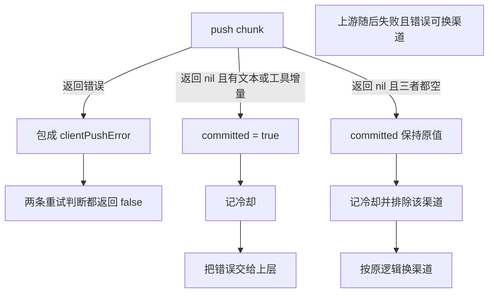

# GW-01 已向客户端输出即不再跨渠道重试

Planned-with: grok-4.7-high
Suggested-Impl-Model: grok-4.7-high

**Goal:** 流式响应一旦成功写给客户端一段有效增量，就不再换渠道从头生成；客户端写失败也不再重试。

**Architecture:** `streamOnChannel` 在 push 成功且 chunk 含文本、推理文本或工具调用增量时记下 `committed`。`Stream` 仍按原规则判断错误是否可换渠道，并照常记冷却；若已经 `committed`，则把该错误交给上层，不再把当前渠道放进排除集。客户端写失败包成私有错误，两条重试判断一开头就拒绝它。

**Tech Stack:** Go 网关 `enterprise/apps/gateway/internal/relay`。

**Plan-Id:** `2026-11-09-gwr-gw01-stream-retry-commit`

依赖：GW-00 已在 `openai.StreamDelta` 增加 `ToolCalls json.RawMessage`（`enterprise/apps/gateway/internal/openai/types.go` 第 88–89 行）。

---

## 根因与证据

主规划证据 A-01（原文）：

> - `enterprise/apps/gateway/internal/relay/executor.go`：`Stream()` 在 176–213 行，失败后只判断 `IsChannelRetryable(err)`，满足就换渠道重试（199–211 行）。
> - `streamOnChannel()` 在 221–297 行，第 244–253 行用 `tokensSent` 记录是否已推送内容，但它**只用于同渠道换 Key**（第 286 行 `canRetryKey := ... && !tokensSent`），没有传回 `Stream()`。
> - 推送函数 `push` 在 `enterprise/apps/gateway/internal/server/server.go` 约 1170–1190 行，直接 `w.Write` 给客户端并 `Flush`，同时 `responseBuilder.WriteString` 累积审计正文。
> - 后果：上游输出到一半返回 5xx、429 或网络错误时，换渠道从头再生成一遍，客户端收到「半段 A + 完整 B」，审计正文和计量也都被累加。
> - 另外，客户端断开导致 `w.Write` 返回的错误如果属于 `net.Error`，会被 `IsChannelRetryable` 判成可重试（第 368–371 行），于是为一个已经离开的客户端再调一次上游。

对照 U-01（主规划摘录）：响应一旦开始写给客户端，就不再重试。

2026-11-09 在本 worktree、GW-00 提交之后重新 Read，行号未漂移。当前代码：

`Stream` 第 205–210 行，可重试错误一律记冷却并排除该渠道：

```go
lastErr = err
if !IsChannelRetryable(err) {
	return StreamResult{Attempts: attempts, Channel: ch, KeyRef: result.keyRef}, err
}
e.picker.MarkFailure(ch, err.Error(), e.cooldown)
excludeChannels[ch.ID] = struct{}{}
```

`channelStreamOutcome` 第 215–219 行只有 `keyRef`、`latencyMS`、`attempts`，没有「是否已输出」。

`streamOnChannel` 第 244–253 行在调用 push **之前**把非空文本记成 `tokensSent`，第 286 行才使用它：

```go
var tokensSent bool
wrappedPush := func(chunk openai.StreamChunk) error {
	if len(chunk.Choices) > 0 {
		delta := chunk.Choices[0].Delta
		if strings.TrimSpace(delta.Content) != "" || strings.TrimSpace(delta.ReasoningContent) != "" {
			tokensSent = true
		}
	}
	return push(chunk)
}
```

```go
canRetryKey := IsKeyRetryable(err) && len(refs) > 0 && resolved.KeyRef != "" && resolved.KeyRef != "direct" && !tokensSent
```

`IsChannelRetryable` 第 368–371 行：`net.Error` 直接返回 true。`IsKeyRetryable` 第 339–342 行同样。

## 精确落点

只改 `enterprise/apps/gateway/internal/relay/executor.go`。新增测试 `enterprise/apps/gateway/internal/relay/stream_commit_test.go`。不改已有测试文件。

### 1. `committed` 的定义

在 `streamOnChannel` 的每次 key 尝试里，用 `committed bool` 替换 `tokensSent`。先调用 `push(chunk)`：

- 返回非 nil：包成 `&clientPushError{err: pushErr}` 并返回，**不**把这次记为 committed。
- 返回 nil，且该 chunk 的 `Content`、`ReasoningContent`、`ToolCalls` 三者之一非空：`committed = true`。

非空规则与现状对齐：

- `strings.TrimSpace(delta.Content) != ""`
- `strings.TrimSpace(delta.ReasoningContent) != ""`
- `len(bytes.TrimSpace(delta.ToolCalls)) > 0` 且不是 JSON `null`

没有 `choices` 的 chunk 不记 committed。只看 `Choices[0]`，与现在的 `tokensSent` 一样。

before（第 244–253 行）见上一节。after 意图：

```go
committed = false
wrappedPush := func(chunk openai.StreamChunk) error {
	if err := push(chunk); err != nil {
		return &clientPushError{err: err}
	}
	if len(chunk.Choices) > 0 && deltaHasClientPayload(chunk.Choices[0].Delta) {
		committed = true
	}
	return nil
}
```

`deltaHasClientPayload` 放在同文件，未导出。需要新增 `"bytes"` 导入。

### 2. `channelStreamOutcome` 增加字段

```go
type channelStreamOutcome struct {
	keyRef    string
	latencyMS int64
	attempts  []channel.Attempt
	committed bool
}
```

`committed` 在循环外声明，每次 key 尝试开始时置回 false。下面每条 return 都带上当前值：

| 行号 | 路径 | 回填 |
| --- | --- | --- |
| 258 | `factory.For` 失败 | `committed`（此时仍为 false） |
| 266 | 流成功 | 该次尝试的 `committed` |
| 294 | 不能再换 key，或已是最后一把 key | 该次尝试的 `committed` |
| 296 | 循环结束后的 `lastErr`（没有可用 key 时 `break` 到这里） | 循环变量里的 `committed`（break 发生在 push 之前，为 false） |

第 286 行改为 `!committed`，其余条件不变。同渠道换 key 的语义不变，只是把工具调用增量也算作已经输出。

### 3. `Stream` 第 205–210 行

before 见证据节。after：

```go
lastErr = err
if !IsChannelRetryable(err) {
	return StreamResult{Attempts: attempts, Channel: ch, KeyRef: result.keyRef}, err
}
e.picker.MarkFailure(ch, err.Error(), e.cooldown)
if result.committed {
	return StreamResult{Attempts: attempts, Channel: ch, KeyRef: result.keyRef}, err
}
excludeChannels[ch.ID] = struct{}{}
```

冷却照常记。已经输出时不再把渠道放进 `excludeChannels`，循环就此结束。未输出时行为与现在相同。

`Complete()` 第 54–97 行不改。

### 4. `clientPushError`

放在 `executor.go`，不导出：

```go
type clientPushError struct {
	err error
}

func (e *clientPushError) Error() string {
	if e == nil || e.err == nil {
		return "client push failed"
	}
	return e.err.Error()
}

func (e *clientPushError) Unwrap() error { return e.err }
```

`IsKeyRetryable`（第 323 行）和 `IsChannelRetryable`（第 354 行）在 `err == nil` 判断之后、其他判断之前：

```go
var pushErr *clientPushError
if errors.As(err, &pushErr) {
	return false
}
```

主规划伪代码写成 `errors.As(err, &clientPushError{})`。Go 的 `errors.As` 要写入匹配结果，目标必须是指向该错误类型的指针；这里错误值的动态类型是 `*clientPushError`，所以目标是 `**clientPushError`。语义仍是命中即返回 false。策略拦截返回的 `"policy blocked stream chunk"` 经过 `wrappedPush` 后也会被包住，结果仍是不重试。未经过 `wrappedPush` 的同文案错误（现有 `retry_test.go` 直接构造 `fmt.Errorf`）保持不重试，因为原文案本来就不满足状态码、网络错误或超时条件。不要改那个测试。



## FR / AC

- FR-1：流式请求在向客户端推送了任何有效内容之后失败，不换渠道重试，直接把错误交给上层。有效内容包括文本、推理文本，以及 GW-00 的工具调用增量。
  - AC-1：`TestStreamDoesNotRetryChannelAfterClientOutput`。上游 A 写出 2 个带 `content` 的 SSE 分片后断开连接，断开方式必须让 `Executor.Stream` 收到的错误满足 `IsChannelRetryable == true`（实现用 Hijack 写完分片后 `SetLinger(0)` 关闭连接，让读侧得到 `net.Error`）。上游 B 正常。断言：push 只收到 A 的 2 个 chunk；B 的请求计数为 0；返回 err 非 nil；A 在 picker 的 stats 里 `InCooldown(now)` 为 true。
  - AC-1b：同一文件 `TestStreamToolCallChunkCountsAsCommitted`。A 只写出一个没有文本、只有 `tool_calls` 的分片，然后用同样的方式断开。断言 B 的请求计数为 0，err 非 nil，A 进入冷却。这锁住主规划里「ToolCalls 非空也算 committed」的定义；AC-1 的正文分片覆盖不到它。
- FR-2：失败发生在推送任何内容之前时，仍然换渠道重试。
  - AC-2：`TestStreamRetriesChannelBeforeAnyOutput`。A 直接返回 HTTP 503，B 正常并写出一段 content。断言 B 被调用一次，push 收到 B 的完整内容，返回 err 为 nil。
- FR-3：客户端写失败不触发任何重试。
  - AC-3：`TestStreamDoesNotRetryWhenClientWriteFails`。两个上游都在线。push 第一次调用就返回 `&net.OpError{Op: "write", Err: errors.New("broken pipe")}`。断言上游合计只被调用一次，且 `IsChannelRetryable(返回的 err)` 为 false。
- FR-4：非流式 `Complete()` 不改。
  - AC-4：`go test ./internal/relay/...` 全绿，包括已有的 `integration_test.go`、`multi_protocol_integration_test.go`、`retry_test.go`。不改这些文件的断言。

## 测试构造要点

两个渠道的 ID 用 `a-up` 与 `b-up`，使排序后 A 在前。测试开始时 `t.Setenv("GATEWAY_AI_LB_POLICY", "prefix_cache")`，并且在 `channel.NewPicker` **之前**设置。请求带一条 content 为空的 user 消息，这样前缀哈希下标为 0，第一次必选 `a-up`，避免权重抽样。同包现有测试没有 `t.Parallel`，`t.Setenv` 在用例结束时还原。

渠道 `ProviderType` 为 `openai`，`Status` 为 active，`APIKey` 用单个字母 `k`，不要写成长密钥字面量。`TenantID` 留空，`Identity` 也留空，这样模型过滤不会按租户丢掉渠道。两条渠道的 `SupportedModels` 都包含请求模型。

503 用 `http.Error` 或 `WriteHeader(503)` 后返回。成功的 B 写出 `data: {"choices":[{"delta":{"content":"from-b"}}]}\n\n` 和 `data: [DONE]\n\n`。

统计冷却用创建 Picker 时传入的同一个 `*channel.StatsStore`：`stats.InCooldown("a-up", time.Now())`。

## In scope

- `executor.go` 的流式重试状态与 `clientPushError`
- `stream_commit_test.go`

## Out of scope

- 修改重试次数、冷却时长、`IsChannelRetryable` 对状态码的判断
- 在服务端补发「重试中」事件
- 非流式 `Complete()`
- 改 `server.go` 的 push 实现
- 改已有测试的断言

## 验证命令

```bash
cd enterprise/apps/gateway && go test ./internal/relay/...
cd enterprise/apps/gateway && go test ./... && go vet ./...
```

如需下载模块，先设置 `http_proxy=http://127.0.0.1:7900`、`https_proxy=http://127.0.0.1:7900`、`all_proxy=socks5://127.0.0.1:7900`。

## 观察到但未处理

- `go test ./...` 在 GW-00 验证时，`internal/mcphost` 的 `TestConnectorBackendExecuteActionMissingConnection` 已失败：缺连接时期望工具级错误，实际 `IsError` 为 false。还原 `StreamDelta` 改动后仍失败。与本子规划无关，不修。
- `provider/openai_http.go` 第 218–221 行的旧流式路径在「已经 push 过」后不再重放，但它不经过 `relay.Executor`。本子规划只改 executor。
- 客户端写失败被包住之后，`Error()` 仍返回内层文案，`Unwrap()` 仍能取出原来的 `net.Error`。调用方若绕过 `IsChannelRetryable`、直接对返回值做 `errors.As(..., *net.Error)`，仍会看成网络错误。主规划只要求两条重试判断返回 false，不改调用方。
