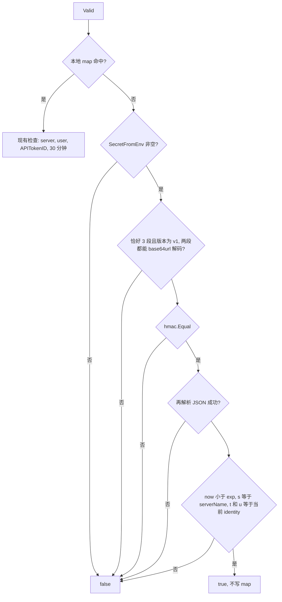

# MCP-01 MCP 会话 ID 自描述

Planned-with: grok-4.7-high
Suggested-Impl-Model: grok-4.7-high

**Goal:** 配置了会话密钥时，旧版 SSE 会话 ID 变成可跨副本校验的签名字符串；未配置时仍只用本进程内存表。同进程 `Remove` 继续只删本地表项。

**Master:** `.cursor/plans/2026-11-09-enterprise-gateway-registry-master.plan.md` 第 6 节 MCP-01。第 9 节 C-08（写操作幂等）是候选，不是本次范围。

---

## 根因与证据（原文）

- **A-07 MCP 旧版 SSE 会话绑定单进程。**
  - `enterprise/apps/gateway/internal/mcphost/transport_sse.go` 的 `sseSessionStore` 是进程内 map。
  - `transport.go` 第 72 行创建会话，第 94–97 行在 `HandleMessages` 里 `t.sessions.Valid(...)`，校验失败返回 400 `invalid session`。
  - JSON-RPC 响应直接写在 POST 的应答里（第 107–113 行），并不依赖 SSE 连接回传。所以只要会话 ID 能被任一副本校验，就可以跨副本工作。
  - 后果：多副本或滚动发布时，客户端的 `/messages` 落到另一个副本就会报错。
- **U-04 会话 ID 自描述。** `mcp/session.rs` 的 `SessionManager` 约在 886–1132 行：会话 ID 以 Base64 或 AES-256-GCM 编码，携带上游会话元数据，任一副本都能解码恢复。注意它的空闲回收不会调用 `delete_session`，我们不照抄这一点。

本次只做签名自描述。不加密 payload（payload 里没有机密），不做空闲回收时的上游删除，也不做吊销列表。

---

## 重新核对后的精确落点

2026-11-09 在本 worktree 重新 `Read`。主规划里的行号仍然对准，下面以当前代码为准。

| 锚点 | 文件与行号 | 现状 |
| --- | --- | --- |
| 内存表 | `enterprise/apps/gateway/internal/mcphost/transport_sse.go` 8–60 | `sseSession` 保存 `serverName`、`userID`、`tokenID`（`identity.APITokenID`）、`created`。`Create` 用 `hashText(serverName + identity.UserID + time.Now().String())` 当 key 写入 map。`Valid` 未命中直接 `false`；命中后要求 `serverName`、`userID`、`tokenID` 一致，且 `time.Since(sess.created) < 30*time.Minute`。`Remove` 只 `delete` |
| 创建 | `transport.go` 62–86 `SSETransport.Handle` | 第 72 行 `sessionID := t.sessions.Create(rec.Name, identity)`。ID 写入响应头 `X-MCP-Session-Id` 和 `endpoint` 事件的 `session` 查询参数。第 83–85 行在 `r.Context().Done()` 时 `t.sessions.Remove(sessionID)` |
| 校验 | `transport.go` 89–97 `HandleMessages` | 第 94 行 `sessionID := strings.TrimSpace(r.URL.Query().Get("session"))`。第 95 行仅当 `sessionID != ""` 时调用 `t.sessions.Valid(sessionID, rec.Name, identity)`，失败则 400 `invalid session` |
| 构造 | `transport.go` 56–58 `NewSSETransport` | `initMCPHost`（`server/mcp_handlers.go` 第 20 行，由 `server.go` 第 234 行在进程启动时调用）在托管开启时执行 `NewSSETransport()`。本次不改 `mcp_handlers.go` |
| 身份从哪来 | `server/mcp_handlers.go` 85–129（只读，不改） | `serveMCP` 用 `identityFromRequest`，再 `toMCPIdentity` 得到 `mcphost.Identity`（`TenantID`、`UserID`、`APITokenID` 等）。`serverName` 先取 URL 参数，再 `ResolveServer` 得到 `rec`。传到 `Valid` 的两个参数是 **`rec.Name`** 和这份 **`identity`**，不是原始 URL 字符串 |
| 密钥读取 | `internal/gatewayinternal/secret.go` 16–25 `SecretFromEnv` | 裸环境变量优先，否则读 `<NAME>_FILE`。`mcphost` 不被 `gatewayinternal` 引用，可以直接 import |
| 旧 ID 算法 | `host.go` 312–315 `hashText` | 同一包内，SHA-256 前 16 字节的 hex。未配置密钥时 `Create` 必须继续调用它，公式不改 |

`Handle` / `HandleMessages` 的函数签名和 400 文案不改。`Create` / `Valid` / `Remove` 的方法签名不改。

---

## 编码格式（全文）

配置了密钥时，会话 ID 为三段，用 `.` 连接：

```text
v1.<base64url(payload)>.<base64url(hmac)>
```

- 版本段必须是字面量 `v1`。不是 `v1`、段数不是 3、任一段 base64 解码失败：`Valid` 返回 `false`，不 panic。
- `payload` 是下面这个结构的 `json.Marshal` 字节（无空白，字段顺序就是结构体顺序）。Go 用 `encoding/json` 默认转义。校验方使用收到的原始字节，不要重新 Marshal 再比较。

```go
type sessionClaims struct {
    S   string `json:"s"` // serverName，即 Create 时的 rec.Name
    T   string `json:"t"` // identity.TenantID
    U   string `json:"u"` // identity.UserID
    Iat int64  `json:"iat"` // time.Now().Unix()
    Exp int64  `json:"exp"` // time.Now().Add(ttl).Unix()
}
```

不放入 `APITokenID`、邮箱、scopes、客户端 IP。主规划 payload 只有这五个字段。

- base64url 使用 `encoding/base64.RawURLEncoding`（无 `=` 填充）。不要用 `URLEncoding`，也不要 StdEncoding。
- HMAC 是 HMAC-SHA256。密钥是 `gatewayinternal.SecretFromEnv("GATEWAY_MCP_SESSION_SECRET")` 的原始字符串字节，不再 hash、不再 hex 解码。`SecretFromEnv` 返回空字符串表示未配置（含只含空白的情况，该函数已 TrimSpace）。
- 被签名的消息是 **payload 的原始 JSON 字节**（base64 解码后的那段），不是 `v1.` 前缀，也不是 base64 文本。
- 比较签名只用 `hmac.Equal(decodedMAC, computedMAC)`。禁止 `bytes.Equal` 或 `==`。长度不同时 `hmac.Equal` 返回 false，不会 panic。
- **先比较签名，通过之后才 `json.Unmarshal`。** Unmarshal 失败返回 false。
- 过期：`time.Now().Unix() >= exp` 为过期（当前秒必须严格小于 `exp`）。不看 `iat`，不做时钟偏移宽限。
- TTL：默认 `24 * time.Hour`。`GATEWAY_MCP_SESSION_TTL` 非空时用 `time.ParseDuration`。空串、解析失败、或 `<= 0` 都回落 24h，不额外打日志。`exp` 在 `Create` 时写入 ID，`Valid` 只读 ID 里的 `exp`，不重新读 TTL。

---

## 跨副本校验成功后不写入本地 map

不登记。理由来自现有连接生命周期，不是额外设计：

1. `Remove` 只在**持有这条 SSE 连接的副本**上执行（`transport.go` `Handle` 第 83–85 行，`r.Context().Done()`）。其他副本没有这条连接，插进去的条目永远不会被 `Remove`。
2. 现有 `Valid` 不删除过期条目。条目只靠 `Remove` 消失。跨副本登记会按会话数无界增长。
3. 本地命中优先，并且仍走 30 分钟 + `APITokenID` 检查。一旦登记，后续 `Valid` 不再走签名。超过 30 分钟后，即使签名的 `exp` 还没到也会返回 false，条目还占着 key，签名路径没有机会执行。跨副本会话的有效期会被错误收成 30 分钟。
4. 本地 map 的职责是本进程 SSE 连接：`Create` 写入，断开时 `Remove`。跨副本是否接受这个 ID，只由签名决定。

因此配置了密钥时：

- `Create` 返回编码 ID，**同时**用这个 ID 做 key 写入本地 map。`Remove(同一个 ID)` 仍然删得到，同进程断开时的删除语义不变。
- `Valid` 先查本地 map。命中则完全沿用现在的四项检查（server、user、token、30 分钟），**不**因为签名仍有效而改判 true。
- 未命中且配置了密钥：验签并检查 `exp`、`s == serverName`、`t == identity.TenantID`、`u == identity.UserID`。通过则返回 true，不写 map。
- 未命中且未配置密钥：返回 false。这就是今天的行为。
- 配置了密钥时，本进程 `Remove` 之后本地变为未命中，签名在 `exp` 之前仍然可以通过。这是「未命中才验签」的直接结果。吊销列表明确不做，所以 `Remove` 只释放本进程内存，不把 ID 拉黑。未配置密钥时，`Remove` 之后 `Valid` 仍然是 false。



---

## Before / After

### `Create`（`transport_sse.go`）

Before：始终 `hashText(...)`，写入 map，返回 hex ID。

After：

```go
func (s *sseSessionStore) Create(serverName string, identity Identity) string {
    id := newSessionID(serverName, identity)
    s.mu.Lock()
    s.sessions[id] = sseSession{
        serverName: serverName,
        userID:     identity.UserID,
        tokenID:    identity.APITokenID,
        created:    time.Now(),
    }
    s.mu.Unlock()
    return id
}
```

`newSessionID`：密钥为空时返回原来的 `hashText(serverName + identity.UserID + time.Now().String())`。密钥非空时 `encodeSessionID`。`json.Marshal` 对这个结构不会失败；若真的失败，回落到同一条 `hashText`，保证 `Create` 仍返回非空 ID，本地 `Remove` 还能对上。

### `Valid`（`transport_sse.go`）

Before：未命中即 `return false`，后面是四项本地检查。

After：把现有四项检查留在 `if ok` 分支里，一行不改判断式。`ok == false` 时才调用签名校验。签名通过后的顺序固定为：`exp`，然后 `s == serverName`，然后 `t`/`u` 与 `identity.TenantID` / `identity.UserID`。任一失败返回 false。不要在这个分支写 `s.sessions[id] = ...`。

### 启动警告（`transport.go` `NewSSETransport`）

Before：

```go
func NewSSETransport() *SSETransport {
    return &SSETransport{sessions: newSSESessionStore()}
}
```

After：先调用 `warnIfMCPSessionSecretUnset()`，再构造 store。

```go
var warnMCPSessionSecretOnce sync.Once

func warnIfMCPSessionSecretUnset() {
    warnMCPSessionSecretOnce.Do(func() {
        if gatewayinternal.SecretFromEnv("GATEWAY_MCP_SESSION_SECRET") == "" {
            slog.Warn("MCP SSE sessions stay process-local until GATEWAY_MCP_SESSION_SECRET is set; multi-replica deployments need it to validate session ids")
        }
    })
}
```

只在密钥为空时警告一次。这是运维日志，可以写环境变量名。托管未开启时 `NewSSETransport` 不会被调用，不警告。日志走 `slog.Default()`，见文末观察项。

`transport.go` 的 `Handle` / `HandleMessages` 不改。

---

## FR / AC

- **FR-1：** 一个副本签发的会话，另一个副本用同一密钥可以校验通过。
  - **AC-1：** 新文件 `enterprise/apps/gateway/internal/mcphost/transport_sse_session_test.go`，`package mcphost`。`TestSignedSessionValidAcrossStores`：
    - `t.Setenv("GATEWAY_MCP_SESSION_SECRET", "test-phrase-a")`，并把 `GATEWAY_MCP_SESSION_SECRET_FILE` 设为空，避免测试机上的文件密钥干扰。字面量用 `test-phrase-a` 这种不像凭据的短语，不要写成 `secret := "..."` 这种赋值。
    - 两个各自 `newSSESessionStore()` 的 store。身份 `TenantID=tenant-a`、`UserID=user-a`、`APITokenID=7`，server 名 `demo-server`。
    - A.Create 的 ID 以 `v1.` 开头，且恰好 3 段。
    - `A.Valid` 与 `B.Valid` 对同一 ID、同一 server、同一身份都为 true。
    - `A.Remove` 之后 `B.Valid` 仍为 true（B 的 map 里从来没有这条，证明没有依赖跨副本登记）。
    - 同一 ID 在 A 上用 `APITokenID=8` 调用 `Valid` 为 false（本地命中仍检查 token）。在 B 上用 `APITokenID=8` 为 true（签名不包含 token，B 未命中本地表）。
- **FR-2：** 篡改、过期、换人、换 server 都拒绝。格式损坏也不 panic。
  - **AC-2：** 同文件 `TestSignedSessionRejectsTamperExpiryUserAndServer`，密钥同上，两个独立 store。
    - 把 payload 解码后的第 1 个字节异或 `0x01`，再用 `RawURLEncoding` 编码回去，MAC 段保持原样。`B.Valid` 为 false。
    - 用 `encodeSessionID` 签一张 `exp = time.Now().Unix()-30` 的票（`s/t/u` 与校验参数一致）。`B.Valid` 为 false。
    - A.Create 的合法 ID：`B.Valid` 在 `UserID=user-b`（tenant 不变）时为 false；在 server 名 `other-server`（身份不变）时为 false。
  - **AC-2b：** 同文件 `TestSignedSessionRejectsMalformedID`。对 `B.Valid` 传入 `""`、`"v1.only"`、`"v1.a.b.c"`、`"v2."+合法后两段`、`"v1.***.***"`，全部为 false，测试本身不 panic。
- **FR-3：** 未配置密钥时行为与现在一致。
  - **AC-3：** 同文件 `TestUnsignedSessionRejectedByOtherStore`。把 `GATEWAY_MCP_SESSION_SECRET`、`GATEWAY_MCP_SESSION_SECRET_FILE`、`GATEWAY_MCP_SESSION_TTL` 都设为空。A.Create 的 ID 不以 `v1.` 开头；同一身份下 `A.Valid` 为 true；`B.Valid` 为 false。`A.Remove` 之后 `A.Valid` 为 false。
  - **AC-3b：** 不修改 `integration_test.go` 的任何断言。
  - **AC-4：** 在 `enterprise/apps/gateway` 下先 `unset http_proxy https_proxy all_proxy HTTP_PROXY HTTPS_PROXY ALL_PROXY GATEWAY_MCP_SESSION_SECRET GATEWAY_MCP_SESSION_TTL`，再 `go test ./... -count=1` 与 `go vet ./...`。已知 `TestConnectorBackendExecuteActionMissingConnection` 在基线就失败，不要修。除此之外全绿。只 gofmt 本次改动的文件；这些文件当前已是 gofmt 干净的。

TTL 回落不单列 FR。`TestSignedSessionTTLFromEnv` 把 `GATEWAY_MCP_SESSION_TTL` 设为 `1h`，解出 A.Create 的 payload，断言 `exp-iat == 3600`。再设为 `not-a-duration`，断言 `exp-iat == 86400`。

---

## In scope

- `enterprise/apps/gateway/internal/mcphost/transport_sse.go`
- `enterprise/apps/gateway/internal/mcphost/transport.go`（仅 `NewSSETransport` 增加一次警告）
- `enterprise/apps/gateway/internal/mcphost/transport_sse_session_test.go`
- 本 plan 文件

## Out of scope

- Streamable HTTP 传输（`StreamableHTTPTransport`，已经是无状态代理）
- 上游会话迁移、把编码 ID 还原成上游 MCP 会话
- 会话吊销列表，或让 `Remove` 在配置密钥后让签名失效
- 用 AES-GCM 加密 payload
- 主规划第 9 节 C-08：托管 MCP 写操作幂等去重
- 主规划第 7 节全部「明确不做」条目
- 修改 `server/mcp_handlers.go`、`integration_test.go` 的断言、桌面端、Python 框架
- 给签名 payload 增加 `APITokenID` 或随机 nonce（会改变已规定的字段集合）

**no-scope-creep：** 计划外问题只记在文末，不改代码。

---

## 观察到但未处理

- `cmd/gateway/main.go` 自己 `slog.New` 写 JSON 到 stdout，没有 `slog.SetDefault`。本次警告使用 `slog.Default()`，默认写到 stderr 文本日志。接到进程那份 JSON logger 必须改 `NewSSETransport` 的签名和 `mcp_handlers.go` 第 20 行，超出允许改的文件。
- 签发副本在 map 条目还在时，`Valid` 仍受 30 分钟和 `APITokenID` 约束；其他副本只检查签名、`exp`、`s`、`t`、`u`，有效期到 `exp`（默认 24h）。同一用户在同一秒内两次 `Create` 会得到相同 ID（`iat`/`exp` 都是秒，字段里没有 nonce）。不改 payload 字段。
- `HandleMessages` 在 `session` 查询参数为空时跳过 `Valid`（`transport.go` 第 95 行，改前就这样）。本次不改这个短路。
- 密钥从无到有之后，已经发出的 hex 会话 ID 在本地条目被 `Remove` 或请求落到其他副本时无法用签名补上。客户端需要重新连 SSE。不做旧 ID 的跨副本兼容。
- `TestConnectorBackendExecuteActionMissingConnection` 在本分支基线就失败，与会话 ID 无关。不修。
