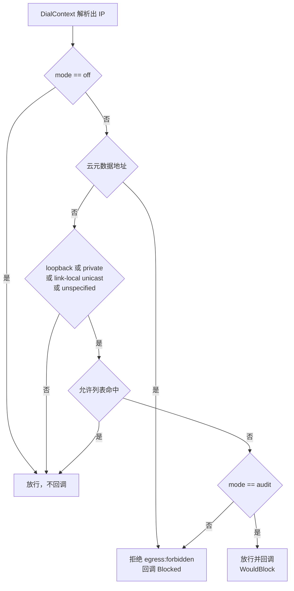

# SEC-01 MCP 出站访问守护

Planned-with: grok-4.7-high
Suggested-Impl-Model: grok-4.7-high

**Goal:** 给 Go 网关的 OpenAPI 后端与上游 MCP 反向代理加上拨号期出站守护。默认 `audit`（私网放行并记 would-block），`enforce` 才拒绝。云元数据地址除 `off` 外始终拒绝。本子规划不把默认模式改成 `enforce`（主规划决策 D-7）。

**Master:** `.cursor/plans/2026-11-09-enterprise-gateway-registry-master.plan.md` 第 6 节 SEC-01。

---

## 根因与证据（A-04，2026-11-09 快照原文）

- **A-04 出站守护覆盖不全。**
  - `connector-runtime/internal/executor/proxy.go` 有守护：第 101–116 行 `isLocalHost`（loopback、private、link-local、unspecified），第 154–172 行 `policyProxy`，第 174 行 `forbiddenByDNS`。
  - `enterprise/apps/gateway/internal/mcphost/backend_connector.go` 第 15 行注释写明复用了这个守护。
  - 但 `enterprise/apps/gateway/internal/mcphost/backend_openapi.go` 第 66–77 行直接用 `baseURL` 构造 `http.NewRequestWithContext`，没有地址守护。
  - `enterprise/apps/gateway/internal/mcp/handler.go` 第 79–160 行用 `rec.UpstreamURL` 做反向代理，也没有守护。
  - 后果：管理员误配置，或被导入的 OpenAPI 文档把 `servers[0].url` 指向云元数据地址 `169.254.169.254` 或内网管理口时，网关会代为请求。

**本次重新 Read 后的锚点（以代码为准）：**

| 锚点 | 现状行号 | 片段 |
| --- | --- | --- |
| `isLocalHost` | `connector-runtime/internal/executor/proxy.go` 100–116 | `ip.IsLoopback() \|\| ip.IsPrivate() \|\| ip.IsLinkLocalUnicast() \|\| ip.IsUnspecified()`。本包只参照这四项，不修改该文件 |
| OpenAPI 客户端来源 | `backend_openapi.go` 16–24 | `OpenAPIBackend.client` 在 `NewOpenAPIBackend` 里写成 `&http.Client{Timeout: 30 * time.Second}`，`Transport` 为 nil，因此走 `http.DefaultTransport` |
| OpenAPI 发请求 | `backend_openapi.go` 66–87 | `baseURL` 取自 spec，可被 `BackendConfig["base_url"]` 覆盖；`b.client.Do(req)`。失败时 `return textResult("upstream request failed: "+err.Error(), true), nil`，**Go error 仍是 nil** |
| 反向代理 Transport | `handler.go` 42–55、128–132 | `Handler.Client` 在 `NewHandler` 里是 `&http.Client{Timeout: 10 * time.Minute}`。`proxy.Transport = h.Client.Transport`，为 nil 时用 `http.DefaultTransport`。`Client.Timeout` **没有**作用到反向代理（只拷贝了 Transport） |
| 代理错误体 | `handler.go` 158–161、189–202 | `ErrorHandler` 固定写 `mcp:upstream_unreachable`，HTTP 502。`writeProxyError` 把该字符串同时放进 JSON 的 `error.message` 和 `error.code` |
| 上游 MCP 审计 | `handler.go` 205–234 | `writeAudit`：`h.Audit == nil` 则返回；`EventType: "mcp_tool_call"`，`Route: "mcp-proxy"`，`MCPStatus: status`，`MCPServer: rec.ID`，`_ = h.Audit.Write(&ev)` |
| 托管工具审计 | `mcphost/host.go` 237–293 | `writeToolAudit`：`EventType: "mcp_tool_call"`，`Route: "mcp"`，`MCPStatus: status`，`MCPServer: rec.Name`。字段定义在 `audit/writer.go` 第 64 行 `MCPStatus string \`json:"mcp_status,omitempty"\``。本子规划**不改** `host.go`，不新增审计列 |
| 连接器注释 | `backend_connector.go` 15 | 已复用连接器侧守护。不改 |

---

## 判定规则



云元数据地址（先把 IPv4-mapped 转成 IPv4 再比）：

- `169.254.169.254/32`
- `fd00:ec2::254/128`

这两项**先于**允许列表。`off` 才放行。`audit` 与 `enforce` 都是真拒绝（`Blocked=true`，`WouldBlock=false`），不是“只记录仍放行”。

其余保留地址只认这四项（与 `isLocalHost` 一致，不含组播）：

```go
ip.IsLoopback() || ip.IsPrivate() || ip.IsLinkLocalUnicast() || ip.IsUnspecified()
```

`Blocked` 与 `WouldBlock` 互斥。干净放行不调用 `onDecision`。

拨号必须连**已经判定过的那个 IP**（`net.JoinHostPort(ip.String(), port)`），不能再把主机名交给系统拨号，避免 DNS 重绑定。同一主机名解析出多个地址时：只要有一个在当前模式下应拒绝，整次拨号拒绝；`audit` 下私网只是 WouldBlock，仍拨第一个可用地址，并回调一次。

---

## 精确落点

### 1. 新包 `enterprise/apps/gateway/internal/egress/`

只依赖标准库，不引用 `audit`。

**`allowlist.go`**

- `func ParseAllowlist(raw string) *Allowlist`
- `func AllowlistFromEnv() *Allowlist` 读 `GATEWAY_EGRESS_ALLOWLIST`
- `func (a *Allowlist) Match(host string, ip net.IP) bool`，`a == nil` 返回 false

解析：按逗号拆，去掉空白，空段忽略。

- 含 `/`：`net.ParseCIDR`。非法段跳过，不影响其余段。
- `net.ParseIP` 成功：精确 IP。
- 以 `*.` 开头：后缀。`*.corp.example` 命中小写、去掉末尾点后**以 `.corp.example` 结尾**的主机名。命中 `a.corp.example`、`a.b.corp.example`。不命中 `corp.example`、`evilcorp.example`。
- 其他：主机名精确匹配（大小写不敏感，去掉末尾点）。

主机名规则看拨号主机名，CIDR / 精确 IP 看解析后的 IP。

**`guard.go`**

```go
type Mode string

const (
    ModeOff     Mode = "off"
    ModeAudit   Mode = "audit"
    ModeEnforce Mode = "enforce"
)

type Decision struct {
    Host       string
    IP         net.IP
    Blocked    bool
    WouldBlock bool
    Reason     string // "metadata" | "restricted" | ""
}

var ErrForbidden = errors.New("egress:forbidden")
```

- `func ModeFromEnv() Mode` 读 `GATEWAY_EGRESS_GUARD_MODE`。去空白、小写。`off` / `audit` / `enforce`。空串和其他值都是 `ModeAudit`。
- `func Decide(mode Mode, allow *Allowlist, host string, ip net.IP) Decision` 纯函数，供测试直接断言，不拨号。
- `type Resolver func(ctx context.Context, network, host string) ([]net.IP, error)`
- `func NewHTTPClient(base *http.Client, mode Mode, allow *Allowlist, onDecision func(Decision)) *http.Client`
- `func NewHTTPClientWithResolver(base *http.Client, mode Mode, allow *Allowlist, resolver Resolver, onDecision func(Decision)) *http.Client`

`NewHTTPClient` 即 resolver 为 nil。nil resolver 的默认实现：主机名已经是 IP（允许去掉 `%zone`）则直接返回该 IP，**不调用** `net.Resolver`；否则 `net.DefaultResolver.LookupIP`，`tcp4`/`udp4` 用 `"ip4"`，`tcp6`/`udp6` 用 `"ip6"`，其余用 `"ip"`。

客户端构造：

- `base == nil` 时用 `&http.Client{}`。
- 浅拷贝 `*base`（保留 Timeout、Jar、CheckRedirect）。
- Transport：`*http.Transport` 则 `Clone()`；nil 则 `http.DefaultTransport.(*http.Transport).Clone()`。**禁止**把 `DialContext` 写进全局 `DefaultTransport`。
- 其他 RoundTripper 类型：换成新的 `*http.Transport`（当前两个接入点都是 nil Transport，不会走到）。
- 把 `DialContext` 设为守护拨号。拨号函数默认为 `(&net.Dialer{}).DialContext`，同包测试可替换，不导出。

`DialContext(ctx, network, address)`：

1. `net.SplitHostPort`。失败则原样返回该错误。
2. 主机名去掉末尾点。IP 字面量（含去掉 `%zone`）不经过 resolver。
3. resolver 出错或没有任何与 `network` 兼容的地址：返回该错误，**不是** `ErrForbidden`，不回调。
4. 按上一节规则选出 IP 或拒绝。
5. 仅当 `Blocked || WouldBlock` 且 `onDecision != nil` 时回调一次。回调发生在返回错误或真正拨号之前。
6. 拒绝时 `return nil, ErrForbidden`（`Error()` 就是 `egress:forbidden`，便于 `errors.Is`）。
7. 放行时拨 `JoinHostPort(ip.String(), port)`。IPv4 且 network 为 `tcp`/`tcp4` 时用 `tcp4`；IPv6 且 network 为 `tcp`/`tcp6` 时用 `tcp6`。

### 2. `enterprise/apps/gateway/internal/mcphost/backend_openapi.go`

**before**（20–24 行，77–87 行）：构造时固定一个无守护的 `http.Client`，`CallTool` 调 `b.client.Do`。

**after**：去掉长期持有的 `client` 字段。构造时只记下超时、模式和允许列表；每次 `CallTool` 按这次的 server / 工具名组装 client，这样回调能带上审计维度，又不改 `host.go`。

```go
type OpenAPIBackend struct {
    timeout time.Duration
    mode    egress.Mode
    allow   *egress.Allowlist
    hook    func(egress.Decision)
    audit   audit.EventWriter
}

func NewOpenAPIBackend() *OpenAPIBackend {
    return &OpenAPIBackend{
        timeout: 30 * time.Second,
        mode:    egress.ModeFromEnv(),
        allow:   egress.AllowlistFromEnv(),
    }
}

func (b *OpenAPIBackend) SetDecisionHook(fn func(egress.Decision)) { b.hook = fn }
func (b *OpenAPIBackend) SetAuditWriter(w audit.EventWriter)       { b.audit = w }

func (b *OpenAPIBackend) httpClient(rec *ServerRecord, tool string) *http.Client {
    return egress.NewHTTPClient(&http.Client{Timeout: b.timeout}, b.mode, b.allow, func(d egress.Decision) {
        if b.hook != nil {
            b.hook(d)
        }
        b.writeEgressAudit(rec, tool, d)
    })
}
```

`CallTool` 里把 `b.client.Do(req)` 换成 `b.httpClient(rec, name).Do(req)`。错误仍走现有 `textResult("upstream request failed: "+err.Error(), true), nil`，这样 `egress:forbidden` 会出现在文本里。

`writeEgressAudit`：`b.audit == nil` 或既非 Blocked 也非 WouldBlock 则返回。否则：

- `MCPStatus`：`Blocked` → `egress_blocked`，否则 `egress_would_block`
- `EventType`: `mcp_tool_call`
- `Route`: `mcp`
- `ClientType`: `web-portal`（与 `host.go` 的 `clientTypeLabel` 在非 PAT 时一致；这里没有 identity，不猜 PAT）
- `MCPServer`: `rec.Name`（rec 为 nil 则空）
- `MCPToolName`: tool
- `ID`: `fmt.Sprintf("audit_%d", time.Now().UnixNano())`
- `EventTime`: UTC RFC3339
- `Digest.ResponseSummary`: `d.IP.String()`
- `_ = b.audit.Write(&ev)`

`ListTools` 不发 HTTP，不改。

### 3. `enterprise/apps/gateway/internal/mcp/handler.go`

**before**（49–55、128–161 行）：`NewHandler` 放入无守护 Client；`ServeHTTP` 把 `h.Client.Transport` 或 `DefaultTransport` 交给反向代理；`ErrorHandler` 一律 `mcp:upstream_unreachable`。

**after**：

`NewHandler` 仍创建 `&http.Client{Timeout: 10 * time.Minute}` 放到 `Client`。另外保存：

```go
egressMode egress.Mode       // egress.ModeFromEnv()
allowlist  *egress.Allowlist // egress.AllowlistFromEnv()
```

这两个字段不导出。模式和允许列表在 `NewHandler` 时读取一次。

`ServeHTTP` 在 `httputil.NewSingleHostReverseProxy` 之后，不再使用 `h.Client.Transport == nil` 就回落 `DefaultTransport` 的旧分支。改为：

```go
guarded := egress.NewHTTPClient(h.Client, h.egressMode, h.allowlist, func(d egress.Decision) {
    if !d.Blocked && !d.WouldBlock {
        return
    }
    status := "egress_would_block"
    if d.Blocked {
        status = "egress_blocked"
    }
    summary := ""
    if d.IP != nil {
        summary = d.IP.String()
    }
    h.writeAudit(id, rec, toolName, status, started, hashText(string(bodyBytes)), summary)
})
proxy.Transport = guarded.Transport
```

`h.Client` 本身保持无守护，避免请求嵌套包裹。`Client.Timeout` 仍然不套到反向代理上（与现状一致，不顺手修）。

`ErrorHandler`：

```go
code := "mcp:upstream_unreachable"
if proxyErr != nil && (errors.Is(proxyErr, egress.ErrForbidden) || strings.Contains(proxyErr.Error(), "egress:forbidden")) {
    code = "egress:forbidden"
}
writeProxyError(rw, http.StatusBadGateway, code, serverID)
```

状态码仍是 502。JSON 的 message 和 code 都会带上 `egress:forbidden`。其他拨号失败仍是 `mcp:upstream_unreachable`。

---

## FR / AC

- **FR-1：** `enforce` 下，云元数据地址、以及不在允许列表中的私网 / 环回 / 链路本地 / 未指定地址，拨号失败，错误为 `egress:forbidden`。`audit` 对云元数据同样拒绝。命中允许列表的保留地址放行。公网放行。允许列表不能放开云元数据。
  - **AC-1：** 新文件 `enterprise/apps/gateway/internal/egress/guard_test.go`。
    - `TestDecideModes` 表驱动，直接调 `Decide`，不拨号、不解析 DNS。行至少包括：
      - `127.0.0.1`、`10.0.0.5`、`::1`：`off` 放行；`audit` 为 `Blocked=false, WouldBlock=true, Reason=restricted`；`enforce` 为 `Blocked=true, WouldBlock=false, Reason=restricted`。
      - `169.254.169.254` 与 `fd00:ec2::254`：`off` 放行；`audit` 和 `enforce` 都是 `Blocked=true, Reason=metadata`。即使允许列表含 `169.254.169.254/32` 或 `fd00:ec2::254/128` 也一样。
      - `10.1.2.3` 且允许列表 `10.1.0.0/16`：三种模式都放行，`WouldBlock=false`。
      - `93.184.216.34`：三种模式都放行。
      - `::ffff:169.254.169.254` 在 `audit` 下按元数据拒绝。
    - `TestAllowlistHostPatterns`：`*.corp.example,10.0.0.0/8` 命中 `a.corp.example` 与 `10.1.2.3`；不命中 `corp.example`、`evilcorp.example`。非法段 `bad/99` 被跳过。大小写 `Foo.CORP.Example` 命中后缀。
    - `TestModeFromEnv`：`t.Setenv` 覆盖空串、`audit`、`enforce`、`off`、`nope`，空串和 `nope` 都是 `ModeAudit`。
    - `TestDialUsesInjectedResolverNotDNS`：resolver 仅当主机名为 `rebind.test` 时返回 `169.254.169.254`，并计数。`NewHTTPClientWithResolver` + `ModeEnforce`，`GET http://rebind.test/latest`。断言 resolver 被调用，错误满足 `errors.Is(..., ErrForbidden)`，且同包拨号桩没有被调用。
    - `TestDialConnectsToResolvedIP`：resolver 把 `name.test` 解析为 `10.0.0.5`，模式 `audit`。同包拨号桩记录地址后返回普通错误。断言拨号地址是 `10.0.0.5:80`，回调恰好一次且 `WouldBlock=true`。再测公网 `93.184.216.34:8080`：拨号地址是该 IP 加端口，回调次数为 0。
- **FR-2：** 默认 `audit` 下，监听在 `127.0.0.1` 的现有后端仍能调用成功，同时回调 `WouldBlock=true`。`enforce` 且无允许列表失败；加上 `127.0.0.1/32` 后成功。已有测试不改断言。
  - **AC-2：** 新文件 `enterprise/apps/gateway/internal/mcphost/backend_openapi_egress_test.go`。用 `net.Listen("tcp", "127.0.0.1:0")` + `httptest.NewUnstartedServer` 固定环回地址。OpenAPI 文档只含 `GET /ping`、`operationId=ping`，`BackendConfig["base_url"]` 指向该服务器，响应体 `{"ok":true}`。
    - `audit` 且允许列表空：`CallTool` 的 Go error 为 nil，`IsError` 为 false，正文含 `ok`，hook 收到 `WouldBlock=true` 且 `Blocked=false`。同一用例 `SetAuditWriter` 后至少一条 `MCPStatus == "egress_would_block"`。
    - `enforce` 且允许列表空：Go error 为 nil（沿用现有吞错），`IsError` 为 true，正文含 `egress:forbidden`，服务器处理函数未被调用。
    - `enforce` 且 `GATEWAY_EGRESS_ALLOWLIST=127.0.0.1/32`：调用成功，hook 不被调用。
  - **AC-2b：** `go test ./internal/mcphost/...` 时不修改 `openapi_loader_test.go` 等已有断言。`NewOpenAPIBackend` 在未设置 `GATEWAY_EGRESS_GUARD_MODE` 时为 `audit`，环回拨号仍成功。
- **FR-3：** 上游 MCP 反向代理使用同一守护。`enforce` 访问 `127.0.0.1` 返回 502，错误体含 `egress:forbidden`，并写审计。
  - **AC-3：** 只在 `enterprise/apps/gateway/internal/mcp/handler_test.go` **追加** `TestHandlerEgressEnforceLoopbackForbidden`。不改已有三个测试的断言。
    - `t.Setenv("GATEWAY_EGRESS_GUARD_MODE", "enforce")`，允许列表设为空串。
    - 上游 `httptest` 若被调用则 `t.Fatal`。
    - 路由写法对齐 `TestHandlerProxyForwardsRequest`（chi `/v1/mcp/{server_id}/*`，POST JSON-RPC）。
    - 内存版 `audit.EventWriter`（带 mutex）断言至少一条 `MCPStatus == "egress_blocked"`，且 `MCPServer` 为该记录的 ID。
    - `w.Code == 502`，`w.Body` 含 `egress:forbidden`。
  - **AC-3b：** 已有 `TestHandlerProxyForwardsRequest` 在环境变量未设成 `enforce` 时仍为 200。默认 `audit` 会多写一条 would-block 审计，该测试不读审计文件，断言保持不动。

验收命令（主规划第 0 节，并按本次任务跑全包）：

```bash
cd enterprise/apps/gateway && go test ./... && go vet ./...
```

下载模块时若需代理，先导出 `http_proxy` / `https_proxy` / `all_proxy` 指向 `127.0.0.1:7900`。跑测试前去掉这些代理变量，避免环回上游被环境代理转走。同时保证进程环境里没有把 `GATEWAY_EGRESS_GUARD_MODE` 设成 `enforce`。

---

## In scope

- 新包 `internal/egress`（`guard.go`、`allowlist.go`、`guard_test.go`）
- `mcphost/backend_openapi.go` 与新测试 `backend_openapi_egress_test.go`
- `mcp/handler.go` 与 `handler_test.go` 追加用例
- 本 plan 文件

## Out of scope

- 管理台允许列表界面、租户级允许列表（主规划候选 C-03）
- 导入 OpenAPI 时检查 `servers[0].url`
- 修改 `connector-runtime`（含 `proxy.go` / `executor.go`）
- 修改 `backend_connector.go`、`host.go`、`adaptor/*`
- 把默认模式改成 `enforce`，或写切换说明（D-7 明确本子规划不做）
- 新增审计表列或改 `audit.Event` 结构
- 给反向代理补上 `Client.Timeout`（现状本来就没套上）
- HTTP 环境代理下改写目标地址的检查方式
- 组播地址拦截（`isForbiddenIP` 有，主规划点名的四项没有）

**no-scope-creep：** 计划外问题只记在文末，不改代码。

---

## 观察到但未处理

- `Host.NewHost`（`mcphost/host.go` 第 51 行）调用 `NewOpenAPIBackend()` 时没有 `audit.EventWriter`。主规划把接入点限制为 OpenAPI client 与 MCP 反向代理两处，因此本计划不改 `host.go`。生产上的托管 OpenAPI 调用会执行守护，但 `audit` 字段为 nil，**不会**写出 `egress_would_block` / `egress_blocked`。写入路径由 `SetAuditWriter` 单测覆盖。反向代理生产路径有 `Handler.Audit`，会写。
- `connector-runtime/internal/executor/executor.go` 第 174–176 行的 `isForbiddenIP` 还包含 `IsLinkLocalMulticast` 与 `IsMulticast`。主规划要求对齐 `proxy.go` 第 101–116 行的四项，组播不拦。
- `http.DefaultTransport` 使用环境代理时，`DialContext` 看到的是代理地址，不是上游主机。守护会判定代理 IP。本计划不改 `Transport.Proxy`。
- `NewOpenAPIBackend` / `NewHandler` 只在构造时读环境变量，运行中修改不会热更新。
- OpenAPI `CallTool` 把传输错误收成 `CallResult.IsError` 文本，返回的 Go error 仍是 nil（`backend_openapi.go` 第 85–87 行）。enforce 失败要断言文本，不能断言 `err != nil`。
- 不实现多地址 Happy Eyeballs。一个主机名只拨选定的一个 IP。
- 链路本地地址若带 `%zone`，判定前会去掉 zone；放行后按无 zone 的 IP 拨号，可能拨不通。不在允许列表里的链路本地地址在 enforce 下会先被拒绝。
- `enterprise/apps/gateway/internal/mcphost/backend_connector_test.go` 的 `TestConnectorBackendExecuteActionMissingConnection` 在本分支上本来就失败，与本次出站守护无关（未改该测试、未改连接器执行器）。失败原因：替身存储里该连接器只有一条连接，`connector-runtime/api/tools.go` 约 200–210 行在未传 `connectionId` 时会自动选用这一条，上游返回 200，`IsError` 为 false；测试仍断言缺连接必须是工具级错误。本次不改。
