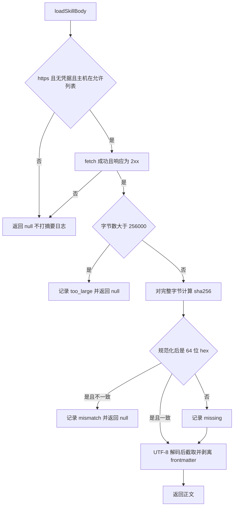

# SEC-02 技能内容完整性校验

Planned-with: grok-4.7-high
Suggested-Impl-Model: grok-4.7-high

**Goal:** 门户在把已扫描技能的正文放进提示词之前，用登记的内容摘要核对本次拉到的完整字节。摘要不一致或响应超过字节上限时不进入提示词。摘要为空的存量技能默认放行，并留下日志。

**决策 D-2（已确认，不得改）：** `bundleDigest` 为空、空白，或规范化后不是 64 位 hex 时，默认放行，并记录 `chat.skill_bundle_digest_missing`。不实现严格模式，不读取任何「必须有摘要」的环境变量。

**行号复核：** 2026-11-09 在本 worktree（`gwr/sec02`）重新 Read。主规划 A-03 引用的行号未漂移，下文以本次 Read 为准。

---

## 根因与证据

复制主规划证据 A-03（不是只写编号）：

- **A-03 技能正文加载不校验摘要。**
  - `enterprise/apps/web-portal/src/lib/enterprise-skill-bundle.ts` 的 `loadSkillBody(bundleUri, fetchImpl)` 校验了 https、无凭据、主机在允许列表内、`redirect: "error"`、2.5 秒超时，然后截取前 24000 字节，**不校验摘要**。
  - 调用方是 `enterprise/apps/web-portal/src/lib/enterprise-skill-context.ts` 第 43 行 `loadSkillBody(source?.bundleUri || null)`，没有传 digest。
  - 门控只依据 `scanVerdict === "safe"`（第 40 行）。`capability-packs-reader.ts` 第 49、95、125 行已经读出 `bundleDigest`。
  - 后果：扫描通过之后，托管方修改了 URL 背后的内容，用户实际拿到的是**未经扫描的提示词**。

本次 Read 锚点（与 A-03 一致）：

- `enterprise-skill-bundle.ts` 第 1 行 `const MAX_BYTES = 24_000;`
- 第 13–16 行签名是 `(bundleUri, fetchImpl = fetch)`，没有摘要参数。
- 第 24 行 `url.protocol !== "https:" || url.username || url.password`
- 第 26 行 `skillBundleAllowlist().has(host)`
- 第 29–31 行 `redirect: "error"` 与 `AbortSignal.timeout(2500)`
- 第 37 行 `const text = (await response.text()).slice(0, MAX_BYTES);` 之后直接剥离 frontmatter，中间没有摘要比较。
- `enterprise-skill-context.ts` 第 40 行 `item.scanVerdict === "safe"`，第 43 行 `loadSkillBody(source?.bundleUri || null)`。
- `capability-packs-reader.ts` 第 49 行 `bundleDigest?: string;`，第 95 行 `bundleDigest: string | null;`，第 125 行 `bundleDigest: row.bundleDigest ?? ""`。

---

## `capabilityStatesFromView` 是否带 `bundleDigest`

**带。本次不改 `capability-packs-reader.ts`。**

依据：

- `UserCapabilityState`（第 71 行）是 `PortalCapability & { state: CapabilityState }`。
- `PortalCapability`（第 39–59 行）已有可选字段 `bundleDigest?: string`。
- 技能行经 `toSkillCapability`（第 112–130 行）写入 `bundleDigest: row.bundleDigest ?? ""`。数据库为 null 时变成空字符串，字段本身仍在。
- `capabilityStatesFromView`（第 321–326 行）是 `view.assigned.map((item) => ({ ...item, state }))`，展开后保留 `bundleDigest`。
- 上下文只对 `kind === "skill"` 的项加载正文（`enterprise-skill-context.ts` 第 29 行），这些项来自 `toSkillCapability`，因此 `source?.bundleDigest` 类型为 `string | undefined`。空字符串由调用点 `|| null` 收成「无摘要」。

不把 `bundleDigest` 改成必填，不改 `?? ""` 的收口。那会碰到 MCP 项和已有测试，超出「只加字段」的前提，而字段已经存在。

---

## 精确落点

只改这三个文件：

| 文件 | 改什么 |
| --- | --- |
| `enterprise/apps/web-portal/src/lib/enterprise-skill-bundle.ts` | 签名、字节上限、sha256、摘要判定、日志 |
| `enterprise/apps/web-portal/src/lib/enterprise-skill-context.ts` | 仅第 43 行补上第二个参数 |
| `enterprise/apps/web-portal/src/lib/__tests__/enterprise-skill-bundle.test.ts` | 旧调用补 `null`；追加新用例 |

`loadSkillBody` 的全部调用方（已用检索确认，只有上面两处加测试文件）：

- 生产：`enterprise-skill-context.ts` 第 43 行。
- 测试：`enterprise-skill-bundle.test.ts` 第 16、17、18、24、26 行。

---

## Before / After

### 1. `loadSkillBody`

Before（第 13–41 行，摘要）：

```ts
export async function loadSkillBody(
  bundleUri: string | null,
  fetchImpl: typeof fetch = fetch,
): Promise<string | null> {
  // https / 凭据 / 允许列表 / redirect:error / 2.5s / 非 2xx → null
  const text = (await response.text()).slice(0, MAX_BYTES);
  // 再按现有规则剥离 frontmatter
}
```

After：文件顶部增加导入（禁止函数体内 inline import）：

```ts
import { createHash } from "node:crypto";

import { log } from "./observability/logger";
```

保留 `MAX_BYTES = 24_000` 与 `skillBundleAllowlist`，不动允许列表解析。新增常量与两个仅本文件使用的函数：

```ts
const MAX_FETCH_BYTES = 256_000;

function normalizeExpectedDigest(expectedDigest: string | null): string | null {
  if (expectedDigest == null) return null;
  const trimmed = expectedDigest.trim().toLowerCase();
  if (!trimmed) return null;
  const hex = trimmed.startsWith("sha256:") ? trimmed.slice("sha256:".length) : trimmed;
  return /^[0-9a-f]{64}$/.test(hex) ? hex : null;
}

function stripFrontmatter(text: string): string {
  const clipped = text.slice(0, MAX_BYTES);
  if (!clipped.startsWith("---")) return clipped;
  const end = clipped.indexOf("\n---", 3);
  if (end === -1) return clipped;
  return clipped.slice(end + 4).replace(/^\n/, "");
}
```

`stripFrontmatter` 必须与现在第 37–41 行逐字等价：先按字符截到 24000，再找 frontmatter。不要改成按字节截断，不要改闭合标记的查找方式。

签名与读取：

```ts
export async function loadSkillBody(
  bundleUri: string | null,
  expectedDigest: string | null,
  fetchImpl: typeof fetch = fetch,
): Promise<string | null> {
  // 第 17–36 行的 URL、允许列表、fetch、非 2xx 判断保持原样，这些路径直接 return null，不打摘要日志
  const bytes = Buffer.from(await response.arrayBuffer());
  if (bytes.byteLength > MAX_FETCH_BYTES) {
    log("warn", {
      event: "chat.skill_bundle_too_large",
      bundle_host: host,
      byte_length: bytes.byteLength,
    });
    return null;
  }
  const actual = createHash("sha256").update(bytes).digest("hex");
  const expected = normalizeExpectedDigest(expectedDigest);
  if (expected && expected !== actual) {
    log("warn", {
      event: "chat.skill_bundle_digest_mismatch",
      bundle_host: host,
      expected_digest: expected,
      actual_digest: actual,
    });
    return null;
  }
  if (!expected) {
    log("warn", {
      event: "chat.skill_bundle_digest_missing",
      bundle_host: host,
    });
  }
  return stripFrontmatter(bytes.toString("utf8"));
}
```

规则（实现时按此判定，不要另加开关）：

1. 摘要对象是**本次响应的完整字节**（通过上限的那一份），不是剥离 frontmatter 之后的文本，也不是截到 24000 字符之后的文本。
2. `expectedDigest`：去首尾空白 → 转小写 → 若以 `sha256:` 开头则去掉这一次前缀 → 剩余部分必须匹配 `/^[0-9a-f]{64}$/`。前缀只去一次。去掉前缀后不再 trim。不满足就当作无摘要。
3. 比较用规范化后的 hex 与 `digest("hex")`（已是小写）做字符串全等。
4. 有合法摘要且不一致：返回 null，`warn` + `chat.skill_bundle_digest_mismatch`。不要同时打 missing。
5. 无摘要：放行（继续解码、截断、剥离），`warn` + `chat.skill_bundle_digest_missing`。不要打 mismatch。
6. 字节数 `> 256_000`：返回 null，`warn` + `chat.skill_bundle_too_large`。不要做 hash，不要打 missing / mismatch。恰好 256000 字节放行并进入摘要判定。
7. 日志字段只用 `event`、`bundle_host`、`byte_length`、`expected_digest`、`actual_digest`。`bundle_host` 用已经算好的 `host`（hostname 小写），不写完整 URL。mismatch 只写规范化后的 64 位 hex。missing / too_large 不写原始 `expectedDigest`，避免把误填进摘要栏的凭据打进日志。不写响应正文。
8. URL 不合法、非 https、带用户信息、主机不在允许列表、fetch 抛错、非 2xx：保持今天的 `return null`，不打这三条新日志。



### 2. 调用点

`enterprise-skill-context.ts` 第 43 行：

```ts
// before
const body = await loadSkillBody(source?.bundleUri || null);
// after
const body = await loadSkillBody(source?.bundleUri || null, source?.bundleDigest || null);
```

第 44–47 行 `chat.skill_bundle_skipped` 不动。摘要不一致、超限、网络失败仍然都表现为 `body` 为 null，由这条既有日志覆盖「没加载到正文」；区分原因靠 `loadSkillBody` 里的新事件。

### 3. 测试调用适配

`enterprise-skill-bundle.test.ts` 里 5 处旧调用把第二个参数改成 `null`，`fetchImpl` 挪到第三个参数。`expect(...).toBeNull()` 与 `expect(body).toBe("步骤")` **一字不改**。第 17 行末尾的 `// gitleaks:allow` 留在同一行。

成功的那条旧用例（正文是 frontmatter + `步骤`，摘要传 null）会多打一条 `chat.skill_bundle_digest_missing`。这是 D-2，返回值仍是 `步骤`。不要为了让旧用例安静而删掉这条日志。

---

## FR / AC

- **FR-1：** 摘要不一致的技能正文不进入提示词。合法摘要一致时，仍按原规则剥离 frontmatter 后返回正文。
  - **AC-1：** 在 `enterprise/apps/web-portal/src/lib/__tests__/enterprise-skill-bundle.test.ts` 追加用例。夹具正文固定为 `"---\nname: a\n---\nhello"`。摘要用 `createHash("sha256").update(Buffer.from(raw, "utf8")).digest("hex")` 现算，不要把 64 位 hex 字面量写进源码。`fetchImpl` 返回该正文，允许列表为 `cdn.example.com`。
    - 传入 `"ab".repeat(32)`（错误的 64 位 hex）：断言返回 `null`，且 `log` 被以 `"warn"` 和 `event: "chat.skill_bundle_digest_mismatch"` 调用。
    - 传入 `` `sha256:${hex}` ``：断言返回 `"hello"`，且本次调用没有 mismatch 事件。
    - 同一用例再断言 `` `  SHA256:${hex.toUpperCase()}  ` ``（首尾空白 + 大写前缀）也返回 `"hello"`。规范化规则是先 trim 再小写再去前缀。
- **FR-2：** 超过 256000 字节的响应被拒绝，正文不进入提示词。
  - **AC-2：** 同一测试文件。`fetchImpl` 返回 `"x".repeat(300_000)`，摘要传 null。断言返回 `null`，且 `log` 收到 `event: "chat.skill_bundle_too_large"`。
- **FR-3：** 原有 https、凭据、允许列表和 404 行为不变。
  - **AC-3：** 已有两个 `it` 的断言不改，并且门户测试与 `typecheck` 通过：
    - `pnpm -C enterprise --filter @agenticx/app-web-portal test`
    - `pnpm -C enterprise --filter @agenticx/app-web-portal typecheck`
- **FR-4（D-2，与 FR-1 同一函数）：** 无合法摘要时放行并记录 missing，不拒绝正文。
  - **AC-4：** 同一测试文件。正文 `"hello"`（无 frontmatter），允许列表同上。
    - `expectedDigest` 为 `null`：断言返回 `"hello"`，且有 `chat.skill_bundle_digest_missing`，没有 mismatch。
    - `expectedDigest` 为 `"not-a-digest"` 以及 `"a".repeat(63)`：同样返回 `"hello"`，事件是 missing 而不是 mismatch。

测试里用 `vi.mock("../observability/logger", () => ({ log: vi.fn() }))`，从该模块导入 `log` 做断言。不要让用例依赖真实 stdout，也不要连数据库。`afterEach` 在删除允许列表环境变量之后调用 `vi.mocked(log).mockClear()`。这不改变已有 `expect`。

---

## In scope

- `loadSkillBody` 的签名、256000 字节上限、完整字节 sha256、摘要规范化与三条 warn 日志。
- `applyAssignedSkillPrompt` 把已透传的 `bundleDigest` 传进 `loadSkillBody`。
- 上述测试文件的签名适配与 AC-1 至 AC-4。

## Out of scope

- 管理台在登记版本时自动计算摘要（主规划候选 C-04）。
- 改扫描逻辑、上传流水线、桌面端技能加载。
- 改 `capability-packs-reader.ts`（字段已经透传，见上节）。
- 改 `chat.skill_bundle_skipped` 的文案或字段。
- 实现 `ENTERPRISE_SKILL_REQUIRE_DIGEST` 或任何严格模式。
- 改 https、凭据、允许列表、超时、重定向、frontmatter 剥离规则。
- 改门户聊天 UI。
- 流式提前中止超大响应（主规划指定先 `arrayBuffer()` 再比长度）。

**no-scope-creep：** 只改「精确落点」里的三个文件。计划外问题记在文末，不修。

---

## 验证

worktree 当前没有 `enterprise/node_modules`。测试前：

```bash
export http_proxy=http://127.0.0.1:7900 https_proxy=http://127.0.0.1:7900
pnpm -C enterprise install --frozen-lockfile
```

然后跑 AC-3 的两条命令。若失败用例在改动前就已经失败：`git stash` 前后各跑一次对照，只在回复里列出，不修。

---

## 观察到但未处理

1. `toSkillCapability`（`capability-packs-reader.ts` 第 125 行）把 SQL NULL 收成 `""`。调用点 `|| null` 会把它当成无摘要并放行。本次确认返回项已带该字段，所以不改 reader。
2. 超限响应仍会先整包读进内存再拒绝。主规划指定 `arrayBuffer()`，没有要求流式中止。
3. 摘要覆盖的是上限以内的完整响应字节，提示词仍只使用前 24000 个字符。截断点之后的改动会使摘要不一致，即使用户可见前缀没变。这是指定的完整性语义，不做「只对进入提示词的片段做摘要」。
4. `enterprise-skill-context.ts` 第 45 行的 `chat.skill_bundle_skipped` 不区分网络失败、摘要不一致和超限。本次只改第 43 行的参数。
5. frontmatter 剥离仍发生在 24000 字符截断之后（现有第 37–41 行）。闭合标记若落在截断之外，标记会留在正文里。主规划要求这段逻辑不变。
6. 只给当前聚焦、`scanVerdict === "safe"` 且未关闭的那一条技能拉正文（第 40–43 行）。目录里其他技能不校验。这是现有门控，不在本子规划。
7. 格式不合法的摘要按无摘要放行。这是主规划写明的规则加上已确认的 D-2，不另加严格模式。
