# Enterprise trace account-driven closure (Master Plan)

Planned-with: Claude Opus 5.5
Suggested-Impl-Model: Grok 4.7 xhigh (all three sub-plans)

Source requirement: the internal Feishu plan "账号驱动的 trace 回流" (L1, Phase 0-3). L2 cloud runtime and L3 task handoff from that plan are out of scope here.

## 1. Evidence: what already works

The Feishu plan assumes the gap is "desktop login does not inject `AGENTICX_OTEL_ENDPOINT`". The code shows that assumption is outdated. A JSON upload chain already exists and is the chain the admin console reads:

```mermaid
flowchart LR
  login["Desktop enterprise login<br/>desktop/electron/main.ts enterprise-login-start"] --> cfg["~/.agenticx/config.yaml<br/>enterprise.enabled / token / base_url"]
  cfg --> rt["agenticx/runtime/enterprise_trace.py<br/>enqueue_completed_run"]
  rt --> outbox["~/.agenticx/enterprise_trace/outbox.jsonl"]
  outbox --> post["POST {base_url}/api/desktop/agent-traces"]
  post --> portal["web-portal route.ts<br/>resolveDesktopIdentity -> tenantId"]
  portal --> pg[("agent_token_traces")]
  pg --> admin["admin-console agent-traces page"]
```

- `desktop/electron/main.ts` `enterprise-login-start` (around L9244) writes `enterprise.enabled/base_url/token/user_email` on success; `enterprise-logout` (around L9282) deletes `enabled/token/user_*`.
- `agenticx/runtime/enterprise_trace.py` `trace_upload_enabled()` rereads YAML on each call (`ConfigManager.get_value`). Login and logout take effect on the next turn without a process restart. `enterprise.trace_upload: false` disables upload.
- `flush_outbox()` keeps a batch on 401/429/5xx/network errors, so offline spans are retried later.
- `enterprise/apps/web-portal/src/app/api/desktop/agent-traces/route.ts` resolves `tenantId` from the desktop PAT and writes `agent_token_traces`.
- The OTel path (`agenticx/ops/otel_bootstrap.py`) exports to a generic OTLP collector. The admin console does not read it. **Do not build the OTLP injection described in the Feishu plan.**

## 2. The three real gaps

### Gap 1 (P0, privacy): content excerpts are uploaded by default

`enterprise_trace.py` `build_spans` copies:

- run span `metadata.user_text`: the user's message, clipped to 500 chars (`_user_text`)
- model span `metadata.reply`: assistant reply preview, 500 chars (`_reply_text`)
- model span `metadata.thought`: reasoning preview, 500 chars (`_thought_text`)

The Feishu plan's goal 2 ("零操作，不需要弹窗确认") is justified by "回传的是运行指标，非内容数据". Its risk table says "默认关闭敏感字段，企业管理员按租户开启". The current default contradicts both. Old desktop clients already in the field will keep sending content, so a server-side guard is also required.

### Gap 2 (P0, tenant isolation): outbox is not bound to an account

Outbox lines carry no account identity. `flush_outbox` posts every queued line with whatever token is in config at flush time. Sequence: account A queues spans and goes offline, logs out, account B logs in, and the next flush posts A's spans under B's token into B's tenant. The Feishu risk table lists "多账号快速切换 → 数据串租户".

### Gap 3 (P1, visibility): the employee cannot see or pause sharing

`desktop/src/components/AccountTab.tsx` shows name, email, portal URL, and logout only. The Feishu plan Phase 3 requires a status indicator and a switch. `enterprise.trace_upload` already exists but has no GUI.

## 3. Shared contract (all sub-plans MUST use these exact names)

| Item | Value |
|---|---|
| Tenant policy field | `DesktopAgentActionPolicy.traceContent: boolean`, default `false` |
| Storage | `enterprise_desktop_agent_policies.config` JSON key `traceContent` (JSON column, no migration) |
| Bootstrap payload | `GET /api/desktop/bootstrap` -> `data.policy.agentActions.traceContent` |
| Desktop disk (synced) | `enterprise.agent_action_policy.trace_content: boolean` (snake_case) |
| Employee switch on disk | `enterprise.trace_upload: boolean`; missing means ON; only explicit `false` pauses |
| Content metadata keys | `user_text`, `reply`, `thought`. Redaction deletes these keys from `span.metadata`. `error_message` is kept |
| Outbox account tag | top-level `_acct` on each outbox JSON line = first 16 hex chars of `sha256(f"{base_url.strip().rstrip('/')}\n{user_email.strip().lower()}")`. Never sent over HTTP |
| New IPC | `set-enterprise-trace-upload` payload `{ enabled: boolean }` -> `{ ok: boolean; traceUpload?: boolean; error?: string }` |
| `load-enterprise-account` additions | `traceUpload: boolean`, `traceContent: boolean` |

## 4. Sub-plans

| Sub-plan | Scope | Suggested model | Reason |
|---|---|---|---|
| [A](2026-11-15-enterprise-trace-runtime-guard.plan.md) | Python runtime redaction and outbox account binding | Grok 4.7 xhigh | Concurrency and ordering in the outbox, privacy-sensitive defaults |
| [B](2026-11-15-enterprise-trace-content-policy.plan.md) | Enterprise config package, admin stores and panel, portal bootstrap and ingest guard | Grok 4.7 xhigh | Several packages must keep PG/MySQL and defaults consistent |
| [C](2026-11-15-desktop-trace-sharing-settings.plan.md) | Electron policy normalizer, IPC, AccountTab UI | Grok 4.7 xhigh | Main process plus renderer plus type declarations |

The three sub-plans touch disjoint files and depend only on section 3. They may run in parallel.

## 5. Master acceptance criteria

- AC-M1: Tenant policy unset. A desktop turn produces outbox lines and HTTP bodies without `user_text`, `reply`, `thought`. Tokens, durations, tool names, statuses remain. (A)
- AC-M2: An old client posts spans with `metadata.user_text`. With `traceContent` false the row in `agent_token_traces` has no such key. (B)
- AC-M3: Admin enables `traceContent` and saves. After the desktop capability sync the config has `enterprise.agent_action_policy.trace_content: true` and new turns carry excerpts. (B + C + A)
- AC-M4: Spans queued under account A are never posted when account B is signed in; they are dropped on B's first flush. (A)
- AC-M5: Signed-in employee sees the sharing status line; turning the switch off writes `enterprise.trace_upload: false`, and the next turn enqueues nothing. (C + A, existing behavior of `trace_upload_enabled`)
- AC-M6: Signed out, the sharing block is not rendered and nothing is uploaded (existing behavior, must not regress).

## 6. Out of scope (no-scope-creep)

- OTLP endpoint injection and `agenticx/ops/otel_bootstrap.py`.
- L2 cloud runtime and L3 local-to-cloud handoff.
- Admin console reading by `DEFAULT_TENANT_ID`: this is the deployment-wide convention across `enterprise/apps/admin-console/src/lib/db-stores/*`. Not changed.
- Admin-scoped manual ingest `enterprise/apps/admin-console/src/app/api/agent-traces/ingest/route.ts`.
- Redacting `error_message` (kept for troubleshooting, already clipped to 500 chars).
- Clearing the outbox on logout (the account tag makes it unnecessary; same-account relogin still uploads its own backlog).
- Any change to `agenticx/studio/server.py`.

## 7. Behavior change to announce

After this ships, tenants that never touched the policy stop receiving content excerpts in the admin console "observe" view. `input_preview` / reply columns render empty. Administrators restore them by turning on the new switch. This is intentional and follows the Feishu plan's default-off recommendation.
