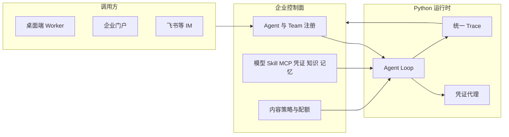

# AgenticX 相对 AgentCore 的差距与补齐路线图

Planned-with: Grok 4.7
Suggested-Impl-Model: 本文件是路线图，不直接开工。各阶段开工前另写实施 plan。

**Goal:** 用同一套维度给桌面端、企业端和阿里云 AgentCore 打分，并给出框架、桌面、企业三层的补齐顺序。

**本文件不是实施计划。** 不包含可直接提交的代码任务。每个阶段开工前，按该阶段单独写一份 Composer 2.5 可独立实施的 plan，再移到 `.cursor/plans/`。

## 对照对象

- AgentCore 产品页：https://www.aliyun.com/product/agentcore
- 帮助中心：https://help.aliyun.com/zh/agentcore/
- 打分只认帮助中心正文里已经写明的控制台和 SDK 能力。官网「凭据隔离、沙箱、全链路评估」里，有一部分属于相邻产品 Agent Sandbox 与 CMS AgentLoop，文中单独标明。
- AgenticX 以仓库当前实现为准：桌面端本地运行时，企业端 `enterprise/README.md` 写明 Go Gateway 是合规与模型转发，不是完整 Agent Runtime；`enterprise/features/agents` 仍是空实现。

## 分数

1 分：没有产品闭环。2 分：有页面或骨架。3 分：主路径能用，边界明显。4 分：可演示、可日常使用，缺企业级深度。5 分：该维度闭环。

| 维度 | 桌面 | 企业 | AgentCore | 判读 |
| --- | --- | --- | --- | --- |
| 构建入口 | 3 | 1 | 4 | 落后 1。他们有 Harness、自定义镜像、本地纳管；注册 Agent 待上线。企业端没有 Agent 构建台。 |
| 弹性与会话隔离 | 3 | 2 | 5 | 落后 2。他们有规格、Session 上限、TTL、扩缩容、OSS、VPC。 |
| 模型连接与能力目录 | 4 | 4 | 4 | 持平。他们多了上下文长度、视觉、音频、工具调用等能力标签；模型参数他们也不能调。 |
| Skill / MCP / 模板 | 4 | 2 | 4 | 持平靠桌面。他们有模板、广场、发布前检测、HTTP 转 MCP。企业端资产面是空的。 |
| 知识库 | 4 | 1 | 3 | 领先 1。托管 Harness 文档写明知识库暂不支持；平台侧只是连接外部库。桌面入库链路更完整。企业端 feature 为空。 |
| 长期记忆 | 4 | 1 | 3 | 领先 1。MemoryStore 在高代码 SDK；托管 Harness 写明长期记忆暂不支持。 |
| 人机协作与任务 | 4 | 2 | 5 | 落后 1。他们有人类成员、Leader、任务验收、定时任务和结果回投。桌面群聊更会对话，缺任务系统。 |
| 身份与权限 | 2 | 4 | 5 | 落后 1。企业 IAM 已经可用，但没有 Agent 自己的身份。 |
| 凭证与出站管控 | 2 | 2 | 4 | 落后 2。控制台凭证是集中键值、环境变量注入。更强的「沙箱不见明文」在 Agent Sandbox，不在 AgentCore 操作步骤里。 |
| 内容合规策略 | 2 | 5 | 2 | 领先 3。拦截、脱敏、警告、草稿发布、部门范围是企业端已有优势。 |
| 可观测与审计 | 3 | 4 | 4 | 持平。他们有请求、错误率、耗时、Token、模型、工具大盘，Trace 进 CMS。我们有审计和计量，缺同一条决策链。 |
| 效果评估 | 1 | 1 | 3 | 落后 2。评估器在 CMS AgentLoop，不在 AgentCore 控制台。我们没有评估产品。 |
| 渠道与开放协议 | 4 | 2 | 4 | 持平靠桌面。他们有 AG-UI、钉钉、飞书、企业微信。桌面有飞书和个人微信。企业端渠道页是模型通道，不是 IM。 |
| 配额与成本归因 | 2 | 3 | 4 | 落后 1。他们按 Agent 设置日/周/月 Token 上限。企业配额仍以租户为主。 |
| 交互体验 | 5 | 2 | 2 | 领先 3。工具审批、打断续问、多窗格、语音。他们的 Harness 写明暂不支持工具审批和人工交互。 |
| 自托管与数据域 | 5 | 4 | 1 | 领先 4。这是我们的交付形态，不补成云依赖。 |

均分：桌面 3.3（52/16），企业 2.5（40/16），AgentCore 3.6（57/16）。未加权。

## 不要补的东西

- 不把 Go Gateway 改成 Agent Loop。企业 README 已划定这条边界。
- 不复刻 CU 计费、多地域、PrivateLink、SchedulerX、云监控探针。
- 不在桌面做实例扩缩容。
- 不做手机 App。渠道以后都打同一个 Agent Endpoint。
- 不把 AgentCore Harness 上尚未交付的知识库、长期记忆、工具审批，当成我们必须追赶的缺口。这三项我们更完整，企业端缺的是把它们接进控制面。

## 目标形态

桌面端继续做个人工作站，同时可以注册成企业 Team 的 Worker。门户和 IM 不各写一套执行器。

## 阶段

### 阶段 1 — 企业控制面接上现有运行时

补的分差：构建入口、人机协作。

- 在企业门户提供 Agent 注册：选择模型、系统提示、技能、MCP、凭证引用。执行进程是现有 Python 运行时，不是网关内部再写一个循环。
- Team 复用桌面群聊的路由语义：人类成员、Leader、成员 Agent。门户现有 rooms 是人的房间，扩展它，不另起一个聊天产品。
- 任务有状态、执行记录和验收人。定时触发先用企业侧已有调度能力，不引入外部调度产品。

验收：管理员在控制台创建一个 Agent，员工在门户里 @ 它得到真实工具调用；同一个 Agent 出现在 Team 成员里。Go 网关的请求/响应策略评估保持原样。

建议实施模型：跨栈高风险收口用强推理档。单独写实施 plan 后再动代码。

### 阶段 2 — 框架凭证代理与 Trace 契约

补的分差：凭证与出站、可观测里的决策链。

- 新增凭证引用。Agent 配置只存凭证 ID。工具发起出站调用时，由运行时在进程边界注入。系统提示、工具结果回显、日志里不出现密钥值。
- 定义一条 Trace：用户输入、模型调用、工具、检索、记忆读取、最终回复。桌面气泡和企业审计都发这条结构。企业现有 `gateway_audit_events` 继续记合规，不拿它冒充 Agent Trace。
- 模型能力做成数据：上下文长度、视觉、工具调用、音频。桌面 `model-vision.ts` 的硬编码判断改为读这份数据，避免两处漂移。

验收：绑定凭证的 MCP 调用成功，会话导出和日志检索不到密钥明文。一次对话能在企业端按 Agent 打开完整 Trace。

建议实施模型：代码专精中档。凭证注入要单独做安全审查。

### 阶段 3 — 桌面成为可纳管 Worker

补的分差：模板、纳管。不在桌面做弹性。

- 分身导出模板：人格文件、技能绑定、MCP 绑定、子智能体。企业阶段 1 能导入。
- 设置里增加本地凭证库：名称、环境变量名、掩码值，分身和 MCP 按 ID 引用。替代在每个 MCP 配置里粘贴密钥。
- 桌面进程可向企业控制面注册为 Worker：心跳、领取任务、回传 Trace。第一版只纳管 AgenticX 自己的运行时。Claude Code 等外部运行时列为后续，不进本阶段。

验收：一台桌面登录企业账号后，出现在 Team Worker 列表；任务在本机工作区执行，Trace 回到企业端。未登录企业账号时，桌面行为与现在一致。

建议实施模型：桌面凭证库和模板用中档；Worker 协议与阶段 1 的控制面一起用强推理档收口。

### 阶段 4 — 配额、知识库连接、记忆分区、最小评估

补的分差：配额、企业侧知识与记忆、效果评估。

- Token 配额落到用户和 Agent，周期为日/周/月。租户级配额保留为上限。超限时门户给出和内容拦截不同的提示。
- 企业知识库第一版做成连接，不迁移文档：连接桌面已有的知识库服务，或一个 OpenAI 兼容的检索端点，再以工具形式交给 Agent。不新做一套向量库。
- 记忆 API 按用户、Agent、会话三个范围读写，和聊天历史分表。范围由服务端身份决定，不让模型自行填写。
- 评估第一版：从 Trace 抽样，人工标记任务是否完成；预置一个「任务完成度」检查。不做在线实验平台。

验收：把某用户月配额调到很小，下一次调用被配额拦住，审计里看得到。Agent 能检索已连接知识库。记忆按用户隔离，换一个用户检索不到。

建议实施模型：配额和连接用中档；记忆范围和评估抽样用强推理档看一致性。

### 阶段 5 — 会话隔离与出站域名策略

补的分差：弹性与隔离。放在控制面和凭证之后，避免先做壳。

- 运行时契约：一个 Session 同时只跑一个请求，独立工作目录，同 Agent 的 Session 可通过共享目录交换文件，空闲 TTL 后回收目录但不删对话历史。
- 自托管部署里，用「每 Agent 一个容器加并发上限」作为隔离的第一档。自动扩缩容和多可用区不在本路线图。
- 出站策略补域名与路径允许列表，命中与否写入 Trace。内容策略继续负责关键词、正则和 PII，两套策略不合并成一个开关。

验收：两个 Session 的工作目录互不可读。关闭某域名后，该 Agent 的出站调用失败并留下 Trace，其他 Agent 不受影响。

建议实施模型：强推理档。先写威胁模型再写实施 plan。

## 手机端

不单独立项。AgentCore 的手机路径是 IM 机器人和协作客户端，不是独立 App。我们已有飞书长连接和个人微信 sidecar。补齐方式是让这些适配器调用阶段 1 的同一个 Agent Endpoint。新渠道（钉钉、企业微信）只在有明确交付需要时加适配器。

## In scope / Out of scope

In scope：上表 16 维的判读，以及阶段 1–5 的产品边界。

Out of scope：任何代码改动、CU 计费、多地域、手机 App、把外部编程 Agent 纳管进第一版 Worker、在 Go 网关内实现 Agent Loop。

## 子规划与建议实施模型

| 子规划 | 建议模型 | 理由 |
| --- | --- | --- |
| 阶段 1 企业控制面接运行时 | 强推理档 | 跨门户、控制面和 Python 运行时，路由语义不能和桌面群聊分叉 |
| 阶段 2 凭证代理与 Trace | 代码专精中档，凭证部分加强推理复核 | 接口契约明确，但密钥注入不能做错 |
| 阶段 3 桌面模板与本地凭证库 | 中档 | 落在现有设置面板和分身模型上 |
| 阶段 3 Worker 注册 | 强推理档 | 和阶段 1 的 Team 协议绑在一起 |
| 阶段 4 配额与知识连接 | 中档 | 配额表和连接配置是现有企业模块的延伸 |
| 阶段 4 记忆分区与评估抽样 | 强推理档 | 范围隔离和「完成度」定义容易做歪 |
| 阶段 5 会话隔离与出站策略 | 强推理档 | 安全边界，先有威胁模型 |
