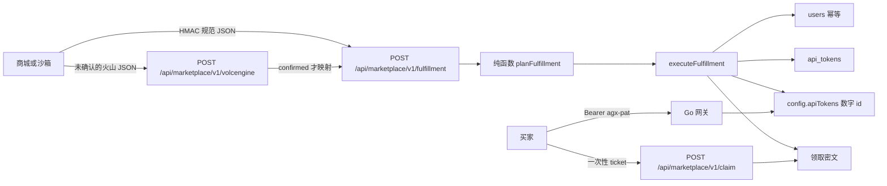
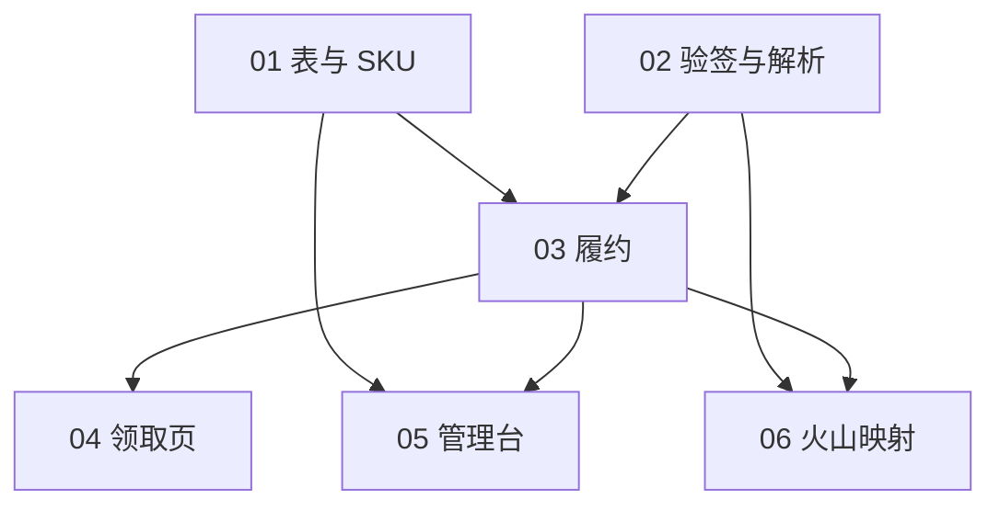

# 万有商城 Token 履约主计划

Planned-with: Grok 4.7
Suggested-Impl-Model: 见下表。本系列不要用 Grok 4.7 实施。协议与状态机用 `gpt-5.6-sol-medium`，表结构与管理台用 `claude-sonnet-5-5-medium`。

> 实施时先把本文件移到 `.cursor/plans/` 根目录，再按子计划逐个移回根目录后开工。子计划可独立阅读，不依赖本对话。

## 目标

Enterprise 现有的 API Token（`agx-pat-`）加上配额，变成商城可交付的调用额度。买家付款后，服务商回调打到门户，系统创建或更新一把 Token，额度只挂在这把 Token 上，明文只通过一次性领取链接出现一次。

## 为什么不能直接“接火山 SPI”

2026-10-15 核对：[万有商城服务商合作管理规范](https://www.volcengine.com/docs/6256/1359015) 规定了入驻、SaaS 必须部署在火山基础设施、保证金与退款，**没有**公开订单回调的字段、签名算法或实例状态机。伙伴入口在 [万有伙伴](https://partner.volcengine.com/partner/wanyou)。

因此工程上“足够接入”的定义是：

1. 一条我们自己发布的履约 HTTP 协议，商城若允许填写自定义生产地址，就填这条。
2. 一条火山专用入口。字段映射文件在 `confirmed: false` 时返回 `501` / `marketplace.spi_unconfigured`，禁止猜测字段名并当正式协议。
3. 履约核心（验签、幂等、签发、配额、吊销、领取）不依赖火山字段名。伙伴沙箱样例到达后，只改映射文件和夹具。

商务项不在本系列：公司人数、软著、保证金 5,000 元、把网关部署到火山资源上。代码完成不等于商品已上架。

## 现状证据

- 签发：`enterprise/packages/iam-core/src/pat-service.ts` 的 `createPat()`。明文 `agx-pat-` + 24 字节 base62，库表 `api_tokens` 只存 SHA-256 `token_hash`。`CreatePatInput` 只有 `expireDays`，没有绝对 `expireAt`。
- 校验：`enterprise/apps/gateway/internal/auth/pat.go` `PATVerifier.Verify`。`status=revoked` 或 `expire_at` 已过则拒绝。成功身份进进程 LRU，TTL 约 60 秒。吊销写入 `recordPatRevocation()`（`pat-revocation-store.ts`），网关用 `GATEWAY_REMOTE_PAT_REVOCATION_URL` 拉取。
- 配额键：`enterprise/apps/gateway/internal/server/server.go` `quotaContext()` 把 `APITokenID` 格式化成十进制字符串。`internal/quota/check_request.go` `selectRuleExtended()` **先**查 `cfg.APITokens[ctx.APITokenID]`。配置来自 `GET /api/internal/quotas`，网关本地缓存约 10 秒（`tracker.go` `loadConfig()`，`GATEWAY_REMOTE_QUOTA_CONFIG_URL`）。
- 现有套餐发布**不会**写 `apiTokens`。`PlanScopeType = "tenant" | "dept" | "user"`（`apps/admin-console/src/lib/db-stores/postgresql/token-quota-store.ts` 第 161 行）。`applyPlanRuleToScope()` 只写 `users` / `departments` / `defaults.role._plan_tenant`。若把商城额度绑到用户，门户 JWT 对话也会吃这份额度。本系列禁止扩这个 scope。
- 配额整包是 `enterprise_runtime_token_quotas.config` 一行 JSON。`setQuotaConfig()` 是整包覆盖，并发履约会丢更新。新写入必须在事务里 `SELECT ... FOR UPDATE`。
- 管理台创建 Token：`apps/admin-console/src/app/api/admin/api-tokens/route.ts`，`requireAdminScope`。没有订单、实例、领取票据表。
- 用户幂等：`upsertUserByEmail()`（`packages/iam-core/src/repos/users.ts`）。密码哈希用 `@agenticx/auth` 的 `hashPassword()`（bcrypt cost 12）。iam-core 已经依赖 `@agenticx/auth`。

## 目标架构



Go 网关、`agenticx/studio/server.py`、Desktop 本系列不改。额度生效依赖已有的 10 秒配额轮询；吊销生效依赖已有的吊销快照加最长约 60 秒 PAT 缓存。计划里把这个延迟写进交付说明，不在网关里改缓存。

## 规范事件（子计划 02 写死，03 消费）

`POST /api/marketplace/v1/fulfillment`

请求头：

- `X-Agx-Marketplace-Timestamp`：十进制 unix 秒
- `X-Agx-Marketplace-Nonce`：16–64 字符，字符集 `[A-Za-z0-9_-]`
- `X-Agx-Marketplace-Signature`：64 位小写 hex。HMAC-SHA256 密钥是 `MARKETPLACE_WEBHOOK_SECRET`，消息是 `` `${timestamp}\n${nonce}\n${rawBody}` ``（rawBody 是未解析的原始字节的 UTF-8 文本）

时间窗：`abs(now - timestamp) <= 300` 秒。nonce 落表，10 分钟内拒绝重放。

正文：

```json
{
  "provider": "sandbox",
  "eventId": "evt_01",
  "eventType": "instance.create",
  "occurredAt": "2026-10-15T03:00:00.000Z",
  "order": {
    "orderId": "ord_01",
    "skuCode": "token-100k",
    "buyer": { "externalUserId": "buyer-1", "email": "buyer@example.com", "displayName": "买家" },
    "periodEnd": "2026-11-15T03:00:00.000Z",
    "trial": false
  },
  "instance": { "instanceId": "" }
}
```

`eventType` 只允许：`instance.create`、`instance.renew`、`instance.upgrade`、`instance.expire`、`instance.release`、`order.refund`。

`provider` 只允许环境变量 `MARKETPLACE_PROVIDERS`（默认 `sandbox,volcengine-wanyou`）里的值。火山入口即使映射成功，写入的 provider 也固定为 `volcengine-wanyou`。

成功响应不包含明文 Token：

```json
{
  "code": "00000",
  "message": "ok",
  "data": {
    "instanceId": "<ulid>",
    "status": "active",
    "duplicate": false,
    "tokenPrefix": "agx-pat-xxxx",
    "expiresAt": "2026-11-15T03:00:00.000Z",
    "claimUrl": "https://portal.example/marketplace/claim?ticket=<url-safe>"
  }
}
```

相同 `provider + eventId` 再投递：HTTP 200，`duplicate: true`，沿用第一次的 `instanceId` 与仍未消费的 `claimUrl`。已消费则 `claimUrl` 为 `null`。不要返回 409，否则商城重试会当成失败。

## 状态机

| 当前实例 | 事件 | 结果 |
| --- | --- | --- |
| 无，且 `orderId` 未占用 | `instance.create` | 建用户、PAT、`apiTokens[id]`、实例 `active`、领取密文 |
| 已有同一 `orderId` | `instance.create` | 200 重复，不第二把 Token |
| `active` 或 `expired`，PAT 未吊销 | `instance.renew` | 把 `expire_at` 改成新的 `periodEnd`，状态 `active` |
| `released` | `instance.renew` / `upgrade` | 409 `marketplace.instance_released` |
| `active` | `instance.upgrade` | 换 SKU，覆盖该 Token 的配额，不轮换 Token |
| `active` 或 `expired` | `instance.expire` | `expire_at = now`，删掉 `apiTokens[id]`，状态 `expired`。不写入吊销表，以便续费恢复 |
| `active` 或 `expired` | `instance.release` 或 `order.refund` | `revokePat`，删配额，清领取密文，状态 `released` |
| `released` | `expire` / `release` / `refund` | 200 重复，不再改 |
| 任何 | 未知 `eventType` 或找不到实例/SKU | 400 或 404，不写实例 |

`periodEnd` 在 create 与 renew 上必填，且必须晚于现在至少 60 秒。

配额 JSON 只写这一段，键是 `String(api_tokens.id)`：

```json
{
  "monthlyTokens": 100000,
  "tpm": 20000,
  "rpm": 60,
  "maxConcurrency": 2,
  "action": "block"
}
```

`action` 固定 `block`。不要写 `poolScope`。

## 子计划

| 子计划 | 文件 | 依赖 | 实施模型 | 交付 |
| --- | --- | --- | --- | --- |
| 01 | `.cursor/plans/pending/2026-10-15-marketplace-token-01-schema-sku.plan.md` | 无 | `claude-sonnet-5-5-medium` | 五张表、SKU 仓库、管理台 SKU API |
| 02 | `.cursor/plans/pending/2026-10-15-marketplace-token-02-signed-ingress.plan.md` | 01 的 nonce 表 | `gpt-5.6-sol-medium` | 验签、解析、nonce。不签发 Token |
| 03 | `.cursor/plans/pending/2026-10-15-marketplace-token-03-fulfillment.plan.md` | 01、02 | `gpt-5.6-sol-medium` | 状态机、HTTP 履约、配额行锁、领取密文 |
| 04 | `.cursor/plans/pending/2026-10-15-marketplace-token-04-claim.plan.md` | 03 | `claude-sonnet-5-5-medium` | 门户领取 API 与页面 |
| 05 | `.cursor/plans/pending/2026-10-15-marketplace-token-05-admin.plan.md` | 01、03 | `claude-sonnet-5-5-medium` | 管理台页面、人工补发领取、实例只读 |
| 06 | `.cursor/plans/pending/2026-10-15-marketplace-token-06-volcengine-adapter.plan.md` | 02、03 | `gpt-5.6-sol-medium` | 火山入口失败关闭、文档、沙箱脚本 |



01 与 02 可并行。02 只读 01 的表名，若 01 未合并，02 的 nonce 写入测试用内存桩，HTTP 仍留到 03。

## 环境变量

| 变量 | 谁读 | 规则 |
| --- | --- | --- |
| `MARKETPLACE_WEBHOOK_SECRET` | 门户履约路由 | 缺失或短于 32 字符：验签函数返回 `secret_missing`，路由 500 `50000`。不使用空密钥 |
| `MARKETPLACE_CLAIM_KEY` | 领取加解密 | 与 webhook 密钥分开。缺失则 create 失败，不落半成品实例 |
| `MARKETPLACE_CLAIM_BASE_URL` | 拼 `claimUrl` | 无尾部斜杠，例如 `https://portal.example` |
| `MARKETPLACE_PROVIDERS` | 解析器 | 默认 `sandbox,volcengine-wanyou` |
| `DEFAULT_TENANT_ID` | 已有 | 履约只写这个租户 |

密钥不进 git、不进日志、不进 `response_json`。

## 范围

In scope：`enterprise/packages/db-schema`、`enterprise/packages/iam-core`、`enterprise/apps/web-portal`、`enterprise/apps/admin-console`、`enterprise/docs/marketplace/`、`enterprise/scripts/db-portability/table-manifest.ts`。

Out of scope：

- 修改 Go 网关、`agenticx/studio/server.py`、Desktop、Python 运行时
- 把 `PlanScopeType` 扩成 `pat`，或改 `publishQuotaPlan()`
- 回调响应或日志里返回明文 `agx-pat-`
- 支付、发票、保证金、商品审核材料
- 给买家发邮件或短信
- 部门 / 用户级配额产品改造
- 猜测并启用火山正式字段名

## 完成定义

沙箱用规范 JSON 走通：创建 → 领取一次 → 同一事件重放不签发第二把 → 续费改 `expire_at` → 升级只改 `apiTokens[id]` → 退款后 `revokePat` 且配额键删除 → 领取链接不能再用。火山入口在映射未确认时稳定 501。管理台能看见 SKU 与实例，看不见明文。
