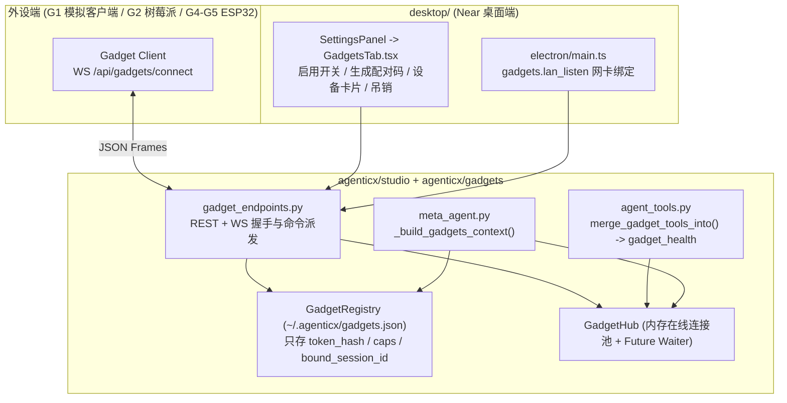

# AgenticX 外设能力（Gadget）系列规划（含 G1 完整实施规范）

Planned-with: Grok 4.7 + Gemini 4 Argon

Suggested-Impl-Model: **Composer 2.5**（G1 主实施；子规划推荐模型见下表）

> **For implementer:**
> 1. 本文件既是「G1～G6 系列蓝图」，也是 **G1（外设协议、配对中心、模拟外设、`gadget_health` 工具、Near 设置页「外设」Tab）的完整实施单**。
> 2. 开始实施 G1 前，先将本文件从 `.cursor/plans/pending/2026-10-16-gadget-peripherals.plan.md` 移回 `.cursor/plans/2026-10-16-gadget-peripherals.plan.md`。
> 3. 严禁在代码、注释、UI 文案、git commit 或 PR 中出现任何第三方竞品/开源项目名称（一律使用中性术语：`Gadget`、`外设`、`配对码`、`局域网代理`）。
> 4. 触碰 `agenticx/studio/server.py` 时，**只允许精确增加指定的 2 行**，禁止整块替换相邻 import，且提交前必须跑一次临时端口 `agx serve` 冷启动冒烟验证。

**Goal:** 让 `agx serve` 与 Near 桌面端具备配对并管理常驻物理外设（树莓派/Linux 守护进程、ESP32 屏幕/语音豆）及局域网 HTTP 设备的能力；第一波（G1）跑通配对码握手、Token 鉴权长连接、在线状态感知、`gadget_health` 工具调用、系统提示词注入与 Near 设置面板「外设」Tab。

**Architecture:**
- **反向长连接 + RPC Waiter**：外设通过 `WS /api/gadgets/connect` 主动连入 `agx serve`，复用 `agenticx/gateway/device_manager.py` 同款 `asyncio.Future` RPC 等待器模式收发命令与结果。
- **能力清单（Capabilities）与窄腰原语**：外设配对时声明 `caps`（`health` / `display` / `audio_in` / `audio_out` / `button` / `http_proxy` / `shell` / `files`），底层只暴露通用原语工具，具体家电协议由纯 Markdown 技能包承载。
- **桌面端局域网可达**：当用户在 Near 开启「允许局域网外设接入」时，`desktop/electron/main.ts` 允许 `agx serve` 监听局域网网卡并生成带本机局域网 IP 的一键配对指令。

**Tech Stack:** Python 3.11+、FastAPI（REST + WebSocket）、Pydantic v2、React 18 + TypeScript + Tailwind（Near Desktop）。无新增第三方 Python 依赖。

---

## 一、现状证据链与差距（实施者须核对）

| 模块 | 仓库现状与精确位置 | G1～G6 差距与对策 |
|---|---|---|
| 本地后端启动 | `desktop/electron/main.ts:3174-3181` 硬编码 `["serve", "--host", "127.0.0.1", "--port", String(apiPort)]` | 只听 `127.0.0.1` 导致局域网内的树莓派/ESP32 无法连入。需支持读取 `gadgets.lan_listen: true` 切换为 `0.0.0.0` 并展示本机局域网 IP |
| 远程后端连接 | `desktop/src/components/SettingsPanel.tsx:9080`（`tab === "server"`） | **已落地**：Near 已支持切换本地/远程服务器，无需等待旧 plan |
| WS 连接池参考 | `agenticx/gateway/device_manager.py:23-131`（含 `wait_for_rpc_reply` / `resolve_rpc_reply`） | 已有成熟的 WS 注册表与 `correlation_id -> Future` 机制，`GadgetHub` 直接采用同款设计 |
| 会话工具合并 | `agenticx/cli/agent_tools.py:3650-3676` `studio_tools_for_session()` | 需在此处增加 `tools = merge_gadget_tools_into(tools)`，按 `gadgets.enabled` 动态注入外设工具 |
| 系统提示注入 | `agenticx/runtime/prompts/meta_agent.py:1150-1165` `build_meta_agent_volatile_sections()` | 需注入 `_build_gadgets_context()`，让模型实时感知当前有哪些外设在线及其 `gadget_id` 和 `caps` |
| 外部消息刷新 | `desktop/src/components/ChatPane.tsx:4148-4165` `needsExternalPoll` | G2 外设主动推消息入会话时，需把绑定了外设的 session 纳入轮询刷新 |
| 实验室硬件窄腰 | `.cursor/plans/pending/2026-09-01-embodiment-hardware-waist.plan.md` | 管的是实验室仪器点表，与本计划互不耦合；本计划**不修改** `agenticx/embodiment/` 下任何文件 |



---

## 二、子规划 → 推荐实施模型

| 波次 | 范围 | 推荐模型 | 理由 |
|---|---|---|---|
| **G1（本计划直接实施）** | 外设协议、注册表、`GadgetHub`、`gadget_health`、系统提示注入、Near 设置页 `GadgetsTab` | **Composer 2.5** | 数据结构、WS 帧协议、文件落点与代码片段已在下方全部写死，无歧义 |
| **G2** | `packaging/agx-gadget/` Linux 守护进程（`health` / `files` / `shell` / `send` 主动入站触发会话） | 代码专精中档（Codex 系列） | 涉及子进程隔离、超时回收与会话入站触发 |
| **G3** | `gadget_http` 局域网代理 + `ConfirmGate(risk="hardware")` + 内置 Home Assistant / 智能插座 Markdown 技能 | Composer 2.5 | CIDR/Host 校验规则固定 + 纯 Markdown 技能 |
| **G4** | `gadget_display` 屏幕推送 + `button` 事件 + Python/ESP32 参考端 | Composer 2.5 | 协议扩展，命令字段明确 |
| **G5** | 外设实时语音桥接（复用 `voice_endpoints.py`） | 强推理档（GPT-5.x） | 音频流、打断与 `messages.json` 落盘时序敏感 |

---

## 三、Scope 边界（G1 严格遵守 `no-scope-creep.mdc`）

### In Scope (G1)
- 新建 `agenticx/gadgets/{__init__,models,registry,hub}.py`
- 新建 `agenticx/studio/gadget_endpoints.py` 并在 `agenticx/studio/server.py` 精确增加 2 行注册调用
- 在 `agenticx/cli/agent_tools.py` 新增 `GADGET_TOOLS`、`merge_gadget_tools_into` 与 `gadget_health` 分发
- 在 `agenticx/runtime/prompts/meta_agent.py` 新增 `_build_gadgets_context()` 并接入 `build_meta_agent_volatile_sections`
- 在 `desktop/electron/main.ts` 读取 `gadgets.lan_listen`，开启时将 `agx serve` 的 `--host` 设为 `0.0.0.0`
- 在 Near 设置面板新增「外设」Tab（`desktop/src/settings-tab.ts`、`desktop/src/components/SettingsPanel.tsx`、`desktop/src/components/settings/GadgetsTab.tsx`、`desktop/locales/{zh,en}/settings.json`）
- 新建 `tests/gadgets/test_registry.py` 与 `tests/gadgets/test_pairing.py`

### Out of Scope (G1 严禁触碰)
- 不修改 `agenticx/embodiment/` 下任何文件
- 不修改 `VoiceFocusMode.tsx` 或现有桌面端语音胶囊逻辑
- G1 不实现 `gadget_exec` / `gadget_http` / `gadget_display`（留给 G2～G4）
- 不引入任何新 pip 包或 npm 包

---

## 四、G1 逐任务实施细则（Composer 2.5 可直接照抄落地）

### Task 1：外设数据模型、持久化注册表与内存连接池（`agenticx/gadgets/`）

**Files:**
- Create: `agenticx/gadgets/__init__.py`
- Create: `agenticx/gadgets/models.py`
- Create: `agenticx/gadgets/registry.py`
- Create: `agenticx/gadgets/hub.py`
- Test: `tests/gadgets/test_registry.py`

#### 1.1 `agenticx/gadgets/models.py` 完整规范

所有 Python 文件头必须包含 `Author: Damon Li` 且注释/docstring 全英文（遵循 `google-python-style.mdc`）：

```python
#!/usr/bin/env python3
"""Data models and protocol constants for AgenticX peripheral gadgets.

Author: Damon Li
"""

from __future__ import annotations

from typing import Any, Dict, List, Optional
from pydantic import BaseModel, Field

PROTOCOL_VERSION = 1

ALLOWED_GADGET_CAPS = frozenset(
    {
        "health",
        "display",
        "audio_in",
        "audio_out",
        "button",
        "http_proxy",
        "shell",
        "files",
    }
)


class GadgetRecord(BaseModel):
    """Persisted metadata for a paired gadget (stored in ~/.agenticx/gadgets.json)."""

    gadget_id: str
    name: str
    caps: List[str] = Field(default_factory=lambda: ["health"])
    token_hash: str
    bound_session_id: str = ""
    created_at: float
    last_seen_at: float = 0.0
    revoked: bool = False

    def to_public_dict(self, *, online: bool = False) -> Dict[str, Any]:
        """Return safe dictionary without token_hash for UI and prompts."""
        return {
            "gadget_id": self.gadget_id,
            "name": self.name,
            "caps": list(self.caps),
            "bound_session_id": self.bound_session_id,
            "created_at": self.created_at,
            "last_seen_at": self.last_seen_at,
            "revoked": self.revoked,
            "online": bool(online and not self.revoked),
        }
```

#### 1.2 `agenticx/gadgets/registry.py` 完整规范

- 默认路径：`Path.home() / ".agenticx" / "gadgets.json"`（支持传入自定义 `path: Optional[Path]` 以便单测使用 `tmp_path`）。
- Token 哈希：`hashlib.sha256(raw_token.encode("utf-8")).hexdigest()`，**严禁落盘明文 token**。
- 配对码管理：`issue_pair_code(ttl_seconds: float = 120.0) -> dict` 生成 6 位纯数字字符串（如 `"048291"`），保存在内存字典 `_pair_codes: Dict[str, float]`（`code -> expires_at`）。
- `consume_pair_code(code: str, name: str, caps: List[str], bound_session_id: str = "") -> tuple[GadgetRecord, str]`：
  - 校验 `code` 存在且未过期（消费后立即 `pop` 删除，一次有效）；
  - 校验 `caps` 非空且每一项都在 `ALLOWED_GADGET_CAPS` 中，否则抛 `ValueError("unsupported capability")`；
  - 生成 `gadget_id = f"gdg_{uuid.uuid4().hex[:10]}"` 与明文 `raw_token = f"agxg_{secrets.token_urlsafe(24)}"`；
  - 写入 `gadgets.json` 并返回 `(record, raw_token)`。
- `verify_token(raw_token: str) -> Optional[GadgetRecord]`：计算 sha256，匹配未 `revoked` 的记录，命中则更新 `last_seen_at` 并返回记录。
- `revoke(gadget_id: str) -> bool`：将对应记录 `revoked = True` 并落盘。

#### 1.3 `agenticx/gadgets/hub.py` 完整规范

- 维护在线 WebSocket 连接池 `_connections: Dict[str, WebSocket]` 与命令等待器 `_waiters: Dict[str, asyncio.Future[Dict[str, Any]]]`（对齐 `agenticx/gateway/device_manager.py:113-131`）。
- 方法：
  - `async def register(gadget_id: str, ws: WebSocket) -> None`（若已有旧连接则先 `close(code=4000)`）
  - `async def unregister(gadget_id: str, ws: WebSocket) -> None`
  - `def is_online(gadget_id: str) -> bool`
  - `def online_ids() -> List[str]`
  - `async def send_command(gadget_id: str, command_name: str, payload: Optional[Dict[str, Any]] = None, timeout: float = 15.0) -> Dict[str, Any]`：
    - 生成 `cmd_id = uuid.uuid4().hex[:12]`，发送帧 `{"type": "command", "id": cmd_id, "name": command_name, "payload": payload or {}}`；
    - 等待外设返回 `{"type": "result", "id": cmd_id, "ok": true, "payload": {...}}`；
    - 超时或断连返回 `{"ok": False, "error": "timeout or disconnected"}`。
  - `def resolve_command_result(cmd_id: str, frame: Dict[str, Any]) -> bool`：唤醒对应 `Future`。

---

### Task 2：Studio REST + WebSocket 端点与 `server.py` 挂接

**Files:**
- Create: `agenticx/studio/gadget_endpoints.py`
- Modify: `agenticx/studio/server.py`（L130 与 L1523，精确新增 2 行）
- Test: `tests/gadgets/test_pairing.py`

#### 2.1 `agenticx/studio/gadget_endpoints.py` 路由与协议规范

提供配置读写 helper（与 `voice_endpoints.py:167` 一致，只读用户全局 `~/.agenticx/config.yaml` 的 `gadgets:` 节）：
- `read_gadgets_config() -> Dict[str, Any]`：返回 `{"enabled": bool, "lan_listen": bool}`，默认均为 `False`。
- `write_gadgets_config(enabled: bool, lan_listen: bool) -> Dict[str, Any]`：调用 `ConfigManager.set_value("gadgets.enabled", enabled, scope="global")` 与 `ConfigManager.set_value("gadgets.lan_listen", lan_listen, scope="global")`。
- 探测本机局域网 IPv4 helper `_detect_lan_ipv4() -> str`：用 `socket.socket(socket.AF_INET, socket.SOCK_DGRAM)` `connect(("10.255.255.255", 1))` 获取首选局域网 IP，失败回退 `"127.0.0.1"`。

注册以下路由（在 `register_gadget_endpoints(app: FastAPI, *, manager: SessionManager, check_token: Callable[[str | None], None]) -> None` 内，并将 `registry` 和 `hub` 挂到 `app.state.gadget_registry` / `app.state.gadget_hub` 以及模块级单例，方便 `agent_tools.py` 读取）：

1. `GET /api/gadgets`（校验 `x_agx_desktop_token`）：
   - 始终返回 HTTP 200：
   ```json
   {
     "ok": true,
     "enabled": false,
     "lan_listen": false,
     "lan_ip": "192.168.1.23",
     "gadgets": []
   }
   ```
2. `PUT /api/gadgets/config`（校验 `x_agx_desktop_token`）：
   - 接收 `{"enabled": bool, "lan_listen": bool}`，持久化并返回最新状态。
3. `POST /api/gadgets/pair-codes`（校验 `x_agx_desktop_token`）：
   - 接收可选 `{"bound_session_id": "..."}`；
   - 签发 6 位配对码，返回 `{"ok": True, "code": "123456", "expires_at": ..., "lan_ip": ...}`。
4. `POST /api/gadgets/{gadget_id}/revoke`（校验 `x_agx_desktop_token`）：
   - 调用 `registry.revoke(gadget_id)`，若该外设当前在线则主动关闭其 WebSocket，返回 `{"ok": True}`。
5. `WS /api/gadgets/connect`（外设长连接，不校验 `x_agx_desktop_token`，因为外设走配对码或外设专属 `token`）：
   - `await websocket.accept()`
   - 首帧必须是 `{"type": "hello", "protocol": 1, ...}`：
     - **分支 A（已配对重连）**：首帧带 `"token": "agxg_..."` → 调用 `registry.verify_token(token)`。校验失败或已吊销则发 `{"type": "error", "error": "invalid_or_revoked_token"}` 并 `close(code=4401)`；校验成功则发 `{"type": "ready", "gadget_id": record.gadget_id}` 并进入主循环。
     - **分支 B（首次配对）**：首帧不带 `token`，带 `"name": "...", "caps": ["health"]` → 服务端发 `{"type": "pair_required"}` → 等待下一帧 `{"type": "pair", "code": "123456"}` → 调用 `registry.consume_pair_code(...)`。成功则发 `{"type": "paired", "gadget_id": record.gadget_id, "token": raw_token}` 并注册进 `hub` 进入主循环；失败则发 `{"type": "error", "error": "..."}` 并 `close(code=4403)`。
   - **主循环**：
     - 收到 `{"type": "result", "id": "...", ...}` → 调用 `hub.resolve_command_result(frame["id"], frame)`。
     - 收到 `{"type": "event", "name": "...", "payload": {...}}` → G1 记录日志并更新 `last_seen_at`。

#### 2.2 `agenticx/studio/server.py` 精确修改（只增 2 行！）

- **锚点 1（约 L130）**：
  ```python
  # Before:
  from agenticx.brain.routes import register_brain_routes
  from agenticx.studio.voice_endpoints import register_voice_endpoints
  from agenticx.memory.workspace_memory import WorkspaceMemoryStore

  # After:
  from agenticx.brain.routes import register_brain_routes
  from agenticx.studio.voice_endpoints import register_voice_endpoints
  from agenticx.studio.gadget_endpoints import register_gadget_endpoints
  from agenticx.memory.workspace_memory import WorkspaceMemoryStore
  ```
- **锚点 2（约 L1522）**：
  ```python
  # Before:
      register_voice_endpoints(app, manager=manager, check_token=_check_token)

      from agenticx.memory.graph.routes import register_memory_graph_routes

  # After:
      register_voice_endpoints(app, manager=manager, check_token=_check_token)
      register_gadget_endpoints(app, manager=manager, check_token=_check_token)

      from agenticx.memory.graph.routes import register_memory_graph_routes
  ```

---

### Task 3：`gadget_health` 工具接线与 `meta_agent.py` 系统提示注入

**Files:**
- Modify: `agenticx/cli/agent_tools.py`（约 L3652 `studio_tools_for_session`、L12077 `_TOOL_REQUIRED_PARAMS`、L12883 `_dispatch_tool_async_unredacted`）
- Modify: `agenticx/runtime/prompts/meta_agent.py`（约 L1150 `build_meta_agent_volatile_sections`）

#### 3.1 `agenticx/cli/agent_tools.py` 改动点

1. 定义 `GADGET_TOOLS` 与 `merge_gadget_tools_into(tools: List[Dict[str, Any]]) -> List[Dict[str, Any]]`：
   ```python
   GADGET_TOOLS: List[Dict[str, Any]] = [
       {
           "type": "function",
           "function": {
               "name": "gadget_health",
               "description": (
                   "Query real-time health metrics (uptime, load, memory, disk, temperature, battery) "
                   "from a paired peripheral gadget."
               ),
               "parameters": {
                   "type": "object",
                   "properties": {
                       "gadget_id": {
                           "type": "string",
                           "description": (
                               "Target gadget_id (e.g. gdg_xxx). May be omitted if exactly one gadget is online."
                           ),
                       },
                   },
                   "additionalProperties": False,
               },
           },
       },
   ]
   ```
   `merge_gadget_tools_into(tools)`：调用 `read_gadgets_config().get("enabled", False)`；为 `False` 时原样返回 `tools`，为 `True` 时将 `GADGET_TOOLS` 去重追加到 `tools`。
2. 在 `studio_tools_for_session`（约 L3653）中调用：
   ```python
   tools = merge_computer_use_tools_into(list(STUDIO_TOOLS))
   tools = merge_near_browser_tools_into(tools)
   tools = merge_gadget_tools_into(tools)
   ```
3. 在 `_dispatch_tool_async_unredacted`（约 L12883 `if name.startswith("lsp_"):` 之后）增加：
   ```python
   if name == "gadget_health":
       from agenticx.studio.gadget_endpoints import dispatch_gadget_health_tool
       return await dispatch_gadget_health_tool(arguments)
   ```
   其中 `dispatch_gadget_health_tool(arguments)` 逻辑：
   - 若 `not read_gadgets_config().get("enabled", False)`，返回 `"ERROR: 外设功能未启用，请在设置 → 外设中开启。"`；
   - 若 `gadget_id` 为空：检查当前 `hub.online_ids()`，若恰好 1 个在线则自动选用该 `gadget_id`；若 0 个在线返回 `"ERROR: 当前没有在线的外设。"`；若多个在线返回 `"ERROR: 当前有多台外设在线，请指定 gadget_id。"`；
   - 调用 `await hub.send_command(gadget_id, "health", timeout=10.0)` 并返回 JSON 字符串。

#### 3.2 `agenticx/runtime/prompts/meta_agent.py` 改动点

在 `meta_agent.py` 新增 `_build_gadgets_context() -> str`：
- 当 `gadgets.enabled` 为 `False` 或注册表无未吊销外设时返回 `""`；
- 否则列出每台未吊销外设：`- {name} (id={gadget_id}, status={online|offline}, caps={','.join(caps)})`；
- 在 `build_meta_agent_volatile_sections`（约 L1151）的 `capabilities` 拼接中加入 `+ _build_gadgets_context()`。

---

### Task 4：Near 桌面端「外设」设置 Tab 与局域网监听开关

**Files:**
- Modify: `desktop/src/settings-tab.ts`（L30 `"automation"` 附近新增 `"gadgets"`）
- Modify: `desktop/locales/zh/settings.json` 与 `desktop/locales/en/settings.json`（新增 `tabs.gadgets` 与 `gadgets.*` 词条）
- Create: `desktop/src/components/settings/GadgetsTab.tsx`
- Modify: `desktop/src/components/SettingsPanel.tsx`（导入 `Radio` 图标与 `GadgetsTab`，`TAB_DEFS` 增加 `{ id: "gadgets", icon: Radio }`，内容区增加 `{tab === "gadgets" && <GadgetsTab />}`）
- Modify: `desktop/electron/main.ts`（约 L3173，`startStudioServe()` 读取 `cfg.gadgets?.lan_listen`，为 `true` 时 `--host` 传 `"0.0.0.0"`，否则保持 `"127.0.0.1"`）

#### 4.1 `desktop/electron/main.ts` 精确改动（L3170-3185）

```typescript
// Before:
  if (bundledPath) {
    serveProcess = spawnBundledServer(
      bundledPath,
      ["--host", "127.0.0.1", "--port", String(apiPort)],
      { cwd: desktopHome, stdio: ["ignore", "pipe", "pipe"], env }
    );
  } else {
    serveProcess = spawnAgx(
      agxResolved,
      ["serve", "--host", "127.0.0.1", "--port", String(apiPort)],
      { cwd: desktopHome, stdio: ["ignore", "pipe", "pipe"], env }
    );
  }

// After:
  const gadgetsCfg = (cfg as Record<string, unknown>)?.gadgets as Record<string, unknown> | undefined;
  const serveHost = gadgetsCfg?.enabled === true && gadgetsCfg?.lan_listen === true ? "0.0.0.0" : "127.0.0.1";
  if (bundledPath) {
    serveProcess = spawnBundledServer(
      bundledPath,
      ["--host", serveHost, "--port", String(apiPort)],
      { cwd: desktopHome, stdio: ["ignore", "pipe", "pipe"], env }
    );
  } else {
    serveProcess = spawnAgx(
      agxResolved,
      ["serve", "--host", serveHost, "--port", String(apiPort)],
      { cwd: desktopHome, stdio: ["ignore", "pipe", "pipe"], env }
    );
  }
```
（注：`getStudioUrl()` 仍返回 `http://127.0.0.1:${apiPort}` 供本机渲染进程访问，完全不影响本机通信。）

#### 4.2 `desktop/src/components/settings/GadgetsTab.tsx` UI 要求

- 使用现有 `SettingsSwitch` 组件（`./SettingsSwitch`）保持视觉统一：
  1. 「启用外设」开关（切换即调 `PUT /api/gadgets/config` 即时保存）。
  2. 「允许局域网设备接入」开关（开启后提示重启 Near 生效，并展示检测到的局域网地址 `ws://<lan_ip>:<port>/api/gadgets/connect`）。
  3. 「生成配对码」按钮：点击调 `POST /api/gadgets/pair-codes`，就近展示醒目的 6 位配对码与一键配对命令复制框。
  4. 已配对外设列表：每台设备展示红/绿双态圆点（在线为绿 `bg-emerald-500`、离线为红 `bg-rose-500`，对齐模型供应商状态点规范）、设备名、`gadget_id`、`caps` 标签，以及「移除」按钮（调 `POST /api/gadgets/{id}/revoke` 后立即刷新列表）。

---

## 五、验收条件（Acceptance Criteria）

- **AC-1（配对与健康查询全链路）**：`pytest tests/gadgets/test_pairing.py::test_pair_code_then_health -q` 通过——使用 FastAPI `TestClient` 签发配对码 → 模拟外设连接 `/api/gadgets/connect` 完成 `hello` → `pair_required` → `pair` → `paired` → 重连带 `token` → 调用 `dispatch_gadget_health_tool({})` 收到模拟外设返回的 `{"uptime_sec": 42}`。
- **AC-2（吊销后禁止重连）**：`pytest tests/gadgets/test_pairing.py::test_revoked_token_rejected -q` 通过——调用 `/api/gadgets/{id}/revoke` 后，旧 token 连接被拒。
- **AC-3（Token 零明文落盘）**：`pytest tests/gadgets/test_registry.py::test_token_not_stored_in_plaintext -q` 通过——检查 `gadgets.json` 原文不包含签发的 `agxg_` 明文 token。
- **AC-4（默认关闭不污染工具表）**：`pytest tests/gadgets/test_pairing.py::test_tools_absent_when_disabled -q` 通过——`gadgets.enabled=False` 时 `studio_tools_for_session()` 不含 `gadget_health`。
- **AC-5（`server.py` 冷启动冒烟门槛）**：在临时端口冷启动 `agx serve --host 127.0.0.1 --port <临时端口>`，验证 `/api/session`、`/api/avatars`、`/api/gadgets` 均返回 HTTP 200。
- **AC-6（前端类型检查）**：`cd desktop && npm run typecheck` 零报错通过。
