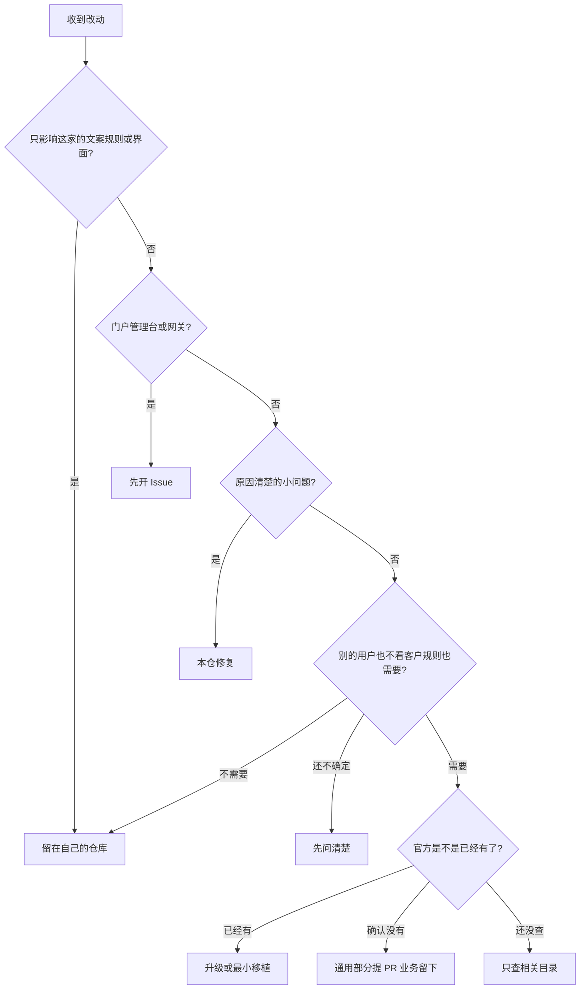

# AgenticX 定制项目助手

帮人把基于 AgenticX 的项目建对，并在遇到 bug 或新功能时判断：留在自己的仓库，还是给官方提 Issue / PR。判断以本技能目录里的 `scripts/custom_project.py` 为准，不要凭感觉改结论。

官方仓库是 [DemonDamon/AgenticX](https://github.com/DemonDamon/AgenticX)。产品说明在 [agxbuilder.com](https://www.agxbuilder.com/)。三条入口（Python SDK、Near 桌面、企业门户）共用能力，但业务代码不要写进官方仓库。

## 什么时候用

用用户的原话对照，不必等对方说出「上游」或「运行时」：

| 用户在说 | 用这个技能 |
| --- | --- |
| 我想基于 AgenticX 做一个自己的项目 / 客户项目 | 初始化 |
| 要不要把官方仓库克隆下来改 | 初始化，多半是「只装依赖」 |
| 这个 bug 要不要提 PR，还是我们自己改 | 判断 |
| 这个功能该写在我们仓库，还是贡献回去 | 判断 |
| 帮我给官方开一个 Issue / PR | 写草稿，满足条件再提交 |
| pip 超时、GitHub 打不开、Windows 说找不到命令 | 先看报错对照 |
| 基于 AgenticX 做领域 Demo / 最小可跑闭环（不改框架） | 初始化（depend）+ 业务分层指引 |
| Demo UI 要换皮 / 想把设计技能并进来 | 初始化后的业务 style；设计技能按兄弟技能组合，不并入本技能 |
| 门户、管理台、网关里的问题能不能直接改代码提 PR | 判断，结论是先开 Issue |

## 什么时候不用

- 只是在 Near 里聊天，不建仓库、不改代码。
- 只想 5 分钟跑通第一个示例智能体。那是快速上手，不是定制项目。
- 用户明确说这次只改业务文案。直接改他们的仓库，不要跑上游流程。

## 边界

| 项目 | 约定 |
| --- | --- |
| 系统 | Windows 10/11、macOS、Linux。命令按当前系统打印。 |
| Python | 安装和运行 AgenticX 需要 3.10 或更高。脚本本身可以在更旧的 Python 上给出提示。 |
| 会不会上传 | 默认不上传。不读取 `~/.agenticx`。`doctor` 只探测 `github.com` 和 `pypi.org` 的 443 端口，不发送项目内容。 |
| 什么时候才会发到 GitHub | 只有用户已经要求提交，并且命令带 `--execute`、门禁通过时，才调用 `gh` 创建 Issue 或 PR。不会 `git push`，不会推 `main`。 |
| 官方 enterprise 目录 | 员工门户、管理台、Go 网关。外部贡献先开 Issue。维护者在 Issue 里同意之前，不要提 PR。 |
| `agx project create --template enterprise` | 这只是应用骨架的名字，不是上面那个目录。 |

## 助手按这个顺序做

脚本和本文件在同一技能目录。下文的 `python3`，在 Windows 上改成 `py -3`，`scripts/custom_project.py` 改成 `scripts\custom_project.py`。脚本自己打印的命令优先照抄。

### 1. 初始化项目

缺信息时只问这三句，不要一次问一长串：

1. 会不会改 AgenticX 本身的源码？
2. 业务程序是 Python、调用本机服务的其他语言，还是要改 Near 桌面？
3. 这个仓库能不能公开？

然后运行：

```bash
python3 scripts/custom_project.py doctor
python3 scripts/custom_project.py plan --mode depend --stack python --name my-agent
```

| 用户的情况 | 参数 |
| --- | --- |
| 不改框架，用 Python 写业务 | `--mode depend --stack python` |
| 不改框架，用别的语言调用本机 `agx serve` | `--mode depend --stack node` |
| 只用官方桌面，不开发 | `--mode depend --stack desktop` |
| 必须改官方源码，并长期跟着升级 | `--mode fork`。客户业务另建仓库 |
| 只能带走一小段运行时 | `--mode vendor` |

`--write` 只会写业务骨架或一份拷贝记录。它不会克隆官方仓库，也不会改 git remote。目录里已有文件就停止，不覆盖。

`agx project create` 若问「目录已存在，是否覆盖」，回答否，除非用户明确说可以覆盖。模板名只有 `basic`、`multi_agent`、`enterprise`。

#### depend 模式：领域 Demo 的默认路径

大多数「基于 AgenticX 做客户或领域 Demo」就是 `--mode depend --stack python`：用 pip 安装官方发布包（写作时验证过的示例是 `agenticx==0.6.5`，安装前以 `agx --version` / PyPI 为准），**不要克隆官方源码**。闭环全部自研，放在业务仓。典型分层（示意路径，可按项目改名）：

| 路径 | 职责 |
| --- | --- |
| `services/<领域>_core/` | 领域概念与存储（内存 + 本地 JSON 即可起步） |
| `services/<规则>/`（如 reasoner） | 业务规则：简单传递、继承、证据链 |
| `services/agent_bridge/` | 把 `query`、`infer` 等包装成 `agenticx.FunctionTool` |
| `scripts/demo_loop.py` | 不联网的一键闭环：写样例 → query → infer → 校验结论 |
| `services/api/` + `apps/portal/` | 可选：FastAPI + 单页 Demo UI |

- `demo_loop.py` 是自检基准：退出码 `0`、样例断言通过即闭环成立；装了 agx 时可再经 `FunctionTool.run` 验证工具链。未装 agx 时桥接可返回空工具列表，纯 Python 部分仍可跑。
- 目标目录已非空时，**不要**强跑 `agx project create` 覆盖；手工对齐 basic 脚手架精神即可。
- 各业务仓锁定自己验证过的 AgenticX 版本，不必全局统一。

#### Demo UI 的 localhost 归属

- Demo UI（如 FastAPI 起在 `http://127.0.0.1:8765/`）是**启动服务那台机器**上的环回地址。助手若在远程桌面或自己的电脑上启动服务，`127.0.0.1` 不是用户笔记本的地址。
- 让用户在**运行服务那台机器**的浏览器里打开，或由助手截图展示。只有服务真的在用户本机时，才说「在你电脑上打开 localhost」。
- Demo UI 的主题、文案、布局是业务 style：`--kind style --where business`，留在业务仓，不提上游 PR。

#### 组合其他技能，不合并正文

- UI 美化、设计系统指引用**独立**的设计类技能，与本技能并列组合使用；国内优先经 SkillHub 发现和安装。
- **禁止**把第三方设计技能的正文合并进 `agenticx-custom-project`，也不要把本技能内容并进别人的技能。
- 安装任何技能前，先汇总来源、版本、风险，征得用户确认。

### 2. 判断 bug 或新功能

把用户的话翻译成参数，然后运行 `classify`。翻译对照：

| 参数 | 怎么听用户的话 |
| --- | --- |
| `--kind bug` | 坏了、和预期不一样 |
| `--kind feat` | 想加一个能力 |
| `--kind style` | 文案、颜色、措辞 |
| `--kind docs` | 只改说明 |
| `--kind deps` | 升级依赖或版本对不上 |
| `--kind security` | 密钥、漏洞 |
| `--where business` | 客户流程、他们自己的界面和规则 |
| `--where runtime` | Python 运行时、SDK、`agx` |
| `--where desktop` | Near 桌面 |
| `--where protocol` | 两边都要认的接口或协议 |
| `--where enterprise` | 门户、管理台、网关 |
| `--cause-clear yes` | 已经知道要改哪一处 |
| `--size small` | 局部小修。说不清就用 `small` |
| `--others-need` | 不看这家客户的规则，别的用户还要不要 |
| `--can-fix no` | 对方改不了官方代码，只想反映问题 |
| `--maintainer-agreed yes` | 维护者已经在 Issue 里同意改 enterprise |

不确定「别的用户要不要」时不要猜，让脚本返回提问。

```bash
python3 scripts/custom_project.py classify --kind bug --where runtime --cause-clear yes --size small
```

照抄输出里的「结论」「接下来」「先不要」。不要把「留在本仓」改写成「顺手提一个 PR」。



和条款一致的短表：

| 情况 | 结论 |
| --- | --- |
| 客户文案、样式、规则 | 留在自己的仓库，不查上游 |
| 原因清楚的小 bug，包括运行时里的小修 | 本仓修。不必联网，不必现在提 PR |
| 原因还没查清，也不能确定大家都会遇到 | 先在本仓查 |
| 大家都能用的新能力，还没核对官方 | 只查相关目录和标题对得上的 Issue |
| 官方已经有 | 升级或最小移植，不重写，不整仓合并 |
| 核对后官方没有，且是通用能力 | 最小 PR 加测试；客户部分留下 |
| enterprise 目录 | 只开 Issue，除非维护者已同意 |
| 这边改不了代码 | 开 Issue，不要求克隆仓库 |
| 密钥出在业务仓库 | 本地轮换。不要开公开 Issue |

同一批、同一模块已经查过官方，就复用那个结论。不要每个小任务都查一次。业务可以先交付，不必等官方合并。

### 3. 写草稿和提交

只有结论允许 Issue 或 PR 时才写草稿。用户提到的客户名称用重复的 `--hide` 去掉。

```bash
python3 scripts/custom_project.py draft \
  --kind issue \
  --title "切换会话后标题变回数字" \
  --summary "从别的会话跳回来，中文标题变成了一串数字。" \
  --expected "仍显示原来的标题。" \
  --actual "显示 session id。" \
  --steps "1. 新建一个只有合成内容的会话。2. 切走再切回来。" \
  --version "0.6.5" \
  --os-name "Windows 11" \
  --hide "客户名称"
```

草稿在 `.agenticx-upstream/ISSUE.md` 或 `PR.md`，并且应被 git 忽略。状态固定是「尚未提交」。

用户已经要求提交时，先不加 `--execute` 看门禁。通过后再加 `--execute`。失败就原样报告脚本的「尚未提交」和最后一行原因，不要说已经提交。

```bash
python3 scripts/custom_project.py submit \
  --want issue \
  --title "切换会话后标题变回数字" \
  --body-file .agenticx-upstream/ISSUE.md \
  --kind bug --where desktop --can-fix no
```

提交目标只限 `DemonDamon/AgenticX`。PR 从功能分支指向 `main`。分支前缀用 `feat/`、`fix/`、`docs/`。提交说明写原因，不写客户名，不加 AI 工具署名。

## 使用案例

### 案例 A：给客户做审批助手，不改框架

用户说：「我们要在自己的仓库里做一个审批助手，用 AgenticX，但不想维护一份框架源码。」

```bash
python3 scripts/custom_project.py plan --mode depend --stack python --name approval-helper
```

脚本结论是：新建业务仓库，用官方发布包装上 AgenticX，不要克隆框架源码。客户规则留在这个仓库。以后的界面文案用 `--kind style --where business`，结论会是不要给官方提 PR。

若当前 `python3` 低于 3.10，先读脚本顶部的「注意」。安装命令会改成机器上已有的更高版本；没有更高版本时，先不要 pip。

### 案例 B：原因清楚的小 bug

用户说：「多窗格里切换模型会串到另一格，我知道是选中状态用了全局变量，改局部就行。」

```bash
python3 scripts/custom_project.py classify --kind bug --where desktop --cause-clear yes --size small
```

实际输出的第一段是：

```text
结论：先在当前仓库修，现在不必给官方提 PR。
原因：根因已经明确的小缺陷，默认在当前仓库修并做定向验证，包括共享运行时里的小修。
业务交付：可以继续，不必等官方合并。
```

修完并做针对性验证即可。不要为了这一处去扫官方全历史。若这批结束时确认它是大家都会遇到的问题，再和同类小修合成一个 PR。

更多案例（通用新功能、门户只开 Issue、不会改代码、密钥被拦住、GitHub 打不开、领域 Demo 的 depend 闭环与 Demo UI）见 [references/examples.md](references/examples.md)。

## 出错了怎么办

先看脚本印出的「下一步」，不要把超时当成代码逻辑错误。

| 你看到的 | 含义和下一步 |
| --- | --- |
| 退出码 0 | 这一步完成。若是草稿，状态仍是尚未提交。 |
| 退出码 1 | 仅 `doctor`：当前 Python 低于 3.10。后面的 Git、agx、网络结果仍然有效。 |
| 退出码 2 | 参数不对，或结论不允许提交，或 GitHub CLI 失败。正文里的「尚未提交」就是事实。 |
| 退出码 3 | 草稿里有密钥。文件没有写。报错只给行号和类型，不会把密钥再打印一遍。 |
| 连接 github.com 失败 | 国内网络常见。分类和草稿可以继续。不要说已经看过最新代码或已经提交。 |
| 连接 pypi.org 失败 | 用你们已有的镜像。没有的话，doctor 会给一条只作用于这一次的清华镜像命令。不要改全局 pip 配置。 |
| `agx` 不是内部或外部命令 | 关掉终端重开。Windows 检查 Python 的 Scripts 是否在 PATH。 |
| 目录里已经有文件 | 没有覆盖。换项目名，或让用户清空后再写。 |
| 中文乱码 | Windows 命令提示符先执行 `set PYTHONUTF8=1`，PowerShell 用 `$env:PYTHONUTF8=1`。 |

完整对照见 [references/troubleshooting.md](references/troubleshooting.md)。发布或接手这个技能时，先运行：

```bash
python3 scripts/custom_project.py self-test
```

自检不联网、不提交。失败时它会列出哪一条判断和预期不一致。

## 常见问题

完整问答见 [references/faq.md](references/faq.md)。

**只是用 Near，需要这个技能吗？** 不需要。

**改一个按钮文案，要提 PR 吗？** 不要。那是业务仓库的事。

**小 bug 已经知道改哪一行，要先把官方仓库搜一遍吗？** 不要。本仓修就行。

**GitHub 打不开，新功能还能做吗？** 业务可以先做。通用部分先留草稿，并写上尚未对照最新上游、尚未提交。

**门户或网关的 bug 为什么不能直接 PR？** 官方不接受事先没约定的外部 PR，直接提会被关闭。先开 Issue。

**草稿写好了，能不能说已经提交？** 不能。只有 `submit --execute` 成功并返回链接之后才能说已创建。

**客户数据能放进复现步骤吗？** 不能。用合成例子。名称用 `--hide` 去掉。

**助手在他的电脑上启动了 Demo UI，我笔记本打不开 127.0.0.1？** `127.0.0.1` 是**运行服务那台机器**的环回。在助手桌面浏览器打开，或让助手截图。详见 [references/faq.md](references/faq.md)。

**能把设计技能的正文并进这个技能吗？** 不能。设计技能按兄弟技能组合（SkillHub 安装），业务 UI 换皮判 `--kind style --where business`，不提上游。

**各个业务仓必须锁同一个 AgenticX 版本吗？** 不必。各仓库使用自己验证过的版本。

## 不能违反

| 借口 | 实际要求 |
| --- | --- |
| 小改动也先把官方全仓扫一遍 | 原因清楚的小 bug 默认本仓修 |
| 顺手把客户流程也提进官方 | 通用机制可以抽出去，整个业务功能不行 |
| 草稿写了就算提交了 | 没创建成功就说尚未提交，并留下原因 |
| 网络失败就停掉客户交付 | 只停下提交这一步，其余继续 |
| 用真实客户材料当复现 | 只用合成或允许公开的脱敏样例 |
| enterprise 目录我直接 PR | 维护者同意之前只开 Issue |
| 官方还没有，所以我重写一套 | 先核对。已经有就升级或最小移植 |
| 一行 bug 一个 PR | 同一批同类小修合成一个，不要混进无关功能 |

条款原文的操作版在 [references/upstream-policy.md](references/upstream-policy.md)。仓库里若已有 `<!-- agenticx-upstream-policy:start` 标记段，按那段执行，不要改写它。

## 本技能里的文件

| 文件 | 什么时候打开 |
| --- | --- |
| `scripts/custom_project.py` | 检查环境、初始化、判断、草稿、提交、自检 |
| [references/examples.md](references/examples.md) | 要对照一个完整案例 |
| [references/faq.md](references/faq.md) | 用户问「为什么不能」 |
| [references/troubleshooting.md](references/troubleshooting.md) | 命令失败，需要按报错往下做 |
| [references/upstream-policy.md](references/upstream-policy.md) | 需要核对九条协作约定 |
