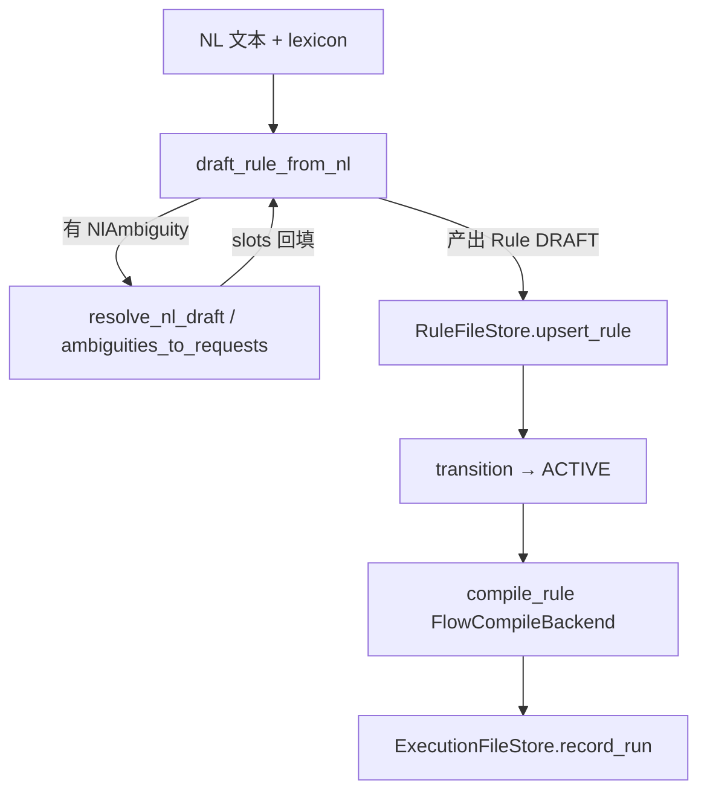

# Rules 模块结论

> 结论更新时间：2026-11-14（mapping 基线 `cebdabd5883de1d5a62c96ae4084de6ad036b32f`，`agenticx/rules` P0 规则资产子系统）

## Responsibility

- 提供 **一等公民规则资产** 的领域模型、声明式 DSL、JSON 文件持久化、编译为可执行计划（默认 Flow 节点序列）、执行记录落盘，以及 **无 LLM 的确定性** 自然语言草稿管线（含与 `runtime.disambiguation` 的消歧会话桥接）。
- Explicit non-responsibilities: 不在本包内 **实际调度或运行** Flow/`workflow_engine`（`FlowCompileBackend` 仅产出 `CompiledPlan.nodes` 与 `meta.target` 标注）；`ExternalEngineBackend` 为外部引擎 **描述符桩**，客户侧适配器属 B 层；Enterprise admin-console 列表/详情 UI 与 TS 侧 `rules-store.ts` 读写逻辑不在此包；不替代 `enterprise` 网关 **策略规则中心**（聊天合规/PG 规则）；`NlRuleDraft.confirm_context` 为形状预留，本包不调用 `runtime/confirm.py`。

## Entry points and public interfaces

- `agenticx.rules`（`__init__.py` 的 `__all__`）：聚合 `Rule` / `RuleMeta` / `RuleStatus` / `ALLOWED_TRANSITIONS` / `can_transition` / `apply_transition` / `RuleTransitionError`；`RuleFileStore` / `resolve_store_dir`；`RuleIntent`；`ExecutionFileStore` / `ExecutionRecord`；`compile_rule` / `CompiledPlan` / `CompileBackend` / `CompileError` / `FlowCompileBackend` / `ExternalEngineBackend`；`draft_rule_from_nl` / `NlRuleDraft` / `NlAmbiguity` / `NlRuleRequest`；`parse_rule_body` / `validate_rule_body` / `RuleBody` / `Condition` / `Action` / `RuleDslError`。
- 子模块入口（未全部 re-export）：`agenticx.rules.disambiguation.resolve_nl_draft` / `resolve_nl_draft_sync` / `ambiguities_to_requests`；`agenticx.rules.nl.classify_intent`。
- 运维/演示：`python -m examples.rules.run_lifecycle`（可选自定义 store 目录参数）；README 指向 Enterprise `/admin/rule-governance` 与同一 JSON store 契约。

## Core execution path

- **DSL 入库**：YAML/映射/dict → `parse_rule_body` → `validate_rule_body`（触发器 `manual|schedule|event`、条件 `and|or|not` + 叶子比较算子、动作 `notify|invoke|set_status|emit_event`）→ 挂到 `Rule.body`。
- **生命周期**：`RuleFileStore.transition` / `set_enabled` 调用 `apply_transition`；仅 `RuleStatus.ACTIVE` 默认可 `enabled=True`；`compile_rule` 对非 `ACTIVE` 抛 `CompileError`（`force=True` 可覆盖）。
- **编译**：`FlowCompileBackend.compile` 按 trigger → condition（递归嵌套）→ actions → feedback 生成有序 `nodes`；`ExternalEngineBackend` 单节点 `external_job` payload。
- **NL + 消歧**：`draft_rule_from_nl` 用前缀与正则抽 intent/object/metric/threshold/channel；歧义时 `disambiguation` 映射为 `DisambiguationRequest`（`candidate_select` / `info_supplement`），可选 `DisambiguationGate` 循环至多 16 轮并重草稿。

## Data and configuration

- **规则实体**：`Rule`（`id`/`name`/`status`/`version`/`enabled`/`body`/`meta`/`created_at`/`updated_at`）；`RuleMeta`（`scope`/`priority`/`trigger`/`depends_on`/`tags`）。
- **状态机**：`ALLOWED_TRANSITIONS`：`draft→pending|archived`；`pending→active|draft|archived`；`active→disabled|archived`；`disabled→active|archived`；`archived` 无出口。
- **持久化目录**：`resolve_store_dir(root?)` — 显式 `root` 优先，否则 `AGX_RULES_STORE_DIR`，否则 `Path.cwd() / .runtime/rules`；`rules.json`（`rules` 数组）、`executions.json`（`executions` 数组）同目录。
- **执行记录**：`ExecutionRecord` 状态 `queued|running|completed|failed|cancelled`；`record_run` 在终态时写入 `finished_at`。
- Enterprise 默认 store 路径为 admin 侧 `../../.runtime/admin/rules`（与 Python 默认不同，靠 env 对齐）。

## Dependencies

- **Upstream**：`PyYAML`（`dsl.parse_rule_body`）；`agenticx.runtime.disambiguation`（`DisambiguationRequest`、`DisambiguationFileStore`、`DisambiguationGate`、`apply_response_to_session` 等，仅 `disambiguation.py`）。
- **Downstream**：`examples/rules/run_lifecycle.py` 串联 store → transition → compile → execution；`enterprise/.../rules-store.ts` 读同一 JSON 形态（TypeScript 镜像，非 Python 依赖）；`tests/rules/*` 与 `tests/runtime/disambiguation/test_dual_path_e2e.py` 覆盖 NL/消歧双路径。
- **未接线**：根包 `agenticx/__init__.py` 在基线 commit 不 re-export `agenticx.rules`；与 `agenticx.flow` 的编译产物为 **松耦合字典**，无 import 边。

## Tests and operations

- **门禁**：`pytest tests/rules/ -q -o addopts=`（README 约定）。
- **覆盖要点**：`test_rule_model` / `test_rule_store`（transition、`set_enabled`）；`test_rule_dsl`；`test_compile_flow`（`CompileError`、节点形态）；`test_nl_to_rule` / `test_nl_disambiguation`；`test_lifecycle_e2e`、`test_execution_store`；`test_dual_path_e2e`（`resolve_nl_draft` + store）。
- **运维**：本地演示无 API Key 依赖（NL 确定性）；变更 store 时统一设置 `AGX_RULES_STORE_DIR` 以免 Python 与 admin-console 分叉；发布编译前确认规则 `status=active` 且 `body` 过 `parse_rule_body`。
- **样例约束**：README 要求示例/fixture 脱敏（合成 Brand-A/Market-X 标签），外部引擎保持 stub。