# AgenticX 规则与知识套件 · 产品操作手册

> 适用：管理台「规则治理 / 知识生命周期 / 图谱增量同步 / 图谱探索 / 消歧确认 / 引用证据」与门户对应验收页（脱敏，无客户名）  
> 环境：管理台默认 `http://127.0.0.1:3001`；门户默认 `http://127.0.0.1:3000`  
> 验证日期：2026-10-29（本地 E2E + 高清截图；含 GraphStore/Neo4j 图谱探索闭环）  
> 样例数据：仅 **Brand-A** 合成标识，不含真实客户名

本手册按「打开哪里 → 做什么 → 看到什么」写，给产品与实施同学按步骤操作。不写引擎内部实现细节。

---

## 一、这份手册给谁看 / 能干什么

| 读者 | 用来做什么 |
|------|------------|
| 产品 / 实施 | 按页面走通 R1、K1、K2、K3（含图谱探索）、R2 演示路径 |
| 验收同学 | 对照截图与清单，确认页面不是空白、状态能改、出处能看见 |

本轮可验收：

| 模块 | 你能做什么 | 主要入口 |
|------|------------|----------|
| R1 规则治理 | 看规则列表、点开详情、看最近执行 | 管理台 `/admin/rule-governance` |
| K1 引用与出处 | 在门户 / 管理台核对出处、冲突、缺失提示 | 门户 `/workspace/citations`；管理台 `/admin/citation-evidence` |
| K2 知识生命周期 | 对象状态流转、跑质量检查、看问题与变更轨迹；读写受 `kb:read` / `kb:update` 约束 | 管理台 `/admin/knowledge-lifecycle` |
| K3 图谱增量同步 | 看增量源列表、点开详情与同步运行、看同步报告；页头可见 GraphStore 后端徽章（如 `neo4j`） | 管理台 `/admin/graph-incremental` |
| K3 图谱探索 | 看 Brand-A 节点/边画布、点泵/阀看属性、确认后端为 GraphStore（Neo4j/file/memory） | 管理台 `/admin/graph-explorer` |
| R2 消歧确认（管理台） | 候选选择 / 信息补充 / 冲突裁决 三种面板答复 | 管理台 `/admin/disambiguation` |
| R2 消歧确认（门户） | 同上三种模式，对接运行时会话（非管理台 JSON 库） | 门户 `/workspace/disambiguation` |

---

## 二、打开哪里

### 启动与登录

1. 确认管理台已启动（开发默认端口 **3001**）；门户演示另需 **3000**。
2. 浏览器打开：`http://127.0.0.1:3001/login`（管理台）或门户登录页。
3. 输入管理员邮箱（本地种子一般为 `admin@agenticx.local`）和本机配置的管理员密码。
4. 点击「登录并进入控制台」（或门户对应登录）。
5. 管理台登录成功后应进入 Dashboard。

### 入口一览

| 入口 | 路径 | 说明 |
|------|------|------|
| 规则治理（R1） | `/admin/rule-governance` | 左侧导航「规则治理」 |
| 知识生命周期（K2） | `/admin/knowledge-lifecycle` | 左侧导航「知识生命周期」 |
| 图谱增量同步（K3） | `/admin/graph-incremental` | 左侧导航「图谱增量同步」；页头后端徽章 |
| 图谱探索（K3 viz） | `/admin/graph-explorer` | 左侧导航「图谱探索」；GraphStore 画布 |
| 消歧确认 · 管理台（R2） | `/admin/disambiguation` | 左侧导航「消歧确认」 |
| 引用证据 · 管理台（K1） | `/admin/citation-evidence` | Brand-A 演示页 |
| 消歧确认 · 门户（R2） | `/workspace/disambiguation` | 设置 → 常规 也可进 |
| 引用证据 · 门户（K1） | `/workspace/citations` | Brand-A 演示页 |

完整示例：`http://127.0.0.1:3001/admin/rule-governance`；门户：`http://127.0.0.1:3000/workspace/disambiguation`。

### 预期

- 管理台各页都能打开，标题与上表一致。
- 列表区短暂显示「加载…」后应出现表格行；长时间空白或一直加载，先确认服务与登录态。
- 无写权限时，K2 的状态流转 / 质量检查等写操作会提示无权限或按钮不可用（见第五节权限说明）。

---

## 三、R1 规则治理

### 3.1 打开列表

1. 打开 **规则治理**（`/admin/rule-governance`）。
2. 等待「加载规则中…」消失。
3. 左侧「规则列表」出现表格：ID、名称、状态、启用。

### 预期

- 至少有一行 Brand-A 样例规则。
- 页脚提示「已从 API 加载」为正常；若显示「本地种子数据」，说明 API 暂不可用，仍可看样例布局。

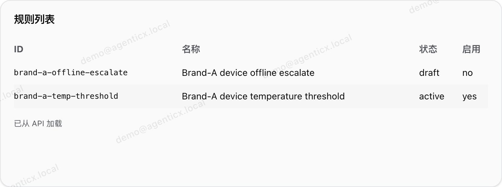

*图：规则列表卡片（元素截图，与详情/执行区分开）*

### 3.2 看详情

1. 在表格中点击某一行（样例可用 Brand-A 规则）。
2. 右侧「规则详情」刷新。
3. 核对：ID、名称、状态、启用、对象等字段与选中行一致。

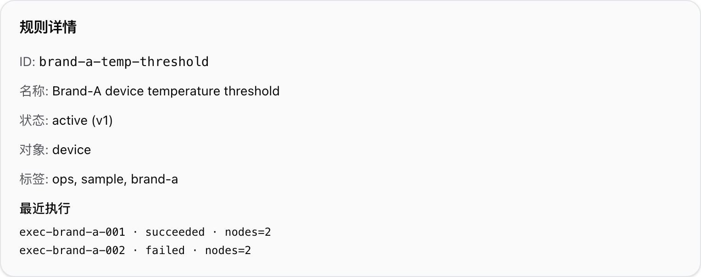

*图：选中 Brand-A 样例后的详情卡片（元素截图）*

### 3.3 看最近执行

1. 保持某条规则选中。
2. 在详情区找到「最近执行」。
3. 有种子执行数据时，应看到若干条记录（验收要求：Brand-A 样例须非空；空列表视为未种子）。

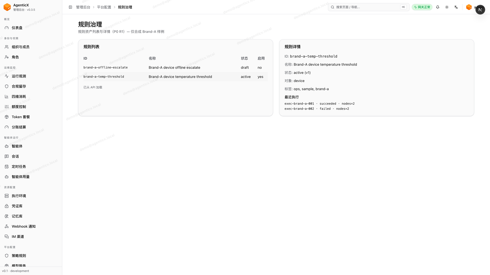

*图：已种子时的最近执行列表（元素截图）*

### 验收标准

列表有行、详情随点击切换、执行区有内容或明确空态——不是空白页。

---

## 四、K1 引用与出处

出处可以在门户对话 / 检索结果旁出现，也可以在专用演示页核对。本轮落地了共享组件 **CitationEvidencePanel**，并挂了两个 Brand-A 演示入口：

| 端 | 路径 | 用途 |
|----|------|------|
| 门户 | `/workspace/citations` | 产品演示首选；截图 16 |
| 管理台 | `/admin/citation-evidence` | 管理台内对照同一套 Brand-A 样例 |

### 你应该看到什么

围绕某个对象（样例可用 Brand-A 泵实体）应出现：

1. **出处列表**  
   每条有短标签 + 摘录（例如台账属性、关联记录、文档条款一类说明）。可再展开看到来源标识、置信度等。
2. **冲突提示（如有）**  
   同一属性来自不同来源且取值不一致时，应并列标出冲突，而不是悄悄合并成一个值。
3. **缺失提示（如有）**  
   证据不齐时给出软提示（例如缺某类必填属性），不要假装证据齐全。

### 操作建议（演示）

1. 打开门户 `http://127.0.0.1:3000/workspace/citations`（或管理台 `/admin/citation-evidence`）。
2. 页面应直接展示 Brand-A 样例：出处条目、冲突区、缺失提示。
3. 若走真实对话 / 检索路径：查询 Brand-A 样例对象，在结果区找同样三点。

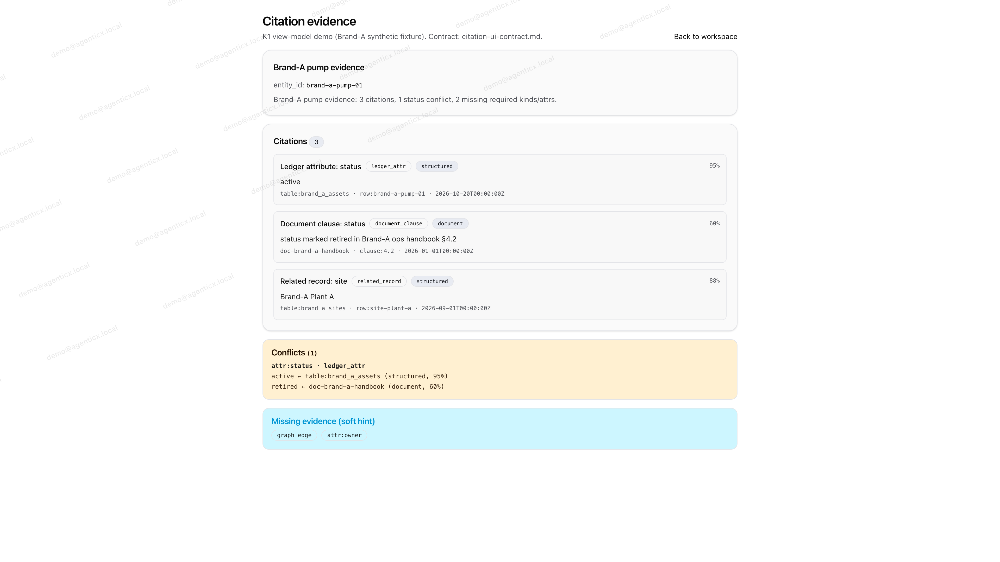

*图：门户 `/workspace/citations` — 出处 + 冲突 + 缺失（Brand-A 泵样例）*

### 验收标准

- 有出处条目（标签 + 摘录），不是「裸答案」。
- 有冲突时能看见冲突，而不是被系统自行抹平。
- 证据不足时有提示，而不是用推测顶替。

（字段含义与展示约定见同目录 `citation-ui-contract.md`；本手册只要求页面上人眼能核对上述三点。）

---

## 五、K2 知识生命周期

### 权限说明（运维备注）

知识生命周期接口按 **`kb:read` / `kb:update`** 鉴权（与 ma-memory 同类约定）：

| 能力 | 需要 |
|------|------|
| 看对象列表、详情、问题列表 | `kb:read` |
| 状态流转、跑质量检查、标记问题已解决 | `kb:update` |

写操作会在会话侧记下操作者邮箱。若当前账号只有读权限：列表仍可看，但状态按钮 /「运行质量检查」等会失败或置灰——这是预期，不是页面坏了。验收写路径请用带 `kb:update` 的管理员账号。

### 5.1 打开对象列表

1. 打开 **知识生命周期**（`/admin/knowledge-lifecycle`）。
2. 等待「加载知识对象中…」消失。
3. 「知识对象」表格出现：ID、类型、状态、版本。

### 预期

- 至少有 Brand-A 合成对象（如泵 / 站点一类样例 ID）。
- 状态取值对应：`draft`（草稿）→ `pending_review`（待审）→ `published`（已发布）→ `retired`（已退役）。

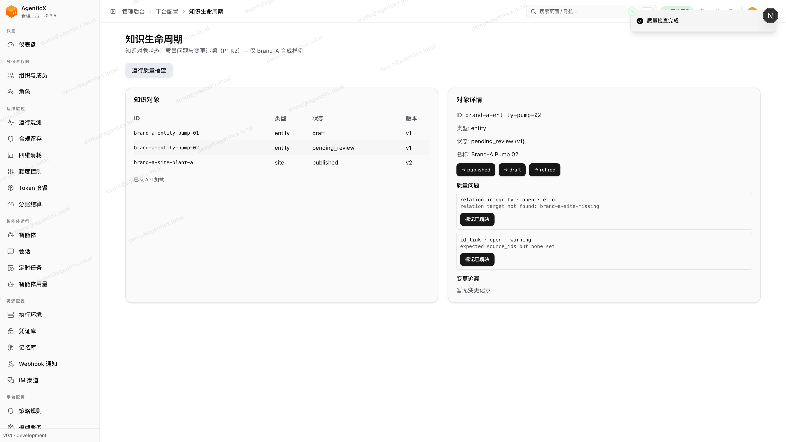

*图：知识对象列表卡片（元素截图）*

### 5.2 状态流转

1. 点击一行对象，右侧打开「对象详情」。
2. 看当前状态（如 `draft`）与版本号。
3. 在详情区点击允许的下一状态按钮（按钮文案形如 `→ pending_review`）。
4. 成功后应提示状态已更新；详情与列表中的状态同步变化。
5. 下方「变更追溯」应多出一条记录（时间 · 动作 · 旧状态→新状态 · 操作者）。

常见可点路径（以页面按钮为准）：

| 当前 | 可转到 |
|------|--------|
| 草稿 `draft` | 待审 / 已退役 |
| 待审 `pending_review` | 已发布 / 回草稿 / 已退役 |
| 已发布 `published` | 已退役 / 回草稿 |
| 已退役 `retired` | 回草稿 |

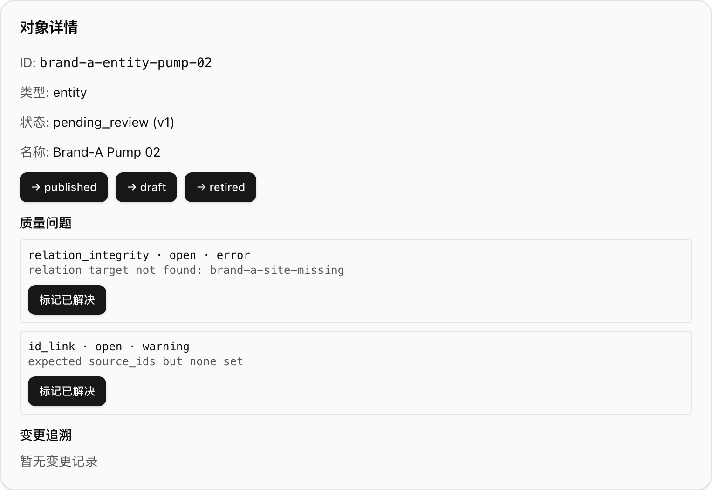

*图：对象详情与可执行状态流转（元素截图）*

### 5.3 跑质量检查、看问题

1. 页面顶部点击 **运行质量检查**。
2. 等待成功提示「质量检查完成」。
3. 再选中相关对象，看「质量问题」列表：编码、严重级别、状态、说明。
4. 对未关闭问题可点 **标记已解决**；解决后状态应变为已解决。

*图：质量检查后的问题列表（元素截图，须非空）*

### 验收标准

列表有对象；有写权限时状态按钮能改状态且变更追溯有记录；跑质量检查后问题区有内容或明确空态；无写权限时读路径仍可用、写路径有明确拒绝。

---

## 六、K3 图谱增量同步

打开 **图谱增量同步**（`/admin/graph-incremental`）。页面结构与知识生命周期类似：左侧源列表，右侧详情 / 同步运行，并可查看某次同步报告。

### 6.1 打开源列表

1. 打开 `/admin/graph-incremental`。
2. 等待加载结束。
3. 「增量源」表格出现：源 ID、类型、指纹 / 哈希、最近同步状态等。

### 预期

- 至少有 Brand-A 合成源；若 API 暂不可用，页面可回落到本地样例布局。
- 需要演示数据时可点页面上的 **种子 / 重置 Brand-A 样例**（文案以页面为准）。

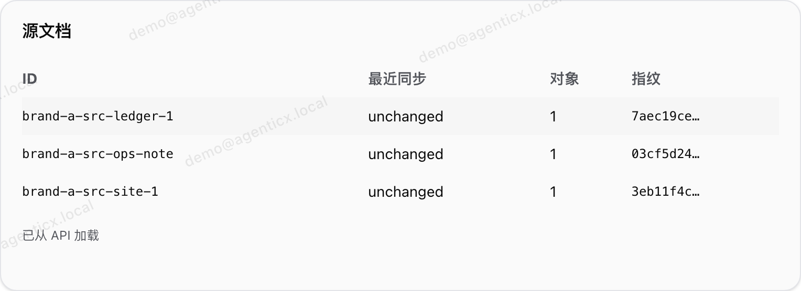

*图：图谱增量源列表卡片（元素截图）*

### 6.2 看源详情与同步运行

1. 点击某一源行，右侧打开详情。
2. 核对源字段与选中行一致；查看关联对象、最近运行等信息。
3. 在同步运行列表中点选一条 run（或触发一次同步，以页面按钮为准）。
4. 详情区应能切到对应运行记录。

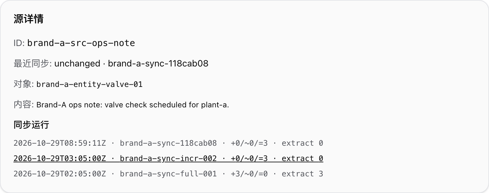

*图：选中源后的详情 / 同步运行卡片（元素截图）*

### 6.3 看同步报告

1. 选中某次同步运行。
2. 打开「同步报告」：应能看到变更集摘要、抽取结果、已发布条目一类统计（字段以页面为准）。
3. 报告区须与列表 / 详情视觉区分开——不是同一张空白卡。

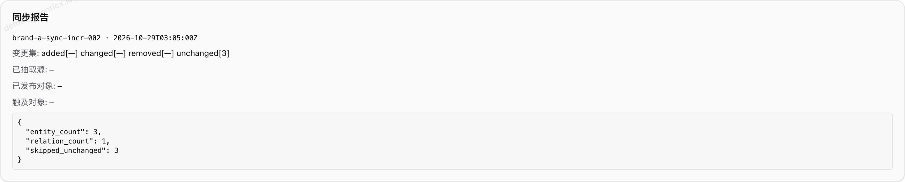

*图：同步报告（变更 / 抽取 / 已发布，元素截图）*

### 验收标准

源列表有行；点源后详情切换；选中运行后报告有内容或明确空态——三张卡片视觉互异。页头应能看到 GraphStore 后端徽章（如 `neo4j` / `file` / `memory`）。

---

## 六·B、图谱探索（GraphStore / Neo4j 闭环）

图谱增量同步把变更写进 **GraphStore**（内存 / 文件 / Neo4j 三种后端）。**图谱探索**用来人眼核对：同步后的图里到底有没有 Brand-A 的节点和边，点开后属性对不对。

> GraphStore 才是图真相；增量页上的 JSON 同步元数据只是过程记录，不是图本身。

### 6B.1 确认后端徽章（增量页）

1. 打开 **图谱增量同步**（`/admin/graph-incremental`）。
2. 看页头 / 工具条上的 **GraphStore 后端**徽章。
3. 本轮 Neo4j 闭环验收时期望显示 **`neo4j`**（本地未接 Neo4j 时可能是 `file` 或 `memory`，仍可演示画布，只是后端不同）。

*图：GraphStore 后端徽章（`neo4j` | `memory` | `file`）*

### 6B.2 打开探索画布

1. 打开 **图谱探索**（`/admin/graph-explorer`），或从增量页跳转（若页面提供入口）。
2. 等待画布加载结束。
3. 应看到 Brand-A 样例的节点与边（力导向布局）；不是空白画布。

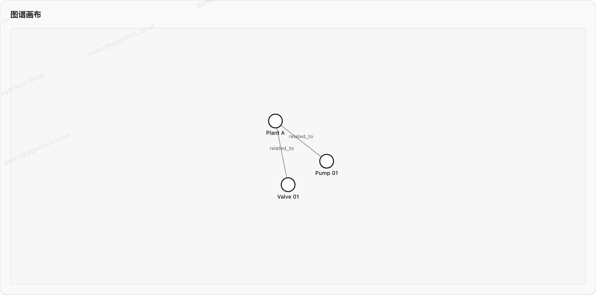

*图：图谱探索画布（Brand-A 节点 / 边，力导向）*

### 6B.3 点开泵 / 阀看属性

1. 在画布上点击一个 Brand-A **泵**或**阀**节点（以页面上可见标签为准）。
2. 右侧（或侧栏）打开节点详情 / 属性面板。
3. 核对：节点 ID、类型、以及同步写入的属性（演示时常见如关联源、`last_sync_run_id` 一类字段）可读。

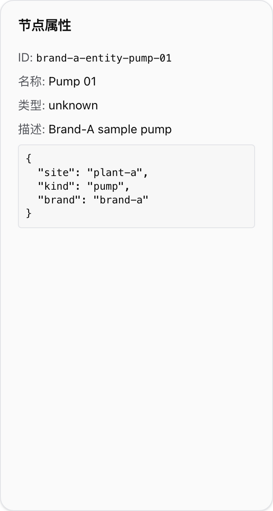

*图：选中节点后的属性面板*

### 6B.4（可选）改源后再同步，看属性更新

1. 回到增量源：对 Brand-A 源做一次可观察的变更（或按页面「强制变更 / 再同步」类操作，文案以页面为准）。
2. 触发同步并等待成功。
3. 再打开图谱探索，点同一节点：属性中与同步轮次相关的字段（如 `last_sync_run_id`）应相对上次有变化——说明闭环写进了 GraphStore，而不是只改了列表文案。

### 环境备注（运维，接 Neo4j 时）

本地要用 Neo4j 后端时，按下面顺序即可（不必改业务代码）：

1. 起 Neo4j（示例：Docker 暴露 Bolt **7687**，浏览器管理可选 **7474**）。
2. 配置连接：`NEO4J_URI=bolt://localhost:7687`，以及用户名 / 密码（与容器一致）。
3. 设置 `AGX_GRAPH_STORE_BACKEND=neo4j`。
4. **重启管理台**，让 Next 进程读到新环境变量。
5. 再走：Brand-A 种子 / 同步 → 增量页徽章显示 `neo4j` → 图谱探索有节点。

未接 Neo4j 时默认可用文件后端（`AGX_GRAPH_STORE_BACKEND=file`），探索页同样可演示；徽章会显示 `file`。

### 验收标准

- `/admin/graph-incremental` 能看到后端徽章，且与当前环境一致。
- `/admin/graph-explorer` 画布有 Brand-A 节点与边（非空）。
- 点击泵 / 阀能打开属性面板；可选路径下，再同步后 `last_sync_run_id` 一类字段会更新。
- 截图 17 / 18 / 19 视觉互异（画布 ≠ 详情 ≠ 徽章）。

---

## 七、R2 消歧确认（管理台）

打开 **消歧确认**（`/admin/disambiguation`）。左侧是会话列表，右侧是「选择面板」。数据来自管理台侧 JSON 样例库。

三种模式各一句：

| 模式 | 何时用 | 你做什么 |
|------|--------|----------|
| 候选选择 | 多个候选对象 / 标签，需要人选一个或几个 | 勾选候选 → 提交答复 |
| 信息补充 | 缺一段必填说明 | 在自由文本框填写 → 提交答复 |
| 冲突裁决 | 同一项有多套冲突取值 | 选定采纳项（及必要时补充说明）→ 提交答复 |

页面若无样例，可点 **重置 Brand-A 样例** 再演示。

### 7.1 候选选择

1. 在会话列表点开「候选选择」类会话。
2. 右侧模式显示「候选选择」。
3. 勾选一个或多个候选。
4. 点击 **提交答复**。
5. 应提示答复已应用；待处理请求减少或会话完成。

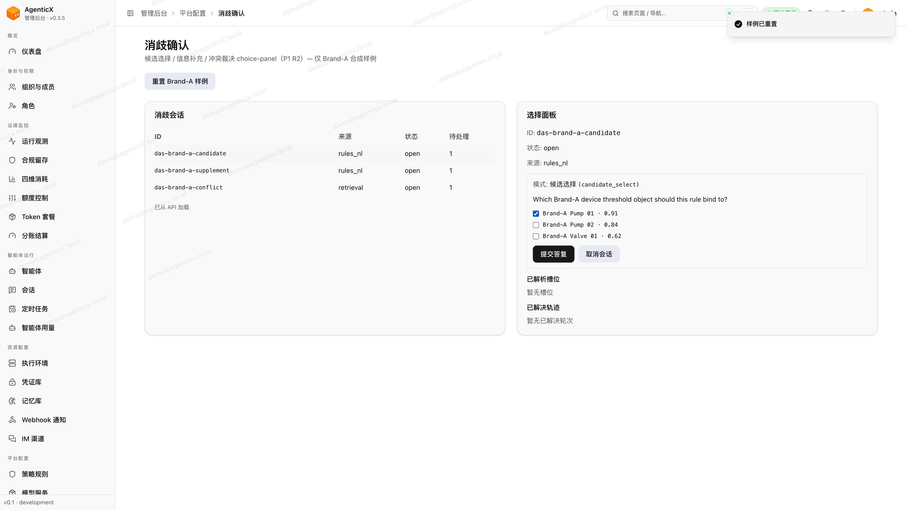

*图：管理台候选选择面板*

### 7.2 信息补充

1. 打开「信息补充」类会话。
2. 在「自由文本」框填写缺失信息（样例文案即可）。
3. 点击 **提交答复**。
4. 应提示成功；已解析槽位 / 已解决轨迹有更新。

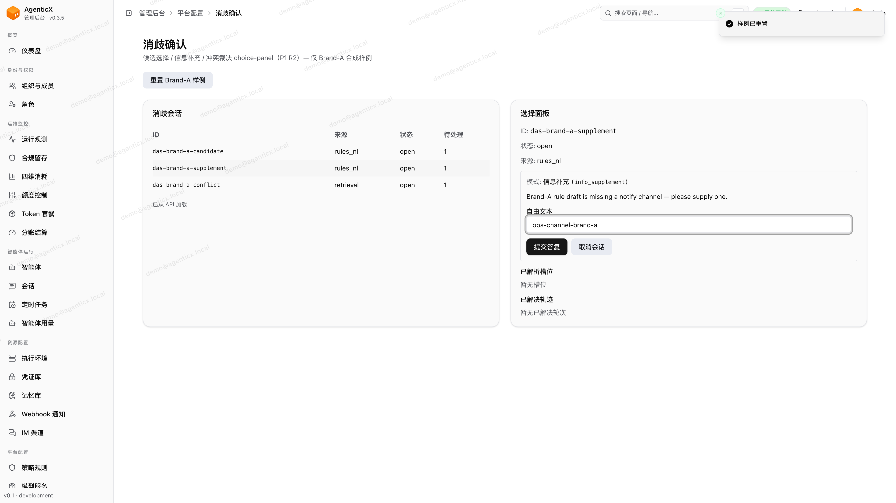

*图：管理台信息补充面板*

### 7.3 冲突裁决

1. 打开「冲突裁决」类会话。
2. 右侧展示冲突项（多来源取值并列）。
3. 按页面选项选定要采纳的一方（必要时勾选候选编码）。
4. 点击 **提交答复**（或 **取消会话** 结束本轮）。
5. 应提示成功或已取消；冲突不再处于待处理。

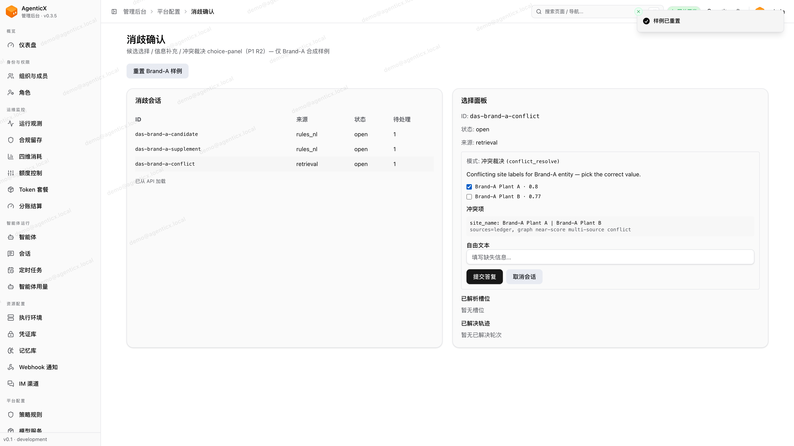

*图：管理台冲突裁决面板*

### 验收标准

三种模式都能打开对应面板；提交或取消后有明确反馈，不是点了没反应。

---

## 八、R2 消歧确认（门户）

门户入口：`/workspace/disambiguation`（设置 → 常规 也可进）。

与管理台的差别（演示时要说清楚）：

| | 管理台 | 门户 |
|--|--------|------|
| 路径 | `/admin/disambiguation` | `/workspace/disambiguation` |
| 会话来源 | 管理台 JSON 样例库 | 运行时会话（`AGX_DISAMBIGUATION_RUNTIME_STORE_DIR`，默认 `.runtime/disambiguation`） |
| 三种模式 | 相同 | 相同：候选选择 / 信息补充 / 冲突裁决 |

### 8.1 候选选择

1. 打开门户消歧页，选中「候选选择」类会话。
2. 勾选 Brand-A 泵等候选。
3. 提交答复，确认有成功反馈。

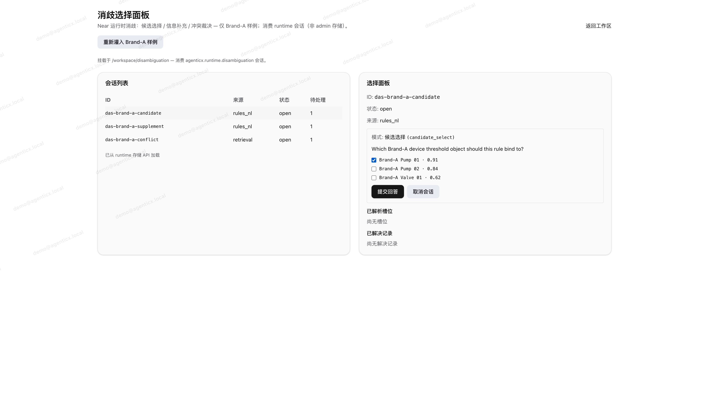

*图：门户候选选择面板（Brand-A 泵候选已勾选）*

### 8.2 信息补充

1. 切到「信息补充」会话。
2. 在自由文本框填写补充说明。
3. 提交答复。

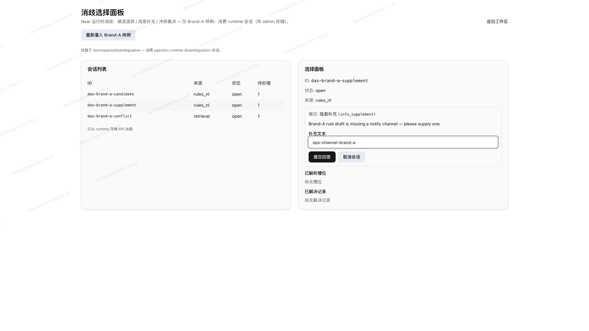

*图：门户信息补充面板（已填自由文本）*

### 8.3 冲突裁决

1. 切到「冲突裁决」会话。
2. 勾选要采纳的冲突项。
3. 提交或取消。

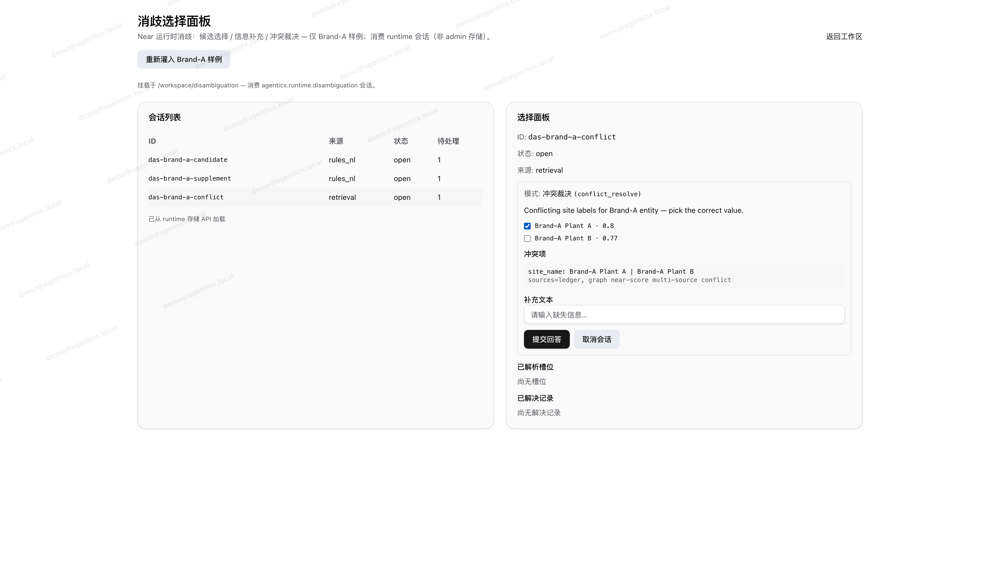

*图：门户冲突裁决面板（冲突候选已勾选）*

### 验收标准

三种模式面板视觉互异；提交 / 取消有反馈；不要和管理台会话库混用同一份数据做联调预期。

---

## 九、日常检查清单

- [ ] 能登录管理台进入 Dashboard；门户能登录（演示 K1 / 门户 R2 时）
- [ ] `/admin/rule-governance`：列表有行，点行后详情切换
- [ ] 规则详情「最近执行」有记录或明确空态
- [ ] `/workspace/citations` 或 `/admin/citation-evidence`：能看到出处（标签 + 摘录）；有冲突 / 缺失时能看见
- [ ] `/admin/knowledge-lifecycle`：列表有 Brand-A 对象
- [ ] 有 `kb:update` 时：知识对象可做至少一次状态流转，变更追溯有新行；无权限时写操作被明确拒绝
- [ ] 「运行质量检查」成功（有写权限时）；问题区可查看（并可标记已解决）
- [ ] `/admin/graph-incremental`：源列表有行；详情与同步报告可打开且视觉互异；页头后端徽章可见
- [ ] `/admin/graph-explorer`：画布有 Brand-A 节点/边；点泵/阀能看属性；徽章与环境一致（Neo4j 闭环时为 `neo4j`）
- [ ] `/admin/disambiguation`：候选选择 / 信息补充 / 冲突裁决三种面板均可打开并提交或取消
- [ ] `/workspace/disambiguation`：同上三种模式（运行时会话）均可打开并提交或取消

---

## 十、附录：截图怎么重跑

高清截图（视口 1920×1080，deviceScaleFactor=2；管理台 R1/K2/K3 多为元素级卡片截图以保证列表/详情/报告视觉互异）与重跑命令见同目录：

`docs/agx-rules-knowledge-suite/e2e-shots/README.md`

| 脚本 | 截图 |
|------|------|
| `e2e-rule-governance.ts` | 01–03 |
| `e2e-knowledge-lifecycle.ts` | 04–06 |
| `e2e-disambiguation.ts` | 07–09（管理台） |
| `e2e-graph-incremental.ts` | 10–12 |
| `e2e-graph-explorer.ts` | 17–19（GraphStore；Neo4j 时需 Docker bolt 7687） |
| `e2e-portal-disambiguation.ts` | 13–15（门户，需 `:3000`） |
| `e2e-portal-citations.ts` | 16（门户，需 `:3000`） |

管理台需已在 `:3001` 运行；门户相关脚本还需 `:3000`。在仓库根目录加载 `enterprise/.env.local` 后执行上表脚本即可覆盖本手册插图。

---

## 十一、修订记录

| 日期 | 说明 |
|------|------|
| 2026-10-29 | R1+K1+K2+R2 首版产品操作手册草稿；对齐 Data Suite S2 写法与 e2e-shots |
| 2026-10-29 | P0 债务清理：重拍 01–09 元素级高清图（01/02/03、04/05/06 MD5 互异）；文案对齐列表/详情/执行与问题非空验收 |
| 2026-10-29 | 增补 K3 图谱增量（#153，shots 10–12）、门户 R2 消歧（#154，shots 13–15）、K1 引用证据 UI（#155，shot 16）、K2 `kb:read`/`kb:update` RBAC 运维备注（#156）；刷新飞书正文与插图 |
| 2026-10-29 | 增补图谱探索 / GraphStore·Neo4j 闭环（#158–#164，shots 17–19）：增量页后端徽章、探索画布与节点详情；飞书正文就地刷新 |
