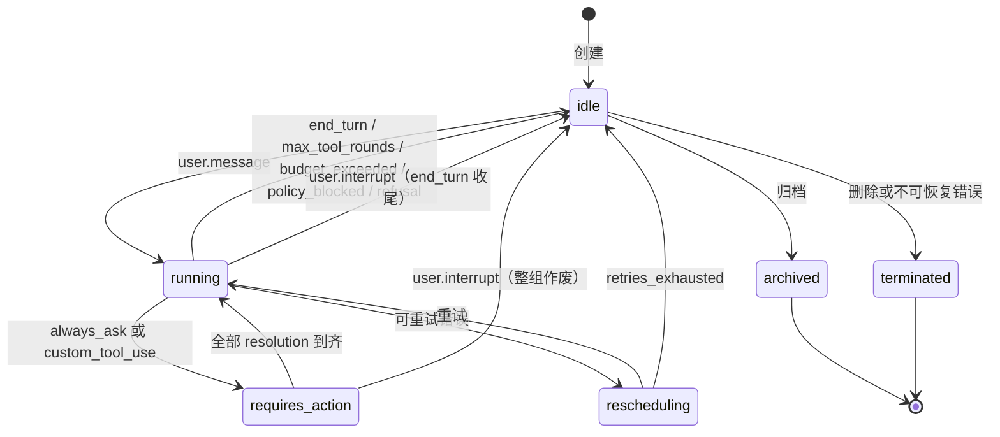

# Managed Agents 协议 `agx-ma/2026-11`

本文面向接入方，说明托管智能体的资源、Manifest、事件和错误码。Python 实现在 `agenticx/managed/`，TypeScript 类型与同语义校验在 `enterprise/packages/core-api/src/managed-agents.ts`。两端对同一组 JSON fixture 的校验结果和 hash 一致。

协议版本号是 `agx-ma/2026-11`。Manifest 的 `schema` 必须是 `agx.agent/v1`。

## 概念

| 资源 | 含义 |
|------|------|
| Agent | 租户内的智能体定义。`slug` 稳定，`latest_version` 指向当前版本，`lifecycle` 为 `draft` / `published` / `recalled`，`origin` 为 `enterprise` / `employee`。 |
| AgentVersion | 某一版不可变 Manifest。`(agent_id, version)` 唯一，行创建后不更新。`manifest_hash` 为规范化 JSON 的 `sha256:` 前缀摘要。 |
| Environment | 执行环境。`cloud` 带沙箱后端、镜像、出站域名和空闲 TTL；`desktop_worker` 带 `worker_keys`。`config.type` 必须与资源 `type` 相同。 |
| Session | 一次对话。锁定 `agent_id` + `agent_version` 与环境。`status` 为 `idle` / `running` / `rescheduling` / `terminated` / `archived`。`source` 为 `portal` / `desktop` / `api` / `schedule` / `channel` / `eval`。 |
| Event | 会话内有序事实。客户端事件与服务端事件都占 `seq`。`thread_id` 为空表示主线程。预览帧不落库、不占 `seq`。 |
| WorkItem | 桌面 Worker 的一次领取。`status` 为 `queued` / `claimed` / `running` / `completed` / `failed` / `stopped`。租约 TTL 120 秒，心跳间隔 15 秒。 |

Agent 关键字段：`id`、`tenant_id`、`slug`、`display_name`、`description`、`latest_version`、`status`（`active` / `disabled`）、`lifecycle`、`origin`、`assignment_keys`、`worker_keys`、`default_environment_id`。

AgentVersion 关键字段：`agent_id`、`version`、`manifest`、`manifest_hash`、`created_by`、`created_at`、`note`。

Environment 关键字段：`id`、`tenant_id`、`name`、`type`（`cloud` / `desktop_worker`）、`config`、`status`。云端 config 含 `sandbox_backend`（`subprocess` / `docker` / `remote`，默认 `docker`）、`image`、`egress_allow_domains`、`idle_ttl_seconds`（60–86400，默认 3600）。桌面 config 含 `worker_keys`。

Session 关键字段：`id`、`tenant_id`、`agent_id`、`agent_version`、`environment_id`、`created_by_user_id`、`source`、`status`、`stop_reason`、`title`、`vault_ids`、`resources`、`usage`、`created_at`、`updated_at`、`archived_at`。

Event 关键字段：`id`、`session_id`、`seq`、`thread_id`、`type`、载荷、`created_at`、`processed_at`。

WorkItem 关键字段：`id`、`session_id`、`environment_id`、`status`、`claimed_by_device`、`lease_expires_at`、`attempts`、`last_heartbeat_at`。

用量 `usage` 字段均为非负整数：`input_tokens`、`output_tokens`、`cache_read_input_tokens`、`tool_calls`、`runtime_ms`。

## Manifest

最小合法文档只需要 `schema` 与 `model`。保存前会补默认值并剥离系统管理的 metadata 键。

```json
{
  "schema": "agx.agent/v1",
  "model": "<providerId>/<modelName>",
  "system": "string，UTF-8 不超过 65536 字节",
  "tools": [
    {
      "type": "agx_builtin",
      "default_policy": "always_allow",
      "configs": [{ "name": "bash_exec", "policy": "always_ask", "enabled": true }]
    },
    {
      "type": "mcp",
      "server": "github",
      "default_policy": "always_ask",
      "configs": [{ "name": "get_issue", "policy": "always_allow" }]
    },
    {
      "type": "custom",
      "name": "lookup_order",
      "description": "string",
      "input_schema": { "type": "object" }
    }
  ],
  "mcp_servers": [
    { "name": "github", "url": "https://mcp.example.com/", "transport": "http" }
  ],
  "skills": [{ "source": "tenant", "id": "<ulid>", "version": "1.2.0" }],
  "multiagent": null,
  "runtime": { "max_tool_rounds": 40, "max_session_tokens": null },
  "metadata": { "welcome_message": "string" }
}
```

顶层只允许：`schema`、`model`、`system`、`tools`、`mcp_servers`、`skills`、`multiagent`、`runtime`、`metadata`。

约束摘要：

- 按 `json.dumps`（`ensure_ascii=false`，分隔符 `(",", ":")`）计的 UTF-8 字节数不超过 262144。顶层必须是 object。
- `model` 匹配 `^[^/\s]+/\S+$`，形如 `<providerId>/<modelName>`。
- `tools[].type` 为 `agx_builtin` / `mcp` / `custom`。`policy` 为 `always_allow` / `always_ask`。`enabled: false` 表示从会话工具表移除。
- `configs[].policy` 缺省为 `null`（运行时继承 `default_policy`）。`default_policy` 缺省为 `always_allow`。
- `mcp_servers[].transport` 为 `http` / `sse`。`streamable-http` 与 `streamable_http` 在规范化时写成 `http`。出现 `headers` 或 `env` 即拒绝。
- `skills[].source` 为 `builtin` / `tenant`。未写 `version` 时规范化为 `null`。
- `multiagent` 在后续多智能体子规划之前必须为 `null` 或缺省。
- `metadata` 里的 `model`、`description`、`agentName` 由系统管理，提交时静默剥离，不报错。

整数判定：Python 使用 `isinstance(x, int) and not isinstance(x, bool)`；TypeScript 使用 `typeof x === "number" && Number.isInteger(x)`。布尔值不算整数。

### 校验规则

先做两个短路检查，命中则只返回这一条错误：

1. `raw` 不是 object → `manifest: must be a JSON object`
2. 序列化字节数大于 262144 → `manifest: exceeds 262144 bytes`

之后收集全部错误，按字符串默认序排序。`<i>`、`<j>` 是数组下标，`<k>` 是键名，`<v>` 是原值的 JSON 字面量（例如 `"foo"` 或 `3`，缺失的 `type` 为 `null`）。

| # | 条件 | 错误字符串 |
|---|------|-----------|
| 1 | 顶层出现允许列表之外的键 | `manifest.<k>: unknown field` |
| 2 | `schema` 缺失或不等于 `agx.agent/v1` | `manifest.schema: must be "agx.agent/v1"` |
| 3 | `model` 缺失 | `manifest.model: is required` |
| 4 | `model` 不是字符串或不匹配 `^[^/\s]+/\S+$` | `manifest.model: must be "<providerId>/<modelName>"` |
| 5 | `system` 存在且不是字符串 | `manifest.system: must be a string` |
| 6 | `system` 的 UTF-8 字节数大于 65536 | `manifest.system: exceeds 65536 bytes` |
| 7 | `tools` 存在且不是数组 | `manifest.tools: must be an array` |
| 8 | `tools[i]` 不是对象 | `manifest.tools[<i>]: must be an object` |
| 9 | `tools[i].type` 不在 `agx_builtin` / `mcp` / `custom` | `manifest.tools[<i>].type: must be one of [agx_builtin,mcp,custom], got <v>`。`type` 缺失时 `<v>` 为 `null`。该条目其余字段不再检查 |
| 10 | `agx_builtin` 出现 `type` / `default_policy` / `configs` 之外的键；`mcp` 出现 `type` / `server` / `default_policy` / `configs` 之外的键；`custom` 出现 `type` / `name` / `description` / `input_schema` 之外的键 | `manifest.tools[<i>].<k>: unknown field` |
| 11 | `default_policy` 存在且不是 `always_allow` / `always_ask` | `manifest.tools[<i>].default_policy: must be one of [always_allow,always_ask]` |
| 12 | `configs` 存在且不是数组 | `manifest.tools[<i>].configs: must be an array` |
| 13 | `configs[j]` 不是对象 | `manifest.tools[<i>].configs[<j>]: must be an object` |
| 14 | `configs[j]` 出现 `name` / `policy` / `enabled` 之外的键 | `manifest.tools[<i>].configs[<j>].<k>: unknown field` |
| 15 | `configs[j].name` 缺失或不是非空字符串 | `manifest.tools[<i>].configs[<j>].name: is required` |
| 16 | `configs[j].policy` 存在、非 null，且不在 `always_allow` / `always_ask` | `manifest.tools[<i>].configs[<j>].policy: must be one of [always_allow,always_ask]` |
| 17 | `configs[j].enabled` 存在且不是布尔 | `manifest.tools[<i>].configs[<j>].enabled: must be a boolean` |
| 18 | 同一 toolset 内 `configs[j].name` 与之前某个 config 重复 | `manifest.tools[<i>].configs[<j>].name: duplicate tool "<name>"` |
| 19 | `mcp` 条目 `server` 缺失或不是非空字符串 | `manifest.tools[<i>].server: is required` |
| 20 | `mcp` 条目 `server` 不在 `mcp_servers[].name` 中（仅当 `mcp_servers` 本身是数组时检查） | `manifest.tools[<i>].server: references undeclared mcp server "<server>"` |
| 21 | 两个 `mcp` 条目的 `server` 相同 | `manifest.tools[<i>].server: duplicate toolset for mcp server "<server>"`（报在后出现的那个） |
| 22 | 两个 `agx_builtin` 条目 | `manifest.tools[<i>].type: duplicate agx_builtin toolset`（报在后出现的那个） |
| 23 | `custom` 条目 `name` 不是字符串或不匹配 `^[A-Za-z][A-Za-z0-9_]{0,63}$` | `manifest.tools[<i>].name: must match ^[A-Za-z][A-Za-z0-9_]{0,63}$` |
| 24 | `custom` 条目 `name` 与之前某个 custom 重复 | `manifest.tools[<i>].name: duplicate custom tool "<name>"` |
| 25 | `custom` 条目 `description` 缺失或不是非空字符串 | `manifest.tools[<i>].description: is required` |
| 26 | `custom` 条目 `input_schema` 不是对象 | `manifest.tools[<i>].input_schema: must be an object` |
| 27 | `mcp_servers` 存在且不是数组 | `manifest.mcp_servers: must be an array` |
| 28 | `mcp_servers[i]` 不是对象 | `manifest.mcp_servers[<i>]: must be an object` |
| 29 | `mcp_servers[i]` 含 `headers` 或 `env` | `manifest.mcp_servers[<i>].<k>: secrets are not allowed in manifest`（两个键分别报） |
| 30 | `mcp_servers[i]` 出现 `name` / `url` / `transport` / `headers` / `env` 之外的键 | `manifest.mcp_servers[<i>].<k>: unknown field` |
| 31 | `name` 缺失或不是非空字符串 | `manifest.mcp_servers[<i>].name: is required` |
| 32 | `name` 与之前某个 MCP server 重复 | `manifest.mcp_servers[<i>].name: duplicate mcp server "<name>"` |
| 33 | `url` 缺失或不是非空字符串 | `manifest.mcp_servers[<i>].url: is required` |
| 34 | `url` 不以 `https://` 或 `http://` 开头 | `manifest.mcp_servers[<i>].url: must start with http:// or https://` |
| 35 | `transport` 存在，经别名归一后不是 `http` / `sse` | `manifest.mcp_servers[<i>].transport: must be one of [http,sse]` |
| 36 | `skills` 存在且不是数组 | `manifest.skills: must be an array` |
| 37 | `skills[i]` 不是对象 | `manifest.skills[<i>]: must be an object` |
| 38 | `skills[i]` 出现 `source` / `id` / `version` 之外的键 | `manifest.skills[<i>].<k>: unknown field` |
| 39 | `source` 不是 `builtin` / `tenant` | `manifest.skills[<i>].source: must be one of [builtin,tenant]` |
| 40 | `id` 缺失或不是非空字符串 | `manifest.skills[<i>].id: is required` |
| 41 | `version` 存在、非 null，且不是非空字符串 | `manifest.skills[<i>].version: must be a string` |
| 42 | `multiagent` 存在且不是 null | `manifest.multiagent: must be null` |
| 43 | `runtime` 存在且不是对象 | `manifest.runtime: must be an object` |
| 44 | `runtime` 出现 `max_tool_rounds` / `max_session_tokens` 之外的键 | `manifest.runtime.<k>: unknown field` |
| 45 | `max_tool_rounds` 存在且不是 1–500 的整数（布尔不算整数） | `manifest.runtime.max_tool_rounds: must be an integer between 1 and 500` |
| 46 | `max_session_tokens` 存在、非 null，且不是大于等于 1000 的整数 | `manifest.runtime.max_session_tokens: must be null or an integer >= 1000` |
| 47 | `metadata` 存在且不是对象 | `manifest.metadata: must be an object` |

校验通过后的规范化（不修改输入）：

- 缺省补齐：`system=""`、`tools=[]`、`mcp_servers=[]`、`skills=[]`、`multiagent=null`、`metadata={}`。
- `runtime` 缺省为 `{ "max_tool_rounds": 40, "max_session_tokens": null }`；对象已存在时只补缺失键。
- `agx_builtin` / `mcp` 缺 `default_policy` 时补 `always_allow`，缺 `configs` 时补 `[]`。每个 config 缺 `enabled` 补 `true`，缺 `policy` 补 `null`。
- `mcp_servers[].transport` 缺失补 `http`，并做别名归一。
- `skills[].version` 缺失补 `null`。
- 从 `metadata` 删除 `model`、`description`、`agentName`。

`manifest_hash` 为 `sha256:` 加上规范化 JSON 的 SHA-256 十六进制摘要。规范化 JSON 按键名排序、无多余空白、保留非 ASCII 字符。键顺序不影响 hash。

## 事件类型

一批客户端事件必须是 `{"events":[...]}`，1–10 条。整批原子校验：任一条非法则整批拒绝，不返回部分结果。同一批里两条 `user.tool_confirmation` 的 `tool_use_id` 相同，或两条 `user.custom_tool_result` 的 `custom_tool_use_id` 相同，返回 `duplicate_resolution`，`index` 指向后出现的那条。

内容块 `type` 为 `text`、`image` 或 `document`。图片 `source.type` 为 `base64`（`media_type` 仅 `image/jpeg`、`image/png`、`image/gif`、`image/webp`）、`url`（必须以 `https://` 开头）或 `file`。文档 `source.type` 为 `text` 或 `file`。

客户端 → 运行时：

| 类型 | 关键字段 | 说明 |
|------|---------|------|
| `user.message` | `content[]`（text / image / document），至少一块 | `requires_action` 期间被拒（409，`session_requires_action`） |
| `user.interrupt` | `thread_id?` | 停止当前模型响应与运行中命令 |
| `user.tool_confirmation` | `tool_use_id`、`result`（`allow` / `deny`）、`deny_message?` | 对应 `always_ask`。`result=allow` 时不得带非空 `deny_message` |
| `user.custom_tool_result` | `custom_tool_use_id`、`content[]?`、`is_error?` | 对应自定义工具 |

运行时 → 客户端（全部落库，占 `seq`）：

| 类型 | 说明 |
|------|------|
| `agent.message` | 最终文本回复（内容块数组） |
| `agent.thinking` | 推理文本，只含 text 块 |
| `agent.tool_use` / `agent.tool_result` | 内置工具。`tool_use` 带 `evaluated_policy`（`always_allow` / `always_ask`） |
| `agent.mcp_tool_use` / `agent.mcp_tool_result` | 额外带 `mcp_server`；结果用 `mcp_tool_use_id` 关联 |
| `agent.custom_tool_use` | 请调用方执行。字段为 `name` 与 `input` |
| `session.status_running` / `session.status_idle` / `session.status_terminated` | 状态权威来源 |
| `session.error` | `error.type`、`error.message`、`error.retry_status.type`（`retrying` / `exhausted` / `terminal`），可选 `mcp_server` |
| `session.usage` | 累计用量 |
| `span.model_request_start` / `span.model_request_end` | 单次模型请求区间。end 带 `model_usage` 与 `is_error` |

`session.status_idle.stop_reason.type`：`end_turn` / `requires_action` / `retries_exhausted` / `refusal` / `max_tool_rounds` / `budget_exceeded` / `policy_blocked`。只有 `requires_action` 可以、并且必须带非空 `event_ids`。其余类型的 `event_ids` 必须为空。

预览帧不继承事件公共字段，不落库：

| 类型 | 字段 |
|------|------|
| `event_start` | `event` 对象 |
| `event_delta` | `event_type`（`agent.message` 或 `agent.thinking`）、`content_delta` |

事件公共可选字段：`id`、`session_id`、`seq`、`thread_id`、`created_at`、`processed_at`。输出到 SSE 和历史接口时省略值为 null 的字段。

## 会话状态机



`requires_action` 在数据上是 `status=idle` 且 `stop_reason.type=requires_action`，图中单独画出只为表达约束。

## 接口清单

会话面由 agent-runtime 提供。

| 方法 | 路径 | 说明 |
|------|------|------|
| POST | `/ma/v1/sessions` | `{agent_id, agent_version?, environment_id?, vault_ids?, resources?, title?}`，缺省锁定最新版本与 Agent 默认环境 |
| GET | `/ma/v1/sessions` | `agent_id`、`limit`（1–100，默认 20）、`scope`（`mine` 默认，或 `tenant`）。缺省只返回调用者自己创建的会话；`scope=tenant` 需 `ma:admin` |
| GET | `/ma/v1/sessions/:id` | 含 `status`、`stop_reason`、`usage` |
| POST | `/ma/v1/sessions/:id/events` | 1–10 条一批，整批原子校验，任一非法则零写入 |
| GET | `/ma/v1/sessions/:id/events` | `after_seq`、`limit`（默认 100，最大 500）、`types` |
| GET | `/ma/v1/sessions/:id/events/stream` | SSE；`Last-Event-ID` 或 `after_seq` 续流；15 秒 `: ping`；`event_deltas[]=agent.message` 订阅预览帧 |
| POST | `/ma/v1/sessions/:id/archive` | 归档 |
| POST | `/ma/v1/environments/:id/work/poll` | Worker 长轮询（最长 25 秒） |
| POST | `/ma/v1/work/:id/ack` / `heartbeat` / `complete` / `fail` | 租约 TTL 120 秒，心跳间隔 15 秒；心跳中断 TTL + 60 秒宽限后置 `stopped`，不自动转派 |
| POST | `/ma/v1/sessions/:id/events:ingest` | 仅 `ma:worker` scope；Worker 批量回传本地产生的事件，服务端分配 `seq` |
| GET | `/ma/v1/sessions/:id/inbox/stream` | 仅 `ma:worker`；Worker 订阅待处理的用户事件 |

时间常数：`SSE_PING_INTERVAL_SECONDS=15`，`WORK_LEASE_TTL_SECONDS=120`，`WORK_HEARTBEAT_INTERVAL_SECONDS=15`，`WORK_STOP_GRACE_SECONDS=60`，`WORK_POLL_MAX_WAIT_SECONDS=25`，`MAX_EVENTS_PER_BATCH=10`。

## 续流规则

已落库事件在单个会话内拥有单调递增的 `seq`。客户端断开后用下面任一游标重连：

- HTTP 头 `Last-Event-ID`：上次收到的事件 `id`
- 查询参数 `after_seq`：上次收到的 `seq`

服务端只发送游标之后的事件，不补发已确认的事件，也不跳过未送达的事件。历史读取使用 `GET /ma/v1/sessions/:id/events?after_seq=`。

SSE 连接每 15 秒写一行 `: ping`，避免中间设备掐断空闲连接。`event_start` 与 `event_delta` 是预览，不写入事件表，也不占用 `seq`。用 `event_deltas[]=agent.message` 订阅 `agent.message` 的增量；`event_delta.event_type` 还可以是 `agent.thinking`。重连后以落库事件为准，预览帧可以重放也可以丢弃，不能当成 `seq` 的空洞。

## 错误码

响应体为 `{"error":{"code":"...","message":"...","details":{...}}}`。事件批失败时，`details.index` 为从 0 起的下标；形状错误（不是列表、空批、超过 10 条）没有 `index`。

| code | HTTP |
|------|------|
| `invalid_request` | 400 |
| `invalid_event_batch` | 400 |
| `duplicate_resolution` | 400 |
| `manifest_invalid` | 400 |
| `unauthorized` | 401 |
| `forbidden_scope` | 403 |
| `session_not_found` | 404 |
| `agent_not_found` | 404 |
| `agent_version_not_found` | 404 |
| `environment_not_found` | 404 |
| `resolution_not_found` | 404 |
| `task_not_found` | 404 |
| `session_requires_action` | 409 |
| `resolution_conflict` | 409 |
| `work_lease_lost` | 409 |
| `session_terminated` | 409 |
| `internal_error` | 500 |

## PAT scope

| scope | 用途 |
|-------|------|
| `ma:agents:read` | 读取 Agent 与版本 |
| `ma:agents:write` | 创建、发布、回收 Agent 版本 |
| `ma:environments:read` | 读取环境 |
| `ma:environments:write` | 创建和修改环境 |
| `ma:sessions:read` | 读取会话、历史事件和 SSE |
| `ma:sessions:write` | 创建会话、提交用户事件、归档 |
| `ma:sessions:on_behalf` | 服务调用方代表指定用户创建会话（配合 `X-AgenticX-On-Behalf-Of` 请求头） |
| `ma:worker` | Worker 领取 Work、心跳、回传事件、订阅 inbox |
| `ma:vaults:read` | 读取 Vault 元数据 |
| `ma:vaults:write` | 写入和轮换 Vault。明文读取不在此 scope |
| `ma:memory:read` | 读取记忆 |
| `ma:memory:write` | 写入记忆 |
| `ma:schedules:read` | 读取定时任务与运行记录 |
| `ma:schedules:write` | 创建、修改、删除定时任务，并请求立即运行 |
| `ma:webhooks:read` | 读取 Webhook 与投递记录 |
| `ma:webhooks:write` | 创建、修改、删除 Webhook，并轮换签名密钥 |
| `ma:channels:read` | 读取 IM 渠道与连接状态 |
| `ma:channels:write` | 创建、修改、删除 IM 渠道 |
| `ma:admin` | 租户级管理操作 |

缺少所需 scope 时返回 `forbidden_scope`（403）。未认证返回 `unauthorized`（401）。

## 版本号

当前协议版本是 `agx-ma/2026-11`。Manifest schema 是 `agx.agent/v1`。不兼容的字段或错误码变更会提升协议版本；Manifest 结构变更会提升 schema 字符串。接入方应同时校验这两个字面量。

## Vault 控制面（MA-E06）

凭证库只写不读。公共接口与管理台接口的响应只包含 `has_secret`、过期时间和匹配目标，不回显密钥、密文或 `kek_id`。明文只出现在内部解析接口的响应里。

### 公共接口

鉴权使用 PAT scope `ma:vaults:read` / `ma:vaults:write`（`ma:admin` 放行全部）。响应带 `cache-control: no-store`。

| 方法 | 路径 | scope | 成功响应 |
|------|------|-------|----------|
| GET | `/api/ma/v1/vaults?include_archived=true` | read | 200 `{"data":[VaultRecord]}` |
| POST | `/api/ma/v1/vaults` | write | 201 `{"vault":VaultRecord}` |
| GET | `/api/ma/v1/vaults/:vaultId` | read | 200 `{"vault":VaultRecord}` |
| PATCH | `/api/ma/v1/vaults/:vaultId` | write | 200 `{"vault":VaultRecord}` |
| POST | `/api/ma/v1/vaults/:vaultId/archive` | write | 200 `{"vault":VaultRecord}` |
| DELETE | `/api/ma/v1/vaults/:vaultId` | write | 200 `{"id","deleted":true}`；未归档 409 `vault_not_archived` |
| GET | `/api/ma/v1/vaults/:vaultId/referenced_by` | read | 200 引用摘要 |
| GET | `/api/ma/v1/vaults/:vaultId/credentials` | read | 200 `{"data":[CredentialRecord]}` |
| POST | `/api/ma/v1/vaults/:vaultId/credentials` | write | 201 `{"credential":CredentialRecord}` |
| GET | `/api/ma/v1/vaults/:vaultId/credentials/:credentialId` | read | 200 `{"credential":CredentialRecord}` |
| PATCH | `/api/ma/v1/vaults/:vaultId/credentials/:credentialId` | write | 200 `{"credential":CredentialRecord}` |
| POST | `/api/ma/v1/vaults/:vaultId/credentials/:credentialId/archive` | write | 200 `{"credential":CredentialRecord}` |
| DELETE | `/api/ma/v1/vaults/:vaultId/credentials/:credentialId` | write | 200 `{"id","deleted":true}` |

### 凭证类型与身份键

| type | 身份键 | 公开配置 | 加密字段 |
|------|--------|----------|----------|
| `static_bearer` | `mcp_server_url` = 归一化 URL | `{}` | `token` |
| `mcp_oauth` | `mcp_server_url` = 归一化 URL | `refresh`（可选） | `access_token`、`refresh_token?`、`client_secret?` |
| `bearer` | `host` = 小写主机名 | `{}` | `token` |
| `environment_variable` | `secret_name` = 变量名 | `networking` | `secret_value` |

每个密钥字段长度 8–16384，不得含换行、NUL 或子串 `${cred:`。同一 Vault 内有效凭证的身份键唯一。单个 Vault 最多 100 条有效凭证。

`environment_variable` 的 `networking` 为 `{type:"unrestricted"}`，或 `{type:"limited", allowed_hosts:[...]}`（1–16 项，支持 `*.example.com`）。

### `mcp_server_url` 归一化

凭证 URL 与运行时匹配使用同一规则。输入 trim 后：

- 长度超过 512，或含可打印 ASCII（0x21–0x7E）以外的字符，拒绝。
- 必须是 `https:`，且不得带用户名、密码、query 或 fragment。
- 主机名小写并去掉末尾的 `.`。
- 端口为空或为 `443` 时不写入；其他端口保留。
- 路径去掉末尾的 `/`（`/` 变成空，`/mcp/` 变成 `/mcp`）。
- 结果为 `https://{host[:port]}{path}`。

示例：`https://MCP.Example.com:443/mcp/` → `https://mcp.example.com/mcp`。Manifest 里带 query 的 URL 按同一规则保留 query，因此匹配不到不允许 query 的凭证 URL。

### 内部解析

`POST /api/internal/ma/vaults/validate` 与 `POST /api/internal/ma/vault-resolve` 只接受 `MA_INTERNAL_TOKEN`。`MA_VAULT_RESOLVE_ENABLED=0` 时解析接口返回 503 `vault_crypto_unavailable`。

解析请求：

```json
{ "tenant_id": "T", "session_id": "01J...", "vault_ids": ["01JVAULTA...", "01JVAULTB..."] }
```

`vault_ids` 必须是会话 `vault_ids` 的子集，长度 1–20，元素为 ULID 且不重复。会话不存在返回 404 `session_not_found`；会话已归档或已终止返回 409 `session_terminated`。

解析响应（`cache-control: no-store`）。顺序是请求中的 Vault 顺序，再按凭证创建时间。`refresh_error` 只在刷新失败时出现。`refresh_token` 与 `client_secret` 不会出现。

```json
{
  "session_id": "01J...",
  "resolved_at": "2026-10-25T08:00:00.000Z",
  "credentials": [
    { "credential_id": "01J...", "vault_id": "01JVAULTA...", "vault_index": 0, "type": "static_bearer", "display_name": "GitHub MCP token", "mcp_server_url": "https://mcp.example.com/mcp", "token": "<plaintext>" },
    { "credential_id": "...", "vault_id": "...", "vault_index": 0, "type": "mcp_oauth", "display_name": null, "mcp_server_url": "https://mcp.example.com", "access_token": "<plaintext>", "expires_at": "2026-10-25T09:00:00.000Z", "refresh_error": "failed" },
    { "credential_id": "...", "vault_id": "...", "vault_index": 1, "type": "bearer", "display_name": null, "host": "docs.example.com", "token": "<plaintext>" },
    { "credential_id": "...", "vault_id": "...", "vault_index": 1, "type": "environment_variable", "display_name": null, "secret_name": "EXAMPLE_API_KEY", "secret_value": "<plaintext>", "networking": { "type": "limited", "allowed_hosts": ["api.example.com", "*.example.org"] } }
  ],
  "skipped": [ { "vault_id": "01K...", "reason": "not_found" } ]
}
```

每次成功解析在返回前写一行 `audit_events`（`event_type=ma.vault.resolve`，`target_kind=ma_session`，`actor_user_id` 为空）。审计写入失败则返回 500，且响应不含任何密钥。

### 控制面错误码

这些码只在 admin-console 的 `MA_CONTROL_PLANE_ERROR_CODES` 中，不进入 MA-00 `ALL_ERROR_CODES`。

| code | HTTP |
|------|------|
| `vault_not_found` | 404 |
| `credential_not_found` | 404 |
| `credential_identity_conflict` | 409 |
| `vault_credential_limit` | 409 |
| `vault_not_archived` | 409 |
| `vault_archived` | 409 |
| `vault_crypto_unavailable` | 503 |

## Memory Store 控制面（MA-E07）

记忆库是租户内共享的路径化文本。每条记忆是一条以 `/` 开头的路径加不超过 100 KiB 的 UTF-8 文本，并带整数 `version`。创建时版本为 1；每次修改加 1。删除写入 `operation=deleted`、版本为原版本加 1 的不可变记录，并删掉当前行。同一路径删除后再创建得到新的记忆 id，版本从 1 重新开始。

物理上只有 admin-console 写入这三张表。agent-runtime 通过内部接口提交写入，接口按版本号做比较并交换（CAS）。更新和删除执行 `UPDATE ... WHERE id = ? AND store_id = ? AND version = ?`；影响行数为 0 时返回 409 `memory_version_conflict`，并带上当前 head。创建靠 `(store_id, path_hash)` 唯一约束，冲突返回 409 `memory_path_conflict`。路径哈希是 NFC 路径的 sha256 hex。

创建或改名时，如果目标路径与已有路径相同，或者一个路径是另一个路径的目录前缀（`/a` 与 `/a/b`），也返回 `memory_path_conflict`。`/ab` 与 `/a` 不冲突。每个库最多 2000 条记忆、合计不超过 20 MiB，单条不超过 100 KiB。超过限额返回 409 `memory_store_limit`。

### 路径规则

1. 必须是字符串，并先做 NFC 归一化。
2. 以 `/` 开头，不能是 `/`，也不能以 `/` 结尾。
3. UTF-8 不超过 1024 字节。
4. 不能包含 U+0000–U+001F、U+007F 或反斜杠。
5. 按 `/` 分段后，任一段不能为空、`.`、`..`，且任一段 UTF-8 不超过 255 字节。

内容必须是字符串，不能含 NUL，UTF-8 不超过 102400 字节。

### 公共接口

鉴权使用 PAT scope `ma:memory:read` / `ma:memory:write`（`ma:admin` 放行全部）。响应带 `cache-control: no-store`。写入方记为用户。

| 方法 | 路径 | scope | 成功响应 |
|------|------|-------|----------|
| GET | `/api/ma/v1/memory_stores?include_archived=true` | read | 200 `{"data":[MemoryStoreRecord]}` |
| POST | `/api/ma/v1/memory_stores` | write | 201 `{"memory_store"}`，请求 `{name, description?, metadata?}` |
| GET | `/api/ma/v1/memory_stores/:storeId` | read | 200 `{"memory_store"}` |
| PATCH | `/api/ma/v1/memory_stores/:storeId` | write | 200 `{"memory_store"}` |
| POST | `/api/ma/v1/memory_stores/:storeId/archive` | write | 200 `{"memory_store"}` |
| DELETE | `/api/ma/v1/memory_stores/:storeId` | write | 200 `{"id","deleted":true}` |
| GET | `/api/ma/v1/memory_stores/:storeId/memories` | read | 200 `{"data":[{"type":"memory",...}\|{ "type":"memory_prefix","path" }],"next_cursor"}` |
| POST | `/api/ma/v1/memory_stores/:storeId/memories` | write | 201 `{"memory"}`，含 `content` |
| GET | `/api/ma/v1/memory_stores/:storeId/memories/:memoryId` | read | 200 `{"memory"}`，含 `content` |
| PATCH | `/api/ma/v1/memory_stores/:storeId/memories/:memoryId` | write | 200 `{"memory"}`。请求必须带 `expected_version` 或 `precondition:{type:"content_sha256", content_sha256}` |
| DELETE | `/api/ma/v1/memory_stores/:storeId/memories/:memoryId` | write | 200 `{"id","deleted":true,"version"}`。查询参数 `expected_version` 或 `expected_content_sha256` 至少有一个 |
| GET | `/api/ma/v1/memory_stores/:storeId/memory_versions` | read | 200 `{"data":[MemoryVersionRecord],"next_cursor"}`，列表不含 `content` |
| GET | `/api/ma/v1/memory_stores/:storeId/memory_versions/:versionId` | read | 200 `{"memory_version"}`，含 `content` |
| POST | `/api/ma/v1/memory_stores/:storeId/memory_versions/:versionId/redact` | write | 200 `{"memory_version"}` |

列表查询：`path_prefix` 默认 `/` 且必须以 `/` 结尾；`depth` 为 0–1024，缺省不限；`view=full` 时 `limit` 最大 20，`view=basic` 时最大 200。哈希前置条件与当前内容不一致时返回 409 `memory_version_conflict`，`details.current` 为 `{id, path, version, content_sha256}`。两者都缺返回 400。

归档后的库不能再被管理员修改，也不能挂到新会话；已经挂载的会话仍可通过内部接口读写。删除前必须先归档，且不能仍被 `running` 或 `rescheduling` 会话挂载。

脱敏只作用于非当前版本。当前 head（现存记忆行上的版本，或已删除记忆的最大 `deleted` 版本）返回 409 `memory_version_is_head`。脱敏把历史版本的路径、路径哈希、内容、内容哈希和大小清空，并记下脱敏时间与操作人。已脱敏的版本再次调用按原样返回。

### 内部接口

`MA_INTERNAL_TOKEN` 鉴权。`MA_MEMORY_INTERNAL_ENABLED=0` 时三个接口返回 503 `{"error":{"code":"internal_error","message":"memory service is disabled"}}`。

快照和写入都要求会话存在、未归档且未终止，并且 `resources` 里有 `{type:"memory_store", memory_store_id}` 指向该库。找不到挂载返回 403 `forbidden_scope`（`session does not mount this memory store`）。写入还要求该项 `access` 为 `read_write`，否则 403（`memory store is mounted read_only`）。会话不存在 404 `session_not_found`；已归档或已终止 409 `session_terminated`。

`POST /api/internal/ma/memory-stores/validate`

```json
{ "tenant_id": "T", "memory_store_ids": ["01J..."] }
```

`memory_store_ids` 为 1–8 个字符串。响应保持原序：`{"memory_stores":[{"id","status":"active"|"archived"|"missing","name":string|null}]}`。

`GET /api/internal/ma/memory-stores/:storeId/snapshot?tenant_id=&session_id=`

已归档的库仍可读。

```json
{
  "memory_store": { "id": "01J...", "name": "项目知识", "status": "active" },
  "memories": [
    { "id": "01J...", "path": "/preferences/report.md", "content": "...", "content_sha256": "ab12...", "size_bytes": 120, "version": 3 }
  ]
}
```

`POST /api/internal/ma/memory-stores/:storeId/writes`

`ops` 为 1–50 条。每条单独事务，一条冲突不回滚其他条。未知字段只让该条返回 `invalid_request`。执行主体为 `{kind:"agent", userId:<会话创建者>, sessionId}`。

```json
{
  "tenant_id": "T",
  "session_id": "01J...",
  "ops": [
    { "op": "create", "path": "/notes/a.md", "content": "..." },
    { "op": "update", "memory_id": "01J...", "expected_version": 3, "content": "..." },
    { "op": "delete", "memory_id": "01J...", "expected_version": 2 }
  ]
}
```

```json
{
  "results": [
    { "index": 0, "ok": true, "memory": { "id": "01J...", "path": "/notes/a.md", "version": 1, "content_sha256": "..." } },
    { "index": 1, "ok": false, "code": "memory_version_conflict", "message": "memory has been modified", "current": { "id": "01J...", "path": "/notes/b.md", "version": 4, "content_sha256": "..." } },
    { "index": 2, "ok": true, "memory": null, "deleted_version": 3 }
  ]
}
```

### 错误码

这些码追加在 `MA_CONTROL_PLANE_ERROR_CODES`，不进入 MA-00 `ALL_ERROR_CODES`。

| code | HTTP |
|------|------|
| `memory_store_not_found` | 404 |
| `memory_not_found` | 404 |
| `memory_version_conflict` | 409 |
| `memory_path_conflict` | 409 |
| `memory_store_archived` | 409 |
| `memory_store_not_archived` | 409 |
| `memory_store_in_use` | 409 |
| `memory_version_is_head` | 409 |
| `memory_store_limit` | 409 |

## 定时任务与 Webhook（MA-E08）

`ma:schedules:read` / `ma:schedules:write` 与 `ma:webhooks:read` / `ma:webhooks:write` 控制公共接口。`ma:admin` 放行全部。签名密钥明文只出现在创建、轮换和内部列表响应里。

定时任务每次触发新建 `source=schedule` 的独立会话。下一次执行时间不写在 `ma_schedules` 上，由运行时预排在 `ma_schedule_runs`（`status=scheduled`）。错过不补跑。

Webhook 投递为 `POST`，请求头：

```text
content-type: application/json
user-agent: AgenticX-Webhooks/1
webhook-id: <event_id>
webhook-timestamp: <unix seconds>
webhook-signature: v1,<base64(HMAC-SHA256(key, "<webhook-id>.<webhook-timestamp>.<raw body>"))>
```

`key` 是 `whsec_` 之后的标准 base64（含填充）解码结果。签名与发送使用同一份 JSON 字节（`ensure_ascii=false`，无多余空格）。重试保持 `webhook-id` 不变，并重新生成时间戳和签名。

事件目录如下。管理台在对应资源写库成功后入队；运行时在对应会话、线程或定时运行状态写入成功后入队。端点可选 `description`，最长 2048，缺省空字符串。

| 类型 | 触发 |
|---|---|
| `session.status_run_started` | 追加 `session.status_running` 之后 |
| `session.status_idled` | 追加 `session.status_idle` 之后（任意 `stop_reason`） |
| `session.idle` | 回合正常结束。`stop_reason.type` 为 `end_turn`、`max_tool_rounds`、`requires_action` |
| `session.failed` | 回合异常结束。`stop_reason.type` 为 `retries_exhausted`、`refusal`、`budget_exceeded`、`policy_blocked`，以及 `session.status_terminated`（此时 `stop_reason` 为 `{"type":"terminated"}`） |
| `session.thread_created` | 追加 `session.thread_created` 之后 |
| `session.thread_idled` | 追加 `session.thread_status_idle` 之后 |
| `session.thread_terminated` | 追加 `session.thread_status_terminated` 之后 |
| `agent.created` | 创建智能体成功后 |
| `agent.version_published` | 发布新版本成功后 |
| `agent.deleted` | 删除智能体成功后 |
| `environment.created` | 创建执行环境成功后 |
| `environment.updated` | 更新执行环境成功后 |
| `environment.deleted` | 删除执行环境成功后 |
| `vault.created` | 创建凭证库成功后 |
| `vault.archived` | 归档凭证库成功后 |
| `vault.deleted` | 删除凭证库成功后 |
| `vault_credential.created` | 创建凭证成功后 |
| `vault_credential.archived` | 归档凭证成功后。随凭证库归档的级联不单独发 |
| `vault_credential.deleted` | 删除凭证成功后 |
| `credential.expiring` | 凭证即将过期 |
| `memory_store.created` | 创建记忆库成功后 |
| `memory_store.archived` | 归档记忆库成功后 |
| `memory_store.deleted` | 删除记忆库成功后 |
| `schedule.created` | 创建定时任务成功后 |
| `schedule.updated` | 更新定时任务成功后（含启停） |
| `schedule.deleted` | 删除定时任务成功后 |
| `schedule_run.started` | 定时运行置为 `running` 之后 |
| `schedule_run.succeeded` | 定时运行置为 `succeeded` 之后 |
| `schedule_run.failed` | 定时运行置为 `failed` 之后（含超时、创建会话失败、需审批） |

通知外层不变：`{"type":"event","id":<ULID>,"created_at":<ISO8601 Z>,"data":{...}}`。`webhook-id` 头等于外层 `id`。

`data`：

- `session.status_run_started`、`session.status_idled`：`{type, tenant_id, session_id, agent_id, agent_version, source}`。`session.status_idled` 另带 `stop_reason: {"type": <stop type>}`。不带 `schedule_*`，不带 `result_text`。
- `session.idle`、`session.failed`：沿用既有字段。`include_result_text` 只对这两种生效。
- 线程类：`{type, tenant_id, session_id, agent_id, thread_id, thread_agent_id?}`。没有 `thread_agent_id` 就不带。`session.thread_terminated` 在来源事件带 `reason` 时另带 `reason`。
- 定时运行类：`{type, tenant_id, schedule_id, schedule_run_id, agent_id, session_id|null, error|null}`。
- 资源类：`{type, tenant_id, resource_type, resource_id}`。`agent.version_published` 另带 `version`；`vault_credential.*` 另带 `vault_id`；`schedule.*` 另带 `agent_id`；`agent.*` 的 `agent_id` 等于 `resource_id`。不带密钥、明文配置或凭证值。

订阅过滤：租户必须相同；`event_types` 必须包含该类型。`agent_ids` 非空时只过滤带 `agent_id` 的事件，事件的 `agent_id` 须在列表中；不带 `agent_id` 的事件（执行环境、凭证库、凭证、记忆库）照常投递。`sources` 非空时只过滤会话类与线程类（按会话 `source`），其它类型忽略。`include_result_text` 只对 `session.idle` / `session.failed` 生效。

自动停用：收到 `410` 时本次投递仍记为 `failed`，并立即停用，原因 `gone`。其它最终失败（不含 `last_error` 为 `webhook_disabled`，不含 `abandoned`）从 `max(最近一次成功投递的 delivered_at, failure_reset_at)` 之后计数；条数达到 `MA_WEBHOOK_AUTO_DISABLE_FAILURES`（默认 20，范围 1–1000），且 `MA_WEBHOOK_AUTO_DISABLE_HOURS`（默认 24，范围 0–720，0 表示不看时间跨度）为 0 或其中最早一条的 `created_at` 早于当前时间减去该小时数时，停用原因写 `consecutive_failures`。把 `enabled` 从 false 改回 true 会清空 `disabled_reason` 与 `disabled_at`，并把 `failure_reset_at` 设为当前时间。停用请求失败只记日志。停用后的端点不再出现在内部启用列表中，尚未发出的投递按既有逻辑记为 `webhook_disabled`。

投递地址默认允许内网（RFC1918）和 `http://`。回环（127.0.0.0/8、::1）、链路本地（169.254.0.0/16、fe80::/10）和云元数据地址始终拒绝，除非 `MA_WEBHOOK_ALLOW_LOOPBACK=1`。`MA_WEBHOOK_BLOCK_PRIVATE=1` 再拒绝 RFC1918 和 `http://`。

控制面扩展错误码（只在 `MA_CONTROL_PLANE_ERROR_CODES`）：`schedule_not_found` 404、`schedule_limit` 409、`webhook_not_found` 404、`webhook_limit` 409。

## 后台工具任务（MA-A09）

只在云端环境、且宿主打开 `tasks_enabled` 时生效。个人模式与 `desktop_worker` 不注入这组能力。任务状态不进独立表：创建写 `session.task_created`，结束写 `session.task_completed`。子进程句柄只留在持有该会话 actor 的进程里。其它副本看到「有 created、无 completed、本进程无 live 记录」时，`state` 为 `unknown`；取消打到其它副本时返回当前记录，不报错。

`bash_exec` 未给 `timeout_sec` 时，总时长默认 3600 秒。先在前台等待 `task_foreground_seconds`（默认 60）。到点仍在跑则转为后台任务并立刻返回 `task_id`。显式 `timeout_sec` 小于等于前台等待时间时，到点杀掉进程并返回 `ERROR: command timeout after {n}s`，不产生任务。`run_in_background: true` 时启动后立即转后台。每会话同时运行的任务默认最多 8 个。

主 Agent 自动获得 `task_list` / `task_get` / `task_kill`。它们不在 Manifest 白名单里，权限来源是 `platform`（企业 deny 仍优先，其余 allow）。

回合以 `end_turn` 结束且仍有未完成任务时，先落本回合的 span / usage，不发 `session.status_idle`。任务完成通知或排队的用户消息唤醒同一 running 区间里的下一回合，不再发第二条 `session.status_running`。`user.interrupt` 取消运行中的任务（`error.type=interrupted`），之后到达的完成事件只落库、不唤醒。其它停止原因会先把任务标成 `session_stopped` 再发 idle。

`session.task_completed.error.type` 取值：`exit_code`、`timeout`、`interrupted`、`session_stopped`、`session_closed`、`killed_by_agent`、`cancelled_by_api`、`host_restarted`。`succeeded` 的 `result.status` 为 `ok`；进程有退出码的 `failed` 为 `error`；`cancelled` 与宿主重启补写的终态可以不带 `result`。`result.output` 只保留尾部 8000 字符。日志在会话工作目录 `.ma/tasks/<task_id>.log`。并行工具调用时，`tool.tool_use_id` 取最近一次同名绑定，只作展示。

唤醒主线程的文本以 `[background task notification]` 开头，包含 `task_id`、`state`、`exit_code`、命令摘要和输出尾部。

| 方法 | 路径 | scope | 响应 |
|------|------|-------|------|
| GET | `/ma/v1/sessions/{id}/tasks?state=running,failed&limit=20` | `ma:sessions:read` | 200 `{"data":[Task]}`，`created_at` 倒序，limit 1–100 |
| GET | `/ma/v1/sessions/{id}/tasks/{task_id}` | `ma:sessions:read` | 200 `{"task": Task}`（含 `result.output`）；404 `task_not_found` |
| POST | `/ma/v1/sessions/{id}/tasks/{task_id}/cancel` | `ma:sessions:write` | 200 `{"task": Task}`；已结束则原样返回；404 `task_not_found` |

会话不存在或跨租户仍是 404 `session_not_found`。`Task.state` 为 `running` / `succeeded` / `failed` / `cancelled` / `unknown`。`thread_id` 恒为 null。

## Multi-agent 与线程（MA-A08）

`multiagent` 为 `null`，或 `{type:"coordinator", agents:[…]}`。`agents` 为 1–20 项。成员是 `{type:"self"}`（至多一个）、`{type:"agent", id, version?}`（id 不重复；省略 `version` 时由企业保存路径固化为该 Agent 当时的最新版本；成员自己不能是协调者；不能引用自身，自身用 `self`）、`{type:"advisor", model, instructions?}`（至多一个，instructions ≤ 8 KiB）。至少要有一个 `self` 或 `agent`。字段校验失败时的错误串与 `agenticx/managed/manifest.py` 一致。

只在云端环境、且宿主打开 `threads_enabled` 时可以创建带 `multiagent` 的会话。否则建会话返回 400 `multiagent is not enabled on this host`。`desktop_worker` 返回 400 `multiagent agents require a cloud environment`。这类会话暂不接受 `vault_ids` 或 `resources`。

协调者会话里，每个成员在同一会话、同一工作目录中以独立上下文的线程运行。主线程自动获得 `list_agents` 和 `send_to_agent`；Manifest 里有 advisor 时还有 `advisor`。`send_to_agent` 立即返回 `thread_id`，不等待成员结束。成员完成后，主线程收到一条以 `[report from member ` 开头的唤醒文本，并在同一段 `running` 里继续。成员线程不提供需要确认的工具、自定义工具、后台任务或再委派。

会话级 `GET /ma/v1/sessions/{id}/events` 与 `…/events/stream` 只返回主线程事件（`thread_id` 为空）和四种线程摘要：`session.thread_created`、`session.thread_status_running`、`session.thread_status_idle`、`session.thread_status_terminated`。成员线程的完整活动走下面的接口。所有事件仍共用会话 `seq`。

| 方法 | 路径 | scope | 响应 |
|------|------|-------|------|
| GET | `/ma/v1/sessions/{id}/threads?include_archived=false` | `ma:sessions:read` | 200 `{"data":[Thread]}` |
| GET | `/ma/v1/sessions/{id}/threads/{thread_id}` | `ma:sessions:read` | 200 `{"thread": Thread}`；未知线程 404 `thread_not_found` |
| GET | `/ma/v1/sessions/{id}/threads/{thread_id}/events` | `ma:sessions:read` | 200 `{"data","has_more","next_after_seq"}`；`thread_id` 等于会话 id 时读主线程 |
| GET | `/ma/v1/sessions/{id}/threads/{thread_id}/events/stream` | `ma:sessions:read` | SSE；支持 `Last-Event-ID` / `after_seq`；不转发 `event_deltas` |
| POST | `/ma/v1/sessions/{id}/threads/{thread_id}/archive` | `ma:sessions:write` | 200 `{"thread": Thread}`；主线程或非 idle 为 400 `invalid_request`；已终止的线程重复归档返回原记录 |

`user.interrupt` 可以带成员线程的 `thread_id`，只停止该线程。其它客户端事件带上 `thread_id` 时，整批 400 `invalid_event_batch`。`thread_id` 等于会话 id 或未知时，同样整批 400。未知线程的读取是 404 `thread_not_found`。

## 评测与自迭代（MA-E12）

评测只在管理台发起，没有公开 `/ma/v1` 评测接口。管理台通过内部地址调用 agent-runtime，Bearer 与其它内部接口相同。默认关闭：运行时需 `MA_RUNTIME_EVALS_ENABLED=1` 才挂执行器与内部路由；管理台导航需 `NEXT_PUBLIC_MA_EVALS_UI_ENABLED=1`。

评测执行器在 agent-runtime 进程内逐条新建托管会话，`source=eval`。若请求带了记忆库，每条挂载都写成 `{"type":"memory_store","memory_store_id","access":"read_only"}`，用例之间不会把记忆写脏。会话以 `retries_exhausted`、`policy_blocked`、`budget_exceeded` 结束，或超时、进入 `requires_action`、建会话失败时，该条记为执行异常，不计入通过率与均分。`requires_action` 会立刻发 `user.interrupt` 收尾。

| 方法 | 路径 | 说明 |
|------|------|------|
| POST | `/internal/ma/eval-runs` | 创建评测任务。请求带评测集与评分标准快照 |
| GET | `/internal/ma/eval-runs/{run_id}?tenant_id=` | 404 `eval_run_not_found` |
| POST | `/internal/ma/eval-runs/{run_id}/cancel` | 排队或运行中改为取消 |
| POST | `/internal/ma/eval-iterations` | 按已完成评测改写系统提示，只生成候选 |
| POST | `/internal/ma/eval-candidates/{candidate_id}/status` | `applied` 或 `discarded`；已决定且目标不同则 409 `eval_candidate_decided`；不存在 404 `eval_candidate_not_found` |

这些错误码只出现在内部接口，不进入公共错误码表。鉴权失败为 401 `unauthorized`。请求体不合法为 400 `invalid_request`。

评分先做规则检查（包含、不包含、正则、工具是否调用、工具次数上限、停止原因，以及用例自带的工具名顺序），再按评分标准可选调用 LLM 裁判。自迭代只改系统提示，产出候选，不创建版本、不切换生效版本。管理员确认「创建候选版本」时，若智能体已发布且跟随最新，会先把路由固定在当前生效版本，再追加一个不自动生效的新版本。

## 记忆整理（MA-A10）

记忆整理把一个输入记忆库和 1–100 个历史托管会话，按一段整理指令合并成一个新的记忆库。输入库不会被修改。输出库在管理员通过审核前不能挂载到会话。

这是 agent-runtime 里的后台任务，不是托管会话，也不创建系统智能体。模型调用走企业网关。默认关闭：只有 `MA_RUNTIME_DREAMS_ENABLED=1` 时才挂执行器和 `/ma/v1/memory_dreams`。未开启时这些路径为 404，管理台发起整理返回 503。

创建任务时就建立输出记忆库。整理进行中它的审核状态是进行中；完成后变为待审核。审核通过后才可以挂载。丢弃、失败或取消会归档输出库。挂载校验对未通过审核的输出库返回 `pending_review`，现有挂载检查只接受 `active`，因此审核通过前不能挂上。

输入和输出各自不超过 300 条、合计 200 KiB。单条内容不超过 100 KiB。写入版本记在发起整理的用户名下。

| 方法 | 路径 | scope | 响应 |
|------|------|-------|------|
| POST | `/ma/v1/memory_dreams` | `ma:memory:write` 且 `ma:sessions:read` | 201 `{"memory_dream": Dream}` |
| GET | `/ma/v1/memory_dreams?memory_store_id=&limit=` | `ma:memory:read` | 200 `{"data":[Dream]}`，按创建时间倒序，limit 1–100，默认 20 |
| GET | `/ma/v1/memory_dreams/{dream_id}` | `ma:memory:read` | 200 `{"memory_dream"}`；未知 404 `memory_dream_not_found` |
| POST | `/ma/v1/memory_dreams/{dream_id}/cancel` | `ma:memory:write` | 200 `{"memory_dream"}`；已结束的任务原样返回 |

管理台通过内部接口发起和取消，Bearer 与其它内部接口相同：`POST /internal/ma/memory-dreams`、`POST /internal/ma/memory-dreams/{dream_id}/cancel`。输出库的导出、创建和完成走 admin-console 的 `GET /api/internal/ma/memory-stores/:id/export`、`POST /api/internal/ma/memory-stores/dream-output`、`POST /api/internal/ma/memory-stores/:id/dream-finish`。这些调用不要求会话挂载该库。

`memory_dream_not_found` 只出现在 agent-runtime 的整理接口上，不进入公共错误码表。鉴权失败为 401，缺 scope 为 403 `forbidden_scope`，请求体不合法为 400 `invalid_request`。任务失败时 `error.type` 可能是 `input_too_large`、`no_sessions`、`model_output_invalid`、`timeout` 或 `internal_error`。

