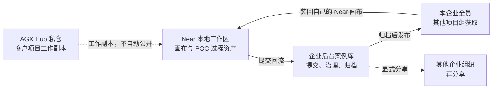

# Master Plan：AGX 能力体系——资产仓库与画布能力线落地规划

> 状态：v1.1（2026-10-18）
> 基线：AgenticX main @ `335ec729`（画布功能已合入，见 §2 现状盘点）
> 文档体系：本 master plan 为总体规划；Phase 启动时按需拆 SP 子计划（暂不预拆）
> v1.1：客户项目工作副本改到 AGX Hub 私仓；过程资产的存放与分享终点改为企业后台案例库（见 §3.4）

---

## 1. 背景与总体判断

定制 GUI 交付的正确拆法是「**能力内核 + 一次性视图**」：GUI 是给客户的一次性交付物，
能力才是资产。内核（领域规则、解析逻辑、工件契约）以 CLI + Skill 形态沉淀回 AGX；
视图随生成技术贬值，可丢弃、可再渲染。

据此，AGX 能力体系确定为「**一个资产仓库 + 三条能力线 + 两个机制**」：

```
┌────────────────────────────────────────────────────────────┐
│ 资产包    capability/ + views/（格式，不是主仓目录）        │
│           客户项目工作副本在 AGX Hub 私仓                   │
├────────────────────────────────────────────────────────────┤
│ 能力线 A  领域能力线（CLI + Skill，规则与逻辑的唯一归属）   │
│ 能力线 B  画布能力线（视图资产的生成与变更工具）            │
│ 能力线 C  案例库（Near 提交与获取 / 企业后台治理与发布）    │
├────────────────────────────────────────────────────────────┤
│ 机制 1    收割回流：FDE 把过程资产提交到企业后台，           │
│           治理归档后发布到案例库，其他项目组再获取          │
│ 机制 2    版本对齐：capability schema 变更 → manifest 反查   │
│           受影响 views（一期人工检查，不做自动迁移）         │
└────────────────────────────────────────────────────────────┘
```

本 plan 聚焦能力线 B（画布），因为它是三条线中**刚落地代码、尚未定型**的一条：
画布 v1 已随 `490da813` 合入，但其定位不是「设计稿生成器」，而是 **UI 资产的变更工具**——
生成只在资产第一次入库（走 solo-design skill），之后换皮 / 增删页 / 调布局全部走画布变更链路。
本 plan 回答：从画布 v1 现状到这个定位之间差什么、按什么顺序补。

试点资产：智能评标系统的画布稿已从主仓迁到私仓
[agxhub/agx-bidmind](https://github.com/agxhub/agx-bidmind)（原 `designs/bidding-eval-system/`，
7 页 + 共享外壳 + 品牌令牌）。主仓不再存放这份工作副本。它仍是第一个走完
「本地编辑 → 回流企业后台 → 归档发布到案例库 → 其他项目组获取」的视图资产。

## 2. 画布能力现状盘点（代码事实）

基于 `490da813`（画布面板 3709 行）、`ce2245f8`（导出超时保护）、`335ec729`（产物卡片边缘修复）：

| 能力 | 现状 | 实现位置 |
|---|---|---|
| 无限画布 | 平移/缩放 0.08–2x、点阵网格、空格拖拽、⌘+滚轮 | `DesignCanvasPanel.tsx` |
| 画框渲染 | HTML（srcDoc 沙箱+相对资源内联）/ 图片两类；桌面 1440×900 / 平板 / 手机三档 | 同上 |
| 页面流连线 | 从画框 HTML 的 href 自动推导，⌥2 开关 | `deriveEdges()` |
| 预览模式 ⌥1 | 画框内真实交互 | 同上 |
| 画框 chrome | 绿色选中态 + 浮动工具条（rAF 跟随）+ 菜单：复制/重命名/导出/设备/删除 | 同上 |
| 导入 | 产物列表一键加入、本地 HTML、图片素材 | `WorkPanel.tsx` |
| 导出 | 画框 PNG/JPG 1–3X（隐藏窗口截图）；Design ZIP（仅源文件打包） | `zip-store.ts` |
| 可视化编辑 ⌥3 | cssPath 选中元素，14 个**布局类**样式属性实时改，确认后 inline style 写回源 HTML | `canvas-visual-editor.ts` |
| 文件联动 | 2s mtime 轮询自动刷新画框 | 同上 |
| 对话集成 | 画框作为聊天上下文附件（图片缩略图 + 非视觉模型拦截） | `ChatPane.tsx` |

对「变更工具」定位最关键的三个代码事实：

1. **画框状态是内存态**：`canvasFramesBySession`（模块级 Map，sessionId → frames），
   重启即失，无落盘。画框 = `{id, title, absolutePath, device, x, y}`，只有文件引用和坐标。
2. **可视化编辑写回是 inline style 合并**（`applyEditsToHtmlSource`：DOMParser 定位 →
   setProperty）。编辑属性目前全为布局类（间距/圆角/透明度/位移/旋转），**不含颜色**——
   这天然避开了 token 写死问题，但换皮场景也没有任何通道。
3. **画布不知道「资产包」的存在**：Design ZIP 只是文件集合；无 manifest、无 `.design`
   项目概念、无页面登记意识（复制画框 = 同一文件两个引用；删除画框不动文件）。

## 3. 目标架构：资产包格式契约

### 3.1 目录结构

```
industry-capabilities/<domain>/
├── capability/                     # 能力内核（唯一业务逻辑归属）
│   ├── manifest.json               # 内核清单（见 3.2）
│   ├── cli/                        # 领域 CLI（如评标规则、标书解析）
│   ├── skills/                     # skill 包
│   └── rules/                      # 规则库（数据化、版本化）
└── views/                          # 视图资产（可丢弃、可再渲染）
    ├── manifest.json               # 视图清单 + 依赖声明（见 3.3）
    ├── <project>.design            # solo-design 项目文件（页面节点/连线/坐标）
    ├── colors_and_type.css         # 品牌令牌（CSS 变量，带 prefix）
    ├── partials/                   # 共享外壳等布局片段（回流模板库的种子）
    └── pages/                      # 页面 HTML
```

分层纪律：`capability/` 与 `views/` 物理同目录、逻辑解耦——views 依赖 capability（经
manifest 声明），capability 永不反向依赖 views。

**包内目录**仍是上面这棵树：`capability/` 与 `views/` 是资产包格式，不是主仓路径。
客户项目的工作副本放在 [AGX Hub](https://github.com/agxhub) 私仓（评标稿在
[agxhub/agx-bidmind](https://github.com/agxhub/agx-bidmind)）。主仓不收客户项目目录，
也不把 `agenticx/industry-capabilities/` 当作过程资产的存放终点。

通用、可开源的内核（与具体客户无关的 CLI / Skill）仍可注册进主仓。带客户项目上下文的
过程资产走 §3.4。

### 3.2 capability/manifest.json（内核清单）

```json
{
  "name": "bidding",
  "version": "1.0.0",
  "schemaVersion": 1,
  "entrypoints": { "cli": "cli/main.py" },
  "skills": [{ "name": "bidding-eval", "path": "skills/bidding-eval" }],
  "exports": { "rules": "rules/" }
}
```

`schemaVersion` 是版本对齐机制的锚点：变更它 = 破坏性变更，需反查 views。

### 3.3 views/manifest.json（视图资产清单）

以 bidding 为例，字段与现有 `.design` 格式对齐（`data[].devMetadata.htmlSrc`、
`interactions[].targetPageId` 均已存在，不新造概念）：

```json
{
  "name": "bidding-eval-system",
  "version": "1.0.0",
  "format": "agx-view-package/1",
  "capabilities": [{ "name": "bidding", "version": "^1.0.0" }],
  "design": "bidding-eval-system.design",
  "tokens": { "file": "colors_and_type.css", "prefix": "bid" },
  "pages": [
    { "id": "page-dashboard", "file": "pages/dashboard.html", "title": "项目总览", "device": "desktop" }
  ],
  "partials": [{ "name": "project-shell", "file": "partials/project-shell.html" }]
}
```

资产包的**自包含判定**（可移植性验收口径）：目录整体拷走 → 导入方按 manifest 即可
恢复画布布局、令牌、页面流，无需任何外部状态。这个包就是回流企业后台时的提交物。

### 3.4 过程资产回流：桌面端与企业后台一起看

v1.0 把企业后台写成「只发一张市场卡片」，满足不了 FDE 交付。本地画布、POC、项目过程
里产生的数字资产，要回到**我们的**企业后台：后台能存、能看见、能治理；归档并发布后，
本企业其他人和其他项目组能在案例库里获取；同一份已发布案例还可以再分享给其他企业组织。

私仓是该客户项目的工作副本。案例库是治理之后的分享副本。两份都要留，职责不同。



案例状态只有四步，发布前别人看不见：

| 状态 | 谁能看见 | 发生什么 |
|---|---|---|
| 已提交 | 提交人、案例管理员 | Near 把资产包（视图包 + 封面 + 私仓链接 + 说明）交到后台 |
| 治理中 | 同上 | 管理员看内容、核对脱敏、退回或通过 |
| 已归档 | 同上 | 治理完成，定稿，尚未公开 |
| 已发布 | 本企业全员 | 出现在案例库；其他项目组可获取。分享给其他组织是另一次显式授权 |

桌面端与后台的分工：

- **Near**：编辑画布；对当前项目执行「回流到企业」；展示这条案例现在处于哪一步；从案例库「获取」时，把包下载进本地工作区并打开画布。获取是复制一份来用，不回写别人的私仓。
- **企业后台**：案例库是独立入口，不塞进现有能力包。现有能力包只分配 Skill / MCP。案例库存放包文件、状态、可见范围和归档记录。管理员在这里治理和发布。
- **获取之后**：对方 Near 里出现同一套画框，可以换皮、增删页，再作为自己的项目重新提交。新提交是一条新案例，不覆盖已发布的那条。

## 4. 差距分析：变更链路视角

| 变更场景 | 画布 v1 现状 | 差距 | 归属 |
|---|---|---|---|
| 资产入库（首次生成） | 产物/本地 HTML 加入画框 | 无资产包概念，`.design` 页面登记不感知 | Phase 1 |
| 资产可移植 | Design ZIP（裸文件） | 无 manifest 导出/导入、画布状态不落盘 | Phase 1 |
| 换品牌（换皮） | 无通道 | 无 token 层编辑（改 `colors_and_type.css` 变量即全局生效） | Phase 2 |
| 增页 | 无 | 需 agent 生成 + `.design` data[]/manifest 登记（画布触发，不做生成） | Phase 2 |
| 删页 | 画框删除不动文件 | 需 `.design` data[] 移除 + partials 导航链接清理 | Phase 2 |
| 复制页 | 复制画框 = 同文件双引用 | 需真复制文件 + 重新登记 | Phase 2 |
| 调布局（精修） | ✅ 可视化编辑器 14 布局属性 + 写回 | 已可用；需补变更后校验 | Phase 2 |
| 变更后一致性 | 无 | token 合规检查（无硬编码色）、交互接线验证（solo-design validate 脚本已存在，未接入画布） | Phase 2 |
| Agent 驱动变更 | 画布纯手动 | 与 solo-design lanes（P1 existing_edit / P3 variants / P4 theme）无桥接；变更大头应走 agent，画布做触发与精修 | Phase 2/3 |
| 收口回流 | 无 | Near 提交资产包到企业案例库；后台治理、归档、发布；其他项目组获取 | Phase 3 |
| 版本对齐 | 无 | manifest 反查受影响 views（人工检查清单） | Phase 3 |

两级变更模型（本 plan 的核心操作语义，保持简单）：

- **Token 级变更**（换皮）：只改 token 文件（或画布 token 面板 → 写回 CSS 变量），
  全局生效。可视化编辑器保持「布局属性 only」，不得写死颜色——v1 的属性选择恰好正确，固化为约束。
- **元素级变更**（精修）：cssPath + inline style，仅布局类属性，走现有写回管线。

## 5. 分阶段落地

### Phase 1 — 资产可移植（画布 v1.5，desktop 线）

1. 画布状态落盘：frames 持久化到会话工作区，重启恢复（替换内存 Map）。
2. 资产包导出：Design ZIP 升级为标准 `agx-view-package/1`（源文件 + manifest，
   从 `.design` 与目录结构自动生成 manifest）。
3. 资产包导入：画布一键恢复全部页面画框、坐标布局、设备尺寸。
4. 契约落地：资产包目录（§3.1）+ 两份 manifest schema 定稿（本文 §3 即契约源）。包能独立拷走，才有东西可回流。

出口判定：bidding 资产包导出 → 清空 → 导入，7 画框布局完整恢复，零手工重排。

### Phase 2 — 变更链路（画布 v2，desktop 线为主）

1. 换皮通道：token 面板（读/编辑 `colors_and_type.css` 变量并写回），或触发 agent 走
   P4 theme lane；两者都落 token 文件，不碰页面 HTML。
2. 页面级操作：删页（`.design` data[] + 导航链接清理 + 连线图更新）、复制页（真复制
   文件 + 登记）、增页（画布发起 → agent 生成 → 自动登记 `.design` + manifest）。
   **页面生成永远走 agent，画布只做登记与触发**——避免画布内长出第二套生成器。
3. 变更后校验：每次写回/变更后跑 token 合规检查 + 交互接线验证（复用 solo-design
   既有确定性脚本，不重写）。
4. 画框 ↔ `.design` 节点 id 对齐（同一资产包内一一对应）。

出口判定：见 §6 黄金链路验收。

### Phase 3 — 回流、治理、案例库（desktop + enterprise）

Phase 1 的资产包是提交物。没有这个包，后台无物可存。Phase 3 把包接上企业案例库。

1. Near「回流到企业」：把当前视图包、封面、说明、私仓链接提交到企业后台，状态为已提交。
2. 后台案例库：列表能看见提交；治理通过后归档；归档后可发布为本企业全员可见。未发布的提交不出现在别人的案例库。
3. 其他项目组在 Near 案例库看到已发布案例，获取后画布恢复全部画框。获取落地为本地副本。
4. 已发布案例可再授权给其他企业组织；未授权的组织看不到。
5. 版本对齐仍由 agenticx CLI 做 `capabilities check`：capability schemaVersion 变更时反查 views manifest，输出受影响清单（人工处理，不做自动迁移）。通用内核的注册与客户案例的发布分开，客户过程资产不进主仓。

## 6. 试点与验收：bidding 黄金链路

验收场景：下一个客户拿 bidding views 资产包，要求「**换品牌色 + 删两页 + 加一页**」。

1. 资产包导入画布 → 7 画框、布局、连线完整恢复（Phase 1 出口）。
2. 换品牌色：token 面板改主色 → 7 页 + partials 全局生效，无 inline 硬编码色残留
   （token 合规检查通过）。
3. 删两页：画布删页 → `.design` 登记、导航链接、连线图同步清理。
4. 加一页：画布发起 → agent 生成 → 自动登记，新页跳转接线可用（交互验证通过）。
5. 全程**零手工逐页 HTML 编辑**、零业务逻辑进画布。
6. 变更后的包从 Near 重新提交 → 后台归档发布 → 另一个项目组获取后画布恢复（链路可循环）。

## 7. 边界与纪律

1. **画布不承载业务逻辑**：领域规则只属于 capability/（CLI + Skill）；画布只负责视图
   资产的生成触发、登记与变更。
2. **两级变更模型不动摇**：颜色/字体走 token 文件，布局走可视化精修；可视化编辑器
   属性白名单保持布局类（当前 14 项即基线）。
3. **生成权在 agent**：页面/变体生成一律走 solo-design lanes，画布不内嵌生成逻辑。
4. **一期版本对齐只做反查清单**，不做自动检测、不做自动迁移。
5. **视图资产可丢弃**：生成技术栈换代时 views 允许整体重渲染，capability 与 manifest
   契约不变即无损。
6. 资产分层保持：领域规则在 CLI+Skill 层，画布只管视图资产——禁止在画布侧实现业务逻辑。

## 8. 风险与克制

| 风险 | 对策 |
|---|---|
| 画布功能膨胀成第二套设计工具 | 生成走 agent、编辑限两级模型、页面操作只做登记——本文 §7 为硬边界 |
| manifest 契约过度设计 | 一期字段以「导入导出能跑通」为限，schemaVersion 留扩展位，不预埋字段 |
| 版本对齐做成自动迁移 | 明确只输出受影响清单，人工决策 |
| 画布状态落盘与会话工作区耦合过深 | 持久化格式对齐资产包（同一套 manifest 语义），避免两份状态 |
| 未归档案例被全公司看见 | 发布前只有提交人与案例管理员可见；发布是单独动作 |
| 客户项目过程资产写进主仓 | 工作副本只在 AGX Hub 私仓；案例库只收治理后的分享副本 |

---

## 附：现状代码索引

- 画布面板：`desktop/src/components/work-panel/DesignCanvasPanel.tsx`（2388 行）
- 可视化编辑桥：`desktop/src/utils/canvas-visual-editor.ts`（447 行，bridge 注入 + inline 写回）
- 画框状态（内存 Map）：`desktop/src/components/work-panel/WorkPanel.tsx#canvasFramesBySession`
- 导出截图链路：`desktop/electron/zip-store.ts` + `electron/main.ts`
- 试点资产：私仓 [agxhub/agx-bidmind](https://github.com/agxhub/agx-bidmind)（原主仓 `designs/bidding-eval-system/`，7 页 + project-shell + colors_and_type.css + .design）
- 生成侧 lanes：solo-design skill（P1 existing_edit / P3 variants / P4 theme_customize / P8 complex_html_page）
