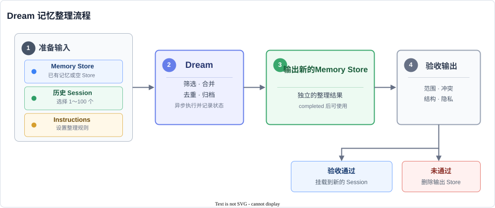

# 使用 Dream 整理长期记忆

> 全部文档的索引见 [llms.txt](https://ark.volcengine.com/llms.txt)；在任一文档页面地址后追加 `.md` 可获取该页的 Markdown 版本。

当 Agent 在多个 Session 中积累了重复、过期或相互冲突的记忆时，逐条人工整理会越来越慢，也容易遗漏历史任务中的稳定规律。**Dream** 可以按照指定规则整理已有记忆和相关 Session，在后台生成一份独立的新 Memory Store，供后续任务复用。

<span id="scenario"></span>
## 场景说明

根据需要解决的问题选择 Dream 的使用方式：

| 场景 | 何时使用 | 带来的价值 |
| --- | --- | --- |
| 定期整理 | Memory Store 已积累重复、过期或冲突的内容。 | 减少记忆噪声，为后续 Session 保留稳定结论。 |
| 冷启动记忆库 | 尚未建立长期记忆，但已有可复用的历史 Session。 | 将历史对话转化为第一份记忆库，避免重新整理和录入。 |
| 提炼特定主题 | 主 Memory Store 包含多个主题，需要为特定任务准备专用记忆。 | 隔离相关知识，减少无关内容对 Agent 检索和判断的干扰。 |
| 跨用户沉淀 | 多个用户反复遇到相似问题，并形成了可复用的解决方法。 | 剥离身份信息后，将个人经验转化为团队可复用的问题模式和解决步骤。 |

以下任务不适合使用 Dream：

- 修改某条 Memory 的一个字段或一句话：直接调用 Memory 更新接口。
- 在 Session 运行过程中立即记录新信息：创建 Session 时以 `read_write` 挂载 Memory Store，并在系统提示词或任务指令中明确要求 Agent 写入需要长期保留的信息。

<span id="core-concepts"></span>
## 核心概念

- **输入 Memory Store**：提供整理前的长期记忆。只从历史对话冷启动时，可以使用空 Store。
- **历史 Session**：提供本次整理的对话素材。每个 Dream 需要选择 1～100 个相关 Session。
- **Instructions**：定义保留范围、隐私剥离、冲突处理和输出结构。
- **Dream**：在后台执行记忆筛选、合并、去重和归档。
- **输出 Memory Store**：保存整理结果，与输入 Memory Store 相互独立。

<span id="core-mechanism"></span>
## 工作机制

Dream 按以下顺序处理记忆：



<span id="quick-start"></span>
## 整理并挂载长期记忆

以下步骤从准备输入开始，依次创建 Dream、等待任务结束、检查输出，并在结果符合预期后挂载到新的 Session。

<span id="select-inputs"></span>
### 1. 准备输入

Dream 读取一个 Memory Store 和 1～100 个历史 Session。输入范围直接影响整理质量：

- 整理已有记忆：选择需要去重、更新或重新组织的 Store。
- 从历史 Session 冷启动：先创建一个空 Store，再将它作为输入。
- 提炼特定主题：选择包含通用背景的主 Store。
- 只选择与本次整理目标相关的 Session，排除测试会话、无效对话和不应长期保存的临时信息。
- 检查敏感信息，确保后续 Instructions 包含对应的剥离规则。

执行示例前，完成以下准备：

- 本地已安装 cURL 和 `jq`。
- `MODEL_ID` 对应的模型已在当前项目中开通。
- 输入 Memory Store 和历史 Session 属于当前账号和项目。

记录输入资源和执行模型，后续示例继续使用这些环境变量：

```bash
export ARK_API_KEY="<ARK_API_KEY>"  # gitleaks:allow
export MODEL_ID="<MODEL_ID>"
export INPUT_MEMORY_STORE_ID="<INPUT_MEMORY_STORE_ID>"
export SESSION_ID_1="<SESSION_ID_1>"
export SESSION_ID_2="<SESSION_ID_2>"
```

> **注意**
>
> 不要把包含未脱敏个人信息的 Session 直接用于团队级整理。如果 Instructions 没有明确要求剥离姓名、邮箱、URL、订单号等身份信息，输出可能继续保留这些内容。

<span id="create-dream"></span>
### 2. 创建 Dream

使用示例中的 Instructions 创建 Dream；需要调整整理规则时，参见 [编写 Instructions 的最佳实践](dream-overview.md#instructions)。

```bash
dream=$(
  curl -sS --fail-with-body "https://ark.cn-beijing.volces.com/api/v3/dreams" \
    -H "Authorization: Bearer $ARK_API_KEY" \
    -H "Content-Type: application/json" \
    -d @- <<EOF
{
  "inputs": [
    {
      "type": "memory_store",
      "memory_store_id": "$INPUT_MEMORY_STORE_ID"
    },
    {
      "type": "sessions",
      "session_ids": [
        "$SESSION_ID_1",
        "$SESSION_ID_2"
      ]
    }
  ],
  "model": "$MODEL_ID",
  "instructions": "保留稳定偏好和已验证结论；删除重复、过期和包含个人身份的信息；按主题组织结果。",
  "output_memory_store_name": "dream-curated-memory",
  "output_memory_store_description": "Dream 整理后的长期记忆"
}
EOF
)

printf '%s\n' "$dream"

DREAM_ID=$(jq -er '.id' <<<"$dream")
OUTPUT_MEMORY_STORE_ID=$(
  jq -er '.outputs[] | select(.type == "memory_store") | .memory_store_id' <<<"$dream"
)

export DREAM_ID OUTPUT_MEMORY_STORE_ID
printf 'Dream ID: %s\n' "$DREAM_ID"
printf 'Output Memory Store ID: %s\n' "$OUTPUT_MEMORY_STORE_ID"
```

脚本从响应中记录 `DREAM_ID` 和 `OUTPUT_MEMORY_STORE_ID`。后续示例继续使用这两个变量。

> **注意**
>
> 创建响应返回 `OUTPUT_MEMORY_STORE_ID`，只表示服务端已经为本次任务分配输出 Memory Store。Dream 处于 `pending` 或 `running` 状态时，不能读取、修改或挂载该 Store。等待任务结束后，按 [检查输出](dream-overview.md#verify-output) 处理。

<span id="track-dream"></span>
### 3. 跟踪任务

通过 [查询 Dream](api/get-dream-api.md) 接口轮询任务，直到状态变为 `completed`、`failed` 或 `canceled`。

| 状态 | 说明 |
| --- | --- |
| `pending` | 任务已受理，正在等待执行。 |
| `running` | 任务正在读取输入并整理记忆。 |
| `completed` | 任务已完成，输出 Memory Store 可以挂载、读取和修改。 |
| `failed` | 任务执行失败。通过 `error.type` 和 `error.message` 定位原因；输出 Memory Store 可能保留部分结果。 |
| `canceled` | 任务已取消；输出 Memory Store 可能为空，也可能保留取消前生成的部分结果。 |

`pending` 和 `running` 不是失败状态，客户端应继续查询。Dream 最长执行 48 小时；任务超过该时限后进入 `failed` 状态，`error.type` 为 `timeout`。

以下脚本每 30 秒查询一次，最多等待 48 小时。任务结束后，脚本更新 `OUTPUT_MEMORY_STORE_ID`；如果任务失败或取消，还会输出错误信息并提示检查部分结果：

```bash
MAX_ATTEMPTS=5760
POLL_INTERVAL_SECONDS=30
status=""

for ((attempt = 1; attempt <= MAX_ATTEMPTS; attempt++)); do
  dream=$(
    curl -sS --fail-with-body "https://ark.cn-beijing.volces.com/api/v3/dreams/$DREAM_ID" \
      -H "Authorization: Bearer $ARK_API_KEY"
  )

  status=$(jq -er '.status' <<<"$dream")
  printf 'Dream status: %s (%d/%d)\n' "$status" "$attempt" "$MAX_ATTEMPTS"

  case "$status" in
    completed | failed | canceled)
      break
      ;;
  esac

  if ((attempt < MAX_ATTEMPTS)); then
    sleep "$POLL_INTERVAL_SECONDS"
  fi
done

if [[ "$status" != "completed" && "$status" != "failed" && "$status" != "canceled" ]]; then
  printf 'Dream did not reach a terminal state within 48 hours.\n' >&2
  exit 1
fi

OUTPUT_MEMORY_STORE_ID=$(
  jq -er '.outputs[] | select(.type == "memory_store") | .memory_store_id' <<<"$dream"
)

export OUTPUT_MEMORY_STORE_ID
printf 'Output Memory Store ID: %s\n' "$OUTPUT_MEMORY_STORE_ID"

if [[ "$status" == "failed" || "$status" == "canceled" ]]; then
  jq -r '.error.message // ("Dream ended with status: " + .status)' <<<"$dream" >&2
  printf 'Inspect the output Memory Store before deciding whether to use it.\n' >&2
fi
```

> **说明：任务跟踪说明**
>
> - 取消任务：取消 `pending` 或 `running` 状态的任务时，[取消 Dream](api/cancel-dream-api.md) 接口先记录取消意图。接口响应仍可能返回 `pending` 或 `running`，需要继续查询，直到任务结束。
> - 查看用量：`usage` 提供任务实际消耗的输入、输出和缓存 token 数。`usage=null` 表示当前响应暂未提供用量数据。
> - 查看运行时长：`running_time` 表示 Dream 排除空闲间隔后的累计运行时长，单位为秒。暂未获得该值时返回 `null`。
> - 查询历史任务：通过 [查询 Dream 列表](api/list-dreams-api.md) 接口按状态或输入 Memory Store 筛选任务，并按创建时间排序。响应包含 `next_page` 时，将该值原样传入下一次请求。
> - 定位错误：HTTP 请求失败时，详情请参见 [错误码](https://ark.volcengine.com/docs/error-codes)。Dream 已受理后发生的异步错误通过 `error.type` 和 `error.message` 返回。

<span id="verify-output"></span>
### 4. 检查输出

状态为 `completed` 时，验收输出 Memory Store。状态为 `failed` 或 `canceled` 时，只检查是否残留部分结果，并结合 `error.type` 和 `error.message` 排查原因；不要将该 Store 直接投入后续 Session。

以下脚本列出第一页中的 Memory，并读取第一条 Memory 的完整内容：

```bash
memories=$(
  curl -sS --fail-with-body \
    "https://ark.cn-beijing.volces.com/api/v3/memory_stores/$OUTPUT_MEMORY_STORE_ID/memories?limit=100&path_prefix=/&order_by=path&depth=2" \
    -H "Authorization: Bearer $ARK_API_KEY"
)

jq -r '.data[] | select(.type == "memory") | [.id, .path] | @tsv' <<<"$memories"

MEMORY_ID=$(
  jq -r '[.data[] | select(.type == "memory")][0].id // empty' <<<"$memories"
)

if [[ -z "$MEMORY_ID" ]]; then
  printf 'No Memory is available in the output store.\n' >&2
  exit 1
fi

curl -sS --fail-with-body \
  "https://ark.cn-beijing.volces.com/api/v3/memory_stores/$OUTPUT_MEMORY_STORE_ID/memories/$MEMORY_ID" \
  -H "Authorization: Bearer $ARK_API_KEY" \
  | jq '{path, content}'

NEXT_PAGE=$(jq -r '.next_page // empty' <<<"$memories")
if [[ -n "$NEXT_PAGE" ]]; then
  printf 'More Memories are available. Continue with page=%s.\n' "$NEXT_PAGE"
fi
```

响应包含 `next_page` 时，将该值作为下一页标识继续查询，直到检查完全部 Memory。状态为 `completed` 时，重点验收以下内容：

1. 主题范围是否符合 Instructions。
2. 重复和冲突内容是否已经合并。
3. 目录路径是否方便 Agent 检索。
4. 隐私信息和过期内容是否已经移除。

根据任务状态和检查结果选择后续动作：

| 任务状态 | 输出检查结果 | 后续动作 |
| --- | --- | --- |
| `completed` | 全部验收项通过。 | 以 `read_only` 方式挂载到新的 Session。 |
| `completed` | 只有少量内容或路径不正确。 | 更新、移动或删除对应 Memory，再重新验收。 |
| `completed` | 整体范围、冲突处理或目录结构不正确。 | 调整输入或 Instructions 后重新创建 Dream。 |
| `failed` 或 `canceled` | Store 为空或只包含部分结果。 | 仅检查已有结果，不直接投入后续 Session；确认无用后删除输出 Store。 |

<span id="use-or-discard-output"></span>
### 5. 使用或删除输出

状态为 `completed` 且验收通过后，创建新的 Session 并挂载输出 Memory Store：

```bash
export AGENT_ID="<AGENT_ID>"
export ENVIRONMENT_ID="<ENVIRONMENT_ID>"
```

```bash
session=$(
  curl -sS --fail-with-body "https://ark.cn-beijing.volces.com/api/v3/sessions" \
    -H "Authorization: Bearer $ARK_API_KEY" \
    -H "Content-Type: application/json" \
    -d @- <<EOF
{
  "agent": "$AGENT_ID",
  "environment_id": "$ENVIRONMENT_ID",
  "resources": [
    {
      "type": "memory_store",
      "memory_store_id": "$OUTPUT_MEMORY_STORE_ID",
      "access": "read_only"
    }
  ]
}
EOF
)

printf '%s\n' "$session"

SESSION_ID=$(jq -er '.id' <<<"$session")
export SESSION_ID
```

创建成功后，响应中的 `id` 是新 Session 的 ID。示例显式使用 `read_only`，避免新 Session 修改已验收的整理结果。如果 Agent 需要继续更新该 Store，将 `access` 改为 `read_write`。

- 修正输出：如果只有少量内容或路径不符合预期，直接更新、移动或删除输出 Store 中的对应 Memory，再重新验收。
- 重新整理：如果整体范围、冲突处理或目录结构不符合预期，调整输入或 Instructions 后重新创建 Dream。确认新结果可用后，再删除旧的输出 Store。
- 保留输入：输入 Memory Store 不会被自动切换或删除，可以继续作为原始版本或回退依据。
- 删除输出：确认输出内容不再需要后，[删除输出 Memory Store](api/delete-memory-store-api.md)，不会影响输入 Store。

<span id="billing"></span>
## 计费说明

Dream 任务包含以下两项费用：

- 记忆整理模型调用费用：按照任务实际消耗的输入、输出和缓存 token 计费。通过 `usage` 查看本次任务的 token 用量。
- Agent 运行时费用：Dream 在后台执行记忆整理时会使用 Agent 运行时，按照实际运行时长计费。通过 `running_time` 查看排除空闲间隔后的累计运行时长。

计费公式：`Dream 费用 = 记忆整理模型调用费用 + Agent 运行时费用`。模型单价、Agent 运行时单价和账单结算规则，详情请参见 [Managed Agents 计费说明](https://ark.volcengine.com/docs/model-pricing#ma_billing)。

<span id="instructions"></span>
## 编写 Instructions 的最佳实践

Instructions 用于描述整理目标、保留与排除范围、冲突处理方式和输出结构，不适合指定单条 Memory 的精确修改。

一份可执行的 Instructions 通常包含以下信息：

- 整理目标：说明输出 Memory Store 服务于什么任务。
- 保留范围：说明需要保留的主题、事实和稳定偏好。
- 排除范围：说明需要忽略的噪声、过期内容和隐私信息。
- 合并规则：说明如何处理重复、冲突或时间不同的记录。
- 组织方式：说明期望的主题分组和路径结构。

可以从以下模板开始：

```text
整理目标：<输出 Memory Store 服务的任务>
保留范围：<需要保留的主题、事实和稳定偏好>
排除范围：<需要移除的噪声、过期内容和隐私信息>
冲突处理：<冲突信息的选择依据和适用条件>
输出结构：<期望的主题分组和路径>
```

例如，整理代码审查记忆：

```text
整理目标：生成供后续代码审查 Session 使用的长期记忆。
保留范围：代码风格偏好、项目约定和已验证的排障方法。
排除范围：一次性调试记录、姓名、邮箱、URL 和账号标识。
冲突处理：保留时间较新的结论，并记录结论的适用条件。
输出结构：按 topics/code-review、topics/project-rules 和 topics/troubleshooting 分类。
```

Dream 适合批量筛选、合并和重组信息，不保证按文件路径或段落位置完成定点修改。只需调整某条 Memory 时，直接调用 Memory 更新接口。

<span id="api-reference"></span>
## API 参考

- [创建 Dream](api/create-dream-api.md)
- [查询 Dream](api/get-dream-api.md)
- [查询 Dream 列表](api/list-dreams-api.md)
- [取消 Dream](api/cancel-dream-api.md)
- [删除 Memory Store](api/delete-memory-store-api.md)
