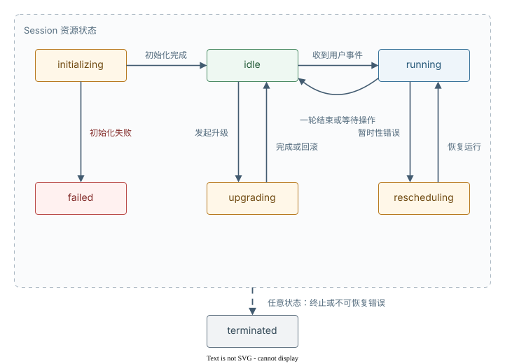

# 管理 Session

> 全部文档的索引见 [llms.txt](https://ark.volcengine.com/llms.txt)；在任一文档页面地址后追加 `.md` 可获取该页的 Markdown 版本。

Session 创建后，你可以查询状态、列出 Session、更新标题和标签、升级运行配置，以及永久删除 Session。

::: tip
创建 Session 与发送首个事件的方法，详情请参见 [启动 Session](start-session.md)。
:::

## 准备工作

开始前你需要：

- 已创建的 API Key：配置为环境变量 `ARK_API_KEY`，详情请参见 [API Key 管理](https://ark.volcengine.com/region:cn-beijing/apiKey)。
- 已创建的 Agent：详情请参见 [定义 Agent](define-agent.md)。
- 已创建的 Environment：详情请参见 [配置云环境](configure-cloud-environment.md)。

本章节示例的 Base URL 与鉴权方式详情请参见 [Base URL 及鉴权](https://ark.volcengine.com/docs/base-url-and-authentication)。

## Session 状态机

| 状态             | 说明                                            |
| -------------- | --------------------------------------------- |
| `idle`         | Agent 正在等待输入，例如用户消息或工具确认。普通新建的 Session 以该状态启动 |
| `running`      | Agent 正在执行任务                                  |
| `terminated`   | Session 已终止，不再接收新事件                           |
| `rescheduling` | 发生暂时性错误后，系统正在重新调度 Session                     |
| `initializing` | Session 正在初始化运行环境或恢复资源                        |
| `failed`       | Session 初始化或运行失败                              |
| `upgrading`    | Session 正在升级 Agent 或 Environment 运行配置         |

这些状态及主要迁移关系如下：



状态迁移规律：

- `initializing` → `idle`：Session 初始化或资源恢复完成。
- `initializing` → `failed`：Session 初始化或资源恢复失败。
- `idle` → `running`：收到 `user.message` 或 `user.tool_confirmation` 等用户事件。
- `running` → `idle`：Agent 一轮工作结束（`end_turn`）或需要等用户输入（`requires_action`，详情请参见 [Session 事件流](session-event-stream.md)）。
- `running` → `rescheduling` → `running`：框架遇到暂时性错误后自动重试，你无需介入。
- `idle` → `upgrading` → `idle`：服务端受理运行配置升级，升级完成或回滚后恢复为空闲状态。
- 任意状态 → `terminated`：Session 终止。终止后不再接收事件，但记录与事件历史保留。

> **说明**
>
> Session 资源的状态值是 `rescheduling`；对应的 SSE 状态事件名是 `session.status_rescheduled`。调用查询接口或使用 `status` 参数过滤时，应传 `rescheduling`，不要传事件名中的 `rescheduled`。

## 选择获取方式

Session 详情接口只返回资源的最新状态、用量统计和配置快照。实时回复和历史事件由 Session Events API 承载：

| 需要获取的内容              | 使用接口                                       | 返回内容和限制                                                                   |
| -------------------- | ------------------------------------------ | ------------------------------------------------------------------------- |
| 实时接收 Agent 回复和状态 | `GET /sessions/{session_id}/events/stream` | 通过 SSE（Server-Sent Events）协议订阅会话主线程收到的实时事件。请建立 SSE 并等待 `: ready` 后，再发送事件。 |
| 已持久化的完整事件            | `GET /sessions/{session_id}/events`        | 用于查询会话主线程中已经产生的事件，主要用于历史事件查询和断线补查，返回信息不包含预览帧。                             |
| 最新状态、累计用量和配置快照       | `GET /sessions/{session_id}`               | 查询指定会话的详细信息，包括智能体、会话运行环境、资源、状态和标签等，不返回 Agent 回复或完整事件历史                    |

正常交互时，通过 SSE 实时接收 Agent 回复和状态。`GET /sessions/{session_id}/events` 仅用于历史事件查询和断线补查。不要只根据 `status=idle` 判断本轮成功。发送任务、接收回复和判断 `stop_reason` 的完整流程，详情请参见 [Session 事件流](session-event-stream.md)。

## 检索 Session

通过 `GET /sessions/{session_id}` 查询 Session 的详细信息，包括智能体、会话运行环境、资源、状态和标签等：

**选项：Curl**

```Bash
curl https://ark.cn-beijing.volces.com/api/v3/sessions/sesn-20260701120100-klmno \
  -H "Authorization: Bearer $ARK_API_KEY"
```

响应主要字段：

- `id`：Session ID。
- `status`：当前状态（见上表）。
- `usage`：累计 token 用量（详情请参见 [Session 事件流 § 跟踪用量](session-event-stream.md)）。
- `agent`：绑定的 Agent 对象，内含 `id`、`version` 等字段。
- `environment_id`：绑定的云环境。

## 列出 Session

`GET /sessions` 支持按 `agent_id` 过滤、按创建时间倒序分页，响应以 `data` 数组形式返回 Session 列表：

**选项：Curl**

```Bash
curl "https://ark.cn-beijing.volces.com/api/v3/sessions?agent_id=agent-20260701120000-abcde&limit=20" \
  -H "Authorization: Bearer $ARK_API_KEY"
```

## 更新与升级 Session

| 需求                          | 接口                                                                               | 状态变化                          |
| --------------------------- | -------------------------------------------------------------------------------- | ----------------------------- |
| 修改标题或标签                     | [更新 Session 标题和标签](api/update-session-api.md) | 不改变 Session 的运行状态             |
| 修改 Agent 或 Environment 运行配置 | [升级会话](api/upgrade-session-api.md)            | `idle` → `upgrading` → `idle` |

升级接口保持原 `session_id` 不变，也不支持换绑其他 Agent 或 Environment。发起升级前，Session 必须处于 `idle`，并且上一轮任务以 `end_turn` 结束。接口返回 `upgrading` 后，轮询 `GET /sessions/{session_id}`；状态恢复为 `idle` 表示升级流程已结束。

> **注意**
>
> 不要通过更新会话接口修改 Agent、Environment、`tools` 或 `mcp_servers`。该接口只更新标题和标签，运行配置变更必须调用升级会话接口。

## 删除 Session

> **注意**
>
> **删除 Session 操作不可逆。** 删除会永久移除 Session 记录、所有事件和关联沙箱。Session 必须处于 `idle` 或 `terminated` 状态才能删除，其他状态会返回 `InvalidAction`。如果 Session 正在 `running`，先发送 [中断事件](session-event-stream.md)，等待状态回到 `idle` 后再删除。

**选项：Curl**

```Bash
curl https://ark.cn-beijing.volces.com/api/v3/sessions/sesn-20260701120100-klmno \
  -X DELETE \
  -H "Authorization: Bearer $ARK_API_KEY"
```

<span id="checkpoint-retention"></span>

## 数据保留与删除影响

Session 资源记录、完整事件、沙箱状态和 Agent 产物使用独立的保留策略：

| 对象           | 默认保留与恢复规则                                                                                     | 删除 Session 后                         |
| ------------ | --------------------------------------------------------------------------------------------- | ------------------------------------ |
| Session 资源记录 | 除非显式删除，否则持续保留                                                                                 | 资源记录不可再查询                            |
| Session 事件历史 | 每条已持久化的完整事件默认保留 6 个月；`event_start` 和 `event_delta` 预览帧不写入历史                                   | 该 Session 的事件全部删除                    |
| 沙箱状态         | Session 处于 `idle` 且尚未终止时，可以恢复文件系统、已安装软件包和沙箱中的临时文件。Session 连续处于 `idle` 达到 14 天后进入 `terminated` | 关联沙箱及其中的临时状态被清理                      |
| Agent 产物     | 方舟默认存储只用于临时保存关联产物；写入自有 TOS Bucket 的对象遵循你配置的 Bucket 生命周期                                       | 默认存储中的关联产物被清理；自有 TOS Bucket 中的对象不受影响 |

> **说明**
>
> Agent、Environment、Memory、Vaults、技能，以及通过 Files API 独立上传的输入文件，都是独立资源，不受 Session 删除影响。
>
> 需要长期保留时，在事件到期前将必要记录保存到自己的存储，并将 Agent 产物写入自有 TOS Bucket。产物存储的配置方法，详情请参见 [配置产物存储](configure-cloud-environment.md#configure-output-storage)。

> **说明：延长沙箱状态保留期**
>
> 如果需要继续保留沙箱状态，在当前期限到期前发送一条 `content` 非空的 `user.message`。Session 完成本轮任务并再次进入 `idle` 后，平台重新计算 14 天保留期。省略 `content` 或传入空数组不会刷新保留期。
