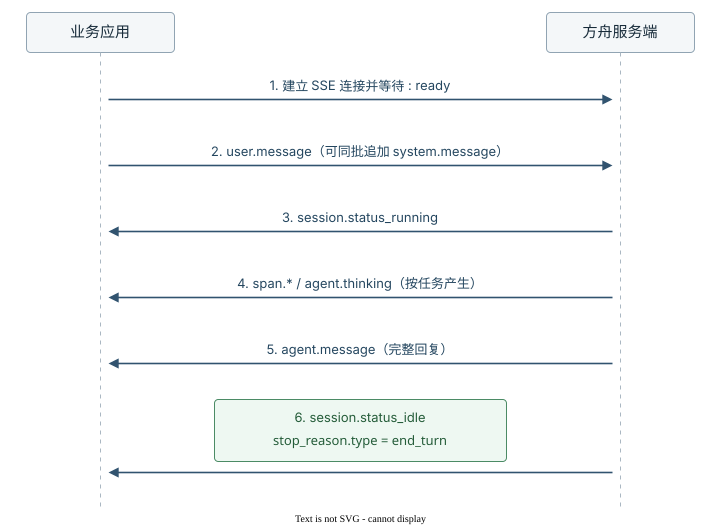
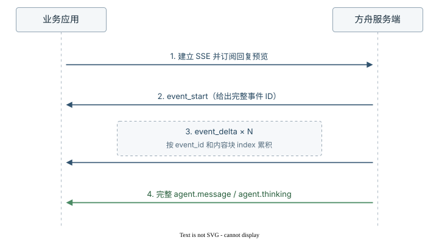

# Session 事件流

> 全部文档的索引见 [llms.txt](https://ark.volcengine.com/llms.txt)；在任一文档页面地址后追加 `.md` 可获取该页的 Markdown 版本。

与 Managed Agents 的通信基于事件。接入时应固定遵循“建立 SSE 并等待 `: ready` → 发送事件 → 接收完整事件 → 根据 `stop_reason` 判断结果”的顺序。连接中断后，先建立新流，再通过历史事件接口补齐中断窗口。

## 准备工作

开始前你需要：

- 已创建的 API Key：配置为环境变量 `ARK_API_KEY`，详情请参见 [API Key 管理](https://ark.volcengine.com/region:cn-beijing/apiKey)。
- 已创建的 Agent：详情请参见 [定义 Agent](define-agent.md)。
- 已创建的 Environment：详情请参见 [配置云环境](configure-cloud-environment.md)。

本章节示例的 Base URL 与鉴权方式详情请参见 [Base URL 及鉴权](https://ark.volcengine.com/docs/base-url-and-authentication)。

本地需要安装 `curl` 和 `jq`。

## 核心交互流程

以下流程适用于云端环境和自托管环境中的业务应用：

1. 通过 `GET /sessions/{session_id}/events/stream` 建立 SSE。
2. 等待服务端返回 `: ready`。
3. 通过 `POST /sessions/{session_id}/events` 发送 `user.message`。
4. 持续接收 `agent.*`、`session.*` 和 `span.*` 事件。
5. 仅在收到 `session.status_idle` 且 `stop_reason.type=end_turn` 时，将本轮判定为正常结束。

> **注意**
>
> **不要先发送消息再建立 SSE。** SSE 只推送连接建立后产生的事件。先发送消息再建立 SSE，会漏掉连接建立前产生的实时事件，客户端还需要查询历史事件补齐。

正常完成一轮任务时，事件按以下顺序流转：



- 客户端先建立 SSE 并等待 `: ready`，再发送 `user.message`，避免漏掉连接建立前已经产生的事件。
- `session.status_running` 表示 Agent 已开始处理任务；`span.*` 和 `agent.thinking` 按任务执行过程产生，完整回复由 `agent.message` 返回。
- 收到 `agent.message` 不代表本轮结束。客户端继续读取事件，只有 `session.status_idle` 且 `stop_reason.type=end_turn` 表示正常结束。

如需直接复用完整实现，请参见 [运行完整示例](session-event-stream.md#complete-example)。

## 理解事件通信

### 接口职责

根据不同用途选择对应接口：

| 接口 | 客户端动作 | 返回内容和限制 |
| --- | --- | --- |
| `GET /sessions/{session_id}/events/stream` | 建立 SSE 并等待 `: ready`，实时接收事件 | 只推送连接建立后产生的事件，不回放历史事件 |
| `POST /sessions/{session_id}/events` | 发送 `user.*` 或 `system.message` 事件 | HTTP 200 只表示事件已受理，不表示 Agent 已处理或本轮已结束 |
| `GET /sessions/{session_id}/events` | 分页查询已持久化的完整事件，用于历史查看和断线补查 | 不包含 `event_start`、`event_delta` 预览帧，也不提供实时推送 |
| `GET /sessions/{session_id}` | 查询 Session 最新状态、累计用量和配置快照 | 不返回完整事件历史或 Agent 回复内容 |

### 事件模型

事件类型遵循 `{domain}.{action}` 命名约定。先根据事件域判断方向和职责，再根据完整的 `type` 读取对应结构。

| 事件域 | 方向 | 说明 |
| --- | --- | --- |
| `user.*`、`system.message` | 客户端 → Session | 提交用户消息、动态系统提示词、中断、工具确认或工具结果 |
| `agent.*` | Session → 客户端 | 返回消息、思考过程、工具调用和主子线程通信事件 |
| `session.*` | Session → 客户端 | 返回 Session 或子线程的运行、等待、重调度、终止和错误状态 |
| `span.*` | Session → 客户端 | 返回模型调用的过程和结果 |

每个完整事件都包含 `id`、`type` 和 `processed_at`。`processed_at` 为 `null` 时，表示事件已进入队列但尚未完成处理。完整事件类型、字段、取值和嵌套结构，详情请参见 [会话事件结构参考](api/sessions-events-reference-v2.md)。

### 运行环境差异

两种环境中的业务应用共用 Session Events API。Environment 类型只改变主 Agent 的 Bash 和文件工具的执行位置，不改变其他工具的执行方：

| 对比项 | 云端环境 | 自托管环境 |
| --- | --- | --- |
| Session 事件 | 业务应用建立 Session SSE 并发送事件 | 业务应用建立 Session SSE 并发送事件 |
| 主 Agent 的 `bash`、`read`、`write`、`edit`、`glob`、`grep` | 方舟云沙箱执行，通过 `agent.tool_result` 返回结果 | 企业 Worker 和 Sandbox 执行，通过 `user.tool_result` 回传结果 |
| `web_fetch`、`web_search` 和多模态工具 | 方舟侧执行 | 方舟侧执行 |
| MCP 工具 | 方舟侧执行 | 方舟侧执行 |
| 自定义工具 | 业务应用执行 | 业务应用执行 |
| 额外链路 | 无 | Worker Poll/Ack Work、建立 Worker SSE 并维持 Heartbeat |

自托管环境中，业务应用不直接调用 Work API。Worker 的部署与运行机制，详情请参见 [配置并运行自托管环境](configure-self-hosted-environment.md)。

<span id="send-message"></span>
## 发送事件

客户端通过 `POST /sessions/{session_id}/events` 向 Session 发送 `user.message` 事件，`content` 是一个块数组，可混合文本（`text`）、图片（`image`）、文档（`document`）、视频（`video`）四类块。

- 图片 `image` 的 `source.type` 支持三种：`base64`（内联 base64，需带 `media_type`）、`url`（公网可访问 URL）、`file`（已上传文件 ID，字段为 `file_id`）。
- 文档 `document` 的 `source.type` 支持四种：`file`（已上传文件 ID）、`url`（公网可访问 URL）、`base64`（内联 base64，需带 `media_type`）、`text`（直接内联纯文本，`media_type: text/plain` + `data` 字段）；可选 `title` 与 `context` 字段为文档附加标题与背景说明。
- 视频 `video` 的 `source.type` 支持三种：`base64`（内联 Base64，需带 `media_type` 和 `data`）、`url`（公网可访问 URL）、`file`（已上传视频文件 ID，字段为 `file_id`）。三种来源均可通过 `fps` 设置抽帧频率，取值范围为 0.2～5。
- 同一请求的 `content` 数组可混合多个图片、文档或视频块。
- 如需为当前轮次动态追加系统提示词，可在 `events` 数组里 `user.message` 后紧跟一个 `system.message`，详情请参见 [动态系统提示词](session-event-stream.md#dynamic-system-prompt)。

### 常见内容组合示例

**选项：纯文本**

```Bash
curl https://ark.cn-beijing.volces.com/api/v3/sessions/sesn-20260701120100-klmno/events \
  -H "Authorization: Bearer $ARK_API_KEY" \
  -H "Content-Type: application/json" \
  -d '{
    "events": [{
      "type": "user.message",
      "content": [{"type": "text", "text": "帮我分析这份销售数据，找出 Q2 异常"}]
    }]
  }'
```

**选项：文本 + 图片（URL）**

```Bash
curl https://ark.cn-beijing.volces.com/api/v3/sessions/sesn-20260701120100-klmno/events \
  -H "Authorization: Bearer $ARK_API_KEY" \
  -H "Content-Type: application/json" \
  -d '{
    "events": [{
      "type": "user.message",
      "content": [
        {"type": "text", "text": "看下这张趋势图哪里不对"},
        {"type": "image", "source": {"type": "url", "url": "https://cdn.example.com/q2-trend.png"}}
      ]
    }]
  }'
```

**选项：文本 + 图片（base64）**

```Bash
curl https://ark.cn-beijing.volces.com/api/v3/sessions/sesn-20260701120100-klmno/events \
  -H "Authorization: Bearer $ARK_API_KEY" \
  -H "Content-Type: application/json" \
  -d '{
    "events": [{
      "type": "user.message",
      "content": [
        {"type": "text", "text": "看下这张趋势图哪里不对"},
        {"type": "image", "source": {"type": "base64", "media_type": "image/png", "data": "iVBORw0KGgoAAAANSUhEUgAA..."}}
      ]
    }]
  }'
```

**选项：文本 + 图片（file_id）**

```Bash
curl https://ark.cn-beijing.volces.com/api/v3/sessions/sesn-20260701120100-klmno/events \
  -H "Authorization: Bearer $ARK_API_KEY" \
  -H "Content-Type: application/json" \
  -d '{
    "events": [{
      "type": "user.message",
      "content": [
        {"type": "text", "text": "看下这张趋势图哪里不对"},
        {"type": "image", "source": {"type": "file", "file_id": "file_img_abc123"}}
      ]
    }]
  }'
```

**选项：文本 + 文档（file_id）**

```Bash
curl https://ark.cn-beijing.volces.com/api/v3/sessions/sesn-20260701120100-klmno/events \
  -H "Authorization: Bearer $ARK_API_KEY" \
  -H "Content-Type: application/json" \
  -d '{
    "events": [{
      "type": "user.message",
      "content": [
        {"type": "text", "text": "总结这份审计报告的关键风险"},
        {"type": "document", "title": "Q2 审计报告.pdf", "context": "Big4 出具的内部审计稿件", "source": {"type": "file", "file_id": "file_pdf_xxx"}}
      ]
    }]
  }'
```

**选项：文本 + 文档（内联纯文本）**

```Bash
curl https://ark.cn-beijing.volces.com/api/v3/sessions/sesn-20260701120100-klmno/events \
  -H "Authorization: Bearer $ARK_API_KEY" \
  -H "Content-Type: application/json" \
  -d '{
    "events": [{
      "type": "user.message",
      "content": [
        {"type": "text", "text": "帮我重写下面这段说明，更技术化一点"},
        {"type": "document", "title": "原稿", "source": {"type": "text", "media_type": "text/plain", "data": "本系统提供数据分析能力，包括但不限于报表生成、异常检测..."}}
      ]
    }]
  }'
```

**选项：文本 + 文档（base64 PDF）**

```Bash
curl https://ark.cn-beijing.volces.com/api/v3/sessions/sesn-20260701120100-klmno/events \
  -H "Authorization: Bearer $ARK_API_KEY" \
  -H "Content-Type: application/json" \
  -d '{
    "events": [{
      "type": "user.message",
      "content": [
        {"type": "text", "text": "提取这份合同里的关键条款"},
        {"type": "document", "title": "framework-agreement.pdf", "source": {"type": "base64", "media_type": "application/pdf", "data": "JVBERi0xLjQKJaqr..."}}
      ]
    }]
  }'
```

**选项：文本 + 文档（URL）**

```Bash
curl https://ark.cn-beijing.volces.com/api/v3/sessions/sesn-20260701120100-klmno/events \
  -H "Authorization: Bearer $ARK_API_KEY" \
  -H "Content-Type: application/json" \
  -d '{
    "events": [{
      "type": "user.message",
      "content": [
        {"type": "text", "text": "把这份文档总结成 5 点"},
        {"type": "document", "title": "公司年报", "source": {"type": "url", "url": "https://investor.example.com/annual-2025.pdf"}}
      ]
    }]
  }'
```

**选项：文本 + 多附件混合**

```Bash
curl https://ark.cn-beijing.volces.com/api/v3/sessions/sesn-20260701120100-klmno/events \
  -H "Authorization: Bearer $ARK_API_KEY" \
  -H "Content-Type: application/json" \
  -d '{
    "events": [{
      "type": "user.message",
      "content": [
        {"type": "text", "text": "结合这份文字稿和两张图给我一份完整分析"},
        {"type": "document", "source": {"type": "file", "file_id": "file_doc_01"}},
        {"type": "image", "source": {"type": "file", "file_id": "file_img_01"}},
        {"type": "image", "source": {"type": "file", "file_id": "file_img_02"}}
      ]
    }]
  }'
```

请求体的 `events` 字段是事件数组，服务端按入队顺序串行处理。

### 运行中继续发送消息

Session 处于 `running` 状态时，你仍可以继续发送 `user.message`。服务端会先接收事件并写入待处理队列，等当前 Agent 执行到可调度边界后再把队列中的消息送入后续模型请求。常见边界包括当前模型请求结束、工具执行结果返回、当前回合结束等。

这种设计适合连续对话、实时追加约束、长任务中补充材料等场景。客户端不需要为了发送下一条消息轮询等待 `idle`，但仍需要通过 SSE 观察事件处理进度：

- HTTP 响应成功只表示事件已被服务端接收，不表示 Agent 已经处理完这条消息。
- 返回事件的 `processed_at` 为 `null` 时，表示该事件仍在队列中，等待前序事件处理完成。
- 多条排队消息可能在后续一次模型请求中合并处理，Agent 不一定为每条消息生成一条独立回复。
- 如果待处理队列已满，接口会返回 HTTP 409。此时不要快速重试，应等待 Agent 消费队列，或按业务需要发送 `user.interrupt` 中断当前执行。

<span id="dynamic-system-prompt"></span>
### 动态系统提示词

除了在 [定义 Agent](define-agent.md) 时配置的固定系统提示词，客户端还可以在发送 `user.message` 的同一请求末尾追加一个 `system.message`，为当前轮次动态注入额外指令；固定系统提示词、运行时 `system.message` 与用户消息拼接后一起送入模型。

| 对比项 | Agent 定义的系统提示词 | 运行时 `system.message` 事件 |
| --- | --- | --- |
| 位置 | 创建 Agent 时设置 | 发 Events 时传入 |
| 生效 | 创建 Session 时拼入，整个 Session 生命周期内固定 | 每次发送后追加到 Session 的系统角色上下文 |

同一请求需要区分 API 提交顺序和模型上下文顺序：

| 阶段 | 顺序 | 说明 |
| --- | --- | --- |
| API 请求中的 `events` 数组 | `user.message` → `system.message` | `system.message` 必须紧跟在 `user.message` 后面，并且是数组的最后一个元素 |
| 进入模型前的上下文 | Agent 系统提示词 → 历史 `system.message` → 本轮 `system.message` → 本轮 `user.message` | 服务端先将本轮 `system.message` 追加到系统角色上下文，再发起本轮模型调用 |

模型上下文实际展开如下，省略普通会话历史：

- 首轮：`[Agent 系统提示词] [首轮 system.message] [首轮 user.message]`。
- 次轮：`[Agent 系统提示词] [首轮 system.message] [次轮 system.message] [次轮 user.message]`。

`system.message` 按追加（append-only）语义写入 Session 的系统角色上下文，不支持替换或清空。后续每次模型调用都会携带该 Session 内全部历史 `system.message` 内容。需要重置系统提示词时，必须新建 Session。

单独发送 `system.message`、未紧跟 `user.message` 或未放在 `events` 数组末尾，都会返回 HTTP 400 `InvalidPayload`。

**选项：Curl**

```Bash
curl https://ark.cn-beijing.volces.com/api/v3/sessions/sesn-20260701120100-klmno/events \
  -H "Authorization: Bearer $ARK_API_KEY" \
  -H "Content-Type: application/json" \
  -d '{
    "events": [
      {"type": "user.message", "content": [{"type": "text", "text": "我的订单 #1234 到哪了？"}]},
      {"type": "system.message", "content": [{"type": "text", "text": "你是 ACME 的客服助手，必须使用可用工具查询订单；绝对不能泄露内部客户 ID。"}]}
    ]
  }'
```

请求成功返回 HTTP 200，响应 `data` 数组按入参顺序包含服务端已受理的事件。

## 接收并处理事件

业务应用通过已经建立的 SSE 连接接收完整事件，并根据 `type` 更新状态、展示回复或进入对应分支。`agent.message`、`agent.thinking` 和 `agent.tool_result` 等完整事件会写入事件历史；客户端应记录事件 ID，用于断线补查时去重。

### 展示预览内容

需要在完整消息生成前更新界面时，通过 `event_deltas` 指定要预览的事件类型。当前支持 `agent.message` 和 `agent.thinking`：

多值可以重复传入，例如 `?event_deltas=agent.message&event_deltas=agent.thinking`；也可以使用逗号分隔，例如 `?event_deltas=agent.message,agent.thinking`。

> **注意**
>
> 参数名必须写为 `event_deltas`，不要写成 `event_deltas[]`。服务端会忽略未知参数名和不支持的事件类型，并继续返回 HTTP 200；客户端应根据是否收到对应的 `event_start` 和 `event_delta` 判断预览订阅是否生效。



- `event_start`：标识一个预览事件开始，并给出完整事件将使用的 ID。
- `event_delta`：按 `event_id` 和内容块 `index` 追加增量内容，同一事件可以返回多次。
- 每个预览帧的顶层 `id` 和 `processed_at` 标识该帧自身；使用 `event_start.event.id` 或 `event_delta.event_id` 关联最终完整事件。
- `agent.message` 或 `agent.thinking`：返回最终完整内容。

预览帧不写入事件历史，也可能在连接中断时不完整。界面可以使用预览帧实时更新，持久化和业务判断应以完整事件为准。参数写法和响应格式，详情请参见 [流式获取会话事件](api/stream-events-api.md)。

### 判断本轮结果

不要使用 HTTP 响应成功、`agent.message` 或 SSE 连接关闭作为本轮结束条件。客户端应继续读取状态事件，并根据以下结果处理：

| 状态事件 | 停止原因 | 客户端动作 |
| --- | --- | --- |
| `session.status_idle` | `end_turn` | 本轮正常结束，可以发送下一条消息 |
| `session.status_idle` | `requires_action` | 本轮尚未结束，根据 `event_ids` 回传工具确认或工具结果 |
| `session.status_idle` | `retries_exhausted` | 当前轮次重试次数已用尽；本轮结束，但仍可发送新的输入 |
| `session.status_rescheduled` | 不适用 | 方舟正在自动恢复，继续监听，不要重复发送原事件 |
| `session.status_terminated` | 不适用 | Session 已进入终态，停止发送事件 |

收到 `session.error` 时，还需要检查 `error.retry_status.type`：

- `retrying`：服务端正在自动重试，继续监听。
- `exhausted`：当前轮次重试耗尽，等待对应的 `session.status_idle`。
- `terminal`：Session 将进入终止状态，停止发送新事件。

完整状态迁移，详情请参见 [管理 Session](manage-session.md)。

<span id="confirm-tool-use"></span>
### 处理工具确认

当工具权限策略要求执行前确认时，按以下步骤解除 `requires_action`：

1. 接收 `agent.tool_use` 或 `agent.mcp_tool_use` 事件。
2. 接收 `session.status_idle`，确认 `stop_reason.type=requires_action`。
3. 遍历 `stop_reason.event_ids`，为每个待处理事件发送一条 `user.tool_confirmation`。将事件 ID 原样填入 `tool_use_id`，并将 `result` 设置为 `allow` 或 `deny`。
4. 所有待确认事件处理完成后，Session 返回 `session.status_running` 并继续当前任务。

拒绝工具调用时，可以通过 `deny_message` 返回具体原因。Agent 会据此选择其他工具、降级处理，或说明无法继续执行。此阶段不要发送新的 `user.message` 替代确认。

工具权限策略的配置方法，详情请参见 [工具权限策略](tool-permission-policy.md)。

## 断线重连与历史补查

SSE 接口不支持从断点自动续传。要补齐中断期间产生的事件，按以下顺序处理：

1. 调用 `GET /sessions/{session_id}/events/stream` 打开新的事件流，并等待 `: ready`。
2. 调用 `GET /sessions/{session_id}/events` 查询历史事件。首次请求省略 `page`。
3. 响应包含 `next_page` 时，将该值原样作为下一次请求的 `page`，直到不再返回 `next_page`。
4. 按事件 ID 合并历史事件和新事件流中的实时事件，跳过已经处理的事件。

必须先建立新流再查询历史。如果先查历史再重连，历史查询结束到新流建立之间仍会留下新的监听空窗。本页的 [完整示例](session-event-stream.md#complete-example) 实现了该顺序和事件去重。

<span id="complete-example"></span>
## 运行完整示例

以下 `run_session_turn` 函数串联 SSE 建连、事件发送、结果判断和断线补查。SSE 意外断开时，函数先建立新流，再分页查询历史事件，并按事件 ID 去重。

完整 cURL 函数

```Bash
run_session_turn() (
  local session_id="$1"
  local user_text="$2"
  local stream_dir
  local stream_pipe=""
  local stream_error
  local stream_pid=""
  local stream_number=0
  local stream_ready=false
  local seen_ids_file
  local events_payload
  local turn_done=false
  local result_code=1
  local message_count=0
  local reconnect_count=0
  local max_reconnects="${ARK_MAX_SSE_RECONNECTS:-3}"
  local max_history_pages="${ARK_MAX_HISTORY_PAGES:-100}"
  local line
  local data

  : "${ARK_BASE_URL:?Set ARK_BASE_URL before calling run_session_turn}"
  : "${ARK_API_KEY:?Set ARK_API_KEY before calling run_session_turn}"
  : "${session_id:?Pass a Session ID as the first argument}"
  : "${user_text:?Pass a user message as the second argument}"
  command -v curl >/dev/null || {
    printf 'curl is required.\n' >&2
    return 1
  }
  command -v jq >/dev/null || {
    printf 'jq is required.\n' >&2
    return 1
  }
  [[ $max_reconnects =~ ^[0-9]+$ ]] || {
    printf 'ARK_MAX_SSE_RECONNECTS must be a non-negative integer.\n' >&2
    return 1
  }
  [[ $max_history_pages =~ ^[1-9][0-9]*$ ]] || {
    printf 'ARK_MAX_HISTORY_PAGES must be a positive integer.\n' >&2
    return 1
  }

  stream_dir=$(mktemp -d) || {
    printf 'Failed to create a temporary directory for the SSE stream.\n' >&2
    return 1
  }
  stream_error="$stream_dir/stream-error.log"
  seen_ids_file="$stream_dir/seen-event-ids"
  : >"$stream_error"
  : >"$seen_ids_file"

  stop_stream() {
    exec 3<&- || true
    if [[ -n $stream_pid ]] && kill -0 "$stream_pid" 2>/dev/null; then
      kill "$stream_pid" 2>/dev/null || true
    fi
    if [[ -n $stream_pid ]]; then
      wait "$stream_pid" 2>/dev/null || true
    fi
    if [[ -n $stream_pipe ]]; then
      rm -f "$stream_pipe"
    fi
    stream_pid=""
    stream_pipe=""
  }

  cleanup_stream() {
    stop_stream
    rm -rf "$stream_dir"
  }
  trap cleanup_stream EXIT

  start_stream() {
    stop_stream
    stream_number=$((stream_number + 1))
    stream_pipe="$stream_dir/events-$stream_number"
    stream_ready=false

    if ! mkfifo "$stream_pipe"; then
      printf 'Failed to create the SSE pipe at %s.\n' "$stream_pipe" >&2
      return 1
    fi

    curl -sS -N --fail-with-body --max-time 600 \
      "$ARK_BASE_URL/sessions/$session_id/events/stream" \
      -H "Authorization: Bearer $ARK_API_KEY" \
      -H "Accept: text/event-stream" >"$stream_pipe" 2>>"$stream_error" &
    stream_pid=$!
    exec 3<"$stream_pipe"

    while IFS= read -r line <&3; do
      line=${line%$'\r'}
      if [[ $line == ": ready" ]]; then
        stream_ready=true
        break
      fi
    done

    if [[ $stream_ready != true ]]; then
      printf 'SSE stream closed before it was ready.\n' >&2
      if [[ -s $stream_error ]]; then
        tail -n 1 "$stream_error" >&2
      fi
      return 1
    fi
  }

  event_seen() {
    local event_id="$1"
    [[ -n $event_id ]] && grep -Fqx -- "$event_id" "$seen_ids_file"
  }

  remember_event() {
    local event_id="$1"
    if [[ -n $event_id ]] && ! event_seen "$event_id"; then
      printf '%s\n' "$event_id" >>"$seen_ids_file"
    fi
  }

  process_event() {
    local event_json="$1"
    local event_id
    local event_type
    local stop_reason
    local retry_status
    local pending_ids

    event_id=$(jq -r '.id // empty' <<<"$event_json" 2>/dev/null || true)
    if event_seen "$event_id"; then
      return 0
    fi
    remember_event "$event_id"

    event_type=$(jq -r '.type // empty' <<<"$event_json" 2>/dev/null || true)
    case "$event_type" in
      agent.message)
        jq -r '.content[]? | select(.type == "text") | .text' <<<"$event_json"
        message_count=$((message_count + 1))
        ;;
      agent.tool_use | agent.mcp_tool_use | agent.custom_tool_use)
        printf '[tool] %s\n' "$(jq -r '.name // .type' <<<"$event_json")"
        ;;
      session.error)
        retry_status=$(jq -r '.error.retry_status.type // empty' <<<"$event_json")
        printf '[error] %s: %s\n' \
          "$(jq -r '.error.type // "unknown_error"' <<<"$event_json")" \
          "$(jq -r '.error.message // "No error message returned."' <<<"$event_json")" >&2
        case "$retry_status" in
          retrying)
            printf '[session] The service is retrying automatically.\n' >&2
            ;;
          exhausted)
            printf '[session] Retries were exhausted for this turn.\n' >&2
            ;;
          terminal)
            printf '[session] The Session cannot continue after this error.\n' >&2
            ;;
          *)
            printf '[session] Unknown error retry status: %s\n' "$retry_status" >&2
            result_code=4
            turn_done=true
            ;;
        esac
        ;;
      session.status_rescheduled)
        printf '[session] The Session was rescheduled; continue waiting.\n' >&2
        ;;
      session.status_idle)
        stop_reason=$(jq -r '.stop_reason.type // empty' <<<"$event_json")
        case "$stop_reason" in
          end_turn)
            if ((message_count == 0)); then
              printf 'The turn ended without an agent.message event.\n' >&2
              result_code=5
            else
              printf '[session] end_turn\n' >&2
              result_code=0
            fi
            turn_done=true
            ;;
          requires_action)
            pending_ids=$(jq -r '.stop_reason.event_ids // [] | join(",")' <<<"$event_json")
            printf '[session] requires_action: %s\n' "$pending_ids" >&2
            result_code=2
            turn_done=true
            ;;
          retries_exhausted)
            printf '[session] retries_exhausted\n' >&2
            result_code=3
            turn_done=true
            ;;
          *)
            printf 'Unknown session.status_idle stop_reason: %s\n' "$stop_reason" >&2
            result_code=5
            turn_done=true
            ;;
        esac
        ;;
      session.status_terminated)
        printf '[session] terminated\n' >&2
        result_code=4
        turn_done=true
        ;;
    esac
  }

  read_history() {
    local mode="$1"
    local page=""
    local page_count=0
    local response
    local event_json

    while :; do
      page_count=$((page_count + 1))
      if ((page_count > max_history_pages)); then
        printf 'History recovery exceeded %s pages.\n' "$max_history_pages" >&2
        return 1
      fi

      if [[ -n $page ]]; then
        response=$(curl -sS --fail-with-body --get \
          "$ARK_BASE_URL/sessions/$session_id/events" \
          -H "Authorization: Bearer $ARK_API_KEY" \
          --data-urlencode "limit=200" \
          --data-urlencode "order=asc" \
          --data-urlencode "page=$page") || return 1
      else
        response=$(curl -sS --fail-with-body --get \
          "$ARK_BASE_URL/sessions/$session_id/events" \
          -H "Authorization: Bearer $ARK_API_KEY" \
          --data-urlencode "limit=200" \
          --data-urlencode "order=asc") || return 1
      fi

      while IFS= read -r event_json; do
        [[ -n $event_json ]] || continue
        if [[ $mode == "seed" ]]; then
          remember_event "$(jq -r '.id // empty' <<<"$event_json")"
        else
          process_event "$event_json"
          [[ $turn_done == true ]] && break
        fi
      done < <(jq -c '.data[]?' <<<"$response")

      [[ $turn_done == true ]] && return 0
      page=$(jq -r '.next_page // empty' <<<"$response")
      [[ -n $page ]] || return 0
    done
  }

  if ! start_stream; then
    return 1
  fi

  # Mark existing history so reconnect recovery only emits this turn.
  if ! read_history seed; then
    printf 'Failed to read the Session history before sending the message.\n' >&2
    return 1
  fi

  events_payload=$(jq -n --arg text "$user_text" \
    '{events: [{type: "user.message", content: [{type: "text", text: $text}]}]}')

  curl -sS --fail-with-body \
    "$ARK_BASE_URL/sessions/$session_id/events" \
    -H "Authorization: Bearer $ARK_API_KEY" \
    -H "Content-Type: application/json" \
    -d "$events_payload" >/dev/null || return 1

  while [[ $turn_done != true ]]; do
    while IFS= read -r line <&3; do
      line=${line%$'\r'}
      if [[ $line == ": server draining, reconnect" ]]; then
        break
      fi
      [[ $line == data:* ]] || continue
      data=${line#data:}
      data=${data# }
      process_event "$data"
      [[ $turn_done == true ]] && break
    done

    [[ $turn_done == true ]] && break
    if ((reconnect_count >= max_reconnects)); then
      printf 'SSE reconnect limit reached before the turn finished.\n' >&2
      return 1
    fi

    reconnect_count=$((reconnect_count + 1))
    printf '[session] Reconnecting SSE and recovering history (%s/%s).\n' \
      "$reconnect_count" "$max_reconnects" >&2

    # Open the replacement stream first, then recover the disconnect window.
    if ! start_stream; then
      return 1
    fi
    if ! read_history recover; then
      printf 'Failed to recover Session history after reconnecting.\n' >&2
      return 1
    fi
  done

  return "$result_code"
)
```

配置鉴权信息和已有 Session ID，然后调用函数：

```bash
export ARK_API_KEY="<ARK_API_KEY>"  # gitleaks:allow
export ARK_BASE_URL="https://ark.cn-beijing.volces.com/api/v3"
export SESSION_ID="<SESSION_ID>"

run_session_turn \
  "$SESSION_ID" \
  "总结当前工作目录中的 README，并列出三个要点。"
```

正常完成时，函数输出完整的 `agent.message`，并以状态码 `0` 退出。其他结果使用非零状态码：

| 状态码 | 结果 | 处理方式 |
| --- | --- | --- |
| `0` | `end_turn`，且已收到 `agent.message` | 本轮正常结束 |
| `2` | `requires_action` | 根据输出的事件 ID 回传工具确认或工具结果 |
| `3` | `retries_exhausted` | 当前轮次失败，可以修正输入后重新发送 |
| `4` | Session 终止或发生不可恢复错误 | 停止向当前 Session 发送事件 |
| `5` | 状态事件缺少有效停止原因，或正常结束前未收到完整回复 | 查询历史事件和错误信息后再决定是否重试 |

## 中断和继续使用 Session

### 中断 Session

客户端发送 `user.interrupt` 事件可中断 Agent 当前执行。中断会清空尚未被调度的待处理消息，避免旧消息在中断后继续触发模型调用。

如果你只是补充当前任务的信息，直接继续发送 `user.message` 即可，消息会按队列顺序处理；如果你要放弃当前执行并切换到新任务，先发送 `user.interrupt`，等 Session 回到 `idle` 后再发送新的 `user.message`：

**选项：Curl**

```Bash
# 第一步：发送中断事件
curl https://ark.cn-beijing.volces.com/api/v3/sessions/sesn-20260701120100-klmno/events \
  -H "Authorization: Bearer $ARK_API_KEY" \
  -H "Content-Type: application/json" \
  -d '{"events": [{"type": "user.interrupt"}]}'

# 第二步：等 Session 回到 idle 后（收到 session.status_idle 事件），发送新消息
curl https://ark.cn-beijing.volces.com/api/v3/sessions/sesn-20260701120100-klmno/events \
  -H "Authorization: Bearer $ARK_API_KEY" \
  -H "Content-Type: application/json" \
  -d '{
    "events": [{
      "type": "user.message",
      "content": [{"type": "text", "text": "Instead, focus on fixing the bug in line 42."}]
    }]
  }'
```

### 继续使用空闲 Session

在 Session 仍处于 `idle` 且尚未终止时，按 [发送消息](session-event-stream.md#send-message) 流程发送包含真实任务内容的 `user.message`，Session 会从 `idle` 变为 `running`。

如果需要继续保留沙箱状态，在当前期限到期前发送一条 `content` 非空的 `user.message`。Session 完成本轮任务并再次进入 `idle` 后，平台重新计算 14 天保留期。省略 `content` 或传入空数组不会刷新保留期。

需要长期保留事件和 Agent 产物时，将必要数据保存到自己的存储。保留与删除影响，详情请参见 [数据保留与删除影响](manage-session.md#checkpoint-retention)。

## 观测与排查

### 跟踪用量

客户端通过 `span.model_request_end` 事件获取本次模型请求的 token 用量。事件携带 `model_usage` 字段，记录本次请求的用量明细：

```json
{
  "id": "sevt-mre-01",
  "type": "span.model_request_end",
  "processed_at": "2026-05-31T16:00:02.100Z",
  "model_request_start_id": "sevt-mrs-01",
  "is_error": false,
  "model_usage": {
    "input_tokens": 1820,
    "output_tokens": 42,
    "cache_creation_input_tokens": 1500,
    "cache_read_input_tokens": 0,
    "speed": "standard"
  }
}
```

字段含义：

- `input_tokens`：未缓存输入 token。
- `output_tokens`：全部输出 token。
- `cache_creation_input_tokens`：本次请求写入提示词缓存的输入 token 数。
- `cache_read_input_tokens`：本次请求从提示词缓存读取的输入 token 数。
- `speed`：本次请求速度档位。

如果需要通过事件流实时统计 Session 级累计用量，客户端需要聚合 `span.model_request_end` 事件的 `model_usage`。如果只需查询服务端记录的最新累计用量，调用 `GET /sessions/{session_id}` 读取 `usage`。

### 控制台可观测性

控制台 [Managed Agents](https://ark.volcengine.com/region:cn-beijing/managedAgents) 提供 Session 的可视化时间线视图：

- Session 列表：全部 Session 及其状态、创建时间、模型。
- 追踪视图：Session 内事件按时间排序展示，仅对开发者与管理员可见。
- 工具执行：每次工具调用及其结果。

### 调试技巧

- 关注 `session.error`：根据 `error.retry_status.type` 判断服务端会重试、结束当前轮次还是终止 Session。
- 检查工具结果：失败的工具调用通常解释了 Agent 异常行为的原因。
- 跟踪 token 用量：监控消耗以优化提示并降低成本。

## 相关文档

- 配置内置工具、MCP 工具和自定义工具，详情请参见 [Tools](tools.md)。
- 观察主线程与子线程之间的任务委派，详情请参见 [编排 Multi Agent](multi-agent.md)。
- 查询、更新、升级或删除 Session，详情请参见 [管理 Session](manage-session.md)。
