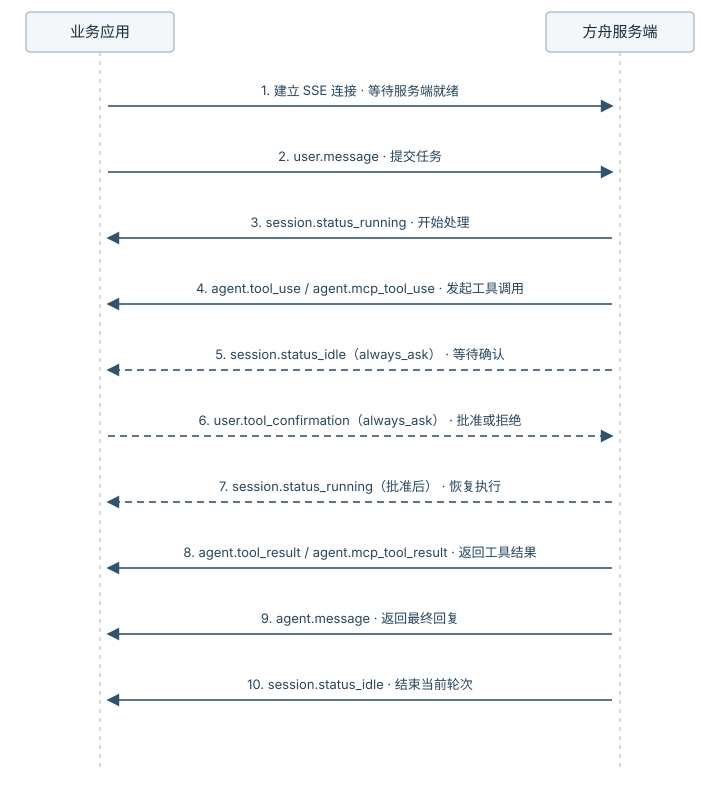
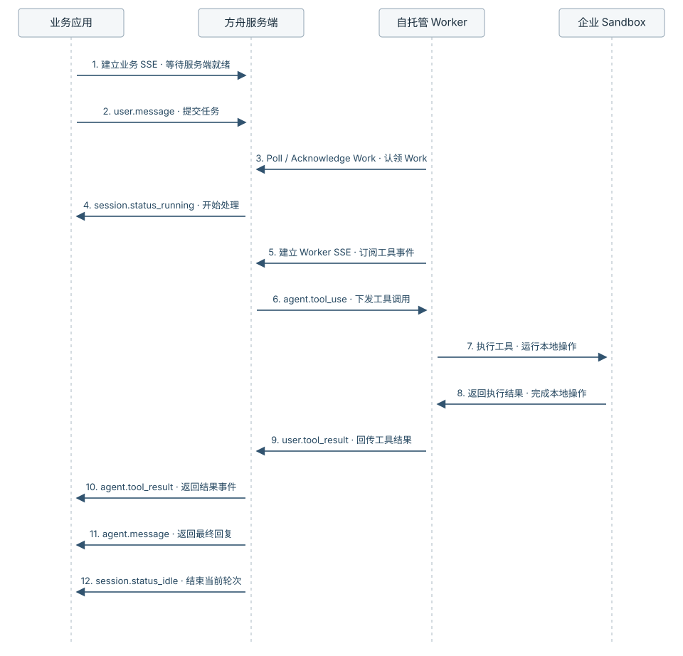
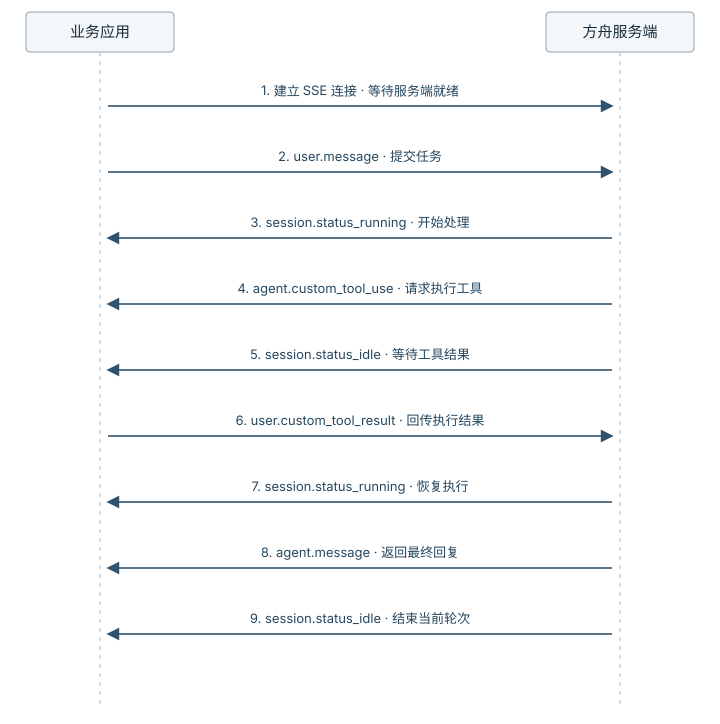

# Tools

> 全部文档的索引见 [llms.txt](https://ark.volcengine.com/llms.txt)；在任一文档页面地址后追加 `.md` 可获取该页的 Markdown 版本。

模型可以理解任务并生成内容，但无法仅靠推理直接操作文件、执行命令或访问业务系统。为 Agent 配置 Tools 后，Agent 可以调用相应的执行能力，并根据工具结果继续处理任务，完成从理解需求到执行操作的闭环。

## 选择工具

根据任务需要访问的资源和工具执行方，选择对应的工具类型。

- 任务需要操作文件、执行命令或获取网页信息时，使用基础工具集。自托管环境只改变其中部分工具的执行位置。
- 任务需要生成图片、视频或组合视觉素材时，使用多模态工具。
- 任务需要访问已经接入 MCP Server 的外部系统时，使用 MCP 工具。
- 任务只需调用少量自有业务操作，且由业务应用执行时，使用自定义工具。

### 使用内置工具

当任务需要处理文件、运行命令或获取网页信息时，新建 Agent 使用当前内置工具集 `agent_toolset_20260916`。典型场景包括整理输入文件、生成并运行代码，以及检索和汇总公开信息。

把 `agent_toolset_20260916` 加到 Agent 后，以下工具默认全部启用。

| 工具 | 配置名 | 说明 |
| --- | --- | --- |
| Bash | `bash` | 在沙箱中执行 Bash 命令。 |
| Read | `read` | 读取沙箱内文件。 |
| Write | `write` | 写入或覆盖沙箱内文件。 |
| Edit | `edit` | 对文件执行字符串替换。 |
| Glob | `glob` | 按名称查找文件。 |
| Grep | `grep` | 按正则搜索文本内容。 |
| Web Fetch | `web_fetch` | 抓取指定 URL 内容。 |
| Web Search | `web_search` | 发起联网搜索。 |

不同版本的基础工具集包含相同的工具。历史取值仅用于兼容已有 Agent 配置，新建 Agent 使用 `agent_toolset_20260916`。

> **注意**
>
> Web Search 按实际调用次数计费。

### 使用多模态工具

Seedance Managed Agent 使用 `agent_toolset_multimodal_20260825` 提供图片生成、视频生成、视觉搜索、通用搜索、视频合成和任务进度管理能力。创建 Seedance Managed Agent 时，还必须同时配置 `agent_toolset_20260916`。

自托管 Session 也可以使用多模态工具集。Environment 类型不会改变多模态工具的执行位置；方舟侧负责执行多模态工具，并将结果写入 Session 事件流。

| 配置名 | 事件中的工具名 | 是否必须启用 | 说明 |
| --- | --- | --- | --- |
| `image_generate` | `GenImage` | 是 | 生成图片。通过 `configs[].models` 绑定已开通的图片生成模型。 |
| `video_generate` | `GenVideo` | 否 | 生成视频。启用时，通过 `configs[].models` 绑定已开通的视频生成模型。 |
| `visual_search` | `VisualSearch` | 是 | 检索与创作任务相关的视觉素材。 |
| `general_search` | `GeneralSearch` | 是 | 检索创作任务需要的通用信息。 |
| `compose_video` | `ComposeVideo` | 是 | 将视频、图片和音频素材合成为视频。 |
| `todo_write` | `TodoWrite` | 默认启用，可关闭 | 为复杂、长耗时任务维护待办和进度。将 `default_config.enabled` 设置为 `false` 时，需要在 `configs[]` 中显式启用该工具。 |

事件流还可能出现 `ViewMedia` 和 `record_search_quality`。这两个工具由平台自动提供，不能通过 `configs[]` 配置。工具调用的顺序和次数由任务内容决定。

多模态工具产生的模型调用费用和工具调用费用，详情请参见 [Managed Agents 计费说明](https://ark.volcengine.com/docs/model-pricing#ma_billing)。

在请求的 `configs[].models[]` 中，每项只需填写模型 ID 或推理接入点 ID（`id`）和是否为默认模型（`default`）。每个生成工具最多配置 10 项，ID 不能重复；配置多项时，必须且只能将一项的 `default` 设置为 `true`。省略已启用生成工具的 `models` 时，服务端绑定平台默认模型，并在响应中返回实际绑定结果。响应中的模型名称（`name`）和版本（`version`）由服务端返回，不需要在请求中填写。

> **注意**
>
> 启用 `general_search` 时，必须在基础工具集中关闭 `web_search`。两个搜索工具同时启用时，服务端返回 400 `InvalidParameter`。

> **注意：自托管环境的数据边界**
>
> 自托管环境不会把图片生成、视频生成、视觉搜索和视频合成迁移到企业 Worker。多模态工具的调用参数和媒体输入会发送到方舟，执行结果也会进入 Session 事件流。业务数据不能进入该链路时，关闭多模态工具集。

Seedance Managed Agent 的完整工具配置和执行流程，详情请参见 [[基础] 使用 Seedance Managed Agent 生成图片和视频](/docs/visual-creation-agent)。

### 接入 MCP 工具

当任务需要访问已经通过 MCP Server 接入的外部系统，或需要复用一组标准化外部工具时，使用 MCP 工具集 `mcp_toolset`。典型场景包括查询项目数据、读取业务信息和触发外部工作流。

MCP 工具集通过 `type: "mcp_toolset"` 将一个 MCP Server 暴露的工具提供给 Agent。`mcp_server_name` 必须与 `mcp_servers[].name` 一致；只声明 MCP Server 而不添加对应的 `mcp_toolset` 时，Agent 无法调用该 Server 的工具。

云环境和自托管环境中的 MCP 工具均由方舟侧执行，不会转交企业 Worker。

可以通过 `default_config` 设置该 Server 下工具的默认状态，再通过 `configs` 按工具名称覆盖。完整配置和鉴权方式请参见 [MCP](mcp.md)。

显式提供 `default_config` 但省略 `permission_policy` 时，MCP 工具运行时使用 `always_ask`，内置工具使用 `always_allow`。为避免 MCP 调用意外暂停，建议显式配置权限策略。

### 接入自定义工具

当任务只需要调用少量自有业务操作，且无需为这些操作单独部署 MCP Server 时，使用自定义工具 `custom`。典型场景包括查询订单、提交工单和触发审批。业务应用负责执行实际操作，再把结果回传给 Agent。

自定义工具通过 `type: "custom"` 声明。每个工具需要配置名称、用途描述和输入参数 Schema。以下示例使用 `curl` 创建 Agent，并使用 `jq` 保存返回的 Agent ID。示例同时显式关闭内置工具集，避免主 Agent 回退启用全部内置工具：

**选项：Curl**

```Bash
AGENT_RESPONSE=$(curl -sS --fail-with-body "https://ark.cn-beijing.volces.com/api/v3/agents" \
  -H "Authorization: Bearer $ARK_API_KEY" \
  -H "Content-Type: application/json" \
  -d '{
    "name": "CustomToolDemo",
    "model": {
      "id": "doubao-seed-2-1-pro-260915"
    },
    "system": "你是一个可以调用业务工具的助手。需要外部业务能力时，调用已声明的自定义工具。不要编造工具结果。",
    "tools": [
      {
        "type": "agent_toolset_20260916",
        "default_config": {
          "enabled": false,
          "permission_policy": {
            "type": "always_allow"
          }
        }
      },
      {
        "type": "custom",
        "name": "query_order",
        "description": "根据订单 ID 查询订单状态。仅当用户要求查询订单信息时使用。",
        "input_schema": {
          "type": "object",
          "properties": {
            "order_id": {
              "type": "string",
              "description": "订单 ID。"
            }
          },
          "required": ["order_id"],
          "additionalProperties": false
        }
      }
    ]
  }') || exit 1

jq . <<<"$AGENT_RESPONSE" || exit 1
AGENT_ID=$(jq -er '.id' <<<"$AGENT_RESPONSE") || exit 1
export AGENT_ID
printf 'Agent ID: %s\n' "$AGENT_ID"
```

配置后，Agent 需要查询订单时会发送 `agent.custom_tool_use`。业务应用读取工具名称和输入参数，执行查询，再通过 `user.custom_tool_result` 回传结果。完整接入流程和多媒体场景示例请参见 [[基础] Custom Tool 使用教程](/docs/managed-agent-custom-tool-tutorial)。

## 配置内置工具

创建 Agent 前，先确定任务必须使用哪些工具、哪些工具可以修改数据，以及哪些调用需要业务应用确认。显式配置 `default_config.enabled` 和 `permission_policy`，再通过 `configs` 覆盖单个工具，可以避免不同工具类型的默认行为造成权限范围偏差。

> **注意**
>
> 不要通过省略 `tools`、传入空数组 `[]`，或只配置 MCP、自定义工具等其他工具来关闭主 Agent 的内置工具。主 Agent 在未找到内置工具集配置时会回退为启用全部内置工具，并使用 `always_allow`；如需限制工具范围，请显式配置 `agent_toolset_20260916`，将 `default_config.enabled` 设为 `false`，再逐项启用必要工具。详细行为请参见 [核对默认工具范围](tools.md#tool-defaults-and-boundaries)。

### 启用全部内置工具

如果 Agent 需要使用全部基础执行能力，挂载 `agent_toolset_20260916`，并显式启用工具集和权限策略：

**选项：Curl**

```Bash
curl https://ark.cn-beijing.volces.com/api/v3/agents \
  -H "Authorization: Bearer $ARK_API_KEY" \
  -H "Content-Type: application/json" \
  -d '{
    "name": "代码助理",
    "model": {
      "id": "doubao-seed-2-1-pro-260628"
    },
    "tools": [
      {
        "type": "agent_toolset_20260916",
        "default_config": {
          "enabled": true,
          "permission_policy": {
            "type": "always_allow"
          }
        }
      }
    ]
  }'
```

### 关闭部分工具

如果 Agent 不应访问网页，可以保持工具集启用，再通过 `configs` 关闭 `web_fetch` 和 `web_search`：

**选项：Curl**

```Bash
curl https://ark.cn-beijing.volces.com/api/v3/agents \
  -H "Authorization: Bearer $ARK_API_KEY" \
  -H "Content-Type: application/json" \
  -d '{
    "name": "离线文档助理",
    "model": {
      "id": "doubao-seed-2-1-pro-260628"
    },
    "tools": [
      {
        "type": "agent_toolset_20260916",
        "default_config": {
          "enabled": true,
          "permission_policy": {
            "type": "always_allow"
          }
        },
        "configs": [
          {
            "name": "web_fetch",
            "enabled": false
          },
          {
            "name": "web_search",
            "enabled": false
          }
        ]
      }
    ]
  }'
```

### 只启用必要工具

如果 Agent 只需要读取和检索沙箱文件，先将工具集整体关闭，再显式启用 `read`、`glob` 和 `grep`：

**选项：Curl**

```Bash
curl https://ark.cn-beijing.volces.com/api/v3/agents \
  -H "Authorization: Bearer $ARK_API_KEY" \
  -H "Content-Type: application/json" \
  -d '{
    "name": "只读审查 Agent",
    "model": {
      "id": "doubao-seed-2-1-pro-260628"
    },
    "tools": [
      {
        "type": "agent_toolset_20260916",
        "default_config": {
          "enabled": false,
          "permission_policy": {
            "type": "always_ask"
          }
        },
        "configs": [
          {
            "name": "read",
            "enabled": true,
            "permission_policy": {
              "type": "always_allow"
            }
          },
          {
            "name": "glob",
            "enabled": true,
            "permission_policy": {
              "type": "always_allow"
            }
          },
          {
            "name": "grep",
            "enabled": true,
            "permission_policy": {
              "type": "always_allow"
            }
          }
        ]
      }
    ]
  }'
```

这种配置适合代码审查和资料检索等只读任务。

### 设置权限策略

`always_allow` 表示工具调用无需业务应用确认，`always_ask` 表示执行前暂停 Session，等待业务应用确认。权限策略不改变工具执行方。建议在请求中显式配置工具集的默认策略，并通过 `configs[].permission_policy` 覆盖风险更高的单个工具。

权限策略的完整配置方式请参见 [工具权限策略](tool-permission-policy.md)。

## 验证和处理工具调用

创建或更新 Agent 后，按以下顺序验证配置是否生效：

1. 调用[查询智能体详情](api/get-agent-api.md)，检查响应中的 `tools` 是否符合预期；使用 MCP 工具时，同时检查 `mcp_servers`。
2. 创建新 Session，或调用[升级会话](api/upgrade-session-api.md)升级现有 Session。已创建的 Session 不会自动使用 Agent 的新版本。
3. 发送一条能够触发目标工具的测试任务。
4. 检查 Session 事件，确认工具调用、执行结果和最终回复已经形成闭环。

以下以查询订单状态并整理结果为例说明主要事件流。具体事件取决于工具的执行方和权限策略。

### 处理云环境工具调用

云环境中，方舟服务端负责执行内置工具和 MCP 工具。下图展示 Agent 发起调用、按需等待确认并返回结果的过程。`always_allow` 会直接执行工具；`always_ask` 会先暂停 Session，等待业务应用批准或拒绝。



#### 自动执行

使用 `always_allow` 时，平台直接执行工具并返回结果：

- 内置工具：`agent.tool_use` → `agent.tool_result`
- MCP 工具：`agent.mcp_tool_use` → `agent.mcp_tool_result`

同一轮可能调用多个工具。使用 `tool_use_id` 或 `mcp_tool_use_id` 将每个结果与对应调用配对，不要只依赖事件到达顺序。

<span id="confirm-tool-use"></span>
#### 确认后执行

内置工具或 MCP 工具使用 `always_ask` 时，Session 会暂停并等待确认：

1. Session 返回 `agent.tool_use` 或 `agent.mcp_tool_use`。
2. Session 返回 `session.status_idle`，其中 `stop_reason.type=requires_action`，`stop_reason.event_ids` 列出待确认的调用事件。
3. 客户端发送 `user.tool_confirmation`，通过 `tool_use_id` 指定调用事件，并将 `result` 设置为 `allow` 或 `deny`。
4. 所有待确认事件处理完成后，Session 返回 `session.status_running`。批准的工具继续执行，拒绝结果交给 Agent 调整后续处理。

> **注意：处理确认结果**
>
> 拒绝调用时，可以通过 `deny_message` 把原因回传给 Agent。Agent 会根据拒绝原因选择其他工具、降级处理，或向最终用户说明无法继续执行。
>
> 在 `requires_action` 阶段，先处理 `stop_reason.event_ids` 中的全部确认事件，不要用新的 `user.message` 替代确认。`always_allow`、`always_ask` 及覆盖规则请参见 [工具权限策略](tool-permission-policy.md)。

### 处理自托管工具调用

自托管环境按工具类型分配执行方：

| 工具类型 | 执行方 | 结果处理 |
| --- | --- | --- |
| 主 Agent 的 `bash`、`read`、`write`、`edit`、`glob`、`grep` | 企业 Worker 和 Sandbox | Worker 通过 `user.tool_result` 回传结果 |
| `web_fetch`、`web_search` | 方舟侧 | 方舟将结果写入 Session 事件流 |
| 多模态工具 | 方舟侧 | 方舟将图片、视频或其他工具结果写入 Session 事件流 |
| MCP 工具 | 方舟侧 | 方舟通过 `agent.mcp_tool_result` 返回结果 |
| 自定义工具 | 业务应用 | 业务应用通过 `user.custom_tool_result` 回传结果 |

上述六个企业侧工具只支持主 Agent。子 Agent 不会通过企业 Worker 执行这些工具。

以下流程只适用于主 Agent 的六个企业侧工具：



1. Session 返回 `agent.tool_use`，下发 Bash 或文件工具调用。
2. Session 返回 `session.status_idle`，其中 `stop_reason.type=requires_action`。
3. Worker 获取对应的 Work，并在企业 Sandbox 中执行工具。
4. Worker 通过 `user.tool_result` 回传结果。`tool_use_id` 必须填写对应的 `agent.tool_use.id`；工具执行失败时，将 `is_error` 设为 `true`，并在 `content` 中返回失败说明。
5. 所有待处理结果回传后，Session 返回 `session.status_running`，Agent 根据工具结果继续处理任务。

Worker 执行期间持续调用 Heartbeat 维持 Work 租约；完整的 Poll、Acknowledge、Heartbeat 和执行环境配置流程请参见 [配置并运行自托管环境](configure-self-hosted-environment.md)。

### 处理自定义工具调用

自定义工具由业务应用执行，事件闭环如下：



1. Session 返回 `agent.custom_tool_use`，其中包含工具名称、输入参数和调用事件 ID。
2. Session 返回 `session.status_idle`，其中 `stop_reason.type=requires_action`，`stop_reason.event_ids` 列出待处理的调用事件。
3. 业务应用根据工具名称和输入参数执行对应操作。
4. 业务应用发送 `user.custom_tool_result`，并将调用事件 ID 原样填入 `custom_tool_use_id`。如果同一轮存在多个待处理调用，需要分别回传结果。
5. 所有待处理结果回传后，Session 返回 `session.status_running`，Agent 根据工具结果继续处理任务。

完整接入示例请参见 [[基础] Custom Tool 使用教程](/docs/managed-agent-custom-tool-tutorial)。所有工具事件的字段结构请参见 [会话事件结构参考](api/sessions-events-reference-v2.md)。

## 更新工具配置

更新 Agent 可以使用的工具时，`tools` 使用整体替换语义。为避免误取消其他可用工具，按照以下步骤读取、合并并写回完整 `tools` 数组：

1. 调用[查询智能体详情](api/get-agent-api.md)，获取最新 `version` 和完整 `tools` 数组。
2. 在本地副本中保留不需要修改的工具，只调整目标工具。
3. 调用[更新智能体](api/update-agent-api.md)，同时提交当前 `version` 和合并后的完整 `tools` 数组。
4. 再次查询 Agent，确认版本号和工具配置已经更新。
5. 创建新 Session，或升级现有 Session 后验证工具调用。

更新请求中 `tools` 的取值语义如下：

| 取值 | 配置结果 | 使用建议 |
| --- | --- | --- |
| 省略或 `null` | 保留当前 `tools` 配置。 | 只修改其他 Agent 字段时使用。 |
| 空数组 `[]` | 只清空已保存的 `tools` 配置，不会关闭主 Agent 的内置工具。主 Agent 运行时仍会回退为启用全部内置工具，并使用 `always_allow`。 | 如需限制内置工具，改用显式工具集配置。 |
| 非空数组 | 使用请求中的数组整体替换当前配置。 | 先读取并合并所有需要保留的工具。 |

## 排查工具问题

先根据 Session 事件流定位中断点，再执行对应检查：

- 未出现目标工具的调用事件：核对 Agent 配置、Session 版本和任务触发条件。
- 出现 `stop_reason.type=requires_action`：根据阻塞事件类型回传确认或工具结果。
- 工具结果包含错误：根据调用 ID 定位输入、权限或执行环境。
- 出现 `session.error`：根据错误类型和重试状态决定等待、修正后重试或创建新 Session。
- 工具可以执行但权限范围过大：核对文件、网络和凭据隔离边界。

### 核对配置、版本和触发条件

如果事件流中没有出现 `agent.tool_use`、`agent.mcp_tool_use` 或 `agent.custom_tool_use`，按以下顺序检查：

1. 查询 Agent，确认目标工具或工具集已经保存。MCP 工具还需要检查 `mcp_servers`。
2. 确认当前 Session 使用的 Agent 版本；Agent 更新不会自动影响已创建的 Session。
3. 按工具类型核对配置与触发条件。
4. 使用相同的明确测试任务比较新旧 Session，避免把任务差异误判为版本问题。

| 工具类型 | 配置检查 | 任务触发条件 |
| --- | --- | --- |
| 内置工具 | `tools` 中包含 `type: "agent_toolset_20260916"`；根据 `default_config.enabled` 和 `configs` 的覆盖结果确认目标工具已启用。 | 测试任务明确要求读取实际文件、执行命令或访问网页，并提供文件路径、命令目标或检索主题。纯文本问答不要求调用工具。 |
| MCP 工具 | `mcp_servers[].name` 与 `tools[].mcp_server_name` 一致；根据 `default_config` 和 `configs` 确认目标 MCP 工具已启用。 | 测试任务明确要求访问对应外部系统，并提供项目、记录或其他业务标识。 |
| 自定义工具 | `tools` 中包含 `type: "custom"`，并保存了正确的 `name`、`description` 和 `input_schema`。`description` 需要说明适用条件。 | 测试任务明确要求执行该业务操作，并提供 `input_schema` 中的必需信息。 |

Agent 会根据任务内容和工具说明判断是否调用工具。单次未调用不能直接证明配置无效；应先使用明确要求目标能力的测试任务复现。

<span id="tool-defaults-and-boundaries"></span>

#### 核对默认工具范围

主 Agent 与子 Agent 在未配置内置工具集时采用不同的运行时行为：

| 配置 | 主 Agent | 子 Agent | 建议 |
| --- | --- | --- | --- |
| 省略 `tools`、传 `[]`，或只配置其他工具类型 | 回退为启用全部内置工具，权限策略为 `always_allow`。 | 不提供内置工具；Session 启用的 Memory 工具不受此规则影响。 | 不依赖省略行为，显式配置内置工具集。 |
| 配置 `agent_toolset_20260916`，省略 `default_config` | 服务端保存 `enabled=true` 和 `always_allow`。 | 按相同配置提供内置工具。 | 在请求中显式写出启用状态和权限策略。 |
| 配置 `default_config.enabled=false`，再逐项启用 | 只提供 `configs` 中显式启用的工具。 | 只提供 `configs` 中显式启用的工具。 | 需要最小工具集时使用。 |

判断子 Agent 是否实际执行工具时，以子线程中的 `agent.tool_use` 和 `agent.tool_result` 为准。System Prompt 或最终回复中声称已执行工具，不代表运行环境实际提供或执行了该工具。

#### 核对默认权限策略

权限策略存在以下默认分支：

| 配置 | 内置工具 | MCP 工具 |
| --- | --- | --- |
| 整个 `default_config` 省略 | 服务端保存 `always_allow`。 | 服务端保存 `always_allow`。 |
| 已提供 `default_config`，但省略 `permission_policy` | 运行时使用 `always_allow`。 | 运行时使用 `always_ask`。 |
| 显式配置 `permission_policy` | 使用配置的 `always_allow` 或 `always_ask`。 | 使用配置的 `always_allow` 或 `always_ask`。 |

### 处理 requires_action

Session 返回 `stop_reason.type=requires_action` 时，先读取 `stop_reason.event_ids`，再根据每个阻塞事件的类型执行对应操作：

| 阻塞事件 | 场景 | 处理方式 |
| --- | --- | --- |
| `agent.tool_use` 或 `agent.mcp_tool_use` | 云环境中的工具使用 `always_ask`。 | 发送 `user.tool_confirmation`，将阻塞事件 ID 填入 `tool_use_id`，并设置 `allow` 或 `deny`。确认 MCP 调用时也使用 `tool_use_id`；`mcp_tool_use_id` 仅用于关联 `agent.mcp_tool_result`。 |
| `agent.tool_use` | 自托管 Environment 中的主 Agent 调用 `bash`、`read`、`write`、`edit`、`glob` 或 `grep`。 | Worker 完成执行后发送 `user.tool_result`，使用 `tool_use_id` 关联调用；失败时设置 `is_error: true` 并返回错误说明。 |
| `agent.custom_tool_use` | 业务应用执行自定义工具。 | 发送 `user.custom_tool_result`，使用 `custom_tool_use_id` 关联调用；失败时设置 `is_error: true` 并返回错误说明。 |

同一轮可能包含多个阻塞事件。处理 `stop_reason.event_ids` 中的全部事件后，Session 才会恢复运行。不要用新的 `user.message` 代替确认或工具结果。

### 排查工具结果错误

工具结果包含错误时，先关联对应的调用事件，再定位执行方：

- `agent.tool_result`：通过 `tool_use_id` 检查原始工具输入，再核对文件路径、Environment 权限、网络策略和执行日志。
- `agent.mcp_tool_result`：通过 `mcp_tool_use_id` 检查原始工具输入，再核对 MCP 工具启用状态、凭据和 Server 返回信息。
- `user.tool_result` 或 `user.custom_tool_result`：检查业务应用或 Worker 的执行日志，确认 `is_error`、`content` 和调用 ID 与实际结果一致。

工具结果尚未处理完成时，不要重复发送原始任务，否则同一工具可能重复执行。

### 处理 Session 错误

`session.error` 不一定由工具配置引起。先读取 `error.type`、`error.message` 和 `error.retry_status.type`，并结合错误前的最后一个事件定位问题。

| 重试状态 | 处理方式 |
| --- | --- |
| `retrying` | 服务端正在自动重试。继续消费事件，不要重复发送任务。 |
| `exhausted` | 当前轮次的重试次数已用尽。等待 Session 恢复为 `idle`，修正输入或配置后再发送任务。 |
| `terminal` | Session 将进入 `terminated`，不能继续发送事件。修正配置后创建新 Session。 |

如果错误发生在 MCP 调用阶段，按错误类型继续检查：

- `mcp_authentication_failed_error`：检查 MCP Server 的鉴权配置、Session 引用的 Vaults 和凭据有效性。
- `mcp_connection_failed_error`：检查 MCP Server URL、网络连通性和服务状态。

修正 MCP 配置后，更新 Agent，并创建新 Session 或升级现有 Session。如果 `error.type` 不是 MCP 相关类型，且错误前没有工具调用事件，优先排查模型调用或 Session 运行问题，不要把所有 `session.error` 都归因于工具。事件字段和其他错误类型请参见 [会话事件结构参考](api/sessions-events-reference-v2.md)。

### 核对文件和网络隔离

> **注意**
>
> 关闭 `write`、`edit`、`web_fetch` 或 `web_search` 不等于完成强隔离。`read`、`glob` 和 `grep` 仍可能访问敏感文件；如果 Agent 仍可使用 `bash`，或者 Environment 允许不受限联网，命令仍可能读取或修改文件并访问网络。需要强隔离时，同时收敛内置工具、Environment 文件和网络策略，以及外部凭据权限。

## 相关文档

**[Agent](define-agent.md)**

Agent 是包含基本信息、System Prompt、扩展能力的配置模板。

**[Skills](skills.md)**

Skills 用于给 Agent 补充领域知识、操作流程和最佳实践。

**[MCP](mcp.md)**

MCP（Model Context Protocol）用于把第三方系统的工具与数据源接入 Agent。

**[工具权限策略](tool-permission-policy.md)**

工具权限策略用于控制 Agent 发起工具调用时，是自动执行，还是暂停等待确认。
