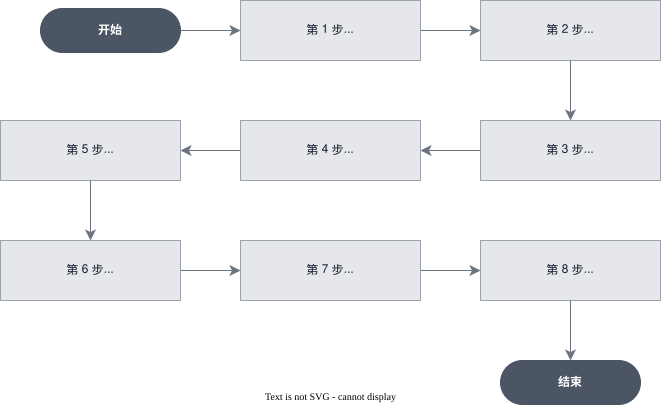

# [进阶] 构建从 CSV 到交互式报告的数据分析 Agent

> 全部文档的索引见 [llms.txt](https://ark.volcengine.com/llms.txt)；在任一文档页面地址后追加 `.md` 可获取该页的 Markdown 版本。

本教程演示如何使用方舟 Managed Agents 完成一次端到端的数据分析：上传一份 CSV 文件，由 Agent 在云沙箱中完成数据读取、清洗、统计、图表生成，并最终输出一份自包含的 HTML 分析报告。

<span id="scenario"></span>
# 场景说明

在企业的数据分析场景中，业务人员拿到 CSV 或 Excel 结构化数据后，往往只能看到原始记录，很难快速判断哪些信息值得关注。传统链路依赖分析师完成数据清洗、统计和可视化，响应周期长、重复性工作多。

这类场景适合交给 Managed Agents 处理：用户只需提供数据文件并描述分析目标，Agent 可以自动完成数据读取、清洗、代码执行、图表生成和结果总结，并输出一份结构清晰的分析报告。

| 环节 | 内容 |
|-|-|
| 输入 | 一个 CSV 文件，例如订单、销售、用户行为或运营数据 |
| 过程 | Agent 读取文件，使用 pandas 分析数据，使用 plotly 生成交互图表 |
| 输出 | 一个自包含的 `report.html`，包含摘要、关键指标、图表和行动建议 |
| 观测 | 通过 Session Events SSE 查看 Agent 消息、工具调用和状态变化 |

<span id="what-you-will-do"></span>
# 你将完成什么

- 创建一个用于数据分析的 Environment。
- 创建一个可复用的数据分析 Agent。
- 上传 CSV 并挂载到 Session 沙箱。
- 发送分析任务并通过事件流观察执行过程。
- 查询 Session 产出的报告文件。

<span id="core-concepts"></span>
# 核心概念

动手前先厘清方舟 Managed Agents 的四个基础对象。

| 概念 | 说明 |
|-|-|
| Agent | 一份可版本化、可复用的配置模板，封装模型、System Prompt 和工具集。创建后得到稳定的 `agent_id`，可被任意 Session 引用 |
| Environment | Agent 运行所在的云沙箱定义，决定网络策略与预装依赖，一次创建，多次复用 |
| Session | 一次具体的运行实例，把 Agent、Environment 和输入资源绑在一起。创建 Session 本身不会触发工作，需要主动下发消息 |
| Event | Session 内的追加式事件流。客户端用 `user.message` 下发任务，再通过 SSE 实时收到 Agent 的消息、工具调用与状态变化 |

<span id="flowchart"></span>
# 工作流程



<span id="prerequisites"></span>
# 前置条件

- 已开通方舟 Managed Agents 和目标模型服务。
- 已创建 API Key，详情请参见 [API Key 管理](https://ark.volcengine.com/docs/manage-api-keys)。
- 本地已安装 `curl` 7.76.0 或更高版本，以及 `jq`。
- 准备一个 CSV 文件，例如 `test_csv.csv`。

将 API Key、Base URL 和常用配置配置为环境变量：

```Bash
export ARK_API_KEY="你的方舟 API Key"  # gitleaks:allow
export ARK_BASE_URL="https://ark.cn-beijing.volces.com/api/v3"
export MODEL_ID="doubao-seed-2-1-pro-260628"
export TOOLSET_TYPE="agent_toolset_20260916"
export DATA_PATH="./test_csv.csv"
```

> **注意**
>
> API Key 用于访问账户下的模型与 Agent 资源，请仅在服务端使用，不要写入前端代码、日志或截图。

<span id="create-environment"></span>
# 第 1 步：创建 Environment

Environment 定义 Agent 的执行环境，例如网络访问权限、预装依赖和运行配置。本示例提前安装 `pandas` 和 `plotly`，Agent 执行任务时可以直接读取 CSV 文件、生成图表，无需运行时再安装依赖。Environment 创建完成后可以长期复用，后续多个 Session 都可以基于同一个 Environment 运行。

> **说明**
>
> 如果已经在控制台创建了包含 `pandas` 和 `plotly` 的 Environment，可以跳过本节，直接设置 `ENVIRONMENT_ID`。

```Bash
environment=$(curl -sS --fail-with-body "$ARK_BASE_URL/environments" \
  -H "Authorization: Bearer $ARK_API_KEY" \
  -H "Content-Type: application/json" \
  -d @- <<'EOF'
{
  "name": "data-analyst-env",
  "description": "用于 CSV 数据分析报告生成的托管沙箱环境。",
  "config": {
    "type": "cloud",
    "networking": {"type": "unrestricted"},
    "packages": {
      "pip": ["pandas", "plotly"]
    }
  }
}
EOF
)

ENVIRONMENT_ID=$(jq -er '.id' <<<"$environment")
echo "Environment: $ENVIRONMENT_ID"
```

> **说明**
>
> 本示例未配置 `config.tos`，生成的报告使用方舟公共 TOS。需要将报告长期保存在自己的 TOS Bucket 时，在创建 Environment 时配置产物存储，详情请参见 [配置产物存储](../configure-cloud-environment.md#configure-output-storage)。

> **注意**
>
> `networking.type=unrestricted` 便于教程演示。生产环境应按最小可用范围收敛网络策略，只放行必要的出站主机。

<span id="create-agent"></span>
# 第 2 步：定义分析 Agent

Environment 创建完成后，创建 Agent。Agent 包含模型、System Prompt 和工具等配置，是 Session 执行任务时使用的核心资源。System Prompt 用于约束 Agent 的分析流程和输出格式，例如数据校验、统计分析、图表生成以及最终报告的组织方式。创建完成后，Agent 可以被多个 Session 复用。

先把 System Prompt 保存为变量：

```Bash
ANALYST_SYSTEM_PROMPT='你是一名资深数据分析师，负责把 CSV 数据集转成可直接交付的 HTML 分析报告。

工作目标：
输出一份面向业务方可直接阅读的报告。报告应包含摘要、关键指标、图表、主要发现、数据质量说明和行动建议。

工作原则：
1. 先读取并理解原始 CSV 的结构，再开始分析。必须明确区分"原始输入字段"和"分析过程中派生出的字段"。
2. 所有关于数据规模、行列数、字段名、缺失值、重复值的描述，都必须基于原始 CSV，不得基于清洗后或派生后的 dataframe。
3. 大表先抽样查看，再按需全量聚合，避免无意义地打印整表。
4. 所有结论必须由具体数字支撑；不能只给判断，不给证据。
5. 使用 pandas 完成清洗与聚合，使用 plotly 生成交互式图表。
6. 生成至少 3 张图表，并在图表之间写简短说明，解释图表反映的业务洞察。
7. 为最终的报告生成一个 HTML 文件。

交付要求：
1. 生成可直接交付的 report.html，要求为单文件、自包含 HTML，可离线浏览，不依赖任何外部资源。
2. 报告内容至少包括：
   - Executive Summary
   - Key Metrics
   - Data Quality Notes
   - 3 个以上图表及对应洞察
   - Action Recommendations

分析与表述要求：
1. 优先呈现最有行动价值的发现。
2. 建议必须区分"数据支持的结论"和"需要进一步验证的假设"。
3. 如果样本时间很短、缺少关键字段或无法支撑因果判断，必须明确写出限制。
4. 不得编造不存在的字段、维度、业务背景或结论。

执行要求：
1. 读取原始 CSV 后，先记录：
   - 原始行数
   - 原始列数
   - 原始列名
   - 缺失值情况
   - 重复值情况
2. 所有 KPI、Top N、占比、均值、毛利率等数字，在写入报告前必须再次校验。
3. 如果发现数据不足以支撑某个结论，应降低结论强度，而不是强行给出确定性判断。

保存前请完成自检，确保：
1. 报告中的数据质量信息和关键指标与原始 CSV 及计算结果一致。
2. report.html 不依赖任何外部资源。
3. HTML 内容完整有效，不包含无效字段、占位内容或语法错误。'
```

再创建 Agent，将上述 System Prompt 与工具一起提交：

```Bash
agent_payload=$(jq -n \
  --arg name "data-analyst-agent" \
  --arg model "$MODEL_ID" \
  --arg system "$ANALYST_SYSTEM_PROMPT" \
  --arg toolset "$TOOLSET_TYPE" \
  '{
    name: $name,
    description: "把 CSV 数据集分析成带交互图表的 HTML 报告。",
    model: {id: $model, speed: "standard"},
    system: $system,
    tools: [{
      type: $toolset,
      default_config: {
        enabled: true,
        permission_policy: {type: "always_allow"}
      }
    }],
    skills: [],
    mcp_servers: [],
    metadata: {scenario: "data_analyst_report"}
  }')

agent=$(curl -sS --fail-with-body "$ARK_BASE_URL/agents" \
  -H "Authorization: Bearer $ARK_API_KEY" \
  -H "Content-Type: application/json" \
  -d "$agent_payload")

AGENT_ID=$(jq -er '.id' <<<"$agent")
echo "Agent: $AGENT_ID"
```

<span id="upload-file"></span>
# 第 3 步：上传待分析数据

上传输入文件有多种方式，本示例通过 Files API 上传 CSV 并获取 `FILE_ID`，后续创建 Session 时通过该 ID 引用文件。文件上传采用异步处理，需要等待文件状态变为 `active` 后再继续后续流程，以确保文件已完成处理并可以正常使用。

```Bash
file=$(curl -sS --fail-with-body "$ARK_BASE_URL/files" \
  -H "Authorization: Bearer $ARK_API_KEY" \
  -F 'purpose=agent' \
  -F "file=@${DATA_PATH}")

FILE_ID=$(jq -er '.id' <<<"$file")
echo "File: $FILE_ID"

for _ in $(seq 1 60); do
  file_info=$(curl -sS --fail-with-body "$ARK_BASE_URL/files/$FILE_ID" \
    -H "Authorization: Bearer $ARK_API_KEY")
  file_status=$(jq -r '.status // "active"' <<<"$file_info")
  [[ "$file_status" == "active" ]] && break
  [[ "$file_status" == "failed" ]] && { echo "$file_info" >&2; exit 1; }
  sleep 2
done
```

<span id="create-session"></span>
# 第 4 步：创建 Session 并挂载数据

Session 表示一次具体的运行实例，用于关联 Agent、Environment 和输入资源。创建 Session 时，通过 `resources` 指定需要挂载的文件，平台会将其映射到沙箱中的 `/mnt/session/uploads/` 目录，供 Agent 在执行过程中访问。Session 创建完成后即进入就绪状态，但不会自动开始执行任务，需在后续发送事件触发执行。

```Bash
UPLOAD_NAME=$(basename "$DATA_PATH")
MOUNT_PATH="/mnt/session/uploads/$UPLOAD_NAME"

session_payload=$(jq -n \
  --arg agent "$AGENT_ID" \
  --arg env "$ENVIRONMENT_ID" \
  --arg file "$FILE_ID" \
  --arg name "$UPLOAD_NAME" \
  '{
    agent: $agent,
    environment_id: $env,
    title: "CSV data analysis",
    resources: [{type: "file", file_id: $file, mount_path: $name}]
  }')

session=$(curl -sS --fail-with-body "$ARK_BASE_URL/sessions" \
  -H "Authorization: Bearer $ARK_API_KEY" \
  -H "Content-Type: application/json" \
  -d "$session_payload")

SESSION_ID=$(jq -er '.id' <<<"$session")
echo "Session: $SESSION_ID"
```

<span id="dispatch-task"></span>
# 第 5 步：建立事件流并下发分析任务

Session 创建完成后并不会自动执行任务。为了完整接收本轮事件，先建立 SSE 流并等待服务端返回 `: ready`，再向 `/sessions/{session_id}/events` 接口发送 `user.message`。以下函数会按该顺序编排，并持续读取到会话终态：

```Bash
run_session_turn() (
  local session_id="$1"
  local user_text="$2"
  local stream_dir
  local stream_pipe=""
  local stream_error
  local stream_pid=""
  local stream_number=0
  local stream_ready=false
  local seen_ids_file
  local events_payload
  local turn_done=false
  local result_code=1
  local message_count=0
  local reconnect_count=0
  local max_reconnects="${ARK_MAX_SSE_RECONNECTS:-3}"
  local max_history_pages="${ARK_MAX_HISTORY_PAGES:-100}"
  local line
  local data

  : "${ARK_BASE_URL:?Set ARK_BASE_URL before calling run_session_turn}"
  : "${ARK_API_KEY:?Set ARK_API_KEY before calling run_session_turn}"
  : "${session_id:?Pass a Session ID as the first argument}"
  : "${user_text:?Pass a user message as the second argument}"
  command -v curl >/dev/null || {
    printf 'curl is required.\n' >&2
    return 1
  }
  command -v jq >/dev/null || {
    printf 'jq is required.\n' >&2
    return 1
  }
  [[ $max_reconnects =~ ^[0-9]+$ ]] || {
    printf 'ARK_MAX_SSE_RECONNECTS must be a non-negative integer.\n' >&2
    return 1
  }
  [[ $max_history_pages =~ ^[1-9][0-9]*$ ]] || {
    printf 'ARK_MAX_HISTORY_PAGES must be a positive integer.\n' >&2
    return 1
  }

  stream_dir=$(mktemp -d) || {
    printf 'Failed to create a temporary directory for the SSE stream.\n' >&2
    return 1
  }
  stream_error="$stream_dir/stream-error.log"
  seen_ids_file="$stream_dir/seen-event-ids"
  : >"$stream_error"
  : >"$seen_ids_file"

  stop_stream() {
    exec 3<&- || true
    if [[ -n $stream_pid ]] && kill -0 "$stream_pid" 2>/dev/null; then
      kill "$stream_pid" 2>/dev/null || true
    fi
    if [[ -n $stream_pid ]]; then
      wait "$stream_pid" 2>/dev/null || true
    fi
    if [[ -n $stream_pipe ]]; then
      rm -f "$stream_pipe"
    fi
    stream_pid=""
    stream_pipe=""
  }

  cleanup_stream() {
    stop_stream
    rm -rf "$stream_dir"
  }
  trap cleanup_stream EXIT

  start_stream() {
    stop_stream
    stream_number=$((stream_number + 1))
    stream_pipe="$stream_dir/events-$stream_number"
    stream_ready=false

    if ! mkfifo "$stream_pipe"; then
      printf 'Failed to create the SSE pipe at %s.\n' "$stream_pipe" >&2
      return 1
    fi

    curl -sS -N --fail-with-body --max-time 600 \
      "$ARK_BASE_URL/sessions/$session_id/events/stream" \
      -H "Authorization: Bearer $ARK_API_KEY" \
      -H "Accept: text/event-stream" >"$stream_pipe" 2>>"$stream_error" &
    stream_pid=$!
    exec 3<"$stream_pipe"

    while IFS= read -r line <&3; do
      line=${line%$'\r'}
      if [[ $line == ": ready" ]]; then
        stream_ready=true
        break
      fi
    done

    if [[ $stream_ready != true ]]; then
      printf 'SSE stream closed before it was ready.\n' >&2
      if [[ -s $stream_error ]]; then
        tail -n 1 "$stream_error" >&2
      fi
      return 1
    fi
  }

  event_seen() {
    local event_id="$1"
    [[ -n $event_id ]] && grep -Fqx -- "$event_id" "$seen_ids_file"
  }

  remember_event() {
    local event_id="$1"
    if [[ -n $event_id ]] && ! event_seen "$event_id"; then
      printf '%s\n' "$event_id" >>"$seen_ids_file"
    fi
  }

  process_event() {
    local event_json="$1"
    local event_id
    local event_type
    local stop_reason
    local retry_status
    local pending_ids

    event_id=$(jq -r '.id // empty' <<<"$event_json" 2>/dev/null || true)
    if event_seen "$event_id"; then
      return 0
    fi
    remember_event "$event_id"

    event_type=$(jq -r '.type // empty' <<<"$event_json" 2>/dev/null || true)
    case "$event_type" in
      agent.message)
        jq -r '.content[]? | select(.type == "text") | .text' <<<"$event_json"
        message_count=$((message_count + 1))
        ;;
      agent.tool_use | agent.mcp_tool_use | agent.custom_tool_use)
        printf '[tool] %s\n' "$(jq -r '.name // .type' <<<"$event_json")"
        ;;
      session.error)
        retry_status=$(jq -r '.error.retry_status.type // empty' <<<"$event_json")
        printf '[error] %s: %s\n' \
          "$(jq -r '.error.type // "unknown_error"' <<<"$event_json")" \
          "$(jq -r '.error.message // "No error message returned."' <<<"$event_json")" >&2
        case "$retry_status" in
          retrying)
            printf '[session] The service is retrying automatically.\n' >&2
            ;;
          exhausted)
            printf '[session] Retries were exhausted for this turn.\n' >&2
            ;;
          terminal)
            printf '[session] The Session cannot continue after this error.\n' >&2
            ;;
          *)
            printf '[session] Unknown error retry status: %s\n' "$retry_status" >&2
            result_code=4
            turn_done=true
            ;;
        esac
        ;;
      session.status_rescheduled)
        printf '[session] The Session was rescheduled; continue waiting.\n' >&2
        ;;
      session.status_idle)
        stop_reason=$(jq -r '.stop_reason.type // empty' <<<"$event_json")
        case "$stop_reason" in
          end_turn)
            if ((message_count == 0)); then
              printf 'The turn ended without an agent.message event.\n' >&2
              result_code=5
            else
              printf '[session] end_turn\n' >&2
              result_code=0
            fi
            turn_done=true
            ;;
          requires_action)
            pending_ids=$(jq -r '.stop_reason.event_ids // [] | join(",")' <<<"$event_json")
            printf '[session] requires_action: %s\n' "$pending_ids" >&2
            result_code=2
            turn_done=true
            ;;
          retries_exhausted)
            printf '[session] retries_exhausted\n' >&2
            result_code=3
            turn_done=true
            ;;
          *)
            printf 'Unknown session.status_idle stop_reason: %s\n' "$stop_reason" >&2
            result_code=5
            turn_done=true
            ;;
        esac
        ;;
      session.status_terminated)
        printf '[session] terminated\n' >&2
        result_code=4
        turn_done=true
        ;;
    esac
  }

  read_history() {
    local mode="$1"
    local page=""
    local page_count=0
    local response
    local event_json

    while :; do
      page_count=$((page_count + 1))
      if ((page_count > max_history_pages)); then
        printf 'History recovery exceeded %s pages.\n' "$max_history_pages" >&2
        return 1
      fi

      if [[ -n $page ]]; then
        response=$(curl -sS --fail-with-body --get \
          "$ARK_BASE_URL/sessions/$session_id/events" \
          -H "Authorization: Bearer $ARK_API_KEY" \
          --data-urlencode "limit=200" \
          --data-urlencode "order=asc" \
          --data-urlencode "page=$page") || return 1
      else
        response=$(curl -sS --fail-with-body --get \
          "$ARK_BASE_URL/sessions/$session_id/events" \
          -H "Authorization: Bearer $ARK_API_KEY" \
          --data-urlencode "limit=200" \
          --data-urlencode "order=asc") || return 1
      fi

      while IFS= read -r event_json; do
        [[ -n $event_json ]] || continue
        if [[ $mode == "seed" ]]; then
          remember_event "$(jq -r '.id // empty' <<<"$event_json")"
        else
          process_event "$event_json"
          [[ $turn_done == true ]] && break
        fi
      done < <(jq -c '.data[]?' <<<"$response")

      [[ $turn_done == true ]] && return 0
      page=$(jq -r '.next_page // empty' <<<"$response")
      [[ -n $page ]] || return 0
    done
  }

  if ! start_stream; then
    return 1
  fi

  # Mark existing history so reconnect recovery only emits this turn.
  if ! read_history seed; then
    printf 'Failed to read the Session history before sending the message.\n' >&2
    return 1
  fi

  events_payload=$(jq -n --arg text "$user_text" \
    '{events: [{type: "user.message", content: [{type: "text", text: $text}]}]}')

  curl -sS --fail-with-body \
    "$ARK_BASE_URL/sessions/$session_id/events" \
    -H "Authorization: Bearer $ARK_API_KEY" \
    -H "Content-Type: application/json" \
    -d "$events_payload" >/dev/null || return 1

  while [[ $turn_done != true ]]; do
    while IFS= read -r line <&3; do
      line=${line%$'\r'}
      if [[ $line == ": server draining, reconnect" ]]; then
        break
      fi
      [[ $line == data:* ]] || continue
      data=${line#data:}
      data=${data# }
      process_event "$data"
      [[ $turn_done == true ]] && break
    done

    [[ $turn_done == true ]] && break
    if ((reconnect_count >= max_reconnects)); then
      printf 'SSE reconnect limit reached before the turn finished.\n' >&2
      return 1
    fi

    reconnect_count=$((reconnect_count + 1))
    printf '[session] Reconnecting SSE and recovering history (%s/%s).\n' \
      "$reconnect_count" "$max_reconnects" >&2

    # Open the replacement stream first, then recover the disconnect window.
    if ! start_stream; then
      return 1
    fi
    if ! read_history recover; then
      printf 'Failed to recover Session history after reconnecting.\n' >&2
      return 1
    fi
  done

  return "$result_code"
)
```

```Bash
analysis_prompt=$(cat <<EOF
分析挂载在 $MOUNT_PATH 的 CSV 数据集。

请完成：
1. 识别字段含义、数据规模和明显质量问题。
2. 找出收入、品类、区域、时间趋势或用户行为中的关键发现。
3. 至少生成 3 张 plotly 交互图表。
4. 输出一个 HTML 报告，包含摘要、图表、关键数字和行动建议。
EOF
)

run_session_turn "$SESSION_ID" "$analysis_prompt"
```

<span id="observe-events"></span>
# 第 6 步：实时观测执行过程

第 5 步建立的 SSE 流会实时输出模型消息、工具调用和任务状态。`run_session_turn` 只有在收到 `session.status_idle` 且 `stop_reason.type=end_turn`，并且本轮至少产生一条 `agent.message` 时才返回成功。

如果 SSE 意外断开，函数会先建立替代流，再分页查询历史事件，补齐断线期间的事件并按事件 ID 去重。连续重连仍失败、Session 终止或服务端返回其他停止原因时，函数会返回非零状态，不会把不完整输出当作成功结果。

主要事件类型：

| 事件类型 | 含义 |
|-|-|
| `agent.message` | Agent 返回的文本消息 |
| `agent.tool_use` | Agent 正在调用工具 |
| `agent.tool_result` | 工具执行结果 |
| `session.status_idle` | 根据 `stop_reason.type` 判断本轮正常结束、等待操作或重试耗尽 |
| `session.status_terminated` | Session 已终止，需要排查原因 |

<span id="fetch-report"></span>
# 第 7 步：取回分析报告

任务完成后，可以通过 Session ID（`scope_id`）查询本次执行生成的文件。Agent 运行过程中产生的报告、图表等文件都会关联到对应的 Session。当查询结果中出现生成的 HTML 文件时，说明分析报告已经生成。

```Bash
curl -sS --fail-with-body "$ARK_BASE_URL/files?scope_id=$SESSION_ID" \
  -H "Authorization: Bearer $ARK_API_KEY" |
  jq '.data[]? | {id, filename, bytes, status}'
```

生成的文件可以通过控制台下载到本地，方便查看、分享或归档。

<span id="cleanup"></span>
# 第 8 步：清理资源

分析完成后，可根据需要清理本次运行产生的资源。Session 和上传文件属于临时资源，会占用平台配额，确认结果已保存后可及时删除。Agent 和 Environment 通常作为可复用资源保留，用于后续任务。再次执行分析时，只需创建新的 Session 并引用已有的 Agent、Environment 和输入文件即可。

```Bash
curl -sS --fail-with-body -X DELETE \
  "$ARK_BASE_URL/sessions/$SESSION_ID" \
  -H "Authorization: Bearer $ARK_API_KEY"

curl -sS --fail-with-body -X DELETE \
  "$ARK_BASE_URL/files/$FILE_ID" \
  -H "Authorization: Bearer $ARK_API_KEY"

curl -sS --fail-with-body -X DELETE \
  "$ARK_BASE_URL/environments/$ENVIRONMENT_ID" \
  -H "Authorization: Bearer $ARK_API_KEY"
```

> **警告**
>
> 删除 Session 前，先确认所需文件的存储位置。使用方舟公共 TOS 时，删除 Session 会清理关联产物，需要提前下载；使用自己的 TOS Bucket 时，删除 Session 不会删除 Bucket 中的对象，你需要继续管理对象生命周期。

<span id="execution-summary"></span>
# 完整执行顺序

1. 设置 `ARK_API_KEY`、`ARK_BASE_URL`、`MODEL_ID`、`DATA_PATH` 等环境变量。
2. 创建或复用 Environment，确保包含 `pandas` 和 `plotly`。
3. 创建 Agent。
4. 上传 CSV。
5. 创建 Session 并挂载 CSV。
6. 建立事件流并等待 `: ready`。
7. 发送 `user.message`，通过同一条事件流等待 `session.status_idle` 且 `stop_reason.type=end_turn`。
8. 按 `scope_id` 查询 Session 产物。
9. 下载生成文件到本地。
10. 按需清理 Session、输入文件与 Environment。
