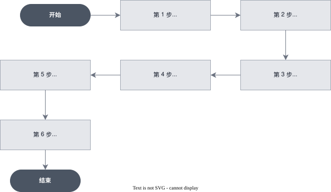

# [进阶] 使用 Vaults 让开发 Agent 以用户身份提交 GitHub PR

> 全部文档的索引见 [llms.txt](https://ark.volcengine.com/llms.txt)；在任一文档页面地址后追加 `.md` 可获取该页的 Markdown 版本。

本教程演示如何使用方舟 Managed Agents 的 **Vaults 凭据托管**能力，构建一个接入 GitHub 的团队开发助手：团队成员提交需求或缺陷描述，Agent 在云沙箱中完成开发，并以成员本人的身份创建分支、提交 PR。全程凭据由平台托管，Agent 与业务代码都接触不到明文 Token。

<span id="scenario"></span>
# 场景说明

一个典型的团队开发助手工作方式如下：成员在 IM 或内部平台用自然语言提交需求或缺陷（例如「结算页两券叠加时金额多 0.01 元，修一下」），Agent 在云沙箱中拉取代码、定位问题、开发自测，最后回到 GitHub 创建分支、提交 PR。整个过程成员不需要打开 IDE。

这里绕不开一个问题：Agent 操作 GitHub 时，用谁的身份？

共享一个机器人账号是最容易想到的做法，也是问题最多的做法：

| 维度 | 共享机器人账号 | 以用户身份（本教程方案） |
|-|-|-|
| 权限边界 | 机器人需要开通所有成员会用到的仓库权限，权限必然过大 | 复用每个成员自己的仓库权限，天然收敛 |
| 审计追溯 | 所有 PR 都是同一个 author，出了问题查不到人 | PR author 即需求提交人，审计链路不断 |
| 协作体验 | Reviewer 不知道该找谁讨论方案 | 直接 @ PR 作者本人 |

Vaults 是「以用户身份」这条路的基础设施。它不是全局配置中心，而是每个终端用户一只的凭据保险柜——平台在 Agent 粒度上管理产品配置，在 Session 粒度上管理用户凭据。

<span id="core-concepts"></span>
# 核心概念

| 能力点 | 说明 |
|-|-|
| Vault | 绑定到某个终端用户的凭据集合，存放该用户的第三方服务 Token；通过 `metadata` 与业务系统的用户 ID 双向映射 |
| Credential | Vault 内的一条凭据。支持 `mcp_oauth`、`static_bearer`、`mcp_static`、`environment_variable` 和 `env_oauth` 五种类型；本教程使用 `static_bearer` |
| Session 级凭据绑定 | 创建 Session 时传入 `vault_ids`，运行时按 URL 自动匹配凭据并注入；Agent 定义不感知任何用户信息 |
| GitHub MCP | 通过 MCP 协议把 GitHub 的仓库、分支、PR 操作暴露为 Agent 工具 |

<span id="flowchart"></span>
# 工作流程



<span id="prerequisites"></span>
# 前置条件

- 已开通方舟 Managed Agents 和目标模型服务。
- 已创建 API Key，详情请参见 [API Key 管理](https://ark.volcengine.com/docs/manage-api-keys)。
- 每个使用助手的成员，需在 GitHub「Settings → Developer settings → Fine-grained tokens」创建一个 PAT，按最小权限收敛。
- 本地已安装 Bash、`curl` 7.76.0 或更高版本，以及 `jq`。

将 API Key 与 Base URL 配置为环境变量：

```Bash
export ARK_API_KEY="your_api_key_here"  # gitleaks:allow
export ARK_BASE_URL="https://ark.cn-beijing.volces.com/api/v3"
```

<span id="pat-scope"></span>
# 第 1 步：准备 GitHub Fine-grained PAT

推荐按下表配置 PAT 权限，只授予助手需要的仓库和最小权限：

| 配置项 | 建议值 | 用途 |
|-|-|-|
| Repository access | 只勾选目标仓库（如 `payments-web`），不选 All repositories | 收敛可访问仓库范围 |
| Contents | Read and write | 拉代码、推分支 |
| Pull requests | Read and write | 创建 PR |
| Metadata | Read-only | GitHub 强制要求 |

> **警告**
>
> PAT 的权限就是 Agent 能力的上限，也是出事时的止损边界。Agent 可以执行该 Key 允许的任何操作，过权 Key 会在 Agent 异常时扩大事故影响范围。宁可先给窄、用到再加——Vaults 隔离的是「谁的凭据」，管不了「这个凭据本身有多大权力」。

<span id="create-vault"></span>
# 第 2 步：为用户创建 Vault

成员 Alice 首次使用助手时，为她创建一只 Vault：

```Bash
curl "$ARK_BASE_URL/vaults" \
  -H "Authorization: Bearer $ARK_API_KEY" \
  -H "Content-Type: application/json" \
  -d '{
    "display_name": "Alice",
    "metadata": {
      "external_user_id": "usr_alice_001",
      "team": "payments"
    }
  }'
```

响应是完整的 Vault 记录：

```json
{
  "type": "vault",
  "id": "vlt-20260701120000-pqrst",
  "display_name": "Alice",
  "metadata": {"external_user_id": "usr_alice_001", "team": "payments"},
  "created_at": "2026-07-08T10:00:00Z",
  "updated_at": "2026-07-08T10:00:00Z"
}
```

请求字段说明：

| 参数 | 必填 | 说明 |
|-|-|-|
| `display_name` | 是 | 控制台展示名 |
| `metadata` | 否 | 任意键值对，用于把 Vault 映射回业务系统的用户记录；后续凭据失效需要找人重新授权，靠它反查 |

将返回的 `id` 存入业务系统的用户表——这是该用户在 Managed Agents 中的身份锚点。

> **注意：权限边界**
>
> Vault 和凭据在工作空间内共享，不按 API Key 单独隔离。持有同一工作空间任一 API Key 的服务，都可以通过 Vault ID 在 Session 中引用其中的凭据。仅向受信任的服务开放工作空间 API Key。

<span id="create-credential"></span>
# 第 3 步：写入 GitHub 凭据

凭据把「MCP 服务器 URL」和「访问它用的 Token」配成一对。GitHub PAT 属于固定 Bearer token，使用 `static_bearer` 类型。以下脚本通过无回显输入读取 PAT，将密钥和请求体写入仅当前用户可读的临时文件，并在请求结束后删除文件：

```Bash
: "${VAULT_ID:?Create a Vault and set VAULT_ID first}"
: "${ARK_BASE_URL:?Set ARK_BASE_URL first}"
: "${ARK_API_KEY:?Set ARK_API_KEY first}"
command -v curl >/dev/null || {
  printf 'curl is required.\n' >&2
  exit 1
}
command -v jq >/dev/null || {
  printf 'jq is required.\n' >&2
  exit 1
}

old_umask=$(umask)
umask 077
secret_file=$(mktemp) || exit 1
payload_file=$(mktemp) || {
  rm -f "$secret_file"
  exit 1
}
umask "$old_umask"

cleanup_secret_files() {
  rm -f "$secret_file" "$payload_file"
}
trap cleanup_secret_files EXIT

IFS= read -r -s -p "GitHub PAT: " GITHUB_PAT || exit 1
printf '\n'
printf '%s' "$GITHUB_PAT" >"$secret_file"
unset GITHUB_PAT

jq -n \
  --rawfile token "$secret_file" \
  '{
    display_name: "Alice GitHub PAT",
    auth: {
      type: "static_bearer",
      mcp_server_url: "https://api.githubcopilot.com/mcp/",
      token: $token
    }
  }' >"$payload_file" || exit 1

CREDENTIAL_RESPONSE=$(curl -sS --fail-with-body \
  "$ARK_BASE_URL/vaults/$VAULT_ID/credentials" \
  -H "Authorization: Bearer $ARK_API_KEY" \
  -H "Content-Type: application/json" \
  --data-binary @"$payload_file") || exit 1

CREDENTIAL_ID=$(jq -er '.id' <<<"$CREDENTIAL_RESPONSE") || exit 1
export CREDENTIAL_ID
printf 'Credential ID: %s\n' "$CREDENTIAL_ID"

cleanup_secret_files
trap - EXIT
```

脚本不会把 PAT 放进命令行参数或可持久化的命令文本。响应中的凭据 ID 会保存为 `CREDENTIAL_ID`。

五种凭据类型按目标服务的认证方式选择：

| 类型 | 适用 | 密钥字段 |
|-|-|-|
| `static_bearer` | 固定 API Key / PAT（GitHub、Linear 等）——本教程场景 | `token` |
| `mcp_oauth` | OAuth 2.0 的 MCP 服务（Slack、Google Drive 等），提供 `refresh` 块后平台代刷令牌 | `access_token` + `refresh` |
| `mcp_static` | MCP 使用固定密钥，需要以 Bearer、自定义 Header 或 URL 查询参数注入 | `token` + `injection_type`，部分类型还需 `injection_name` |
| `environment_variable` | 沙箱内 CLI / SDK 走环境变量鉴权的场景，用 `allowed_hosts` 限制密钥可发往的主机 | `secret_name` + `secret_value` |
| `env_oauth` | 沙箱内 CLI / SDK 从环境变量读取 OAuth 访问令牌 | `access_token` + `secret_name` + `networking` |

三个值得知道的行为：

- 创建即校验：MCP 类凭据（`static_bearer`、`mcp_oauth`、`mcp_static`）创建时，平台会立即连接目标 MCP 服务器探测握手。PAT 写错会直接返回 4xx、创建失败，不会拖到 Session 运行时才暴露。
- 密钥 write-only：`token` 等实际密钥被视为敏感的只写字段，永远不会在 API 响应中返回。
- `mcp_server_url` 唯一且不可变：`mcp_server_url` 在 Vault 的活跃凭据中必须唯一（重复返回 409），且创建后锁定——要改 URL 只能删旧建新。每个 Vault 最多包含 100 个凭据。

<span id="create-agent"></span>
# 第 4 步：创建 Agent 与 Environment

Agent 定义只声明「要连接哪些 MCP 服务器」，不含任何凭据——平台把 MCP 配置明确拆成两层：Agent 定义层声明连接目标，Session 运行层注入凭据。这是同一个 Agent 能代表不同用户行动的前提。

```Bash
curl "$ARK_BASE_URL/agents" \
  -H "Authorization: Bearer $ARK_API_KEY" \
  -H "Content-Type: application/json" \
  -d '{
    "name": "team-dev-assistant",
    "model": {"id": "doubao-seed-2-1-pro-260628"},
    "system": "你是团队开发助手。收到需求或缺陷描述后，在沙箱中完成开发与自测，并通过 GitHub 工具以当前用户身份创建分支、提交 PR。",
    "mcp_servers": [
      {
        "type": "url",
        "name": "github",
        "url": "https://api.githubcopilot.com/mcp/"
      }
    ],
    "tools": [
      {"type": "agent_toolset_20260916"},
      {"type": "mcp_toolset", "mcp_server_name": "github"}
    ]
  }'
```

两条声明约束：

- `mcp_servers` 里的 `url` 在同一个 Agent 内不能重复；`name` 冲突时，服务端会自动追加数字后缀，调用方无需保证名称唯一。
- 每个 `mcp_servers` 条目必须有一个 `mcp_toolset` 通过 `mcp_server_name` 字段与之对应引用，反之亦然。

若 MCP 服务器暴露的工具很多，可以在 `mcp_toolset` 上用 `default_config: {"enabled": false}` 加 `configs` 白名单按需开启。

创建 Environment（`name` 在当前 project 内须唯一）：

```Bash
curl "$ARK_BASE_URL/environments" \
  -H "Authorization: Bearer $ARK_API_KEY" \
  -H "Content-Type: application/json" \
  -d '{
    "name": "dev-assistant-env",
    "config": {"type": "cloud", "networking": {"type": "unrestricted"}}
  }'
```

> **注意**
>
> `unrestricted` 只适合演示和受控测试。生产环境应按 GitHub MCP、代码仓库和必要依赖配置最小网络白名单，并与 Vault 凭据的允许主机共同收敛出口。

<span id="create-session"></span>
# 第 5 步：创建 Session 并绑定 Vault

Session 是绑定发生的地方——`vault_ids` 一传，这条 Session 里 Agent 对 GitHub 的所有调用都会自动带上 Alice 的 PAT。`agent` 字段传字符串 ID 即使用该 Agent 的最新版本（需要锁定版本做灰度时，改传 `{"type": "agent", "id": "...", "version": 1}` 对象）：

```Bash
curl "$ARK_BASE_URL/sessions" \
  -H "Authorization: Bearer $ARK_API_KEY" \
  -H "Content-Type: application/json" \
  -d '{
    "agent": "'"$AGENT_ID"'",
    "environment_id": "'"$ENV_ID"'",
    "vault_ids": ["'"$VAULT_ID"'"],
    "title": "fix: 结算页金额四舍五入缺陷"
  }'
```

响应中 `status` 为 `idle`：创建 Session 只完成沙箱配置，不会启动任何工作。这个解耦让开发者可以先挂好 Vaults 凭据、检查环境，再发送首个事件启动 Agent。

运行时的凭据匹配机制：

```Text
Agent 声明    mcp_servers[].url = https://api.githubcopilot.com/mcp/
Session 携带  vault_ids = [vlt_alice]
运行时        在 vlt_alice 中查找 mcp_server_url 精确等于该 URL 的凭据
              命中     : 连接 MCP 服务器时自动注入 Alice 的 PAT
              未命中   : 尝试匿名连接（服务器要求鉴权则报错）
              多个命中 : 第一个匹配的 Vault 优先
```

多用户隔离在这一步自然成立：

```Text
一份 Agent 定义（全团队复用）
  mcp_servers: github  ->  https://api.githubcopilot.com/mcp/

Alice 的 Vault (vlt-...pqrst)         Bob 的 Vault (vlt-...uvwxy)
  PAT: 由 Vault 托管                  PAT: 由 Vault 托管

Session A: vault_ids=[vlt_alice]  ->  提交的 PR author 是 Alice
Session B: vault_ids=[vlt_bob]    ->  提交的 PR author 是 Bob
```

<span id="dispatch"></span>
# 第 6 步：下发任务并观察执行

先加载可靠事件处理函数。该函数会建立 SSE 并等待 `: ready`，再发送 `user.message`；连接中断时，函数先重连，再分页补查历史事件并按事件 ID 去重：

```Bash
run_session_turn() (
  local session_id="$1"
  local user_text="$2"
  local stream_dir
  local stream_pipe=""
  local stream_error
  local stream_pid=""
  local stream_number=0
  local stream_ready=false
  local seen_ids_file
  local events_payload
  local turn_done=false
  local result_code=1
  local message_count=0
  local reconnect_count=0
  local max_reconnects="${ARK_MAX_SSE_RECONNECTS:-3}"
  local max_history_pages="${ARK_MAX_HISTORY_PAGES:-100}"
  local line
  local data

  : "${ARK_BASE_URL:?Set ARK_BASE_URL before calling run_session_turn}"
  : "${ARK_API_KEY:?Set ARK_API_KEY before calling run_session_turn}"
  : "${session_id:?Pass a Session ID as the first argument}"
  : "${user_text:?Pass a user message as the second argument}"
  command -v curl >/dev/null || {
    printf 'curl is required.\n' >&2
    return 1
  }
  command -v jq >/dev/null || {
    printf 'jq is required.\n' >&2
    return 1
  }
  [[ $max_reconnects =~ ^[0-9]+$ ]] || {
    printf 'ARK_MAX_SSE_RECONNECTS must be a non-negative integer.\n' >&2
    return 1
  }
  [[ $max_history_pages =~ ^[1-9][0-9]*$ ]] || {
    printf 'ARK_MAX_HISTORY_PAGES must be a positive integer.\n' >&2
    return 1
  }

  stream_dir=$(mktemp -d) || {
    printf 'Failed to create a temporary directory for the SSE stream.\n' >&2
    return 1
  }
  stream_error="$stream_dir/stream-error.log"
  seen_ids_file="$stream_dir/seen-event-ids"
  : >"$stream_error"
  : >"$seen_ids_file"

  stop_stream() {
    exec 3<&- || true
    if [[ -n $stream_pid ]] && kill -0 "$stream_pid" 2>/dev/null; then
      kill "$stream_pid" 2>/dev/null || true
    fi
    if [[ -n $stream_pid ]]; then
      wait "$stream_pid" 2>/dev/null || true
    fi
    if [[ -n $stream_pipe ]]; then
      rm -f "$stream_pipe"
    fi
    stream_pid=""
    stream_pipe=""
  }

  cleanup_stream() {
    stop_stream
    rm -rf "$stream_dir"
  }
  trap cleanup_stream EXIT

  start_stream() {
    stop_stream
    stream_number=$((stream_number + 1))
    stream_pipe="$stream_dir/events-$stream_number"
    stream_ready=false

    if ! mkfifo "$stream_pipe"; then
      printf 'Failed to create the SSE pipe at %s.\n' "$stream_pipe" >&2
      return 1
    fi

    curl -sS -N --fail-with-body --max-time 600 \
      "$ARK_BASE_URL/sessions/$session_id/events/stream" \
      -H "Authorization: Bearer $ARK_API_KEY" \
      -H "Accept: text/event-stream" >"$stream_pipe" 2>>"$stream_error" &
    stream_pid=$!
    exec 3<"$stream_pipe"

    while IFS= read -r line <&3; do
      line=${line%$'\r'}
      if [[ $line == ": ready" ]]; then
        stream_ready=true
        break
      fi
    done

    if [[ $stream_ready != true ]]; then
      printf 'SSE stream closed before it was ready.\n' >&2
      if [[ -s $stream_error ]]; then
        tail -n 1 "$stream_error" >&2
      fi
      return 1
    fi
  }

  event_seen() {
    local event_id="$1"
    [[ -n $event_id ]] && grep -Fqx -- "$event_id" "$seen_ids_file"
  }

  remember_event() {
    local event_id="$1"
    if [[ -n $event_id ]] && ! event_seen "$event_id"; then
      printf '%s\n' "$event_id" >>"$seen_ids_file"
    fi
  }

  process_event() {
    local event_json="$1"
    local event_id
    local event_type
    local stop_reason
    local retry_status
    local pending_ids

    event_id=$(jq -r '.id // empty' <<<"$event_json" 2>/dev/null || true)
    if event_seen "$event_id"; then
      return 0
    fi
    remember_event "$event_id"

    event_type=$(jq -r '.type // empty' <<<"$event_json" 2>/dev/null || true)
    case "$event_type" in
      agent.message)
        jq -r '.content[]? | select(.type == "text") | .text' <<<"$event_json"
        message_count=$((message_count + 1))
        ;;
      agent.tool_use | agent.mcp_tool_use | agent.custom_tool_use)
        printf '[tool] %s\n' "$(jq -r '.name // .type' <<<"$event_json")"
        ;;
      session.error)
        retry_status=$(jq -r '.error.retry_status.type // empty' <<<"$event_json")
        printf '[error] %s: %s\n' \
          "$(jq -r '.error.type // "unknown_error"' <<<"$event_json")" \
          "$(jq -r '.error.message // "No error message returned."' <<<"$event_json")" >&2
        case "$retry_status" in
          retrying)
            printf '[session] The service is retrying automatically.\n' >&2
            ;;
          exhausted)
            printf '[session] Retries were exhausted for this turn.\n' >&2
            ;;
          terminal)
            printf '[session] The Session cannot continue after this error.\n' >&2
            ;;
          *)
            printf '[session] Unknown error retry status: %s\n' "$retry_status" >&2
            result_code=4
            turn_done=true
            ;;
        esac
        ;;
      session.status_rescheduled)
        printf '[session] The Session was rescheduled; continue waiting.\n' >&2
        ;;
      session.status_idle)
        stop_reason=$(jq -r '.stop_reason.type // empty' <<<"$event_json")
        case "$stop_reason" in
          end_turn)
            if ((message_count == 0)); then
              printf 'The turn ended without an agent.message event.\n' >&2
              result_code=5
            else
              printf '[session] end_turn\n' >&2
              result_code=0
            fi
            turn_done=true
            ;;
          requires_action)
            pending_ids=$(jq -r '.stop_reason.event_ids // [] | join(",")' <<<"$event_json")
            printf '[session] requires_action: %s\n' "$pending_ids" >&2
            result_code=2
            turn_done=true
            ;;
          retries_exhausted)
            printf '[session] retries_exhausted\n' >&2
            result_code=3
            turn_done=true
            ;;
          *)
            printf 'Unknown session.status_idle stop_reason: %s\n' "$stop_reason" >&2
            result_code=5
            turn_done=true
            ;;
        esac
        ;;
      session.status_terminated)
        printf '[session] terminated\n' >&2
        result_code=4
        turn_done=true
        ;;
    esac
  }

  read_history() {
    local mode="$1"
    local page=""
    local page_count=0
    local response
    local event_json

    while :; do
      page_count=$((page_count + 1))
      if ((page_count > max_history_pages)); then
        printf 'History recovery exceeded %s pages.\n' "$max_history_pages" >&2
        return 1
      fi

      if [[ -n $page ]]; then
        response=$(curl -sS --fail-with-body --get \
          "$ARK_BASE_URL/sessions/$session_id/events" \
          -H "Authorization: Bearer $ARK_API_KEY" \
          --data-urlencode "limit=200" \
          --data-urlencode "order=asc" \
          --data-urlencode "page=$page") || return 1
      else
        response=$(curl -sS --fail-with-body --get \
          "$ARK_BASE_URL/sessions/$session_id/events" \
          -H "Authorization: Bearer $ARK_API_KEY" \
          --data-urlencode "limit=200" \
          --data-urlencode "order=asc") || return 1
      fi

      while IFS= read -r event_json; do
        [[ -n $event_json ]] || continue
        if [[ $mode == "seed" ]]; then
          remember_event "$(jq -r '.id // empty' <<<"$event_json")"
        else
          process_event "$event_json"
          [[ $turn_done == true ]] && break
        fi
      done < <(jq -c '.data[]?' <<<"$response")

      [[ $turn_done == true ]] && return 0
      page=$(jq -r '.next_page // empty' <<<"$response")
      [[ -n $page ]] || return 0
    done
  }

  if ! start_stream; then
    return 1
  fi

  # Mark existing history so reconnect recovery only emits this turn.
  if ! read_history seed; then
    printf 'Failed to read the Session history before sending the message.\n' >&2
    return 1
  fi

  events_payload=$(jq -n --arg text "$user_text" \
    '{events: [{type: "user.message", content: [{type: "text", text: $text}]}]}')

  curl -sS --fail-with-body \
    "$ARK_BASE_URL/sessions/$session_id/events" \
    -H "Authorization: Bearer $ARK_API_KEY" \
    -H "Content-Type: application/json" \
    -d "$events_payload" >/dev/null || return 1

  while [[ $turn_done != true ]]; do
    while IFS= read -r line <&3; do
      line=${line%$'\r'}
      if [[ $line == ": server draining, reconnect" ]]; then
        break
      fi
      [[ $line == data:* ]] || continue
      data=${line#data:}
      data=${data# }
      process_event "$data"
      [[ $turn_done == true ]] && break
    done

    [[ $turn_done == true ]] && break
    if ((reconnect_count >= max_reconnects)); then
      printf 'SSE reconnect limit reached before the turn finished.\n' >&2
      return 1
    fi

    reconnect_count=$((reconnect_count + 1))
    printf '[session] Reconnecting SSE and recovering history (%s/%s).\n' \
      "$reconnect_count" "$max_reconnects" >&2

    # Open the replacement stream first, then recover the disconnect window.
    if ! start_stream; then
      return 1
    fi
    if ! read_history recover; then
      printf 'Failed to recover Session history after reconnecting.\n' >&2
      return 1
    fi
  done

  return "$result_code"
)
```

发送 Alice 的缺陷描述：

```bash
github_task=$(cat <<'EOF'
结算页缺陷：叠加使用满减券和折扣券时，应付金额比手算结果多 0.01 元，疑似分转元时的浮点精度问题。
1. 在 payments-web 仓库定位金额计算逻辑并修复。
2. 补充单元测试，覆盖两券叠加的边界用例。
3. 创建分支提交 PR，PR 描述写清根因分析。
EOF
)

run_session_turn "$SESSION_ID" "$github_task"
```

任务执行的关键步骤：

1. 定位与开发：Agent 通过 GitHub MCP 读取仓库——从这一刻起使用 Alice 的 PAT——把代码拉进云沙箱，定位到金额计算中分转元使用浮点除法的问题，改为整数分运算并补充测试。
2. 沙箱内自测：运行测试套件，确认新增用例通过、存量用例不回归。
3. 以 Alice 身份提 PR：Agent 调用 GitHub MCP 的分支与 PR 工具，创建 `fix/coupon-rounding` 分支并提交 PR。打开 GitHub 验证效果：PR 的 author 是 Alice 本人，commit 归属、通知、review 流程与她手工提交完全一致。

`run_session_turn` 只在收到 `session.status_idle`、`stop_reason.type=end_turn` 且已经收到完整 `agent.message` 时返回状态码 `0`。返回 `2` 表示 Session 仍在等待工具确认；返回 `3` 表示本轮重试耗尽；返回 `4` 表示 Session 已终止或发生不可恢复错误。

> **注意**
>
> 不要以连接关闭或单条文本作为终态。客户端应记录事件 ID、去重，并在断线后通过事件历史或官方恢复机制补齐，再继续订阅。

<span id="security-model"></span>
# 安全模型与多租户隔离

Token 全链路不可见，这是 Vaults 与「把 Token 塞进 prompt 或沙箱环境变量」的本质区别：

| 环节 | 行为 |
|-|-|
| API 层 | 凭据 write-only，任何读接口不返回密钥值 |
| 沙箱内 | Agent 看不到明文；`environment_variable` 类型在沙箱内呈现为不透明占位符 |
| 出口注入 | 替换发生在沙箱出口处，不在沙箱内——真实值不经过模型上下文 |
| 网络限制 | Credential 的 `networking.allowed_hosts` 限制凭据可以注入哪些出站主机 |

> **注意**
>
> Vault 能显著降低明文 Token 进入模型上下文或业务日志的风险，但不等于阻止越权操作：一旦 Agent 被错误指令控制，仍可能在该用户凭据允许的范围内调用工具。真正的安全边界来自最小权限 PAT、网络白名单、工具白名单、写操作确认和完整审计的组合。

<span id="lifecycle"></span>
# 生命周期管理

| 操作 | 接口 | 行为 |
|-|-|-|
| 轮换密钥 | `POST /vaults/{vault_id}/credentials/{credential_id}` | 可更新密钥值与 `display_name`；结构性字段（`mcp_server_url` 等）创建后锁定，要改只能删旧建新 |
| 删除凭据 | `DELETE .../credentials/{credential_id}` | 硬删除，相关记录与密钥一并清除，不可恢复 |
| 删除 Vault | `DELETE /vaults/{vault_id}` | 成员离职时使用，级联删除其全部凭据，不可恢复 |

> **警告**
>
> 删除是唯一的撤权手段且不可恢复。执行删除操作前，请确认对象是否正确。

> **说明**
>
> 凭据会在 Session 运行期间周期性重新解析，轮换、删除都会自动传播到运行中的 Session，无需重启。

<span id="credential-failure"></span>
# 凭据失效的处理

凭据失效的暴露时机分两段：

- 首次校验失败：MCP 类凭据可能在创建或首次使用阶段暴露配置问题。
- 运行期失效：存入后才失效的凭据，会在 Session 访问 GitHub 时表现为鉴权错误。

应用侧应根据事件与 Session 状态判断是否可继续，不能统一假设错误不会终止 Session。监听到错误后，可凭 Vault `metadata` 中的 `external_user_id` 反查用户，引导其轮换 Token；是否复用原 Session，应以当次错误语义和官方恢复机制为准。
