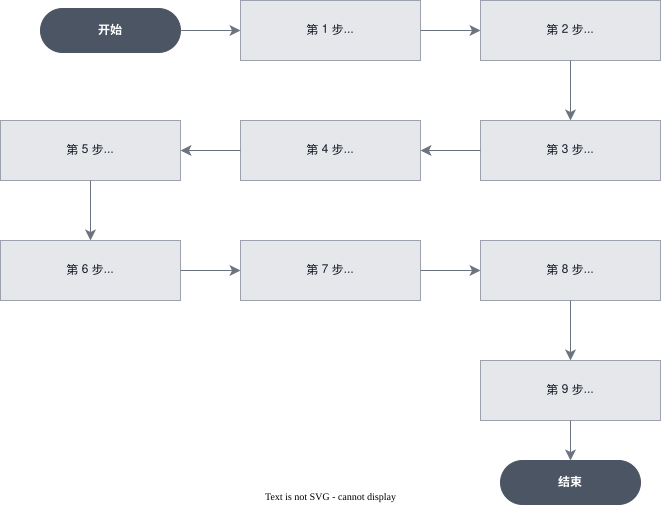

# [进阶] 使用 arkcli 构建集成 Vault 与 Memory 的投研 Agent

> 全部文档的索引见 [llms.txt](https://ark.volcengine.com/llms.txt)；在任一文档页面地址后追加 `.md` 可获取该页的 Markdown 版本。

本教程演示如何使用官方命令行工具 **arkcli** 构建一个具备 **MCP 直连取数、Vault 密钥托管、Memory 长期记忆** 三项能力的投研 Agent。教程以 Wind 行情 MCP 为例，完整走一遍从「安装登录 → 创建资源 → 下发任务 → 观测执行 → 取回报告 → 清理资源」的闭环。

<span id="scenario"></span>
# 场景说明

投研场景有一个典型诉求：分析师希望 AI 助手「懂行情、懂我」。「懂行情」意味着行情、财务等结构化数据必须使用专业数据源；「懂我」意味着助手要记住用户的关注板块、输出格式等长期偏好，不必每次对话重复交代。

这两个诉求恰好对应 Managed Agents 的两项进阶能力：

- Vault 让第三方数据服务的密钥托管在平台侧、按 MCP 服务地址自动注入鉴权，密钥全程不进沙箱。
- Memory Store 让用户偏好以文件形式挂载到每个会话，Agent 在执行前先读取并遵循。

| 环节 | 内容 |
|-|-|
| 输入 | 一句自然语言任务，例如「查询贵州茅台最新行情，按我的偏好写一份简评」 |
| 过程 | Agent 读取挂载的记忆文件，调用 Wind MCP 工具取行情（鉴权由 Vault 注入），按偏好撰写报告 |
| 输出 | `report.md`，结论先行、关键数据用表格、风险提示单独成段（这些约定全部来自记忆文件）|
| 观测 | `arkcli +tail` 或 `events list` 查看 Agent 消息、工具调用与状态变化 |

<span id="what-you-will-do"></span>
# 你将完成什么

- 安装并登录 arkcli，理解控制面与数据面的认证边界。
- 创建 Environment。
- 创建 Vault 并托管 Wind 密钥（`static_bearer` 凭据）。
- 创建 Memory Store 并写入一条用户偏好。
- 创建挂载 Wind MCP 的投研 Agent。
- 创建 Session 并一次性挂上 Vault 与 Memory。
- 下发任务、通过事件流观测执行、取回报告文件。
- 按精确 ID 清理本次创建的全部资源。

<span id="core-concepts"></span>
# 核心概念

| 对象 | 说明 |
|-|-|
| Agent | 可版本化、可复用的配置模板，封装模型、System Prompt、工具集与 MCP 连接 |
| Environment | Agent 运行所在的云沙箱定义，决定网络策略与预装依赖，一次创建多次复用 |
| Session | 一次具体的运行实例，把 Agent、Environment、Vault 和 Memory 等资源绑在一起 |
| Event | Session 内的追加式事件流：用 `user.message` 下发任务，实时收到消息、工具调用与状态变化 |
| Vault | 平台侧密钥保管库。`static_bearer` 凭据按 MCP 服务 URL 匹配注入 Bearer 鉴权，密钥不进沙箱 |
| Memory Store | 跨会话长期记忆库。Agent 可以根据挂载权限读取或修改其中的内容 |

<span id="flowchart"></span>
# 工作流程



<span id="prerequisites"></span>
# 前置条件

- 已开通方舟 Managed Agents 与目标模型服务。
- 已创建方舟 API Key，详情请参见 [API Key 管理](https://ark.volcengine.com/docs/manage-api-keys)。
- 已获取 Wind API Key（[aifinmarket.wind.com.cn](https://aifinmarket.wind.com.cn)，按积分计费）。
- 本地已安装 Node.js（用于 npm 安装 arkcli）。

<span id="install-cli"></span>
# 第 1 步：安装并登录 arkcli

```Bash
npm i @volcengine/ark-cli -g --registry https://registry.npmjs.org
arkcli --version
arkcli auth login volc-sso    # 浏览器完成火山账号授权
arkcli auth status --format json
```

> **注意**
>
> arkcli 创建和管理 Agent、Environment、Session、Vault、Memory Store 前，必须先完成火山账号 SSO 登录；`events`、`files`、`+tail` 等运行时命令使用方舟 API Key。使用 `curl` 调用本文涉及的 REST API 时，使用方舟 API Key 鉴权。

> **注意**
>
> 如果账号装过 Agent Plan 套餐，其 profile 的 `base_url` 是 `/api/plan/v3`，数据面命令会返回 404。使用 `arkcli profile list` 查看，并在命令前加 `--profile <按量 profile 名>` 切到控制台按量 profile。

<span id="create-env"></span>
# 第 2 步：创建 Environment

Environment 定义 Agent 的云沙箱：网络策略、预装依赖等。创建一次可长期复用，本示例无需额外 pip 依赖：

```Bash
arkcli agent env create \
  --name "cookbook-invest-env" \
  --config '{Type: cloud, Networking: {Type: unrestricted}}' \
  --format json --transform "Result.Id"
# 输出示例：env-20260716132305-xxxxx
```

> **注意**
>
> 线上创建 `cloud` 类型环境必须显式携带 `Networking` 配置。仅传 `{Type: cloud}` 会被后端校验拒绝，报错 `config.networking` 缺失。

将返回的 ID 记录为 `ENVIRONMENT_ID`。

> **说明**
>
> 本示例创建的 Environment 未配置产物存储，因此报告使用方舟公共 TOS。需要将报告长期保存在自己的 TOS Bucket 时，通过控制台或 Environment API 配置 `config.tos`，详情请参见 [配置产物存储](../configure-cloud-environment.md#configure-output-storage)。

<span id="create-vault"></span>
# 第 3 步：创建 Vault 并写入 Wind 凭据

Wind 提供多个 MCP 数据服务，地址形如 `https://mcp.wind.com.cn/vserver_<name>/mcp/`，以 Bearer Key 鉴权。传统做法是把 Key 写进环境变量带入沙箱，泄漏面较大。Managed Agents 的做法是：把 Key 存成 Vault 里的 `static_bearer` 凭据，Session 挂载该 Vault 后，平台在连接对应 MCP URL 时自动注入 Bearer 鉴权。密钥全程不进沙箱、不进提示词、不进事件流。

创建 Vault：

```Bash
arkcli agent vault create --display-name "cookbook-wind-vault" \
  --format json --transform "Result.Id"
# 输出示例：vlt-20260716132312-xxxxx
```

写入 `static_bearer` 凭据（以股票行情服务为例）。以下命令通过无回显输入读取 Wind API Key，再使用 `@file` 将密钥交给 ArkCLI：

```bash
old_umask=$(umask)
umask 077
WIND_KEY_FILE=$(mktemp)
umask "$old_umask"
trap 'rm -f "$WIND_KEY_FILE"' EXIT

IFS= read -r -s -p "Wind API Key: " WIND_API_KEY
printf '\n'
printf '%s' "$WIND_API_KEY" >"$WIND_KEY_FILE"
unset WIND_API_KEY

CREDENTIAL_ID=$(arkcli agent vault credentials create "$VAULT_ID" \
  --display-name "wind_stock_data" \
  --auth-type static_bearer \
  --mcp-server-url "https://mcp.wind.com.cn/vserver_stock_data/mcp/" \
  --token "@$WIND_KEY_FILE" \
  --format json \
  --transform "Result.Id")
export CREDENTIAL_ID

rm -f "$WIND_KEY_FILE"
trap - EXIT
printf 'Credential ID: %s\n' "$CREDENTIAL_ID"
```

API Key 不会出现在命令行参数、Shell 历史或 ArkCLI 结构化输出中。脚本只在请求期间保留权限为 `600` 的临时文件，并在结束时删除。

> **说明**
>
> 创建凭据时平台会立即对目标 MCP 服务做握手探测。创建成功（返回 `vcrd-` 开头的凭据 ID）即代表 Key 有效，等于免费得到一次同步校验。

> **说明**
>
> 生产使用建议给每个需要的 Wind MCP 服务各建一条凭据（每条对应一个 `mcp_server_url`），Agent 即可全域取数。本教程为保持最小可跑通，只挂股票行情服务 `vserver_stock_data`。

<span id="create-memory"></span>
# 第 4 步：创建 Memory Store 并写入用户偏好

```Bash
arkcli agent memory-store create \
  --name "cookbook-user-memory" \
  --description "投研偏好与输出约定" \
  --format json --transform "Result.Id"
# 输出示例：memstore-20260716132317-xxxxx

arkcli agent memory-store memories create $STORE_ID \
  --path "/投研偏好.md" \
  --content "# 用户投研偏好
- 长期关注：白酒、半导体行业
- 输出格式：结论先行，正文不超过 300 字，关键数据用表格
- 风险提示必须单独成段" \
  --format json
```

> **注意**
>
> Memory Store 的内容不会自动注入模型上下文。请在 System Prompt 中明确要求 Agent 在开始任务前读取已挂载的投研偏好。

<span id="create-agent"></span>
# 第 5 步：创建投研 Agent 并挂载 Wind MCP

挂 MCP 需要两处配置成对出现：`McpServers` 声明连接（名称 + URL），`Tools` 里的 `mcp_toolset` 按名称放行该服务的工具。System Prompt 写清三条规则：优先用 MCP 取数、先读记忆、标注数据来源。

将请求体写入 `cookbook-agent.json`：

```json
{
  "Name": "cookbook投研分析师",
  "Description": "Wind MCP + Memory 演示用投研 Agent",
  "Model": {"Id": "doubao-seed-2-1-pro-260628", "Speed": "standard"},
  "System": "你是一名 A 股投研分析师。规则：1) 行情、财务等结构化数据必须优先调用 wind_stock_data MCP 工具获取，单次调用单标的，日期格式 yyyyMMdd；2) 开始任务前使用 Memory 工具浏览已挂载的记忆库，读取其中的投研偏好文件，并严格遵循偏好与输出约定；3) 引用 Wind 数据时标注来源。",
  "McpServers": [
    {
      "Type": "url",
      "Name": "wind_stock_data",
      "Url": "https://mcp.wind.com.cn/vserver_stock_data/mcp/"
    }
  ],
  "Tools": [
    {
      "Type": "agent_toolset_20260916",
      "Name": "agent_toolset_20260916",
      "DefaultConfig": {"Enabled": true, "PermissionPolicy": {"Type": "always_allow"}}
    },
    {
      "Type": "mcp_toolset",
      "McpServerName": "wind_stock_data",
      "DefaultConfig": {"PermissionPolicy": {"Type": "always_allow"}}
    }
  ]
}
```

提交请求：

```Bash
arkcli agent agent create --file cookbook-agent.json \
  --format json --transform "Result.Id"
# 输出示例：agent-20260716132811-xxxxx
```

> **注意**
>
> 复杂配置建议整体走 `--file` 传 JSON 请求体，字段使用 arkcli 接受的 PascalCase。`--tool @文件名` 这种单参数文件引用语法不可用，会报 YAML 解析错误。

> **注意**
>
> `McpServers[].Name` 必须与 `mcp_toolset.McpServerName` 逐字一致；Vault 凭据则按 `mcp_server_url` 与这里的 `Url` 匹配注入。三处对齐，鉴权才能生效。

> **注意**
>
> `agent_toolset_20260916` 是内置工具集（`bash` / `read` / `write` / `edit` / `glob` / `grep` / `web_fetch` / `web_search`）。`Tools` 字段是全量替换语义：只要显式传了 `Tools`，就必须把内置工具集和 `mcp_toolset` 放在同一个数组里，否则 Agent 会失去内置工具。

将返回的 ID 记录为 `AGENT_ID`。

<span id="create-session"></span>
# 第 6 步：创建 Session 并一次挂上 Vault 与 Memory

```Bash
arkcli agent session create \
  --agent-id $AGENT_ID \
  --environment-id $ENVIRONMENT_ID \
  --vault-ids $VAULT_ID \
  --resource '[{"Type": "memory_store", "MemoryStoreId": "'"$STORE_ID"'", "Access": "read_only"}]' \
  --title "cookbook-invest-session" \
  --format json
# 输出示例：sesn-20260716132851-xxxxx
```

> **注意**
>
> `--resource` 里的字段名必须使用 PascalCase（`MemoryStoreId`）。写成 snake_case（`memory_store_id`）字段会被静默丢弃，报错 `resources[0].memory_store_id is required`——报错信息用的是 snake_case，容易造成混淆。

将返回的 ID 记录为 `SESSION_ID`。

<span id="dispatch-task"></span>
# 第 7 步：下发投研任务并持续接收事件

Session 创建后处于就绪状态，不会自动执行任务。使用 `--stream` 发送 `user.message`，让 ArkCLI 在同一条命令中持续接收事件，并通过事件位置补偿发送与建连之间的事件：

```Bash
arkcli agent session events send $SESSION_ID \
  --type user.message \
  --text "查询贵州茅台（600519.SH）最新行情数据，并按我的偏好写一份简评，保存为 /mnt/session/outputs/report.md" \
  --stream \
  --no-event-deltas \
  --format json
```

不要先执行不带等待参数的 `events send`，再单独启动 `+tail`。两个命令之间存在监听空窗，容易让终端漏掉任务开始阶段的事件。

<span id="observe-events"></span>
# 第 8 步：回查执行过程

<span id="tail"></span>
## 方式一：继续观察已有 Session

```Bash
arkcli +tail $SESSION_ID
```

第 7 步的 `--stream` 已覆盖本轮实时观测。只有需要在另一个终端继续观察已有 Session 时，才使用 `+tail`。

<span id="events-list"></span>
## 方式二：结构化拉取历史事件

```Bash
arkcli agent session events list $SESSION_ID --limit 100 --format json
```

主要事件类型：

| 事件类型 | 含义 |
|-|-|
| `agent.thinking` | Agent 思考中（信号级事件） |
| `agent.tool_use` / `agent.tool_result` | 内置工具调用与结果（`bash`、`read`、`write` 等） |
| `agent.mcp_tool_use` / `agent.mcp_tool_result` | MCP 工具调用与结果，观察 Wind 取数就看它 |
| `agent.message` | Agent 返回的文本消息 |
| `span.model_request_start` / `span.model_request_end` | 一次模型请求的起止，`end` 携带 token 用量 |
| `session.status_idle` | 本轮任务结束 |

一次成功任务的典型事件轨迹：

```Text
user.message        查询贵州茅台最新行情，按我的偏好写一份简评
agent.tool_use      读取已挂载的投研偏好
agent.tool_result   返回已保存的偏好内容
agent.mcp_tool_use  wind_stock_data/get_stock_price_indicators               -- Wind 取数（Vault 注入鉴权）
agent.mcp_tool_use  wind_stock_data/get_stock_price_indicators
agent.tool_use      write: /mnt/session/outputs/report.md                    -- 按偏好写入报告
agent.message       已按你的投研偏好完成，保存至 /mnt/session/outputs/report.md
session.status_idle
```

> **说明**
>
> 若 `--stream`、`+tail` 或 `events stream` 出现 awaiting headers 超时，不影响任务在云端执行，改用 `events list` 轮询同一个 Session，避免重复发送原任务。

<span id="fetch-report"></span>
# 第 9 步：取回分析报告

Agent 写入沙箱的产物会自动登记到 Files API，按 Session 维度可查：

```Bash
arkcli agent file list \
  --session-id $SESSION_ID \
  --purpose agent \
  --format json
# 返回示例：{"filename": "report.md", "id": "file-20260716213008-xxxxx", "bytes": 1341, "status": "active"}
```

> **注意**
>
> `file list` 默认按 `--purpose user_data` 过滤，而 Agent 生成的产物 `purpose` 是 `agent`。不带 `--purpose agent` 参数会得到空列表，误以为没有产物。

文件可以在方舟控制台对应 Session 页下载。本示例使用方舟公共 TOS，你需要在平台 TTL 到期前下载报告。需要长期保留报告时，为 Environment 配置自己的 TOS Bucket，并在 TOS 中管理对象生命周期。

<span id="cleanup"></span>
# 第 10 步：清理资源

确认报告已转存后，按依赖顺序清理本次创建的资源。Agent 与 Environment 通常留作复用，本教程为演示做完整清理：

```Bash
arkcli agent session delete $SESSION_ID --yes
arkcli agent vault credentials delete $VAULT_ID $CREDENTIAL_ID --yes
arkcli agent vault delete $VAULT_ID --yes
arkcli agent memory-store delete $STORE_ID --yes
arkcli agent agent delete $AGENT_ID --yes
arkcli agent env delete $ENVIRONMENT_ID --yes
```

> **警告**
>
> 只删除本次创建、且记录了精确 ID 的资源。切勿按名称模糊匹配批量删除——企业账号下的资源可能被多人或多系统共享，误删不可恢复。删除类命令在非交互环境（脚本或 CI）中不带 `--yes` 时会返回 `requires_confirmation` 而不执行，这是有意的安全设计。

<span id="execution-summary"></span>
# 完整执行顺序

1. 安装 arkcli 并完成 `arkcli auth login volc-sso`（控制面需 SSO，数据面用 API Key）。
2. 创建 Environment（显式带 `Networking`）。
3. 创建 Vault，写入 Wind 的 `static_bearer` 凭据（创建即校验 Key）。
4. 创建 Memory Store，写入用户偏好文件。
5. 用 `--file` 传 PascalCase 请求体创建 Agent（内置工具集 + `mcp_toolset` 同数组）。
6. 创建 Session：`--vault-ids` 挂 Vault，`--resource`（PascalCase）以 `read_only` 权限挂载 Memory。
7. 使用 `events send --stream` 下发 `user.message`，持续观测到 `session.status_idle`。
8. 需要恢复观测时，使用 `+tail` 或 `events list` 回查同一个 Session。
9. `file list --session-id ... --purpose agent` 取回产物并转存。
10. 按精确 ID 清理临时资源。

<span id="next-steps"></span>
# 进阶方向

- 全域数据：给需要的 MCP 服务各建一条 Vault 凭据并全部挂到 Agent，覆盖更多数据面。
- 领域技能：把 MCP 路由规则、参数契约、指标词典打包成自定义 Skill（`arkcli agent skill create --zip`）挂给 Agent，取数精准度更高。
- 多智能体：通过 `Multiagent` 配置把个股研究员、行业分析师、宏观经济学家组成 coordinator 协作团队，详情请参见 [用多智能体团队生成定制销售提案](build-multi-agent-proposal-team.md)。
- 工程化：应用后端可以按需改用对应 REST API，配合调度器与推送渠道构建完整投研平台。

> **注意**
>
> 方舟按 token、沙箱时长与工具调用计费，第三方 MCP 服务按其自身计费策略结算。单次复杂投研任务可消耗数十万 input tokens，请留意用量。所有产出仅供参考，不构成投资建议。
