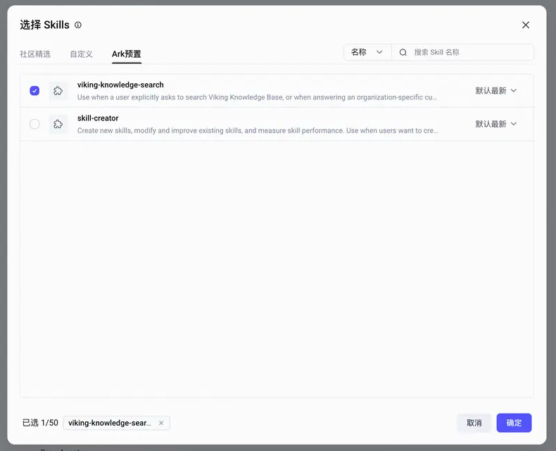
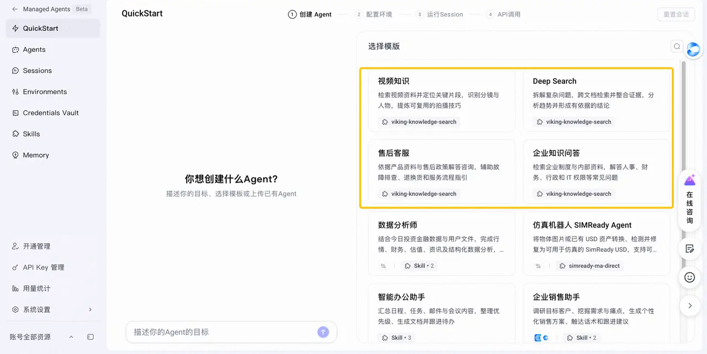
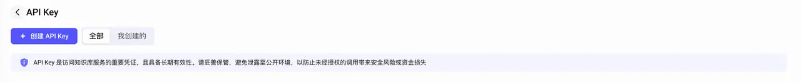
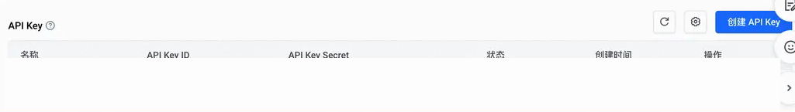
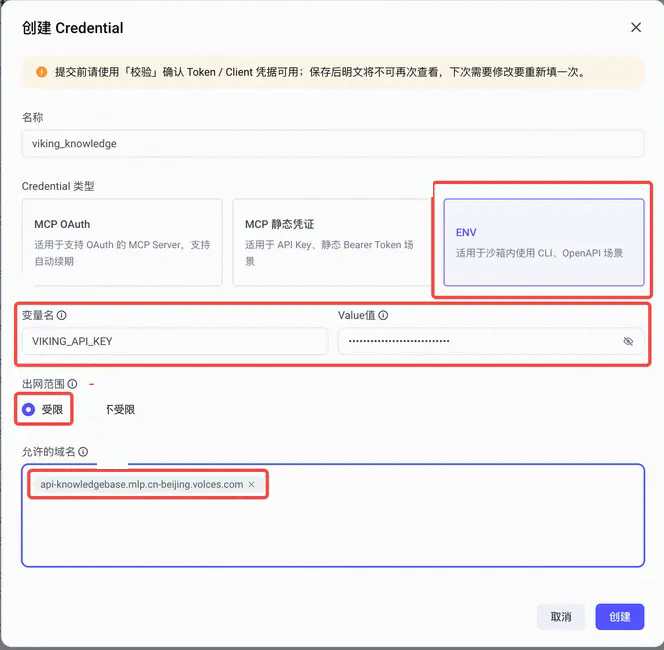
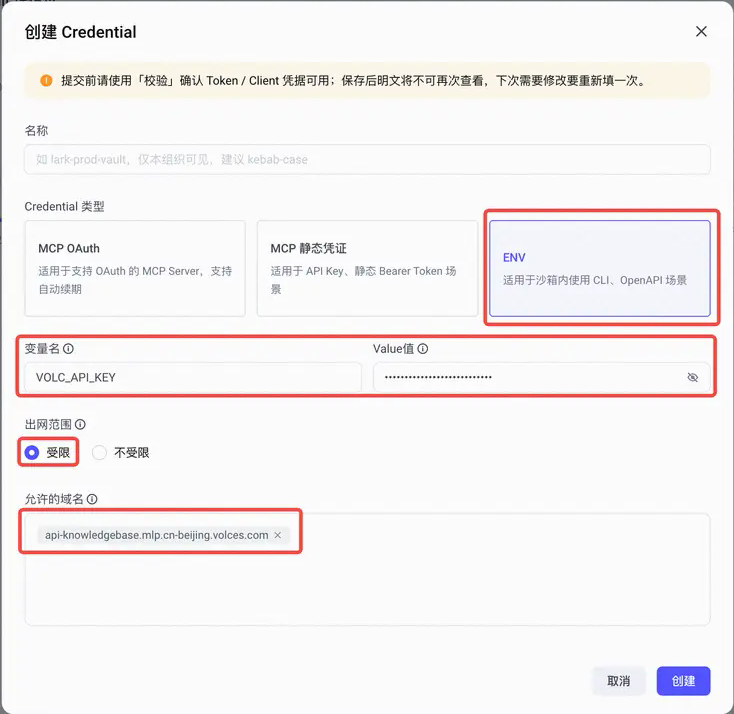
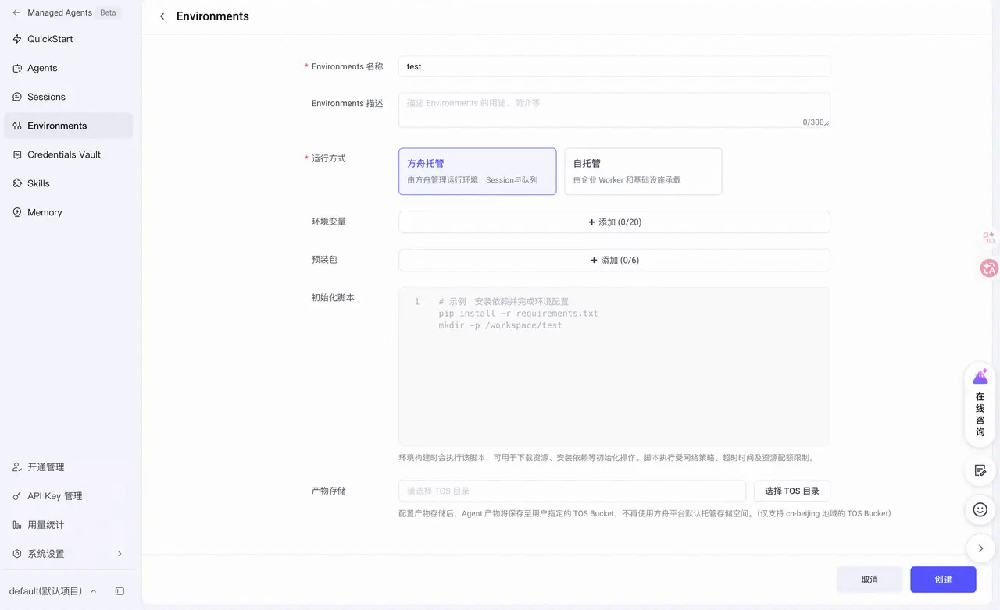

# [基础] 使用 Viking 知识库检索构建知识问答 Agent

> 全部文档的索引见 [llms.txt](https://ark.volcengine.com/llms.txt)；在任一文档页面地址后追加 `.md` 可获取该页的 Markdown 版本。

企业知识问答往往需要同时检索制度文档、产品资料、售后政策和视频教程等多种业务资料。你可以为 Agent 接入 Viking 知识库检索 Skill，让 Agent 基于这些资料回答问题，而不是只依赖模型自身知识。

本教程演示如何完成从「选择创建入口 → 配置知识库鉴权 → 创建 Session → 验证检索结果」的完整流程。

## 完成目标

完成本教程后，你将获得一个能够在 Session 中检索 Viking 知识库并回答业务问题的 Agent。

## 核心概念

- `viking-knowledge-search` Skill：让 Agent 检索 Viking 知识库中的内容。需要基于企业资料、产品文档或视频内容回答问题时使用。
- Viking API Key：可以绑定指定知识库或知识服务。需要按知识库范围控制访问权限时使用。
- 火山 API Key：用于以 IAM 子账号身份访问 Viking 知识库。选择这种鉴权方式时，需要在该子账号下创建 API Key，并在 Credential 中将其配置为 `VOLC_API_KEY`。
- Credential：在 Credentials Vault 中保存 API Key，并限制密钥可以发送到哪些域名。
- Environment：承载 Agent 运行所需的环境配置。创建 Session 时需要选择对应的 Environment。
- Session：绑定 Agent、Credential 和 Environment，承载一次实际对话。

## 前提条件

开始前，完成以下准备：

- 已开通火山方舟 Managed Agents。
- 已开通 [Viking 知识库](https://console.volcengine.com/vikingdb/knowledge/region:vdb-knowledge+cn-beijing/center/collection/list?projectName=default)。
- 已在 Viking 知识库中准备可检索的业务资料。
- 已准备具备 Viking 知识库访问权限的账号。
- 已确认 Viking 知识库与 Managed Agents 使用同一项目空间。

> **注意：保持项目一致**
>
> Viking 知识库与 Managed Agents 必须使用同一项目空间。开始配置前，分别检查两个产品页面当前选择的项目；如果项目不一致，Managed Agents 中无法找到目标知识库。

> **注意**
>
> Viking API Key 和火山 API Key 选择一种配置。创建 Credential 时，变量名必须与所选鉴权方式匹配。

## 步骤 1 · 创建 Agent

先创建负责执行知识库检索的 Agent，并为它启用 `viking-knowledge-search` Skill。你可以从 Agents 页面自行配置 Agent，也可以基于 QuickStart 模板快速创建。

**选项：从 Agents 创建**

1. 打开 [Agents 创建页](https://ark.volcengine.com/region:cn-beijing/managed-agents/agents/create)。
2. 在 **Skills** 中选择 **Ark 预置**。
3. 搜索并选择 `viking-knowledge-search`。
4. 完成其他 Agent 配置后，创建 Agent。

**验证**：Agent 的 Skills 列表中显示 `viking-knowledge-search`。

**选项：从 QuickStart 创建**

1. 打开 [Managed Agents QuickStart](https://ark.volcengine.com/region:cn-beijing/managed-agents/quickstart)。
2. 选择以下任一模板：
   - 视频知识：检索视频资料并定位关键片段。
   - Deep Search：跨文档检索行业报告、产品报告和技术报告。
   - 售后客服：依据产品资料与售后政策回答问题。
   - 企业知识问答：依据企业制度与内部资料回答问题。
3. 需要调整 Agent 配置时，直接在对话中描述修改要求。

**验证**：模板的 Agent 配置中包含 `viking-knowledge-search` Skill。

> **说明**
>
> 只需要体验预置知识库效果时，可以打开 [方舟体验中心](https://ark.volcengine.com/region:cn-beijing/experience)，在 Managed Agents 下选择视频知识、Deep Search、售后客服或企业知识问答。

## 步骤 2 · 创建 API Key

为 Viking 知识库准备调用凭据，供 Agent 发起经过鉴权的检索请求。根据已有权限管理方式，选择一种知识库鉴权方式。

**选项：Viking API Key**

1. 打开 [Viking 知识库 API Key 页面](https://console.volcengine.com/vikingdb/knowledge/region:vdb-knowledge+cn-beijing/apiKey)。
2. 创建 API Key。
3. 选择 Agent 需要访问的知识库或知识服务。
4. 完成创建并记录 API Key。

**验证**：API Key 已绑定 Agent 需要检索的知识库。

**选项：火山 API Key**

选择以 IAM 子账号身份访问 Viking 知识库时，需要在该子账号下创建火山 API Key，并在后续 Credential 中使用。

1. 打开 [火山引擎访问控制用户管理](https://console.volcengine.com/iam/identitymanage/user)。
2. 选择用于访问 Viking 知识库的子账号。
3. 在用户详情的 **密钥** 页签中创建 API Key。
4. 记录创建后的 API Key。

**验证**：子账号的 **API Key** 列表中显示新建的 API Key。

## 步骤 3 · 创建 Credential

把步骤 2 创建的 API Key 保存到 Credentials Vault，并限制密钥可以发送到的域名。

1. 打开 [Credentials Vault](https://ark.volcengine.com/region:cn-beijing/managed-agents/credentials-vault?projectName=default)。
2. 创建 Vault，并在 Vault 中添加 Credential。
3. 将 **Credential 类型** 设为 **ENV**。
4. 根据步骤 2 选择的鉴权方式，只填写一组变量名和值：
   - 选择 Viking API Key 时，变量名填写 `VIKING_API_KEY`，**Value** 填写对应的 Viking API Key。
   - 选择火山 API Key 时，变量名填写 `VOLC_API_KEY`，**Value** 填写对应的火山 API Key。
5. 将 **出网范围** 设为 **受限**。
6. 在 **允许的域名** 中填写 `api-knowledgebase.mlp.cn-beijing.volces.com`，然后创建 Credential。

**选项：Viking API Key**

**选项：火山 API Key**

**验证**：Vault 的 Credential 列表中显示新建的 ENV Credential。

> **注意**
>
> 保存 Credential 后，页面不再显示完整密钥。提交前确认变量名、Value 和允许域名填写正确。

## 步骤 4 · 创建 Environment

创建 Agent 运行所需的 Environment，供后续 Session 选择。

打开 Managed Agents 的 **Environments** 页面，输入名称，选择运行方式，并按业务需要完成配置后创建 Environment。

**验证**：Environment 列表中显示新建的 Environment。

## 步骤 5 · 创建 Session

将 Agent、Credential 和 Environment 绑定到同一个 Session，开始验证知识库检索。

1. 打开 [Sessions](https://ark.volcengine.com/region:cn-beijing/managed-agents/sessions?projectName=default)，创建 Session。
2. 依次选择步骤 1 创建的 Agent、步骤 3 创建的 Credential 和步骤 4 创建的 Environment，然后创建 Session 并进入调试页面。

**验证**：Session 创建成功，并显示已绑定的 Agent、Credential 和 Environment。

## 验证结果

向 Session 发送一个只能从目标知识库中回答的问题。例如，知识库中保存了售后政策时，询问某个产品的退换条件。

检查以下结果：

- Agent 返回的内容与目标知识库中的资料一致。
- Agent 没有混入其他知识库的内容。
- Session 没有显示知识库鉴权失败。

检索结果不符合预期时，依次检查 API Key 绑定的知识库、Credential 变量名、Value 和允许域名。

## 常见问题

| 现象 | 处理方法 |
| --- | --- |
| Agents 中找不到 Skill | 在 **Skills** 中选择 **Ark 预置**，并搜索完整名称 `viking-knowledge-search`。 |
| 配置时找不到目标知识库 | 分别将 Viking 知识库与 Managed Agents 切换到同一项目空间，然后重新配置。 |
| 知识库鉴权失败 | 确认 Viking API Key 使用 `VIKING_API_KEY`，火山 API Key 使用 `VOLC_API_KEY`。 |
| 检索不到目标资料 | 确认 API Key 已绑定目标知识库，并确认知识库中已有可检索内容。 |
| Session 创建后无法检索 | 确认 Session 选择了包含 `viking-knowledge-search` 的 Agent 和正确的 Credential。 |

## 进阶方向

- 需要调整 Agent 的能力组合时，详情请参见[Skills](../skills.md)。
- 需要管理更多凭证或认证方式时，详情请参见[使用 Vaults 认证](../use-vaults-authentication.md)。
- 需要配置 Agent 的运行环境时，详情请参见[配置云环境](../configure-cloud-environment.md)。
- 需要通过 Session 持续处理任务时，详情请参见[启动 Session](../start-session.md)。
