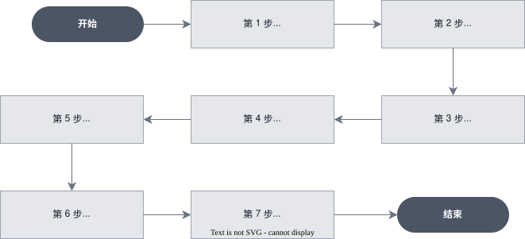

# [进阶] 用多智能体团队生成定制销售提案

> 全部文档的索引见 [llms.txt](https://ark.volcengine.com/llms.txt)；在任一文档页面地址后追加 `.md` 可获取该页的 Markdown 版本。

本教程演示如何使用方舟 Managed Agents 的多智能体协作能力，编排一个协调器 Agent 与三个专家 Agent，端到端完成一份定制销售提案：调研目标客户所在行业的优先事项、挑选最相关的案例、依据内部规则生成定价方案，最终由协调器整合为可交付的 Markdown 提案。

<span id="scenario"></span>
# 场景说明

销售员工每接触一个新客户，都需要手动调研行业痛点、从案例库挑选相关成功案例、依据内部规则制定价格，再整合为一份定制提案。这些步骤各自需要不同的信息源和工具集，也存在依赖关系。

本教程用一个协调器 Agent 编排三个专家 Agent 完成这一流程：

- 行业调研员（`prospect_researcher`）：联网调研客户行业的优先事项与动态。
- 资料管理员（`case_study_picker`）：从案例库中挑选 2 个最相关的成功案例。
- 方案定价员（`pricing_modeler`）：基于内部规则表生成 2 至 3 个定价方案。

三个专家各自使用显式工具白名单：研究员只启用网页工具，资料管理员和定价员只启用文件读取工具。协调器读取产品说明后，把它们的产出组装成 `proposal.md`。

<span id="core-concepts"></span>
# 核心概念

| 对象 | 说明 |
|-|-|
| Sub-agent | 专家 Agent，只干一件事、只有必要工具。三个专家彼此不感知对方存在，全部由 Coordinator 调度 |
| Coordinator | 协调器 Agent，负责编排 sub-agent 的调用顺序、传递上下文、组装最终产物；通过 `multiagent.type: coordinator` 声明 |
| `send_to_parent` | Sub-agent 将结构化结果回传给 Coordinator 的内置能力 |
| Session Resources | Session 挂载的文件资源，映射到沙箱 `/mnt/session/uploads/` 目录，供 Agent 在执行过程中访问 |

<span id="flowchart"></span>
# 工作流程



<span id="prerequisites"></span>
# 前置条件

- 已开通方舟 Managed Agents 和目标模型服务。
- 已创建 API Key，详情请参见 [API Key 管理](https://ark.volcengine.com/docs/manage-api-keys)。
- 本地已安装 `curl` 7.76.0 或更高版本，以及 `jq`。
- 准备好资源文件：产品一页说明、定价规则、5 至 10 个成功案例（Markdown 格式）。

将 API Key 与 Base URL 配置为环境变量：

```Bash
export ARK_API_KEY="你的 API Key"  # gitleaks:allow
export ARK_BASE_URL="https://ark.cn-beijing.volces.com/api/v3"
```

<span id="scoped-tools"></span>
# 第 1 步：设计 Sub-agent 的工具作用域

多智能体拆分的核心价值之一是权限隔离：每个 sub-agent 只保留完成其任务必需的工具。使用 `agent_toolset_20260916` 时，可以在 `configs` 数组里对单个工具设 `enabled: false` 关闭。

| Sub-agent | 工具作用域 | 收敛理由 |
|-|-|-|
| `prospect_researcher` | 仅启用 `web_search`、`web_fetch` | 执行联网调研，不提供文件与命令工具 |
| `case_study_picker` | 仅启用 `read`、`glob`、`grep` | 读取 Session 已挂载的资料，不提供联网、命令或写入工具 |
| `pricing_modeler` | 仅启用 `read`、`glob`、`grep` | 读取 Session 已挂载的定价资料，不提供联网、命令或写入工具 |

> **注意**
>
> 工具白名单限制的是 Agent 可调用的工具，不提供目录级访问控制。资料管理员和定价员仍可读取当前 Session 挂载的其他文件。不要在同一个 Session 中挂载这两个角色不应看到的敏感文件。

<span id="create-specialists"></span>
# 第 2 步：创建三个专家 Agent

<span id="researcher"></span>
## 行业调研员

```Bash
curl -X POST "$ARK_BASE_URL/agents" \
  -H "Authorization: Bearer $ARK_API_KEY" \
  -H "Content-Type: application/json" \
  -d @- <<'EOF'
{
  "name": "prospect_researcher",
  "model": {"id": "doubao-seed-2-1-pro-260628"},
  "system": "你是一位企业调研分析师。给定行业细分和企业规模，用 web_search / web_fetch 调研该细分市场的近期优先事项、痛点和动态。完成后通过 send_to_parent 返回结构化结果：{priorities, recent_moves, pain_points, sources}。",
  "tools": [
    {
      "type": "agent_toolset_20260916",
      "default_config": {
        "enabled": false,
        "permission_policy": {"type": "always_allow"}
      },
      "configs": [
        {"name": "web_search", "enabled": true},
        {"name": "web_fetch",  "enabled": true}
      ]
    }
  ]
}
EOF
```

<span id="picker"></span>
## 资料管理员

```Bash
curl -X POST "$ARK_BASE_URL/agents" \
  -H "Authorization: Bearer $ARK_API_KEY" \
  -H "Content-Type: application/json" \
  -d @- <<'EOF'
{
  "name": "case_study_picker",
  "model": {"id": "doubao-seed-2-1-pro-260628"},
  "system": "你是一位案例库管理员。给定行业和企业优先事项，从 /mnt/session/uploads/case_studies/ 中挑选 2 个最相关的案例，通过 send_to_parent 返回：{picks: [{file, customer, why_relevant}, ...]}。禁止访问其他目录。",
  "tools": [
    {
      "type": "agent_toolset_20260916",
      "default_config": {
        "enabled": false,
        "permission_policy": {"type": "always_allow"}
      },
      "configs": [
        {"name": "read", "enabled": true},
        {"name": "glob", "enabled": true},
        {"name": "grep", "enabled": true}
      ]
    }
  ]
}
EOF
```

<span id="pricing"></span>
## 方案定价员

```Bash
curl -X POST "$ARK_BASE_URL/agents" \
  -H "Authorization: Bearer $ARK_API_KEY" \
  -H "Content-Type: application/json" \
  -d @- <<'EOF'
{
  "name": "pricing_modeler",
  "model": {"id": "doubao-seed-2-1-pro-260628"},
  "system": "你是一位定价建模师。基于 /mnt/session/uploads/pricing_rules.md 提供的规则，为给定席位数与用量层级生成 2 至 3 个定价选项：conservative（年付低单价）、flexible（月付高单价）；若席位 > 500 增加 enterprise（含平台费）。通过 send_to_parent 返回：{options: [{name, structure, year_one_total}, ...]}。",
  "tools": [
    {
      "type": "agent_toolset_20260916",
      "default_config": {
        "enabled": false,
        "permission_policy": {"type": "always_allow"}
      },
      "configs": [
        {"name": "read", "enabled": true},
        {"name": "glob", "enabled": true},
        {"name": "grep", "enabled": true}
      ]
    }
  ]
}
EOF
```

三个专家均返回类似结构：

```json
{
  "id": "agent-20260708162137-mzhwx",
  "type": "agent",
  "name": "prospect_researcher",
  "version": 1
}
```

将返回的 `id` 分别记录为 `RESEARCHER_ID`、`PICKER_ID`、`PRICING_ID`。

<span id="contract"></span>
## `send_to_parent` 的契约设计

每个 sub-agent 必须在 System Prompt 里明确告诉它「完成后通过 `send_to_parent` 返回如下 JSON 结构」。契约越清晰，Coordinator 的下游拼装越可靠。以调研员为例：

```
{
  "priorities": ["cost reduction", "clinician burnout"],
  "recent_moves": ["merged with X in 2025-Q3"],
  "pain_points": ["fragmented ops between clinics and hospitals"],
  "sources": ["https://..."]
}
```

<span id="upload-files"></span>
# 第 3 步：上传工作素材

三个专家需要访问静态资料（案例库、产品说明、定价规则）。先通过 Files API 上传：

```Bash
curl -X POST "$ARK_BASE_URL/files" \
  -H "Authorization: Bearer $ARK_API_KEY" \
  -F "file=@./product_one_pager.md" \
  -F "purpose=agent"
```

响应包含 `id`（`file-...`）与 `status`：

```json
{
  "object": "file",
  "id": "file-20260708200926-txv7h",
  "purpose": "agent",
  "filename": "product_one_pager.md",
  "bytes": 123,
  "mime_type": "text/plain; charset=utf-8",
  "status": "active",
  "created_at": 1783512566,
  "expire_at": 1784117366
}
```

建议一次上传的资料清单：

- `product_one_pager.md`：产品一页说明。
- `pricing_rules.md`：内部定价规则表。
- `case_studies/*.md`：5 至 10 个成功案例。

分别记录为 `FILE_PRODUCT_ID`、`FILE_PRICING_ID`、`FILE_CASE1_ID` 等。

<span id="create-coordinator"></span>
# 第 4 步：创建 Coordinator

Coordinator 负责编排三个专家的调用顺序、把上下文在专家之间传递、最后组装产物。关键在于 `multiagent.type: coordinator` 字段。

```Bash
curl -X POST "$ARK_BASE_URL/agents" \
  -H "Authorization: Bearer $ARK_API_KEY" \
  -H "Content-Type: application/json" \
  -d @- <<EOF
{
  "name": "proposal_coordinator",
  "model": {"id": "doubao-seed-2-1-pro-260628"},
  "system": "你是一位销售提案作者。收到目标客户信息后，按以下顺序调度专家：\n1. 把行业和企业规模发给 prospect_researcher。\n2. 同时把席位数和用量层级发给 pricing_modeler（可并行）。\n3. 收到研究员报告后，把行业、规模、优先事项发给 case_study_picker。\n4. 基于所有专家返回结果，将最终提案作为消息文本回复给用户，并最终将 Markdown 文件写入 /mnt/session/outputs/proposal.md。",
  "tools": [
    {
      "type": "agent_toolset_20260916",
      "default_config": {
        "enabled": false,
        "permission_policy": {"type": "always_allow"}
      },
      "configs": [
        {"name": "read", "enabled": true},
        {"name": "write", "enabled": true}
      ]
    }
  ],
  "multiagent": {
    "type": "coordinator",
    "agents": [
      {"type": "agent", "id": "$RESEARCHER_ID"},
      {"type": "agent", "id": "$PICKER_ID"},
      {"type": "agent", "id": "$PRICING_ID"},
      {"type": "self"}
    ]
  }
}
EOF
```

关键字段说明：

| 字段 | 说明 |
|-|-|
| `multiagent.type` | 固定为 `coordinator`，标识该 Agent 是协调器 |
| `multiagent.agents` | 协调器可调度的成员列表。填写 Agent ID 时使用指定 Agent；填写 `{"type": "self"}` 时，复用当前 Agent 的配置，无需再创建一个 Agent |
| `system` | 核心。用自然语言写清楚调度顺序，包括哪些步骤可以并行、哪些有依赖 |

将返回的 `id` 记录为 `COORDINATOR_ID`。

<span id="create-env-session"></span>
# 第 5 步：创建 Environment 与 Session

创建 Environment：

```Bash
curl -X POST "$ARK_BASE_URL/environments" \
  -H "Authorization: Bearer $ARK_API_KEY" \
  -H "Content-Type: application/json" \
  -d '{
    "name": "proposal-coordinator-env",
    "config": {
      "type": "cloud",
      "networking": {"type": "unrestricted"}
    }
  }'
```

将返回的 `id` 记录为 `ENVIRONMENT_ID`。

创建 Session 并挂载资源：

```Bash
curl -X POST "$ARK_BASE_URL/sessions" \
  -H "Authorization: Bearer $ARK_API_KEY" \
  -H "Content-Type: application/json" \
  -d @- <<EOF
{
  "agent": "$COORDINATOR_ID",
  "environment_id": "$ENVIRONMENT_ID",
  "title": "Custom proposal generation",
  "resources": [
    {
      "type": "file",
      "file_id": "$FILE_PRODUCT_ID",
      "mount_path": "product_one_pager.md"
    },
    {
      "type": "file",
      "file_id": "$FILE_PRICING_ID",
      "mount_path": "pricing_rules.md"
    },
    {
      "type": "file",
      "file_id": "$FILE_CASE1_ID",
      "mount_path": "case_studies/st_clair.md"
    }
  ]
}
EOF
```

`mount_path` 会被系统自动加上 `/mnt/session/uploads/` 前缀。例如传 `"product_one_pager.md"`，实际挂在 `/mnt/session/uploads/product_one_pager.md`。所有子 Agent 都可能读取当前 Session 挂载的文件，因此只挂载本次协作流程允许共享的资料。

> **注意**
>
> 单个 Session 最多挂载 100 个文件。云环境当前要求 `networking.type=unrestricted`，该配置不提供网络隔离；本教程通过工具白名单确保只有行业调研员具备网页访问工具。不要为其他角色增加 `bash`、`web_search` 或 `web_fetch`。

<span id="dynamic-resources"></span>
## 动态管理 Session 资源（可选）

Session 创建后，还可以通过 Session Resources API 动态添加或查询挂载的文件资源，适合在多轮对话中根据需要补充上下文：

```Bash
# 添加文件资源到已有 Session
curl -X POST "$ARK_BASE_URL/sessions/$SESSION_ID/resources" \
  -H "Authorization: Bearer $ARK_API_KEY" \
  -H "Content-Type: application/json" \
  -d '{
    "type": "file",
    "file_id": "'"$FILE_ID"'"
  }'

# 查询当前 Session 挂载的全部资源
curl "$ARK_BASE_URL/sessions/$SESSION_ID/resources" \
  -H "Authorization: Bearer $ARK_API_KEY"
```

<span id="dispatch-task"></span>
# 第 6 步：建立事件流并下发提案生成任务

先建立主线程 SSE 流并等待服务端返回 `: ready`，再向 Session 发送目标客户信息。协调器创建子线程后，以下函数会立即订阅对应的子线程 SSE；子线程流返回 `: ready` 后，函数会查询该线程的历史事件，补齐建连前已经产生的事件。主线程或子线程 SSE 断开时，函数会先建立替代流，再分页补查历史事件，并按事件 ID 去重。

```Bash
run_multi_agent_turn() (
  local session_id="$1"
  local user_text="$2"
  local stream_dir
  local main_pipe=""
  local main_error
  local main_pid=""
  local main_stream_number=0
  local main_stream_ready=false
  local seen_ids_file
  local thread_ids_file
  local child_pids_file
  local terminated_marker
  local events_payload
  local turn_done=false
  local result_code=1
  local main_message_count=0
  local reconnect_count=0
  local max_reconnects="${ARK_MAX_SSE_RECONNECTS:-3}"
  local max_history_pages="${ARK_MAX_HISTORY_PAGES:-100}"
  local thread_ready_timeout="${ARK_THREAD_READY_TIMEOUT:-30}"
  local line
  local data

  : "${ARK_BASE_URL:?Set ARK_BASE_URL before calling run_multi_agent_turn}"
  : "${ARK_API_KEY:?Set ARK_API_KEY before calling run_multi_agent_turn}"
  : "${session_id:?Pass a Session ID as the first argument}"
  : "${user_text:?Pass a user message as the second argument}"
  command -v curl >/dev/null || {
    printf 'curl is required.\n' >&2
    return 1
  }
  command -v jq >/dev/null || {
    printf 'jq is required.\n' >&2
    return 1
  }
  [[ $max_reconnects =~ ^[0-9]+$ ]] || {
    printf 'ARK_MAX_SSE_RECONNECTS must be a non-negative integer.\n' >&2
    return 1
  }
  [[ $max_history_pages =~ ^[1-9][0-9]*$ ]] || {
    printf 'ARK_MAX_HISTORY_PAGES must be a positive integer.\n' >&2
    return 1
  }
  [[ $thread_ready_timeout =~ ^[1-9][0-9]*$ ]] || {
    printf 'ARK_THREAD_READY_TIMEOUT must be a positive integer.\n' >&2
    return 1
  }

  stream_dir=$(mktemp -d) || {
    printf 'Failed to create a temporary directory for SSE streams.\n' >&2
    return 1
  }
  main_error="$stream_dir/main-error.log"
  seen_ids_file="$stream_dir/seen-event-ids"
  thread_ids_file="$stream_dir/current-thread-ids"
  child_pids_file="$stream_dir/child-pids"
  terminated_marker="$stream_dir/thread-terminated"
  : >"$main_error"
  : >"$seen_ids_file"
  : >"$thread_ids_file"
  : >"$child_pids_file"

  acquire_lock() {
    local lock_dir="$1"
    while ! mkdir "$lock_dir" 2>/dev/null; do
      sleep 0.01
    done
  }

  release_lock() {
    rmdir "$1" 2>/dev/null || true
  }

  remember_event_if_new() {
    local event_id="$1"
    local is_new=true

    [[ -n $event_id ]] || return 0
    acquire_lock "$stream_dir/seen.lock"
    if grep -Fqx -- "$event_id" "$seen_ids_file"; then
      is_new=false
    else
      printf '%s\n' "$event_id" >>"$seen_ids_file"
    fi
    release_lock "$stream_dir/seen.lock"
    [[ $is_new == true ]]
  }

  emit_event() {
    local source="$1"
    local event_json="$2"
    local event_id

    event_id=$(jq -r '.id // empty' <<<"$event_json" 2>/dev/null || true)
    remember_event_if_new "$event_id" || return 0

    acquire_lock "$stream_dir/output.lock"
    printf '[%s] %s\n' "$source" "$event_json"
    release_lock "$stream_dir/output.lock"
  }

  record_thread_id() {
    local thread_id="$1"

    acquire_lock "$stream_dir/threads.lock"
    if ! grep -Fqx -- "$thread_id" "$thread_ids_file"; then
      printf '%s\n' "$thread_id" >>"$thread_ids_file"
    fi
    release_lock "$stream_dir/threads.lock"
  }

  record_child_pid() {
    acquire_lock "$stream_dir/pids.lock"
    printf '%s\n' "$1" >>"$child_pids_file"
    release_lock "$stream_dir/pids.lock"
  }

  process_observed_event() {
    local source="$1"
    local event_json="$2"
    local event_type
    local child_thread_id

    event_type=$(jq -r '.type // empty' <<<"$event_json" 2>/dev/null || true)
    case "$event_type" in
      session.thread_created)
        child_thread_id=$(jq -r '.session_thread_id // empty' <<<"$event_json")
        if [[ -n $child_thread_id ]]; then
          start_thread_monitor "$child_thread_id"
        fi
        ;;
      session.thread_status_terminated)
        : >"$terminated_marker"
        ;;
    esac

    emit_event "$source" "$event_json"
  }

  read_thread_history() {
    local thread_id="$1"
    local source="$2"
    local page=""
    local page_count=0
    local response
    local event_json

    while :; do
      page_count=$((page_count + 1))
      if ((page_count > max_history_pages)); then
        printf 'Thread %s history exceeded %s pages.\n' \
          "$thread_id" "$max_history_pages" >&2
        return 1
      fi

      if [[ -n $page ]]; then
        response=$(curl -sS --fail-with-body --get \
          "$ARK_BASE_URL/sessions/$session_id/threads/$thread_id/events" \
          -H "Authorization: Bearer $ARK_API_KEY" \
          --data-urlencode "limit=200" \
          --data-urlencode "order=asc" \
          --data-urlencode "page=$page") || return 1
      else
        response=$(curl -sS --fail-with-body --get \
          "$ARK_BASE_URL/sessions/$session_id/threads/$thread_id/events" \
          -H "Authorization: Bearer $ARK_API_KEY" \
          --data-urlencode "limit=200" \
          --data-urlencode "order=asc") || return 1
      fi

      while IFS= read -r event_json; do
        [[ -n $event_json ]] || continue
        process_observed_event "$source" "$event_json"
      done < <(jq -c '.data[]?' <<<"$response")

      page=$(jq -r '.next_page // empty' <<<"$response")
      [[ -n $page ]] || return 0
    done
  }

  monitor_thread() (
    local thread_id="$1"
    local source="thread:$thread_id"
    local stream_pipe=""
    local stream_error="$stream_dir/thread-$thread_id-error.log"
    local stream_pid=""
    local stream_number=0
    local stream_ready=false
    local thread_reconnect_count=0
    local thread_line
    local thread_data

    stop_thread_stream() {
      exec 3<&- || true
      if [[ -n $stream_pid ]] && kill -0 "$stream_pid" 2>/dev/null; then
        kill "$stream_pid" 2>/dev/null || true
      fi
      if [[ -n $stream_pid ]]; then
        wait "$stream_pid" 2>/dev/null || true
      fi
      if [[ -n $stream_pipe ]]; then
        rm -f "$stream_pipe"
      fi
      stream_pid=""
      stream_pipe=""
    }

    fail_thread_monitor() {
      printf '%s\n' "$1" >"$stream_dir/thread-$thread_id.failed"
      return 1
    }

    trap stop_thread_stream EXIT
    trap 'exit 0' INT TERM
    : >"$stream_error"

    while :; do
      stop_thread_stream
      stream_number=$((stream_number + 1))
      stream_pipe="$stream_dir/thread-$thread_id-$stream_number.pipe"
      stream_ready=false

      if ! mkfifo "$stream_pipe"; then
        fail_thread_monitor "Failed to create the SSE pipe for thread $thread_id."
        return 1
      fi

      curl -sS -N --fail-with-body --max-time 600 \
        "$ARK_BASE_URL/sessions/$session_id/threads/$thread_id/stream" \
        -H "Authorization: Bearer $ARK_API_KEY" \
        -H "Accept: text/event-stream" >"$stream_pipe" 2>>"$stream_error" &
      stream_pid=$!
      exec 3<"$stream_pipe"

      while IFS= read -r thread_line <&3; do
        thread_line=${thread_line%$'\r'}
        if [[ $thread_line == ": ready" ]]; then
          stream_ready=true
          break
        fi
      done

      if [[ $stream_ready != true ]]; then
        fail_thread_monitor "Thread $thread_id SSE closed before it was ready."
        return 1
      fi

      # Thread streams have no replay, so recover history after the replacement
      # stream is ready. Shared event IDs suppress history/live duplicates.
      if ! read_thread_history "$thread_id" "$source"; then
        fail_thread_monitor "Failed to recover history for thread $thread_id."
        return 1
      fi
      : >"$stream_dir/thread-$thread_id.ready"

      while IFS= read -r thread_line <&3; do
        thread_line=${thread_line%$'\r'}
        if [[ $thread_line == ": server draining, reconnect" ]]; then
          break
        fi
        [[ $thread_line == data:* ]] || continue
        thread_data=${thread_line#data:}
        thread_data=${thread_data# }
        process_observed_event "$source" "$thread_data"
      done

      if ((thread_reconnect_count >= max_reconnects)); then
        fail_thread_monitor \
          "Thread $thread_id SSE reconnect limit was reached."
        return 1
      fi

      thread_reconnect_count=$((thread_reconnect_count + 1))
      printf '[%s] reconnecting SSE (%s/%s)\n' \
        "$source" "$thread_reconnect_count" "$max_reconnects" >&2
    done
  )

  start_thread_monitor() {
    local thread_id="$1"
    local child_pid

    if [[ ! $thread_id =~ ^[A-Za-z0-9._-]+$ ]]; then
      printf 'Ignoring invalid thread ID: %s\n' "$thread_id" >&2
      return 1
    fi

    if mkdir "$stream_dir/thread-$thread_id.started" 2>/dev/null; then
      record_thread_id "$thread_id"
      monitor_thread "$thread_id" &
      child_pid=$!
      record_child_pid "$child_pid"
    fi
  }

  stop_main_stream() {
    exec 3<&- || true
    if [[ -n $main_pid ]] && kill -0 "$main_pid" 2>/dev/null; then
      kill "$main_pid" 2>/dev/null || true
    fi
    if [[ -n $main_pid ]]; then
      wait "$main_pid" 2>/dev/null || true
    fi
    if [[ -n $main_pipe ]]; then
      rm -f "$main_pipe"
    fi
    main_pid=""
    main_pipe=""
  }

  cleanup_streams() {
    local child_pid

    stop_main_stream
    if [[ -f $child_pids_file ]]; then
      while IFS= read -r child_pid; do
        [[ -n $child_pid ]] || continue
        if kill -0 "$child_pid" 2>/dev/null; then
          kill "$child_pid" 2>/dev/null || true
        fi
      done <"$child_pids_file"
      while IFS= read -r child_pid; do
        [[ -n $child_pid ]] || continue
        wait "$child_pid" 2>/dev/null || true
      done <"$child_pids_file"
    fi
    rm -rf "$stream_dir"
  }
  trap cleanup_streams EXIT

  start_main_stream() {
    stop_main_stream
    main_stream_number=$((main_stream_number + 1))
    main_pipe="$stream_dir/main-$main_stream_number.pipe"
    main_stream_ready=false

    if ! mkfifo "$main_pipe"; then
      printf 'Failed to create the main SSE pipe.\n' >&2
      return 1
    fi

    curl -sS -N --fail-with-body --max-time 600 \
      "$ARK_BASE_URL/sessions/$session_id/events/stream" \
      -H "Authorization: Bearer $ARK_API_KEY" \
      -H "Accept: text/event-stream" >"$main_pipe" 2>>"$main_error" &
    main_pid=$!
    exec 3<"$main_pipe"

    while IFS= read -r line <&3; do
      line=${line%$'\r'}
      if [[ $line == ": ready" ]]; then
        main_stream_ready=true
        break
      fi
    done

    if [[ $main_stream_ready != true ]]; then
      printf 'Main SSE stream closed before it was ready.\n' >&2
      if [[ -s $main_error ]]; then
        tail -n 1 "$main_error" >&2
      fi
      return 1
    fi
  }

  process_main_event() {
    local event_json="$1"
    local event_type
    local stop_reason
    local retry_status
    local pending_ids

    event_type=$(jq -r '.type // empty' <<<"$event_json" 2>/dev/null || true)
    case "$event_type" in
      agent.message)
        main_message_count=$((main_message_count + 1))
        ;;
      session.error)
        retry_status=$(jq -r '.error.retry_status.type // empty' <<<"$event_json")
        case "$retry_status" in
          retrying)
            ;;
          exhausted)
            printf '[main] Session retries were exhausted.\n' >&2
            ;;
          terminal)
            printf '[main] The Session cannot continue after this error.\n' >&2
            ;;
          *)
            printf '[main] Unknown error retry status: %s\n' \
              "$retry_status" >&2
            result_code=4
            turn_done=true
            ;;
        esac
        ;;
      session.status_idle)
        stop_reason=$(jq -r '.stop_reason.type // empty' <<<"$event_json")
        case "$stop_reason" in
          end_turn)
            if ((main_message_count == 0)); then
              printf 'The main thread ended without an agent.message event.\n' >&2
              result_code=5
            else
              result_code=0
            fi
            turn_done=true
            ;;
          requires_action)
            pending_ids=$(jq -r \
              '.stop_reason.event_ids // [] | join(",")' <<<"$event_json")
            printf '[main] requires_action: %s\n' "$pending_ids" >&2
            result_code=2
            turn_done=true
            ;;
          retries_exhausted)
            printf '[main] retries_exhausted\n' >&2
            result_code=3
            turn_done=true
            ;;
          *)
            printf 'Unknown session.status_idle stop_reason: %s\n' \
              "$stop_reason" >&2
            result_code=5
            turn_done=true
            ;;
        esac
        ;;
      session.status_terminated)
        printf '[main] terminated\n' >&2
        result_code=4
        turn_done=true
        ;;
    esac

    process_observed_event "main" "$event_json"
  }

  read_main_history() {
    local mode="$1"
    local page=""
    local page_count=0
    local response
    local event_json
    local event_id

    while :; do
      page_count=$((page_count + 1))
      if ((page_count > max_history_pages)); then
        printf 'Main history exceeded %s pages.\n' "$max_history_pages" >&2
        return 1
      fi

      if [[ -n $page ]]; then
        response=$(curl -sS --fail-with-body --get \
          "$ARK_BASE_URL/sessions/$session_id/events" \
          -H "Authorization: Bearer $ARK_API_KEY" \
          --data-urlencode "limit=200" \
          --data-urlencode "order=asc" \
          --data-urlencode "page=$page") || return 1
      else
        response=$(curl -sS --fail-with-body --get \
          "$ARK_BASE_URL/sessions/$session_id/events" \
          -H "Authorization: Bearer $ARK_API_KEY" \
          --data-urlencode "limit=200" \
          --data-urlencode "order=asc") || return 1
      fi

      while IFS= read -r event_json; do
        [[ -n $event_json ]] || continue
        if [[ $mode == "seed" ]]; then
          event_id=$(jq -r '.id // empty' <<<"$event_json")
          remember_event_if_new "$event_id" || true
        else
          process_main_event "$event_json"
          [[ $turn_done == true ]] && break
        fi
      done < <(jq -c '.data[]?' <<<"$response")

      [[ $turn_done == true ]] && return 0
      page=$(jq -r '.next_page // empty' <<<"$response")
      [[ -n $page ]] || return 0
    done
  }

  check_thread_monitor_failures() {
    local failure_file

    for failure_file in "$stream_dir"/thread-*.failed; do
      [[ -e $failure_file ]] || continue
      cat "$failure_file" >&2
      return 1
    done
  }

  wait_for_thread_monitors() {
    local elapsed=0
    local all_ready
    local thread_id

    while ((elapsed < thread_ready_timeout)); do
      check_thread_monitor_failures || return 1
      all_ready=true
      while IFS= read -r thread_id; do
        [[ -n $thread_id ]] || continue
        if [[ ! -f $stream_dir/thread-$thread_id.ready ]]; then
          all_ready=false
          break
        fi
      done <"$thread_ids_file"
      [[ $all_ready == true ]] && return 0
      sleep 1
      elapsed=$((elapsed + 1))
    done

    printf 'Not all child-thread SSE streams became ready within %s seconds.\n' \
      "$thread_ready_timeout" >&2
    return 1
  }

  verify_current_thread_states() {
    local page=""
    local page_count=0
    local response
    local thread_json
    local thread_id
    local thread_status
    local observed_count=0
    local listed_ids_file="$stream_dir/listed-current-thread-ids"

    : >"$listed_ids_file"
    while :; do
      page_count=$((page_count + 1))
      if ((page_count > max_history_pages)); then
        printf 'Thread listing exceeded %s pages.\n' "$max_history_pages" >&2
        return 1
      fi

      if [[ -n $page ]]; then
        response=$(curl -sS --fail-with-body --get \
          "$ARK_BASE_URL/sessions/$session_id/threads" \
          -H "Authorization: Bearer $ARK_API_KEY" \
          --data-urlencode "limit=1000" \
          --data-urlencode "page=$page") || return 1
      else
        response=$(curl -sS --fail-with-body --get \
          "$ARK_BASE_URL/sessions/$session_id/threads" \
          -H "Authorization: Bearer $ARK_API_KEY" \
          --data-urlencode "limit=1000") || return 1
      fi

      while IFS= read -r thread_json; do
        [[ -n $thread_json ]] || continue
        thread_id=$(jq -r '.id // empty' <<<"$thread_json")
        grep -Fqx -- "$thread_id" "$thread_ids_file" || continue

        observed_count=$((observed_count + 1))
        printf '%s\n' "$thread_id" >>"$listed_ids_file"
        thread_status=$(jq -r '.status // empty' <<<"$thread_json")
        printf '[thread-state] %s\n' "$thread_json"
        case "$thread_status" in
          idle)
            ;;
          running | rescheduling)
            printf 'Thread %s is still %s.\n' \
              "$thread_id" "$thread_status" >&2
            return 1
            ;;
          terminated)
            printf 'Thread %s was terminated.\n' "$thread_id" >&2
            return 1
            ;;
          *)
            printf 'Thread %s returned unknown status: %s\n' \
              "$thread_id" "$thread_status" >&2
            return 1
            ;;
        esac
      done < <(jq -c '.data[]?' <<<"$response")

      page=$(jq -r '.next_page // empty' <<<"$response")
      [[ -n $page ]] || break
    done

    if [[ ! -s $thread_ids_file ]]; then
      printf 'No child thread was created for this multi-agent turn.\n' >&2
      return 1
    fi
    while IFS= read -r thread_id; do
      [[ -n $thread_id ]] || continue
      if ! grep -Fqx -- "$thread_id" "$listed_ids_file"; then
        printf 'Thread %s was observed in events but not in the thread list.\n' \
          "$thread_id" >&2
        return 1
      fi
    done <"$thread_ids_file"
    ((observed_count > 0))
  }

  if ! start_main_stream; then
    return 1
  fi

  # Seed existing main-thread event IDs before sending the new turn.
  if ! read_main_history seed; then
    printf 'Failed to read main-thread history before sending the message.\n' >&2
    return 1
  fi

  events_payload=$(jq -n --arg text "$user_text" \
    '{events: [{type: "user.message", content: [{type: "text", text: $text}]}]}')

  curl -sS --fail-with-body \
    "$ARK_BASE_URL/sessions/$session_id/events" \
    -H "Authorization: Bearer $ARK_API_KEY" \
    -H "Content-Type: application/json" \
    -d "$events_payload" >/dev/null || return 1

  while [[ $turn_done != true ]]; do
    while IFS= read -r line <&3; do
      line=${line%$'\r'}
      if [[ $line == ": server draining, reconnect" ]]; then
        break
      fi
      [[ $line == data:* ]] || continue
      data=${line#data:}
      data=${data# }
      process_main_event "$data"
      [[ $turn_done == true ]] && break
    done

    [[ $turn_done == true ]] && break
    check_thread_monitor_failures || return 1
    if ((reconnect_count >= max_reconnects)); then
      printf 'Main SSE reconnect limit was reached before the turn finished.\n' >&2
      return 1
    fi

    reconnect_count=$((reconnect_count + 1))
    printf '[main] reconnecting SSE and recovering history (%s/%s)\n' \
      "$reconnect_count" "$max_reconnects" >&2

    # Open the replacement stream first, then recover the disconnect window.
    if ! start_main_stream; then
      return 1
    fi
    if ! read_main_history recover; then
      printf 'Failed to recover main-thread history after reconnecting.\n' >&2
      return 1
    fi
  done

  ((result_code == 0)) || return "$result_code"
  wait_for_thread_monitors || return 6
  check_thread_monitor_failures || return 6
  if [[ -f $terminated_marker ]]; then
    printf 'A child thread emitted session.thread_status_terminated.\n' >&2
    return 6
  fi
  verify_current_thread_states || return 6
  return 0
)
```

```Bash
proposal_request=$(cat <<'EOF'
请为以下潜在客户生成一份定制销售提案：
- 客户名称：Meridian Health
- 行业：Regional healthcare system
- 员工规模：8,500
- 预计席位：600
- 用量层级：Heavy
EOF
)

run_multi_agent_turn "$SESSION_ID" "$proposal_request"
```

函数只有在以下条件全部满足时才返回成功：

- 主线程产生至少一条 `agent.message`。
- Session 以 `session.status_idle` 且 `stop_reason.type=end_turn` 结束。
- 本轮创建的子线程都处于 `idle`，没有子线程停留在 `running` 或 `rescheduling`。
- 本轮没有出现 `session.thread_status_terminated`。

<span id="observe-events"></span>
# 第 7 步：观察多智能体事件流

第 6 步的函数会为主线程事件添加 `[main]` 前缀，为子线程事件添加 `[thread:<THREAD_ID>]` 前缀。主线程与各子线程使用独立事件流，客户端不能依赖不同事件流之间的全局到达顺序，应通过 `session_thread_id`、`from_session_thread_id` 和 `to_session_thread_id` 关联事件。

| 事件类型 | 发生时机 | 观察位置 | 可读取字段 |
|-|-|-|-|
| `session.thread_created` | Coordinator 创建 sub-agent 子线程时 | 主线程 | `agent_name`、`session_thread_id` |
| `agent.thread_message_sent` | 当前线程向另一个线程发送消息时 | 发送方线程 | `content`、`to_session_thread_id` |
| `agent.thread_message_received` | 当前线程收到另一个线程的消息时 | 接收方线程 | `content`、`from_session_thread_id` |
| `session.thread_status_running` | Sub-agent 开始运行时 | 主线程或对应子线程 | `agent_name`、`session_thread_id` |
| `session.thread_status_idle` | 单个 sub-agent 暂停或结束时 | 主线程或对应子线程 | `agent_name`、`session_thread_id`、`stop_reason` |
| `agent.tool_use` / `agent.tool_result` | Agent 调用工具及返回结果时 | 触发调用的线程 | `name`、`input`、`session_thread_id` |
| `span.model_request_start` / `span.model_request_end` | 单次模型请求起止时 | 发起请求的线程 | 仅 `span.model_request_end` 携带 `model_usage`，包含输入、输出和缓存 token 用量；`span.model_request_start` 不携带该字段 |
| `session.status_idle` | 整个 Session 回合结束或等待客户端操作时 | 主线程 | `stop_reason` |

典型事件序列如下（省略中间字段），可以看到并行 spawn 与串行依赖的调度过程：

```Text
# 阶段 1：Coordinator 思考并决定调度
agent.thinking
agent.message                       "我将并行调度研究员和定价专家..."

# 阶段 2：并行 spawn 前两个 sub-agent
session.thread_created              agent_name = prospect_researcher
agent.thread_message_sent           "请调研区域医疗系统..."
session.thread_status_running       prospect_researcher

session.thread_created              agent_name = pricing_modeler
agent.thread_message_sent           "席位 600、Heavy 用量..."
session.thread_status_running       pricing_modeler

# 阶段 3：两个 sub-agent 并行工作（事件交织）
agent.tool_use                      name = web_search      (researcher 线程)
agent.tool_result
agent.tool_use                      name = web_fetch       (researcher 线程)
agent.tool_result
agent.tool_use                      name = read            (pricing 线程)
agent.tool_result

# 阶段 4：sub-agent 陆续回传结果
agent.thread_message_sent           {options: [...]}       (pricing 结果)
session.thread_status_idle          agent_name = pricing_modeler
agent.thread_message_sent           {priorities: [...]}    (researcher 结果)
session.thread_status_idle          agent_name = prospect_researcher

# 阶段 5：串行 spawn 第三个 sub-agent
session.thread_created              agent_name = case_study_picker
agent.thread_message_sent           "行业:..., priorities:[...]"
session.thread_status_running       case_study_picker
agent.tool_use                      name = bash / read     (picker 线程)
agent.tool_result
agent.thread_message_sent           {picks: [...]}
session.thread_status_idle          agent_name = case_study_picker

# 阶段 6：Coordinator 整合所有信息，输出最终提案
agent.tool_use                      name = write, file_path = /mnt/session/outputs/proposal.md
agent.tool_result
agent.message                       "# 定制销售提案 ..."

# 阶段 7：整个 Session 正常结束
session.status_idle                  stop_reason.type = end_turn
```

观察要点：

- 研究员和定价员并行启动——它们的输入互不依赖。
- 资料管理员等研究员产出后才启动——需要 `priorities` 作为选案例的依据。
- `session.status_idle` 只有在 `stop_reason.type=end_turn` 时才表示本轮正常结束；`requires_action` 和 `retries_exhausted` 需要进入对应处理分支。
- 这种「并行 + 串行」的调度由 Coordinator 的 System Prompt 驱动，无需在业务代码中写死专家调用顺序。

<span id="fetch-proposal"></span>
# 第 8 步：取回最终提案

Coordinator 将最终产物写入 `/mnt/session/outputs/proposal.md`。通过 Files API 按 Session 查询产物：

```Bash
curl "$ARK_BASE_URL/files?scope_id=$SESSION_ID" \
  -H "Authorization: Bearer $ARK_API_KEY" |
  jq '.data[]? | {id, filename, bytes, status}'
```

生成的 Markdown 文件可以通过控制台下载到本地或转存到持久化存储。

<span id="when-to-use"></span>
# 何时选择多智能体拆分

一个带全部工具的单一 Agent 理论上也能完成本教程的任务。拆分为多个专家 + 一个协调器，主要价值在于三点：

- 权限隔离：每个 sub-agent 只保留完成任务所需的工具，缩小事故影响范围。
- 上下文经济：案例库可能有几百个文件，让它们只出现在资料管理员的上下文中，不污染 Coordinator 的主上下文。
- 编排清晰：Coordinator 只做「派谁去干什么」的决策，不掺和专家的具体工作，可维护性更高。

推荐拆分与不推荐拆分的场景对照：

| 场景特征 | 是否推荐拆分 | 说明 |
|-|-|-|
| 任务的各环节需要不同的工具集（联网 vs 只读文件） | 推荐 | 权限隔离价值最高 |
| 某个环节需要读取大量文档，读完就丢 | 推荐 | 避免污染主上下文 |
| 某些环节可以并行完成 | 推荐 | Coordinator 会自然并行调度 |
| 任务简单、单一工具就能完成 | 不推荐 | 引入不必要的复杂度 |
