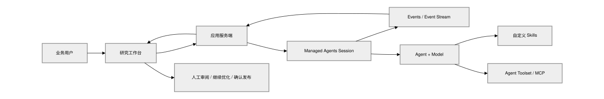

# [进阶] 构建可持续迭代的 AI 研究交付工作台

> 全部文档的索引见 [llms.txt](https://ark.volcengine.com/llms.txt)；在任一文档页面地址后追加 `.md` 可获取该页的 Markdown 版本。

用一个长期 Session 承载复杂研究任务，实时观察 Agent 的工具调用和执行状态，并把每轮结果沉淀为可审阅、可继续优化的完整交付物。

<span id="what-to-build"></span>
# 你将构建什么

「研究工作台」接受一个研究目标和若干资料链接，由方舟 Managed Agents 在云端执行长任务。用户能够看到 Agent 正在调用什么工具、当前处理到哪一步，并在 Session 完成后直接审阅完整报告。

如果首版报告不够好，用户可以继续提出「补强证据」「增加方案对比」或「重写结论」。系统不会重新创建任务，而是继续向原 Session 发送消息，生成 V2、V3，同时保留旧版本。

最终应用具备以下能力：

- 接收飞书文档、网页和业务背景；
- 展示工具调用、阶段消息和 Session 状态；
- 以 `session.status_idle` 判断本轮完整输出已经结束；
- 在同一个 Session 中持续追加优化要求；
- 保存每轮完整交付物，支持版本切换和导出；
- 提供当前 Session 的方舟控制台入口；
- 用户确认后再执行发布等外部写操作。

<span id="how-it-works"></span>
# 工作原理



| 对象 | 在项目中的职责 |
|-|-|
| Agent | 定义模型、系统指令、工具和 Skills |
| Environment | Agent 的云端运行环境，决定网络和执行能力 |
| Session | 一项业务任务的连续工作空间，初次请求和后续优化复用同一个 Session |
| Event | Session 中的用户输入、工具调用、Agent 消息和状态变化 |
| Skill | 可复用的工作方法，例如研究规划、证据核验和交付审查 |
| Report Version | 每个用户轮次结束后保存的一份完整交付物 |

一次完整运行遵循以下顺序：

1. 应用创建 Session；
2. 应用打开 Session Events SSE 流，并等待 `: ready`；
3. 向 Session 发送 `user.message`；
4. Agent 规划任务、调用工具并产生 Events；
5. 应用展示 `agent.tool_use` 和阶段消息；
6. Session 进入 `idle`；
7. 应用提取最后的完整交付物并生成版本；
8. 用户审阅后可以继续向原 Session 发送下一轮要求。

<span id="quickstart"></span>
# 10 分钟快速开始

本章完成一件事：创建 Session、发送研究任务、观察事件，并在 Session 进入 idle 后输出最终报告。

<span id="quickstart-env"></span>
## 准备环境

你需要：

- Node.js 20 或更高版本；
- 一个可用的方舟 Managed Agents Agent；
- Agent 对应的 Environment；
- 可用的 ARK API Key。

安装依赖并创建本地配置：

```bash
pnpm install
cp .env.example .env
```

填写 `.env`：

```dotenv
ARK_BASE_URL=https://ark.cn-beijing.volces.com/api/v3
ARK_API_KEY=ark-替换为你的_API_Key
ARK_AGENT_ID=替换为你的_Agent_ID
ARK_ENVIRONMENT_ID=替换为你的_Environment_ID
```

> **注意**
>
> ARK API Key 只应由服务端读取，不要放进 `VITE_*` 变量、React 代码或浏览器请求。

<span id="quickstart-run"></span>
## 创建 Session、建立事件流并发送任务

下面是完整的最小示例：

```js
import "dotenv/config";

const baseUrl = (
  process.env.ARK_BASE_URL ||
  "https://ark.cn-beijing.volces.com/api/v3"
).replace(/\/$/, "");

const apiKey = process.env.ARK_API_KEY;
const agentId = process.env.ARK_AGENT_ID;
const environmentId = process.env.ARK_ENVIRONMENT_ID;

if (!apiKey || !agentId || !environmentId) {
  throw new Error(
    "请设置 ARK_API_KEY、ARK_AGENT_ID 和 ARK_ENVIRONMENT_ID",
  );
}

async function request(path, init = {}) {
  const response = await fetch(`${baseUrl}${path}`, {
    ...init,
    headers: {
      Authorization: `Bearer ${apiKey}`,
      "Content-Type": "application/json",
      ...init.headers,
    },
  });
  if (!response.ok) {
    throw new Error(
      `${init.method || "GET"} ${path} 失败:${await response.text()}`,
    );
  }
  return response;
}

async function createSession() {
  const response = await request("/sessions", {
    method: "POST",
    body: JSON.stringify({
      agent: { id: agentId },
      environment_id: environmentId,
    }),
  });
  const session = await response.json();
  return session.id ?? session.session_id;
}

async function sendMessage(sessionId, text) {
  await request(`/sessions/${sessionId}/events`, {
    method: "POST",
    body: JSON.stringify({
      events: [{
        type: "user.message",
        content: [{ type: "text", text }],
      }],
    }),
  });
}

function textFromEvent(event) {
  return event.content
    ?.filter((item) => item.type === "text" && item.text)
    .map((item) => item.text)
    .join("\n") || "";
}

async function runTurn(sessionId, text) {
  const response = await request(
    `/sessions/${sessionId}/events/stream`,
    { headers: { Accept: "text/event-stream" } },
  );

  const reader = response.body.getReader();
  const decoder = new TextDecoder();
  let buffer = "";
  let finalMessage = "";
  let messageSent = false;

  try {
    while (true) {
      const { done, value } = await reader.read();
      buffer += decoder.decode(value, { stream: !done });
      const lines = buffer.split(/\r?\n/);
      buffer = lines.pop() || "";

      for (const line of lines) {
        if (!messageSent && line === ": ready") {
          await sendMessage(sessionId, text);
          messageSent = true;
          continue;
        }
        if (!line.startsWith("data:")) continue;
        const payload = line.slice(5).trim();
        if (!payload) continue;

        let event;
        try {
          event = JSON.parse(payload);
        } catch {
          continue;
        }

        if (event.type === "agent.tool_use") {
          console.log(`工具调用:${event.name || "unknown"}`);
        }
        if (event.type === "agent.message") {
          finalMessage = textFromEvent(event) || finalMessage;
        }
        if (event.type === "session.status_idle") {
          return finalMessage;
        }
        if (event.type === "session.status_terminated") {
          throw new Error("Session 已终止");
        }
      }

      if (done) {
        const reason = messageSent
          ? "没有收到 session.status_idle"
          : "没有收到 : ready";
        throw new Error(`事件流已经结束，但${reason}`);
      }
    }
  } finally {
    await reader.cancel().catch(() => {});
  }
}

const sessionId = await createSession();
console.log(`Session:${sessionId}`);

const report = await runTurn(
  sessionId,
  `研究方舟 Managed Agents 的 Session 与 Events 机制，
形成一份包含关键发现、证据、接入建议、风险和下一步的 Markdown 报告。`,
);

console.log(report);
```

运行：

```bash
node run-session.mjs
```

预期看到：

```text
Session:sesn-...
工具调用:web_search
工具调用:read
工具调用:write

# 方舟 Managed Agents 接入研究
...
```

`agent.message` 只是交付物候选。Agent 可能先返回阶段消息，再继续调用工具；只有收到 `session.status_idle`，应用才把最后的完整消息视为本轮结果。

至此，快速路径已经完成。后续章节用于把最小示例升级为真实业务应用。

<span id="build-agent"></span>
# 构建完整研究 Agent

一个真实研究 Agent 不能只依赖一段很长的系统提示。本项目把稳定、可复用的工作方法拆成五个 Skill：

| Skill | 负责的问题 | 主要输出 |
|-|-|-|
| `research-planning` | 任务边界、问题树和证据要求 | 研究计划 |
| `source-verification` | 来源权威性、时效性、冲突和引用支持关系 | Claim Ledger |
| `product-synthesis` | 方案选项、统一标准下的取舍、MVP 和建议 | 决策建议 |
| `api-doc-authoring` | 字段、约束、示例、错误、重试和幂等 | 可实现 API 文档 |
| `delivery-review` | 事实、完整性、一致性、安全性和发布质量 | 发布门禁结论 |

每个 Skill 是一个独立目录，至少包含 `SKILL.md`：

```text
skills/
├── research-planning/SKILL.md
├── source-verification/SKILL.md
├── product-synthesis/SKILL.md
├── api-doc-authoring/SKILL.md
└── delivery-review/SKILL.md
```

将每个 Skill 目录分别打包：

```bash
mkdir -p skill-packages
for skill_dir in skills/*; do
  skill_name=$(basename "$skill_dir")
  (cd "$skill_dir" && zip -r "../../skill-packages/$skill_name.zip" .)
done
```

上传一个 Skill：

```js
import { readFile } from "node:fs/promises";

const form = new FormData();
form.append(
  "files",
  new Blob([await readFile("skill-packages/research-planning.zip")], {
    type: "application/zip",
  }),
  "research-planning.zip",
);

const response = await fetch(`${ARK_BASE_URL}/skills`, {
  method: "POST",
  headers: { Authorization: `Bearer ${ARK_API_KEY}` },
  body: form,
});

const skill = await response.json();
```

记录返回的 `id` 和 `latest_version`。创建或更新 Agent 时提交完整的 Skills 列表。

本项目的系统指令重点约束三件事：

```text
1. 先规划研究问题和证据标准，再开始收集资料。
2. 只能把有来源支持的内容写成事实;推断和待确认项必须明确标注。
3. 最终返回一份完整 Markdown;发布、发送、删除或修改外部系统前必须等待用户确认。
```

创建 Agent 时，将工具和 Skills 一起配置：

```js
await fetch(`${ARK_BASE_URL}/agents`, {
  method: "POST",
  headers: {
    Authorization: `Bearer ${ARK_API_KEY}`,
    "Content-Type": "application/json",
  },
  body: JSON.stringify({
    name: "research-workbench-agent",
    description: "面向产品与研发团队的研究交付 Agent。",
    model: {
      id: "doubao-seed-2-1-pro-260628",
      speed: "standard",
    },
    system: systemPrompt,
    tools: [{
      type: "agent_toolset_20260916",
      default_config: {
        enabled: true,
        permission_policy: { type: "always_allow" },
      },
    }],
    skills: uploadedSkills.map((skill) => ({
      type: "custom",
      skill_id: skill.id,
      version: skill.latest_version,
    })),
  }),
});
```

依次上传五个 Skills 后，使用各响应中的 `id` 和 `latest_version` 组装 Agent 请求。模型和工具版本可能随环境变化，应以当前方舟控制台和 API 返回为准。

<span id="embed-in-app"></span>
# 嵌入真实 App

<span id="embed-session-reuse"></span>
## 一个任务始终复用一个 Session

业务系统需要保存 `taskId → sessionId` 映射。用户继续优化时，向原 Session 发送新的 `user.message`：

```js
const followUp = `请基于当前 Session 中已有研究和上一版交付物继续优化。

用户的新要求:补充三种实现方案的对比，并明确推荐方案的 MVP 边界。

要求:
1. 保留仍然成立的事实和引用。
2. 不要只返回修改建议，要返回一份可独立使用的完整 Markdown。
3. 明确标注仍缺少证据或需要用户确认的信息。`;

const nextReport = await runTurn(existingSessionId, followUp);
```

`runTurn` 会先为新一轮建立 SSE，再发送消息并等待 `session.status_idle`。同一个 Session 正在运行时不要继续发送下一轮要求。前端应禁用发送按钮，服务端也应拒绝并发轮次。

<span id="embed-turn-id"></span>
## 用 turnId 组织对话和事件

每个用户消息创建一个 `turnId`。工具调用、阶段消息、完成事件和最终报告都归属到这一轮：

```ts
interface TaskMessage {
  id: string;
  turnId: string;
  role: "user" | "agent";
  kind: "brief" | "follow-up" | "delivery" | "status";
  content: string;
  versionId?: string;
  createdAt: string;
}

interface ReportVersion {
  id: string;
  number: number;
  content: string;
  instruction: string;
  createdAt: string;
}
```

本轮进入 idle 后，追加一个新版本，不要覆盖上一版：

```js
const version = {
  id: crypto.randomUUID(),
  number: task.reportVersions.length + 1,
  content: completedReport,
  instruction: currentUserMessage,
  createdAt: new Date().toISOString(),
};

task.reportVersions.push(version);
task.activeReportVersionId = version.id;
```

<span id="embed-ui-split"></span>
## 把执行过程和最终交付分开呈现

推荐的交互方式是：

- 左侧按用户轮次展示协作对话；
- 用户消息右对齐，Agent 最终交付左对齐；
- `agent.tool_use` 和阶段消息放入「处理中」区域；
- 运行时展开过程，收到 idle 后自动折叠；
- 右侧独立滚动并渲染完整 Markdown；
- 报告顶部提供版本选择、导出和人工确认发布；
- 页面展示当前 Session ID 和方舟控制台链接。

```js
function arkSessionConsoleUrl(sessionId, region, projectName) {
  return `https://ark.volcengine.com/region:cn-beijing/ark/region:${encodeURIComponent(region)}`
    + `/managed-agents/sessions/${encodeURIComponent(sessionId)}`
    + `?projectName=${encodeURIComponent(projectName)}`;
}
```

<span id="production"></span>
# 生产化改造要点

本章是进阶内容。最小示例已经跑通后，再根据部署环境逐项加入。

<span id="production-serverless"></span>
## Serverless 环境使用轮询对账

本地 Node 服务可以持续消费 Event Stream。Serverless 请求不应等待整个长任务，可以使用「快速提交 + 前端轮询 + 服务端对账」：

1. 创建 Session 并发送消息后立即返回；
2. 前端定时调用任务详情接口；
3. 服务端读取 Session 当前状态和事件历史；
4. Session 仍为 `running` 时继续等待；
5. Session 为 `idle` 时提取本轮最终结果并生成版本。

```js
const [session, history] = await Promise.all([
  client.getSession(task.sessionId),
  client.listEvents(task.sessionId),
]);

if (session.status === "running") return task;

const idleObserved =
  session.status === "idle" ||
  hasSessionIdleForCurrentTurn(history);

if (!idleObserved) {
  throw new Error(`Session 当前状态为 ${session.status ?? "unknown"}`);
}

const content =
  latestWrittenArtifactForCurrentTurn(history)?.content ??
  latestAgentMessageForCurrentTurn(history);
```

事件历史可能不会完整保留某个实时状态事件，因此恢复流程同时检查历史中的 `session.status_idle` 和 Session 当前 `status`。

<span id="production-file-artifact"></span>
## 恢复文件型交付物

Agent 有时会把报告写入 `/mnt/session/outputs/report.md`，随后只回复「文件已生成」。浏览器无法直接访问这个云端路径。

优先检查 `write` 工具事件，从 `event.input.file_path` 和 `event.input.content` 提取正文。如果只有路径，就向同一 Session 发送一次补充请求：

```text
请读取刚才生成的交付文件，并把完整 Markdown 正文作为本轮最终
agent.message 返回。不要再次只返回路径、摘要、字数或完成通知。
```

补充请求仍然要等待新的 `session.status_idle`。

<span id="production-resume"></span>
## 为中断和重启设计恢复

应用需要保留 Session ID。浏览器关闭或服务重启后，不要重复提交任务，而应：

1. 查询 `GET /sessions/{session_id}`；
2. 读取 `GET /sessions/{session_id}/events`；
3. Session 为 running 时继续观察；
4. Session 为 idle 时恢复最后的完整交付；
5. 对已经处理过的源事件做幂等去重。

<span id="production-security"></span>
## 保护凭证和外部写操作

- ARK API Key 只保留在服务端；
- 生产环境为每个用户或租户校验任务访问权限；
- 对发布、发送、删除和修改业务数据设置人工确认；
- 不要把长期访问 Token 保留在页面 URL、日志或截图中；
- 测试完成后归档无用 Session，并轮换演示期间使用过的凭证。

部署业务应用时，只向服务端配置调用 Managed Agents 所需的环境变量：

```text
ARK_BASE_URL
ARK_API_KEY
ARK_AGENT_ID
ARK_ENVIRONMENT_ID
```

> **注意**
>
> 不要把 ARK API Key 或其他第三方凭据写入前端环境变量。发布、发送等外部写操作应由服务端执行，并在调用前校验用户授权。

<span id="acceptance"></span>
# 验收结果

| 场景 | 通过标准 |
|-|-|
| 最小调用 | 创建 Session，看到工具事件，idle 后输出完整 Markdown |
| 持续优化 | 第二轮复用原 Session，生成 V2，V1 仍然可以查看 |
| 中间过程 | 工具调用和阶段消息运行时可见，完成后可以折叠 |
| 完成边界 | 没有 idle 时不生成最终版本；恢复时可以用 Session 当前状态对账 |
| 文件型产物 | 返回 `/mnt/session/outputs/...` 时恢复正文，而不是只展示路径 |
| 页面恢复 | 刷新或服务重启后，可以根据 Session ID 恢复执行状态和结果 |
| 事件审计 | 每个任务页面能打开对应 Session 的方舟控制台 |
| 数据安全 | 浏览器看不到 ARK API Key，外部写操作需要人工确认 |

<span id="extensions"></span>
# 扩展方向

这套模式适合任何需要「长任务 + 可观察过程 + 人工审阅 + 多轮优化」的业务：

- 方案投标和 RFP 响应；
- 合同、政策和行业研究；
- 销售洞察与客户方案；
- 故障复盘和技术调研；
- PRD、API 设计和上线评审；
- 竞品研究与持续监控。

把「研究目标和 Skill」替换成你的业务方法，把最终确认动作接入你的系统，就可以将这个案例嵌入自己的 App 或软件。
