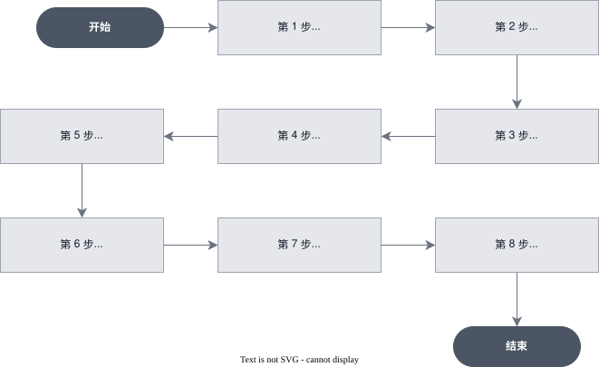

# [进阶] 使用 Memory Store 构建有记忆的购物助手

> 全部文档的索引见 [llms.txt](https://ark.volcengine.com/llms.txt)；在任一文档页面地址后追加 `.md` 可获取该页的 Markdown 版本。

本教程演示如何使用方舟 Managed Agents 的 **Memory Store（记忆存储）** 能力，构建一个能记住客户购物偏好的个人购物助手。跨会话保留的记忆让 Agent 无需在每次对话开始时重复询问尺码、预算、材质忌讳等信息，从而提供真正个性化的服务。

<span id="scenario"></span>
# 场景说明

大多数销售助手每次对话都要从头开始。顾客告诉助手尺码、预算和不喜欢的材质，但下次顾客回来时，这些信息全都不见了，顾客不得不重复一遍，整个体验缺乏个性化。

Managed Agents 提供了开箱即用的记忆能力：Memory Store。它是一个由平台托管的持久化容器，Agent 可以在多次会话之间通过后端应用层 API 调用读写用户信息，从而记住用户。

<span id="what-you-will-build"></span>
# 你将构建什么

- 一个 Memory Store，用于保存单个客户的购物偏好。
- 一个配置为读写该 Memory Store 的购物 Agent。
- 两个独立的 Session，演示记忆如何跨会话延续。
- 一种从后端应用检查和初始化记忆的模式。

<span id="how-it-works"></span>
# 记忆如何工作

Memory Store 挂载后，Agent 可以根据 `access` 配置读取或修改其中的内容。应用程序也可以通过 API 读写同一份内容，用于预填信息、审核 Agent 写入的内容或导出数据。



<span id="prerequisites"></span>
# 前置条件

- 已开通方舟 Managed Agents 和目标模型服务。
- 已创建 API Key，详情请参见 [API Key 管理](https://ark.volcengine.com/docs/manage-api-keys)。
- 本地已安装 `curl` 7.76.0 或更高版本，以及 `jq`（用于解析 SSE 事件）。

将 API Key、Base URL 配置为环境变量，方便后续 `curl` 命令复用：

```Bash
export ARK_API_KEY="你的 API Key"  # gitleaks:allow
export ARK_BASE_URL="https://ark.cn-beijing.volces.com/api/v3"
```

所有请求统一使用以下鉴权头：

```Text
Authorization: Bearer $ARK_API_KEY
Content-Type: application/json
```

<span id="helper-function"></span>
# 辅助函数：一步完成一轮对话

为了让后续每一步不必重复输入长命令，先定义一个 shell 函数。它会先建立 SSE 流并等待 `: ready`，再发送消息，最后持续读取到会话终态：

```Bash
run_session_turn() (
  local session_id="$1"
  local user_text="$2"
  local stream_dir
  local stream_pipe=""
  local stream_error
  local stream_pid=""
  local stream_number=0
  local stream_ready=false
  local seen_ids_file
  local events_payload
  local turn_done=false
  local result_code=1
  local message_count=0
  local reconnect_count=0
  local max_reconnects="${ARK_MAX_SSE_RECONNECTS:-3}"
  local max_history_pages="${ARK_MAX_HISTORY_PAGES:-100}"
  local line
  local data

  : "${ARK_BASE_URL:?Set ARK_BASE_URL before calling run_session_turn}"
  : "${ARK_API_KEY:?Set ARK_API_KEY before calling run_session_turn}"
  : "${session_id:?Pass a Session ID as the first argument}"
  : "${user_text:?Pass a user message as the second argument}"
  command -v curl >/dev/null || {
    printf 'curl is required.\n' >&2
    return 1
  }
  command -v jq >/dev/null || {
    printf 'jq is required.\n' >&2
    return 1
  }
  [[ $max_reconnects =~ ^[0-9]+$ ]] || {
    printf 'ARK_MAX_SSE_RECONNECTS must be a non-negative integer.\n' >&2
    return 1
  }
  [[ $max_history_pages =~ ^[1-9][0-9]*$ ]] || {
    printf 'ARK_MAX_HISTORY_PAGES must be a positive integer.\n' >&2
    return 1
  }

  stream_dir=$(mktemp -d) || {
    printf 'Failed to create a temporary directory for the SSE stream.\n' >&2
    return 1
  }
  stream_error="$stream_dir/stream-error.log"
  seen_ids_file="$stream_dir/seen-event-ids"
  : >"$stream_error"
  : >"$seen_ids_file"

  stop_stream() {
    exec 3<&- || true
    if [[ -n $stream_pid ]] && kill -0 "$stream_pid" 2>/dev/null; then
      kill "$stream_pid" 2>/dev/null || true
    fi
    if [[ -n $stream_pid ]]; then
      wait "$stream_pid" 2>/dev/null || true
    fi
    if [[ -n $stream_pipe ]]; then
      rm -f "$stream_pipe"
    fi
    stream_pid=""
    stream_pipe=""
  }

  cleanup_stream() {
    stop_stream
    rm -rf "$stream_dir"
  }
  trap cleanup_stream EXIT

  start_stream() {
    stop_stream
    stream_number=$((stream_number + 1))
    stream_pipe="$stream_dir/events-$stream_number"
    stream_ready=false

    if ! mkfifo "$stream_pipe"; then
      printf 'Failed to create the SSE pipe at %s.\n' "$stream_pipe" >&2
      return 1
    fi

    curl -sS -N --fail-with-body --max-time 600 \
      "$ARK_BASE_URL/sessions/$session_id/events/stream" \
      -H "Authorization: Bearer $ARK_API_KEY" \
      -H "Accept: text/event-stream" >"$stream_pipe" 2>>"$stream_error" &
    stream_pid=$!
    exec 3<"$stream_pipe"

    while IFS= read -r line <&3; do
      line=${line%$'\r'}
      if [[ $line == ": ready" ]]; then
        stream_ready=true
        break
      fi
    done

    if [[ $stream_ready != true ]]; then
      printf 'SSE stream closed before it was ready.\n' >&2
      if [[ -s $stream_error ]]; then
        tail -n 1 "$stream_error" >&2
      fi
      return 1
    fi
  }

  event_seen() {
    local event_id="$1"
    [[ -n $event_id ]] && grep -Fqx -- "$event_id" "$seen_ids_file"
  }

  remember_event() {
    local event_id="$1"
    if [[ -n $event_id ]] && ! event_seen "$event_id"; then
      printf '%s\n' "$event_id" >>"$seen_ids_file"
    fi
  }

  process_event() {
    local event_json="$1"
    local event_id
    local event_type
    local stop_reason
    local retry_status
    local pending_ids

    event_id=$(jq -r '.id // empty' <<<"$event_json" 2>/dev/null || true)
    if event_seen "$event_id"; then
      return 0
    fi
    remember_event "$event_id"

    event_type=$(jq -r '.type // empty' <<<"$event_json" 2>/dev/null || true)
    case "$event_type" in
      agent.message)
        jq -r '.content[]? | select(.type == "text") | .text' <<<"$event_json"
        message_count=$((message_count + 1))
        ;;
      agent.tool_use | agent.mcp_tool_use | agent.custom_tool_use)
        printf '[tool] %s\n' "$(jq -r '.name // .type' <<<"$event_json")"
        ;;
      session.error)
        retry_status=$(jq -r '.error.retry_status.type // empty' <<<"$event_json")
        printf '[error] %s: %s\n' \
          "$(jq -r '.error.type // "unknown_error"' <<<"$event_json")" \
          "$(jq -r '.error.message // "No error message returned."' <<<"$event_json")" >&2
        case "$retry_status" in
          retrying)
            printf '[session] The service is retrying automatically.\n' >&2
            ;;
          exhausted)
            printf '[session] Retries were exhausted for this turn.\n' >&2
            ;;
          terminal)
            printf '[session] The Session cannot continue after this error.\n' >&2
            ;;
          *)
            printf '[session] Unknown error retry status: %s\n' "$retry_status" >&2
            result_code=4
            turn_done=true
            ;;
        esac
        ;;
      session.status_rescheduled)
        printf '[session] The Session was rescheduled; continue waiting.\n' >&2
        ;;
      session.status_idle)
        stop_reason=$(jq -r '.stop_reason.type // empty' <<<"$event_json")
        case "$stop_reason" in
          end_turn)
            if ((message_count == 0)); then
              printf 'The turn ended without an agent.message event.\n' >&2
              result_code=5
            else
              printf '[session] end_turn\n' >&2
              result_code=0
            fi
            turn_done=true
            ;;
          requires_action)
            pending_ids=$(jq -r '.stop_reason.event_ids // [] | join(",")' <<<"$event_json")
            printf '[session] requires_action: %s\n' "$pending_ids" >&2
            result_code=2
            turn_done=true
            ;;
          retries_exhausted)
            printf '[session] retries_exhausted\n' >&2
            result_code=3
            turn_done=true
            ;;
          *)
            printf 'Unknown session.status_idle stop_reason: %s\n' "$stop_reason" >&2
            result_code=5
            turn_done=true
            ;;
        esac
        ;;
      session.status_terminated)
        printf '[session] terminated\n' >&2
        result_code=4
        turn_done=true
        ;;
    esac
  }

  read_history() {
    local mode="$1"
    local page=""
    local page_count=0
    local response
    local event_json

    while :; do
      page_count=$((page_count + 1))
      if ((page_count > max_history_pages)); then
        printf 'History recovery exceeded %s pages.\n' "$max_history_pages" >&2
        return 1
      fi

      if [[ -n $page ]]; then
        response=$(curl -sS --fail-with-body --get \
          "$ARK_BASE_URL/sessions/$session_id/events" \
          -H "Authorization: Bearer $ARK_API_KEY" \
          --data-urlencode "limit=200" \
          --data-urlencode "order=asc" \
          --data-urlencode "page=$page") || return 1
      else
        response=$(curl -sS --fail-with-body --get \
          "$ARK_BASE_URL/sessions/$session_id/events" \
          -H "Authorization: Bearer $ARK_API_KEY" \
          --data-urlencode "limit=200" \
          --data-urlencode "order=asc") || return 1
      fi

      while IFS= read -r event_json; do
        [[ -n $event_json ]] || continue
        if [[ $mode == "seed" ]]; then
          remember_event "$(jq -r '.id // empty' <<<"$event_json")"
        else
          process_event "$event_json"
          [[ $turn_done == true ]] && break
        fi
      done < <(jq -c '.data[]?' <<<"$response")

      [[ $turn_done == true ]] && return 0
      page=$(jq -r '.next_page // empty' <<<"$response")
      [[ -n $page ]] || return 0
    done
  }

  if ! start_stream; then
    return 1
  fi

  # Mark existing history so reconnect recovery only emits this turn.
  if ! read_history seed; then
    printf 'Failed to read the Session history before sending the message.\n' >&2
    return 1
  fi

  events_payload=$(jq -n --arg text "$user_text" \
    '{events: [{type: "user.message", content: [{type: "text", text: $text}]}]}')

  curl -sS --fail-with-body \
    "$ARK_BASE_URL/sessions/$session_id/events" \
    -H "Authorization: Bearer $ARK_API_KEY" \
    -H "Content-Type: application/json" \
    -d "$events_payload" >/dev/null || return 1

  while [[ $turn_done != true ]]; do
    while IFS= read -r line <&3; do
      line=${line%$'\r'}
      if [[ $line == ": server draining, reconnect" ]]; then
        break
      fi
      [[ $line == data:* ]] || continue
      data=${line#data:}
      data=${data# }
      process_event "$data"
      [[ $turn_done == true ]] && break
    done

    [[ $turn_done == true ]] && break
    if ((reconnect_count >= max_reconnects)); then
      printf 'SSE reconnect limit reached before the turn finished.\n' >&2
      return 1
    fi

    reconnect_count=$((reconnect_count + 1))
    printf '[session] Reconnecting SSE and recovering history (%s/%s).\n' \
      "$reconnect_count" "$max_reconnects" >&2

    # Open the replacement stream first, then recover the disconnect window.
    if ! start_stream; then
      return 1
    fi
    if ! read_history recover; then
      printf 'Failed to recover Session history after reconnecting.\n' >&2
      return 1
    fi
  done

  return "$result_code"
)
```

<span id="create-memory-store"></span>
# 第 1 步：创建 Memory Store

Memory Store 是 Agent 存储客户偏好的容器。生产环境中，每位客户对应一个独立的 Memory Store，以保证隔离性。

```Bash
curl -X POST "$ARK_BASE_URL/memory_stores" \
  -H "Authorization: Bearer $ARK_API_KEY" \
  -H "Content-Type: application/json" \
  -d '{
    "name": "shopper_preferences_demo",
    "description": "该记忆库保存客户的个人购物偏好。请在每次对话开始时读取，学到新偏好时立即写入。"
  }'
```

响应示例：

```
{
  "id": "memstore-20260708080047-svq7t",
  "type": "memory_store",
  "name": "shopper_preferences_demo",
  "description": "该记忆库保存客户的个人购物偏好。请在每次对话开始时读取，学到新偏好时立即写入。",
  "memory_count": 0,
  "storage_bytes": 0,
  "session_count": 0,
  "created_at": "2026-07-08T08:00:47Z",
  "updated_at": "2026-07-08T08:00:47Z",
  "metadata": {}
}
```

记录返回的 `id`，后续步骤会将其作为 `STORE_ID` 使用。

<span id="create-agent-env"></span>
# 第 2 步：创建购物 Agent 与 Environment

每个 Managed Agents Session 都需要一个 Agent（模型、System Prompt 和工具）和一个 Environment（Agent 运行所在的容器）。这两个资源一次创建后可以在多个客户与 Session 之间重复使用。

创建 Agent：

```Bash
curl -X POST "$ARK_BASE_URL/agents" \
  -H "Authorization: Bearer $ARK_API_KEY" \
  -H "Content-Type: application/json" \
  -d @- <<'EOF'
{
  "name": "Personal Shopper",
  "model": {"id": "doubao-seed-2-1-pro-260628"},
  "system": "你是一位专业的品牌私人购物助手。你的核心职责是帮助客户找到符合他们个人品味和预算的商品。你需要主动了解客户的风格偏好、尺码信息、预算范围、感兴趣的品牌和品类等信息，并在对话中记住所有了解到的客户信息，以便在后续的交流和下次服务中能够提供更精准、个性化的推荐。你可以使用 Memory 工具访问持久化记忆。对话开始时先读取已有的客户偏好，避免重复询问；学到新的稳定偏好后，及时更新记忆。你的输出风格亲切、专业、有耐心，始终以客户的需求为中心，提供贴心的购物建议。",
  "tools": [
    {"type": "agent_toolset_20260916"}
  ]
}
EOF
```

创建 Environment：

```Bash
curl -X POST "$ARK_BASE_URL/environments" \
  -H "Authorization: Bearer $ARK_API_KEY" \
  -H "Content-Type: application/json" \
  -d @- <<'EOF'
{
  "name": "shop_agent",
  "description": "为购物 Agent 提供基础运行环境",
  "config": {
    "type": "cloud",
    "networking": {"type": "unrestricted"}
  }
}
EOF
```

将返回的 `agent.id` 和 `environment.id` 分别记录为 `AGENT_ID` 和 `ENVIRONMENT_ID`。

> **注意**
>
> `networking.type=unrestricted` 便于教程演示。生产环境应按最小可用范围收敛网络策略，只放行必要的出站主机。

<span id="create-session"></span>
# 第 3 步：创建 Session 并挂载 Memory Store

Session 是一次会话上下文。客户偏好需要由 Agent 持续补充，因此将访问权限显式设置为 `read_write`：

```Bash
curl -X POST "$ARK_BASE_URL/sessions" \
  -H "Authorization: Bearer $ARK_API_KEY" \
  -H "Content-Type: application/json" \
  -d @- <<EOF
{
  "agent": "$AGENT_ID",
  "environment_id": "$ENVIRONMENT_ID",
  "title": "Personal shopper session with memory",
  "resources": [
    {
      "type": "memory_store",
      "memory_store_id": "$STORE_ID",
      "access": "read_write"
    }
  ]
}
EOF
```

响应中 `status` 为 `idle`：Session 创建完成后处于就绪状态，但不会自动开始执行任务，需在后续发送事件触发执行。将返回的 `id` 记录为 `SESSION_ID`。

<span id="first-visit"></span>
# 第 4 步：首次访问，Agent 学习偏好

调用辅助函数发送第一条用户消息，观察 Agent 如何一边对话一边读取或补充 Memory Store：

```Bash
run_session_turn \
  "$SESSION_ID" \
  "你好，我想找一件秋冬外套，预算 800 以内，我平时穿 M 码，喜欢大地色系（驼色、卡其、焦糖），不接受动物皮革。"
```

<span id="write-memory"></span>
# 第 5 步：应用侧写入 Memory

从对话中提取用户偏好后，由应用后端直接调 REST API 落库，应用侧掌控写入时机和内容格式：

```Bash
curl -X POST "$ARK_BASE_URL/memory_stores/$STORE_ID/memories" \
  -H "Authorization: Bearer $ARK_API_KEY" \
  -H "Content-Type: application/json" \
  -d '{
    "path": "/user_preferences.md",
    "content": "# 用户购物偏好\n- 尺码：M\n- 颜色偏好：大地色系（驼色、卡其、焦糖）\n- 预算：秋冬外套 ≤ 800 元\n- 材质禁忌：完全不接受动物皮革（真皮、真皮拼接、天然麂皮）\n- 可接受：人造革、仿麂皮"
  }'
```

响应示例：

```
{
  "id": "mem-20260708084847-c5xnj",
  "type": "memory",
  "memory_store_id": "memstore-20260708080047-svq7t",
  "path": "/user_preferences.md",
  "content_sha256": "c459e3ea973af3e5f5a10d1548136cedceeec613893dc8e641e3f3886fe0f3b5",
  "content_size_bytes": 256,
  "memory_version_id": "memver-20260708084847-zdg9g",
  "created_at": "2026-07-08T08:48:47Z",
  "updated_at": "2026-07-08T08:48:47Z"
}
```

<span id="inspect-memory"></span>
# 第 6 步：检查 Memory Store 内容

应用后端可以直接读取 Memory Store 的内容，用于审计、向用户展示「我们记住了什么」，或做数据分析。列表接口只返回精简元信息；先从列表中取得 Memory ID，再查询单条 Memory 的完整正文：

```Bash
memories=$(curl -sS --fail-with-body \
  "$ARK_BASE_URL/memory_stores/$STORE_ID/memories" \
  -H "Authorization: Bearer $ARK_API_KEY")

MEMORY_ID=$(jq -r \
  '.data[] | select(.type == "memory" and .path == "/user_preferences.md") | .id' \
  <<<"$memories")

if [[ -z "$MEMORY_ID" ]]; then
  echo "Memory not found" >&2
  exit 1
fi

curl -sS --fail-with-body \
  "$ARK_BASE_URL/memory_stores/$STORE_ID/memories/$MEMORY_ID" \
  -H "Authorization: Bearer $ARK_API_KEY" \
  | jq '{path, content, updated_at}'
```

响应示例：

```
{
  "path": "/user_preferences.md",
  "content": "# 用户偏好\n- 尺码：M\n- 颜色：大地色系\n- 预算：不超过 800 元\n- 材质：不接受动物皮革",
  "updated_at": "2026-07-08T08:48:47Z"
}
```

<span id="second-visit"></span>
# 第 7 步：再次访问，Agent 自主回忆

关闭原 Session，创建一个新的 Session，挂载同一个 Memory Store。观察 Agent 在完全新的会话里如何主动读取偏好——不问尺码、不问预算、不问颜色。

重复第 3 步创建新 Session（`resources` 保持不变），记录新的 `NEW_SESSION_ID`。继续使用辅助函数，让新一轮先建立事件流，再发送消息：

```Bash
run_session_turn \
  "$NEW_SESSION_ID" \
  "最近有什么新款外套推荐？帮我看看有什么值得入手的。"
```

事件流中可以看到 Agent 主动读取 Memory Store：

```Text
agent.tool_use      读取已挂载的客户偏好
agent.tool_result   返回已保存的偏好内容
```

Agent 读取到偏好后，会基于「M 码、大地色系、预算 ≤ 800 元、不接受动物皮革」直接给出符合条件的推荐，不再重复询问。

> **注意**
>
> Memory Store 采用工具访问语义，而不是把内容自动注入模型上下文。请在 Agent 的 System Prompt 中说明何时读取和更新记忆。`read_write` 会提供读写类 Memory 工具；如果设置为 `read_only`，Agent 只能浏览、读取和搜索，不能创建、修改、移动或删除 Memory。

<span id="seeding"></span>
# 进阶模式一：从已有数据预填 Memory Store

如果业务系统已经有客户画像（会员等级、历史订单、CRM 备注），可以在客户第一次进入 Agent 之前直接把已知信息写入 Memory Store，让 Agent 一开始就「认识」客户：

```Bash
curl -X POST "$ARK_BASE_URL/memory_stores/$STORE_ID/memories" \
  -H "Authorization: Bearer $ARK_API_KEY" \
  -H "Content-Type: application/json" \
  -d '{
    "path": "/history.md",
    "content": "# 已知信息\n- 会员等级：Gold\n- 常购品类：户外服饰\n- 上次购买日期：2026-06-20\n- 常用支付：微信支付"
  }'
```

<span id="multi-store"></span>
# 进阶模式二：组合每客户存储与共享存储

典型生产模式：一个 Session 同时挂载多个 Memory Store——一个客户私有（可读写）、一个品牌共享（只读）：

```Bash
curl -X POST "$ARK_BASE_URL/sessions" \
  -H "Authorization: Bearer $ARK_API_KEY" \
  -H "Content-Type: application/json" \
  -d @- <<EOF
{
  "agent": "$AGENT_ID",
  "environment_id": "$ENVIRONMENT_ID",
  "title": "Multi-store session",
  "resources": [
    {
      "type": "memory_store",
      "memory_store_id": "$CUSTOMER_STORE_ID",
      "access": "read_write"
    },
    {
      "type": "memory_store",
      "memory_store_id": "$BRAND_STORE_ID",
      "access": "read_only"
    }
  ]
}
EOF
```

<span id="update-memory"></span>
# 进阶模式三：更新已有记忆

Agent 可能记错内容（例如把「过敏」记成「不喜欢」）。先查询对应的 Memory ID，再调用更新接口修改内容，无需删除原记录：

```Bash
# ① 查出要更新的 memory_id
MEMORY_ID=$(curl -sS "$ARK_BASE_URL/memory_stores/$STORE_ID/memories" \
  -H "Authorization: Bearer $ARK_API_KEY" \
  | jq -r '.data[] | select(.path=="/user_preferences.md") | .id')

# ② 更新原记录
curl -X POST "$ARK_BASE_URL/memory_stores/$STORE_ID/memories/$MEMORY_ID" \
  -H "Authorization: Bearer $ARK_API_KEY" \
  -H "Content-Type: application/json" \
  -d '{
    "content": "# 用户购物偏好（更新后版本）\n- 尺码：M\n- 颜色偏好：大地色系（驼色、卡其、焦糖）\n- 预算：秋冬外套 ≤ 800 元\n- 材质禁忌：完全不接受动物皮革\n- 新增：严重花生过敏，请勿推荐相关周边食品\n- 可接受：人造革、仿麂皮"
  }'
```

<span id="cleanup"></span>
# 第 8 步：清理资源

Demo 结束后，请按以下顺序清理资源，避免占用额度和留下测试数据：

```Bash
# 1. 删除 Session（Environment 上如有 Session 未清，第 3 步会报 InvalidAction）
curl -X DELETE "$ARK_BASE_URL/sessions/$SESSION_ID" \
  -H "Authorization: Bearer $ARK_API_KEY"

# 2. 删除 Agent（如不再复用）
curl -X DELETE "$ARK_BASE_URL/agents/$AGENT_ID" \
  -H "Authorization: Bearer $ARK_API_KEY"

# 3. 删除 Environment（该环境下的所有 Session 必须先删完，否则会拒绝）
curl -X DELETE "$ARK_BASE_URL/environments/$ENVIRONMENT_ID" \
  -H "Authorization: Bearer $ARK_API_KEY"

# 4. 删除 Memory Store
curl -X DELETE "$ARK_BASE_URL/memory_stores/$STORE_ID" \
  -H "Authorization: Bearer $ARK_API_KEY"
```

> **警告**
>
> 删除 Memory Store 不可恢复，操作前请确认该 Store 中的偏好数据已无长期保留价值。
