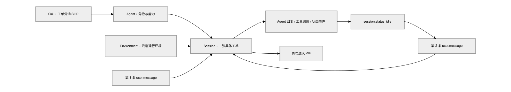
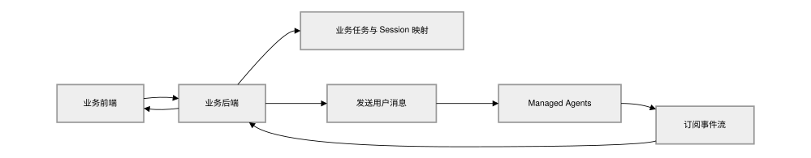

# [基础] 构建连续对话的工单分诊助手

> 全部文档的索引见 [llms.txt](https://ark.volcengine.com/llms.txt)；在任一文档页面地址后追加 `.md` 可获取该页的 Markdown 版本。

本教程面向第一次接触方舟 Managed Agents 的开发者。你将先认识 Agent、Skill、Environment、Session 和 Event 五个核心对象，再以一个售后工单分诊场景跑通完整链路。

完成后，你会得到一个绑定了工单分诊 Skill 的 Agent，并能在**同一个 Session** 中连续发送两轮消息：第一轮提交故障现象，第二轮补充新的线索。Agent 会沿用上一轮的上下文继续判断，而不是重新开始。

<span id="core-objects"></span>
# 先理解五个核心对象

| 对象 | 它负责什么 | 本教程中的对应实例 |
|-|-|-|
| Agent | 定义模型、系统指令、Tools 和 Skills，是可复用的智能体配置 | 售后工单分诊助手 |
| Skill | 把一类任务的知识、流程、约束和输出格式打包成可复用能力 | 工单分诊 SOP |
| Environment | 定义 Session 使用的云端运行环境 | 一个隔离的 cloud 环境 |
| Session | 保存一次任务的上下文、状态和事件历史 | 某一张客户工单的处理过程 |
| Event | 向 Session 追加输入，或记录 Agent 回复、工具调用和状态变化 | `user.message`、`agent.message`、`session.status_idle` |

五者的关系可以概括为：Agent 决定「谁来做、会什么」，Environment 决定「在哪里做」，Session 承载「这一次具体任务」，Events 记录「任务如何一步步发生」。



其中最重要的一点是：**Session 不是一次请求，而是一段可持续推进的任务上下文**。每次调用 `POST /sessions/{session_id}/events` 都是在这个 Session 中追加一个新的回合，而不是重开一次模型调用。

<span id="case-overview"></span>
# 你将跑通的场景

假设客服收到一张「升级客户端后无法登录」的工单。第一轮只有基础现象；Agent 按 Skill 输出初步分诊和需要补充的信息。随后客服拿到「账号刚迁移过，旧租户仍能登录」的新线索，并把它作为第二条消息发送到原 Session。Agent 应结合两轮信息更新判断和下一步动作。

本场景特意不接入 CRM、工单系统或知识库，目的是先看清 Managed Agents 的最小运行链路。跑通后，再把真实业务查询封装成 MCP Tool 即可。

<span id="prepare-environment"></span>
# 准备环境

先设置 API 地址和 API Key。API Key 只应保存在本地环境变量或服务端密钥系统中，不要硬编码在代码中。

```bash
export ARK_BASE_URL="https://ark.cn-beijing.volces.com/api/v3"
export ARK_API_KEY="替换为你的 ARK API Key"  # gitleaks:allow
```

本地需安装 `curl` 7.76.0 或更高版本、`zip` 和 `jq`。运行以下命令确认版本：

```Bash
curl --version
zip -v
jq --version
```

<span id="create-skill"></span>
## 创建并上传 Skill

Skill 是一个包含 `SKILL.md` 的目录。本教程创建的 Skill 不负责调用外部系统，而是把工单分诊的步骤、约束和输出格式固化下来。

先创建目录：

```bash
mkdir -p customer-support-triage
```

在 `customer-support-triage/SKILL.md` 中写入：

````markdown
---
name: customer-support-triage
description: Triage customer support incidents. Use when a user reports login, account, payment, membership, or client failures and the agent must separate facts from assumptions, ask for missing evidence, assess severity, and recommend the next safe action.
---

# Customer Support Triage

Follow this workflow for every incident:

1. Restate the confirmed symptom without inventing account, order, or system status.
2. Separate confirmed facts, likely hypotheses, and missing evidence.
3. Assess severity as P1, P2, P3, or P4, and explain the reason in one sentence.
4. Ask only the minimum questions needed to distinguish the leading hypotheses.
5. Recommend safe, reversible checks before any write or irreversible action.
6. Escalate when the incident affects many users, risks data or money, lacks required permission, or remains unresolved after standard checks.

## Output

Return these sections:

- 当前判断
- 已确认事实
- 待核实信息
- 建议动作
- 是否升级

Do not claim that a system change, refund, reset, or escalation succeeded unless a tool explicitly confirms success.
````

打包时保留顶层目录：

```bash
zip -r customer-support-triage.zip customer-support-triage
unzip -l customer-support-triage.zip
```

上传 Skill：

```bash
SKILL_RESPONSE=$(curl --silent --show-error --fail \
  --request POST "$ARK_BASE_URL/skills" \
  --header "Authorization: Bearer $ARK_API_KEY" \
  --form "files=@customer-support-triage.zip;type=application/zip")

echo "$SKILL_RESPONSE" | jq

export ARK_SKILL_ID=$(echo "$SKILL_RESPONSE" | jq -er '.id')
export ARK_SKILL_VERSION=$(echo "$SKILL_RESPONSE" | jq -er '.latest_version')
```

`id` 标识这项能力，`latest_version` 标识当前最新版本。Agent 绑定的是明确的 Skill 版本，因此更新 Skill 后需要把 Agent 配置更新到新版本，运行中的旧 Session 不会被悄悄改变。

<span id="create-agent"></span>
## 创建 Agent 并绑定 Skill

创建 Agent 时，把刚上传的 Skill 放入 `skills`。系统指令只描述稳定角色和边界，具体的分诊流程交给 Skill 管理。

```bash
AGENT_RESPONSE=$(curl --silent --show-error --fail \
  --request POST "$ARK_BASE_URL/agents" \
  --header "Authorization: Bearer $ARK_API_KEY" \
  --header "Content-Type: application/json" \
  --data @- <<JSON
{
  "name": "managed-agents-beginner-triage",
  "description": "用于 Managed Agents 入门演示的售后工单分诊助手。",
  "model": {
    "id": "doubao-seed-2-1-pro-260628",
    "speed": "standard"
  },
  "system": "你是售后工单分诊助手。基于当前 Session 中的用户消息和已绑定 Skill 工作。不得编造客户、账号或系统状态;需要外部数据时明确说明待查询。使用中文,结论简洁、可执行。",
  "tools": [
    {
      "type": "agent_toolset_20260916",
      "default_config": {
        "enabled": true,
        "permission_policy": {
          "type": "always_allow"
        }
      }
    }
  ],
  "skills": [
    {
      "type": "custom",
      "skill_id": "$ARK_SKILL_ID",
      "version": "$ARK_SKILL_VERSION"
    }
  ]
}
JSON
)

echo "$AGENT_RESPONSE" | jq
export ARK_AGENT_ID=$(echo "$AGENT_RESPONSE" | jq -r '.id // .agent_id // .data.id // .data.agent_id')
```

<span id="create-environment"></span>
## 创建 Environment

Environment 是 Session 的运行基础设施。本场景不需要额外 Python 包，只创建一个最小 cloud 环境。

```bash
ENV_RESPONSE=$(curl --silent --show-error --fail \
  --request POST "$ARK_BASE_URL/environments" \
  --header "Authorization: Bearer $ARK_API_KEY" \
  --header "Content-Type: application/json" \
  --data '{
    "name": "managed-agents-beginner-env",
    "description": "Managed Agents 入门场景的隔离运行环境。",
    "config": {
      "type": "cloud",
      "networking": {
        "type": "unrestricted"
      }
    }
  }')

echo "$ENV_RESPONSE" | jq
export ARK_ENVIRONMENT_ID=$(echo "$ENV_RESPONSE" | jq -r '.id // .environment_id // .data.id // .data.environment_id')
```

> **注意**
>
> 如果你的业务不需要访问公网，正式环境中应收紧网络策略；示例中的 `unrestricted` 只是为了避免入门场景被网络配置阻塞。

<span id="create-session"></span>
## 创建 Session

现在创建一张具体「工单」。请注意 `agent` 是对象，Agent ID 放在 `agent.id` 中。

```bash
SESSION_RESPONSE=$(curl --silent --show-error --fail \
  --request POST "$ARK_BASE_URL/sessions" \
  --header "Authorization: Bearer $ARK_API_KEY" \
  --header "Content-Type: application/json" \
  --data @- <<JSON
{
  "agent": {
    "id": "$ARK_AGENT_ID"
  },
  "environment_id": "$ARK_ENVIRONMENT_ID"
}
JSON
)

echo "$SESSION_RESPONSE" | jq
export ARK_SESSION_ID=$(echo "$SESSION_RESPONSE" | jq -r '.id // .session_id // .data.id // .data.session_id')
echo "Session: $ARK_SESSION_ID"
```

`ARK_SESSION_ID` 是后续所有消息和事件查询的共同地址。只要任务仍然属于同一张工单，就应复用这个 Session。

<span id="send-first-message"></span>
## 先订阅 Events，再发送第一条消息

发送消息使用以下接口：

```text
POST /sessions/{session_id}/events
```

请求体中的 `events` 是事件数组，但一次请求只放一个 `user.message`，不要把多个用户回合打包在一起。

先定义一个单轮执行函数。它会建立 SSE 流，等待服务端返回 `: ready`，再发送消息并持续读取到会话终态：

```Bash
run_session_turn() (
  local session_id="$1"
  local user_text="$2"
  local stream_dir
  local stream_pipe=""
  local stream_error
  local stream_pid=""
  local stream_number=0
  local stream_ready=false
  local seen_ids_file
  local events_payload
  local turn_done=false
  local result_code=1
  local message_count=0
  local reconnect_count=0
  local max_reconnects="${ARK_MAX_SSE_RECONNECTS:-3}"
  local max_history_pages="${ARK_MAX_HISTORY_PAGES:-100}"
  local line
  local data

  : "${ARK_BASE_URL:?Set ARK_BASE_URL before calling run_session_turn}"
  : "${ARK_API_KEY:?Set ARK_API_KEY before calling run_session_turn}"
  : "${session_id:?Pass a Session ID as the first argument}"
  : "${user_text:?Pass a user message as the second argument}"
  command -v curl >/dev/null || {
    printf 'curl is required.\n' >&2
    return 1
  }
  command -v jq >/dev/null || {
    printf 'jq is required.\n' >&2
    return 1
  }
  [[ $max_reconnects =~ ^[0-9]+$ ]] || {
    printf 'ARK_MAX_SSE_RECONNECTS must be a non-negative integer.\n' >&2
    return 1
  }
  [[ $max_history_pages =~ ^[1-9][0-9]*$ ]] || {
    printf 'ARK_MAX_HISTORY_PAGES must be a positive integer.\n' >&2
    return 1
  }

  stream_dir=$(mktemp -d) || {
    printf 'Failed to create a temporary directory for the SSE stream.\n' >&2
    return 1
  }
  stream_error="$stream_dir/stream-error.log"
  seen_ids_file="$stream_dir/seen-event-ids"
  : >"$stream_error"
  : >"$seen_ids_file"

  stop_stream() {
    exec 3<&- || true
    if [[ -n $stream_pid ]] && kill -0 "$stream_pid" 2>/dev/null; then
      kill "$stream_pid" 2>/dev/null || true
    fi
    if [[ -n $stream_pid ]]; then
      wait "$stream_pid" 2>/dev/null || true
    fi
    if [[ -n $stream_pipe ]]; then
      rm -f "$stream_pipe"
    fi
    stream_pid=""
    stream_pipe=""
  }

  cleanup_stream() {
    stop_stream
    rm -rf "$stream_dir"
  }
  trap cleanup_stream EXIT

  start_stream() {
    stop_stream
    stream_number=$((stream_number + 1))
    stream_pipe="$stream_dir/events-$stream_number"
    stream_ready=false

    if ! mkfifo "$stream_pipe"; then
      printf 'Failed to create the SSE pipe at %s.\n' "$stream_pipe" >&2
      return 1
    fi

    curl -sS -N --fail-with-body --max-time 600 \
      "$ARK_BASE_URL/sessions/$session_id/events/stream" \
      -H "Authorization: Bearer $ARK_API_KEY" \
      -H "Accept: text/event-stream" >"$stream_pipe" 2>>"$stream_error" &
    stream_pid=$!
    exec 3<"$stream_pipe"

    while IFS= read -r line <&3; do
      line=${line%$'\r'}
      if [[ $line == ": ready" ]]; then
        stream_ready=true
        break
      fi
    done

    if [[ $stream_ready != true ]]; then
      printf 'SSE stream closed before it was ready.\n' >&2
      if [[ -s $stream_error ]]; then
        tail -n 1 "$stream_error" >&2
      fi
      return 1
    fi
  }

  event_seen() {
    local event_id="$1"
    [[ -n $event_id ]] && grep -Fqx -- "$event_id" "$seen_ids_file"
  }

  remember_event() {
    local event_id="$1"
    if [[ -n $event_id ]] && ! event_seen "$event_id"; then
      printf '%s\n' "$event_id" >>"$seen_ids_file"
    fi
  }

  process_event() {
    local event_json="$1"
    local event_id
    local event_type
    local stop_reason
    local retry_status
    local pending_ids

    event_id=$(jq -r '.id // empty' <<<"$event_json" 2>/dev/null || true)
    if event_seen "$event_id"; then
      return 0
    fi
    remember_event "$event_id"

    event_type=$(jq -r '.type // empty' <<<"$event_json" 2>/dev/null || true)
    case "$event_type" in
      agent.message)
        jq -r '.content[]? | select(.type == "text") | .text' <<<"$event_json"
        message_count=$((message_count + 1))
        ;;
      agent.tool_use | agent.mcp_tool_use | agent.custom_tool_use)
        printf '[tool] %s\n' "$(jq -r '.name // .type' <<<"$event_json")"
        ;;
      session.error)
        retry_status=$(jq -r '.error.retry_status.type // empty' <<<"$event_json")
        printf '[error] %s: %s\n' \
          "$(jq -r '.error.type // "unknown_error"' <<<"$event_json")" \
          "$(jq -r '.error.message // "No error message returned."' <<<"$event_json")" >&2
        case "$retry_status" in
          retrying)
            printf '[session] The service is retrying automatically.\n' >&2
            ;;
          exhausted)
            printf '[session] Retries were exhausted for this turn.\n' >&2
            ;;
          terminal)
            printf '[session] The Session cannot continue after this error.\n' >&2
            ;;
          *)
            printf '[session] Unknown error retry status: %s\n' "$retry_status" >&2
            result_code=4
            turn_done=true
            ;;
        esac
        ;;
      session.status_rescheduled)
        printf '[session] The Session was rescheduled; continue waiting.\n' >&2
        ;;
      session.status_idle)
        stop_reason=$(jq -r '.stop_reason.type // empty' <<<"$event_json")
        case "$stop_reason" in
          end_turn)
            if ((message_count == 0)); then
              printf 'The turn ended without an agent.message event.\n' >&2
              result_code=5
            else
              printf '[session] end_turn\n' >&2
              result_code=0
            fi
            turn_done=true
            ;;
          requires_action)
            pending_ids=$(jq -r '.stop_reason.event_ids // [] | join(",")' <<<"$event_json")
            printf '[session] requires_action: %s\n' "$pending_ids" >&2
            result_code=2
            turn_done=true
            ;;
          retries_exhausted)
            printf '[session] retries_exhausted\n' >&2
            result_code=3
            turn_done=true
            ;;
          *)
            printf 'Unknown session.status_idle stop_reason: %s\n' "$stop_reason" >&2
            result_code=5
            turn_done=true
            ;;
        esac
        ;;
      session.status_terminated)
        printf '[session] terminated\n' >&2
        result_code=4
        turn_done=true
        ;;
    esac
  }

  read_history() {
    local mode="$1"
    local page=""
    local page_count=0
    local response
    local event_json

    while :; do
      page_count=$((page_count + 1))
      if ((page_count > max_history_pages)); then
        printf 'History recovery exceeded %s pages.\n' "$max_history_pages" >&2
        return 1
      fi

      if [[ -n $page ]]; then
        response=$(curl -sS --fail-with-body --get \
          "$ARK_BASE_URL/sessions/$session_id/events" \
          -H "Authorization: Bearer $ARK_API_KEY" \
          --data-urlencode "limit=200" \
          --data-urlencode "order=asc" \
          --data-urlencode "page=$page") || return 1
      else
        response=$(curl -sS --fail-with-body --get \
          "$ARK_BASE_URL/sessions/$session_id/events" \
          -H "Authorization: Bearer $ARK_API_KEY" \
          --data-urlencode "limit=200" \
          --data-urlencode "order=asc") || return 1
      fi

      while IFS= read -r event_json; do
        [[ -n $event_json ]] || continue
        if [[ $mode == "seed" ]]; then
          remember_event "$(jq -r '.id // empty' <<<"$event_json")"
        else
          process_event "$event_json"
          [[ $turn_done == true ]] && break
        fi
      done < <(jq -c '.data[]?' <<<"$response")

      [[ $turn_done == true ]] && return 0
      page=$(jq -r '.next_page // empty' <<<"$response")
      [[ -n $page ]] || return 0
    done
  }

  if ! start_stream; then
    return 1
  fi

  # Mark existing history so reconnect recovery only emits this turn.
  if ! read_history seed; then
    printf 'Failed to read the Session history before sending the message.\n' >&2
    return 1
  fi

  events_payload=$(jq -n --arg text "$user_text" \
    '{events: [{type: "user.message", content: [{type: "text", text: $text}]}]}')

  curl -sS --fail-with-body \
    "$ARK_BASE_URL/sessions/$session_id/events" \
    -H "Authorization: Bearer $ARK_API_KEY" \
    -H "Content-Type: application/json" \
    -d "$events_payload" >/dev/null || return 1

  while [[ $turn_done != true ]]; do
    while IFS= read -r line <&3; do
      line=${line%$'\r'}
      if [[ $line == ": server draining, reconnect" ]]; then
        break
      fi
      [[ $line == data:* ]] || continue
      data=${line#data:}
      data=${data# }
      process_event "$data"
      [[ $turn_done == true ]] && break
    done

    [[ $turn_done == true ]] && break
    if ((reconnect_count >= max_reconnects)); then
      printf 'SSE reconnect limit reached before the turn finished.\n' >&2
      return 1
    fi

    reconnect_count=$((reconnect_count + 1))
    printf '[session] Reconnecting SSE and recovering history (%s/%s).\n' \
      "$reconnect_count" "$max_reconnects" >&2

    # Open the replacement stream first, then recover the disconnect window.
    if ! start_stream; then
      return 1
    fi
    if ! read_history recover; then
      printf 'Failed to recover Session history after reconnecting.\n' >&2
      return 1
    fi
  done

  return "$result_code"
)
```

发送第一条消息：

```bash
run_session_turn \
  "$ARK_SESSION_ID" \
  "客户升级桌面客户端后无法登录，页面提示账号不存在。请按工单分诊流程给出初步判断和下一步。"
```

这个调用表示「把一条用户消息追加到已有 Session」，不是新建一次模型调用。SSE 就绪后，服务接收消息，Session 从 `idle` 进入 `running`，Agent 随后产生回复、工具调用和状态事件。

<span id="subscribe-events"></span>
## 识别本轮完成信号

入门阶段重点关注三类事件：

| 事件 | 含义 | 应用中的典型展示 |
|-|-|-|
| `agent.tool_use` | Agent 正在调用工具 | 展示工具名称和进行中状态 |
| `agent.message` | Agent 产生了可展示的回复 | 渲染文本或交付物 |
| `session.status_idle` 且 `stop_reason.type=end_turn` | 当前回合正常结束，Session 可接收下一条消息 | 收起过程事件，展示最终回复和继续输入框 |

`session.status_idle` 表示 Session 当前暂停处理，但不一定表示正常完成。应继续检查 `stop_reason.type`：

- `end_turn`：本轮正常结束。
- `requires_action`：客户端需要根据 `stop_reason.event_ids` 处理待确认或待回传的工具事件。
- `retries_exhausted`：自动重试已耗尽，需要根据 `session.error` 排查原因。

**不要只以收到第一条 `agent.message` 作为完成信号**，因为 Agent 后续仍可能继续调用工具或补充回复。`run_session_turn` 会执行上述判断；SSE 意外断开时，函数会先建立替代流，再分页补查历史事件并按事件 ID 去重。

<span id="continue-in-same-session"></span>
## 在同一 Session 继续发送消息

现在模拟客服拿到新线索。不要创建新 Session，继续使用 `run_session_turn` 向原来的 `ARK_SESSION_ID` 追加 `user.message`。函数会为新一轮重新建立 SSE 流，并在确认 `: ready` 后发送消息：

```bash
run_session_turn \
  "$ARK_SESSION_ID" \
  "补充信息：这个账号昨天刚完成租户迁移，旧租户仍然可以登录。请基于上一轮判断更新根因优先级，并给出客服可以直接执行的检查清单。"
```

函数收到新的 `session.status_idle` 且 `stop_reason.type=end_turn` 后返回。这一次 Agent 应能识别「上一轮」指什么，并把租户迁移线索与最初的登录故障合并分析。

这就是 Session 的核心价值：

- 同一个 Session 保留任务上下文、事件历史和运行状态；
- 每个 `POST /events` 只推进一个用户回合；
- 上一轮以 `session.status_idle` 且 `stop_reason.type=end_turn` 结束后，再发送下一轮；
- 如果创建新 Session，新的任务不会自动继承这张工单的上下文。

<span id="common-mistakes"></span>
# Session 发消息时最容易出错的地方

| 现象 | 常见原因 | 正确处理 |
|-|-|-|
| 后续消息没有继承上文 | 每一轮都创建了新 Session | 业务任务未结束时复用同一个 `session_id` |
| 消息请求被拒绝 | 上一轮仍在运行，或 Session 正在等待客户端处理工具事件 | 等待 `session.status_idle`，并确认 `stop_reason.type=end_turn` 后再发送下一条消息 |
| 一次请求里塞了多轮对话 | 一个 Events 请求包含多个 `user.message` | 每次请求只发送一个 `user.message` |
| 页面过早显示「已完成」 | 收到 `agent.message` 或任意 `session.status_idle` 就结束监听 | 同时检查 `session.status_idle` 和 `stop_reason.type=end_turn` |
| 重连后出现重复事件 | SSE 重连后重复消费历史事件 | 按事件 `id` 去重，并保存最后已处理位置 |
| API Key 泄漏 | 浏览器直接调用 Managed Agents API | 由业务后端保管 Key、发送消息和消费 SSE |

<span id="embed-into-business"></span>
# 把它嵌入自己的业务

在真实应用中，建议由业务后端维护「业务对象 ID 到 Session ID」的映射。例如一张工单、一个研究任务或一个代码修复任务，各对应一个 Session。前端只把用户输入交给业务后端；业务后端再追加 `user.message`、消费 SSE，并把标准化的进度推给前端。



前端可以把 `agent.tool_use` 展示为可折叠的执行过程，把最后的 `agent.message` 展示为正式结果，并在收到 `session.status_idle` 且 `stop_reason.type=end_turn` 后恢复输入框。这样用户既能看到 Agent 正在做什么，也能在同一任务中继续补充要求。

<span id="what-you-completed"></span>
# 你刚才完成了什么

你已经完成了 Managed Agents 的最小闭环：把组织流程写成 Skill，绑定到 Agent，创建 Environment 和 Session，通过 Events 发送消息，再以 `session.status_idle` 和 `stop_reason.type=end_turn` 判断一轮正常结束。更重要的是，你没有把第二条要求当成一项新任务，而是复用了原 Session，让 Agent 基于已有上下文继续工作。

下一步可以选择一个方向扩展：

- 把 CRM、工单或知识库接成 MCP Tool；
- 给 Session 挂载文件或 Memory；
- 把 Events 映射成产品中的过程状态；
- 为高风险工具增加用户确认和幂等控制。
