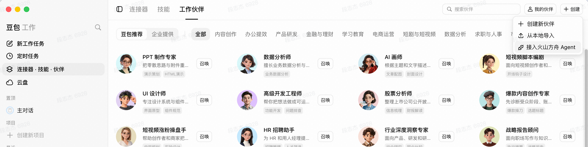
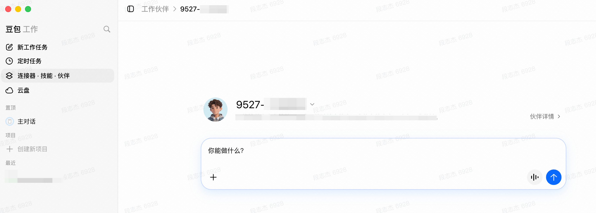
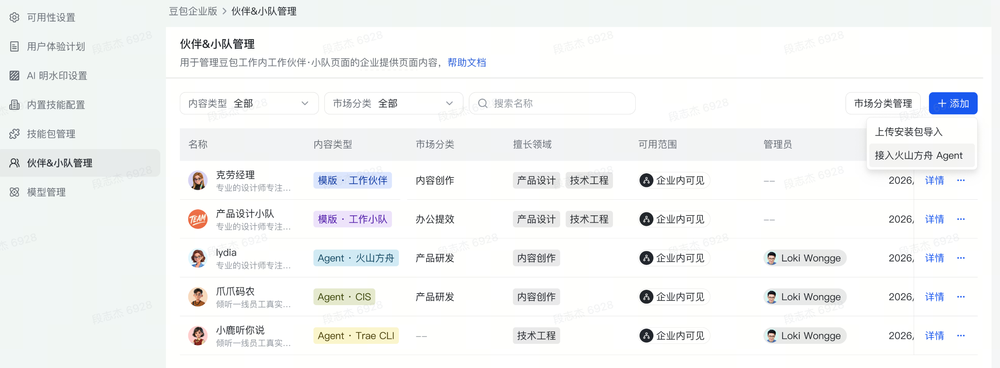

# [基础] 在豆包工作中使用 Managed Agents

> 全部文档的索引见 [llms.txt](https://ark.volcengine.com/llms.txt)；在任一文档页面地址后追加 `.md` 可获取该页的 Markdown 版本。

将已在火山方舟中构建好的 Agent 接入豆包工作后，企业员工可以自行添加，企业管理员也可以统一分发。你无需重复开发应用入口，即可复用豆包工作和飞书的对话、任务过程展示与产物交付能力。

## 场景说明

你已经在火山方舟中完成 Agent 的开发和调试，希望在豆包企业版中使用，或者把它分发给其他企业员工，而不是再开发一套对话页面、任务列表和流式输出界面。

根据你的角色选择一条接入路径，无需同时执行两条：

| 维度 | 员工自行添加 | 管理员统一分发 |
|-|-|-|
| 操作角色 | 具备方舟 Agent 和 API Key 管理权限的企业员工 | Agent 开发者和企业管理员 |
| 添加入口 | **连接器·技能·伙伴** > **工作伙伴** > **创建** | 豆包企业后台 **伙伴&小队管理** |
| 使用范围 | 默认仅添加者 | 管理员配置的成员或部门 |
| 使用入口 | **我的伙伴** | **工作伙伴** > **企业提供** |

本文中的“员工自行添加”仅适用于豆包企业版，不适用于豆包个人版。

## 核心概念

| 概念 | 说明 |
|-|-|
| **Managed Agents** | 火山方舟提供的托管 Agent 运行框架，负责 Agent 配置、会话、工具调用和运行环境。 |
| **Agent** | 可复用的智能体配置，包含模型、系统提示词、技能和工具。豆包工作导入的是这项配置。 |
| **资源项目（Project）** | 方舟资源的隔离边界。豆包工作通过 API Key 获取该项目下可访问的 Agent。 |
| **API Key** | 连接方舟账号时使用的鉴权凭证。它属于敏感信息，泄漏后可能造成资源越权访问和费用损失。 |
| **工作伙伴** | 豆包企业版中的 Agent 使用入口，可以由员工自行添加，也可以由管理员统一提供。 |
| **可用范围** | 管理员分发时使用的访问范围，决定哪些企业员工可以看到并使用工作伙伴。 |

## 前置条件

- 已开通火山方舟 Managed Agents，详情参见 [概述](../overview.md)。
- 已在方舟中创建并调试 Agent。首次使用时，可参见 [快速入门（控制台）](../quick-start-console.md)。
- 员工自行添加时，你已登录豆包企业版账号、所在企业已开通该功能，并具备在 Agent 所在项目中创建 API Key 的权限。
- 管理员统一分发时，Agent 开发者可以提供目标 Agent 和同一项目下的专用 API Key，企业管理员已获得豆包企业后台的智能体管理权限。
- 待导入 Agent 不需要登录或授权第三方服务即可完成基础任务。如果 Agent 使用的第三方服务需要授权，先完成相应服务的登录或授权。

> **说明**
>
> 当前只支持接入基于 Managed Agents 开发和配置的 Agent，不支持直接导入任意已有 Agent 服务。

> **警告**
>
> API Key 可以访问所属项目中其权限范围内的资源。建议使用独立项目和专用 API Key，避免与其他应用共享凭证。如果 Agent 开发者和企业管理员不是同一人，使用企业批准的密钥管理工具交接 API Key，不要通过群聊、工单或截图传递。

## 路径一：员工自行添加

企业员工可以把自己在方舟中维护的 Agent 加入豆包企业版。添加后，工作伙伴默认仅本人可用。

### 第 1 步：准备 Agent 和 API Key

1. 在方舟 **Managed Agents** > **Agents** 中打开目标 Agent，检查配置并运行一次测试任务。
2. 确认 Agent 所在项目，在 [API Key 管理](https://ark.volcengine.com/region:cn-beijing/apiKey) 中创建专用 API Key。
3. 记录 Agent 名称，并安全保存 API Key。

> **注意**
>
> API Key 必须与 Agent 位于同一项目，否则列表中不会出现目标 Agent。

### 第 2 步：导入 Agent

1. 打开豆包企业版 **连接器·技能·伙伴** > **工作伙伴**，单击 **创建** > **接入火山方舟 Agent**。
2. 填写 API Key，选择目标 Agent 并完成添加。

### 第 3 步：在豆包工作中使用

1. 在 **我的伙伴** 中打开刚添加的 Agent，或在 **新工作任务** 中 `@` 该伙伴。
2. 发送测试任务，检查回复、任务状态和产物。

例如，数据分析 Agent 可以使用以下任务：

> 汇总这份销售数据中的主要变化，列出三个异常指标，并给出下一步核查建议。

### 第 4 步：按需在飞书中使用

1. 在工作伙伴详情中选择 **飞书对话**，按指引完成添加或授权。
2. 在飞书中发送测试任务，核对工作伙伴和授权账号。

> **注意**
>
> 豆包工作与飞书中的会话入口可能不同。不要假设两端共享同一个可见会话列表。

## 路径二：管理员统一分发

管理员统一分发由 Agent 开发者准备 Agent 和 API Key，再由企业管理员设置成员或部门的使用范围。

### 第 1 步：准备 Agent 和 API Key

1. Agent 开发者在方舟 **Managed Agents** > **Agents** 中测试目标 Agent。
2. 在 Agent 所在项目的 [API Key 管理](https://ark.volcengine.com/region:cn-beijing/apiKey) 中创建企业集成专用 API Key。
3. 如果企业管理员不是 Agent 开发者，使用企业批准的密钥管理工具交接 API Key。

> **注意**
>
> 不要与个人调试或其他应用共享该 API Key，以免撤销访问时影响其他业务。

### 第 2 步：连接方舟账号

1. 打开豆包企业后台 **伙伴&小队管理**。
2. 单击 **添加** > **接入火山方舟 Agent**。
3. 填写 API Key，选择目标 Agent。

### 第 3 步：设置范围并发布

1. 设置工作伙伴的名称、说明和 **可用范围**。
2. 首次仅选择测试成员或测试部门，检查后发布。

> **注意**
>
> 可用范围过大会让仍在调试的 Agent 直接出现在企业员工的工作伙伴列表中。首次发布只选择测试成员；验证通过后，再按企业发布流程扩大范围。

### 第 4 步：让企业员工使用

1. 使用测试成员账号进入 **连接器·技能·伙伴** > **工作伙伴** > **企业提供**，添加并打开目标工作伙伴；也可以在 **新工作任务** 中 `@` 该伙伴。
2. 发送测试任务，检查回复、任务状态和产物。
3. 使用范围外账号确认该工作伙伴不可见。

### 第 5 步：按需在飞书中使用

1. 在工作伙伴详情中选择 **飞书对话**，按指引完成添加或授权。
2. 使用测试成员账号发起任务，并确认范围外成员无法使用。

> **警告**
>
> 只在豆包工作的方舟账号连接窗口中填写 API Key。不要把 API Key 填进 Agent 的系统提示词、环境变量说明、工作伙伴介绍或对话消息；这些内容可能进入运行上下文或被其他人看到。

## 验证结果

完成所选路径的检查，并满足公共检查项，说明基础接入链路已经跑通：

- 员工自行添加：可以在 **我的伙伴** 中找到目标 Agent。
- 管理员统一分发：管理员可以在后台找到目标 Agent，测试成员可以在 **企业提供** 中添加它，范围外成员看不到它。
- 公共检查：发送任务后可以看到回复和任务状态变化，任务执行过程中没有鉴权或工具调用错误；Agent 生成文件时，豆包工作可以展示并打开对应产物。

## 常见问题

| 现象 | 优先检查 | 处理方法 |
|-|-|-|
| 连接方舟账号失败 | API Key 是否完整、是否已禁用 | 在方舟控制台检查 Key 状态；Key 已泄漏或失效时，创建新 Key 后重新连接 |
| Agent 列表为空 | API Key 所属项目是否正确 | 切换到目标 Agent 所在项目，创建该项目的专用 API Key |
| 列表中没有目标 Agent | Agent 是否位于同一项目、是否能在方舟中正常运行 | 回到方舟核对 Agent ID，并完成一次控制台测试 |
| 看不到 **接入火山方舟 Agent** | 是否使用豆包企业版，以及所在企业是否已开通该功能 | 联系企业管理员检查企业功能配置 |
| 提示 Agent 已被添加 | 该 Agent 是否已由其他成员注册 | 如果页面提示该 Agent 已被添加，不要重复注册；按页面提示联系现有添加人申请使用权限 |
| 新增其他 Agent 时仍要求输入 API Key | 是否误认为页面会自动填充上次使用的 Key | 这是预期行为；每次新增接入都需重新输入 API Key |
| 员工自行添加后找不到 Agent | 当前登录账号是否为执行添加操作的账号 | 切换到正确账号，再打开 **我的伙伴** |
| 企业员工看不到工作伙伴 | 是否已发布、当前账号是否在可用范围内 | 修正可用范围，并确认员工从 **企业提供** 添加伙伴 |
| 可以发起任务但执行失败 | Agent 自身配置、工具或外部依赖是否可用 | 使用相同输入在方舟中复现；先修复 Agent，再重新验证豆包工作链路 |
| 第三方工具要求登录 | Agent 使用的第三方服务是否需要当前使用者登录或授权 | 按页面指引完成第三方服务的登录或授权；验证基础接入链路时，先使用不需要额外授权的任务 |

## 进阶方向

- 为 Agent 增加技能，固化企业任务的步骤与输出要求，详情参见 [技能](../skills.md)。
- 为 Agent 配置 MCP，接入企业外部系统，详情参见 [MCP](../mcp.md)。
- 使用 Vaults 为不同人员注入各自的第三方凭据，详情参见 [使用 Vaults 认证](../use-vaults-authentication.md)。
- 了解 Session 和事件流，排查任务运行过程，详情参见 [Session 事件流](../session-event-stream.md)。
