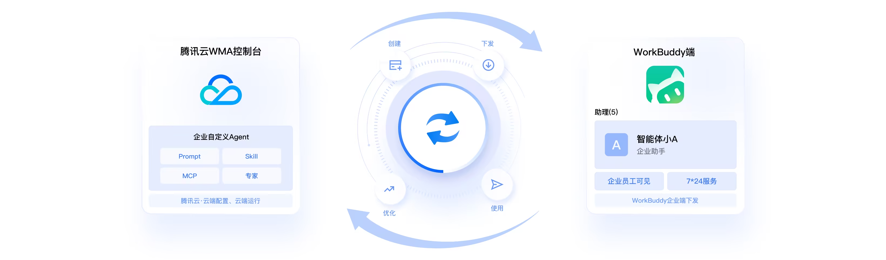
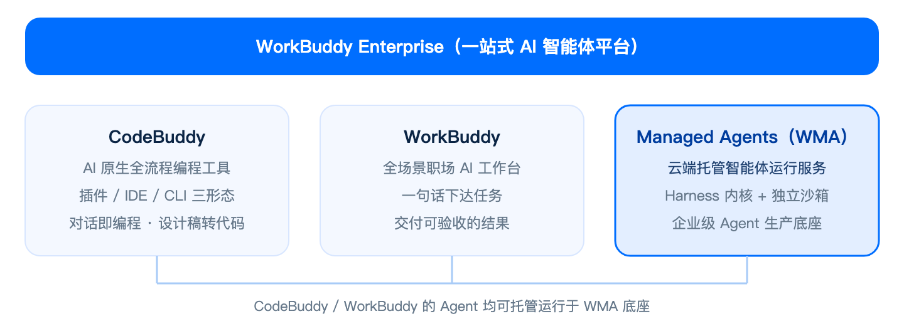
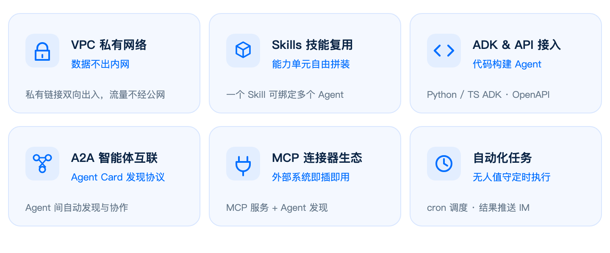
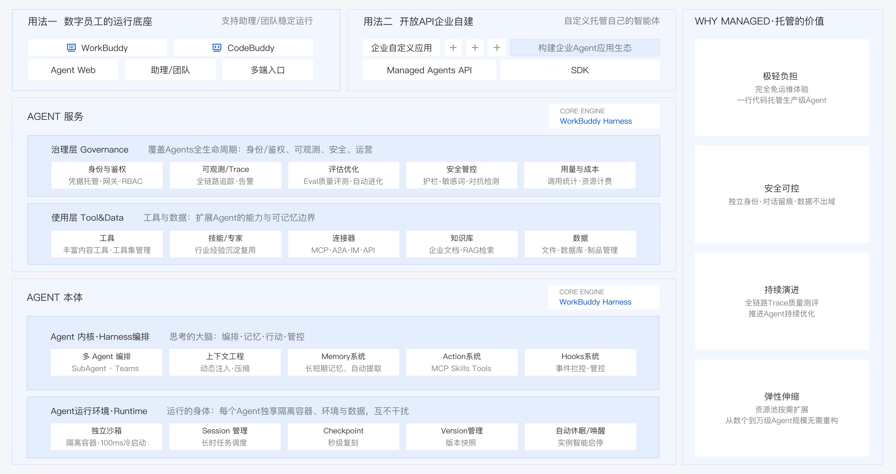

## 产品概述

WorkBuddy Managed Agents（简称 WMA）提供云端托管的智能体运行服务。底层基于 **WorkBuddy Harness 内核**构建，内置 Agent 内核编排与独立沙箱，无需自建基础设施，通过控制台或 API 即可在云端运行复杂任务并接收结果，让企业的每个 Agent 都跑在生产级底座上。WMA 与 WorkBuddy 原生互联，让企业智能体无缝接入 WorkBuddy 管理工作台。

**WMA 的核心定位**：支持企业在云控制台（或通过 ADK / OpenAPI）构建自己的企业智能体，一键下发到 WorkBuddy 客户端供员工使用，并通过运行保障与全链路观测能力推进持续迭代优化——让企业智能体从“构建得出”到“真正用起来、越用越好”。

**统一 Agent 平台**：自建需从 0 构建编排框架、行动调用、Hooks 管理、隔离运行环境与可观测体系，研发与运维成本高，且内核能力难以随模型与工程范式持续演进。WMA 将“Harness 内核 + 云端 Runtime”一体化交付：企业只需通过 API / SDK 或可视化控制台接入业务逻辑，即可一键托管生产级 Agent，显著降低总体拥有成本（TCO）。

**云端运行 Agent**：本地智能体“人在电脑前才运行、单人单机、关机即停”，只能解决个人提效；满足企业级场景要求 Agent 常驻运行（长程任务连续跑完不丢状态）、被系统与事件唤醒（定时/触发式任务无需人在场）、可并发、可审计、可管理——从个人提效迈入企业全栈化改造。

**Agent 全生命周期闭环**：WMA 围绕 Agent“构建 > 下发 > 运行 > 观测迭代”的全生命周期提供闭环能力，让每个 Agent 都具备确定性的运行边界与可量化的质量基线。

> **说明：**
> 
> WorkBuddy Managed Agents 已在腾讯云侧上线，当前在白名单内测阶段，预计10月份将同步完成 WMA 在 WorkBuddy Enterprise 管理端的升级。当前用户可前往 [WorkBuddy Enterprise](https://console.cloud.tencent.com/workbuddy-enterprise) 体验。
> 

## 产品矩阵

WMA 与 CodeBuddy、WorkBuddy 同属 **WorkBuddy Enterprise** 产品矩阵，三者既可独立使用，也可在企业内统一管理与协同：

|产品|CodeBuddy|WorkBuddy|WorkBuddy Managed Agents|
|---------|---------|---------|---------|
|定位|AI 原生全流程编程工具|全场景职场 AI 智能体桌面工作台|云端托管的智能体运行服务|
|目标用户|产品、设计师、全栈开发者及编程初学者|职场全职能角色|企业 IT、平台工程与 Agent 开发者|
|核心能力|对话即编程；插件 / IDE / CLI 三形态；设计稿转代码；开箱即用的生态集成|一句话下达任务，自主规划执行多步骤复杂任务，交付可验收结果|Harness 内核 + 独立沙箱；API 调用即可云端运行复杂任务；Agent 全生命周期治理|

> **说明：**
> 
> CodeBuddy / WorkBuddy 的 Agent 均可托管运行于 WMA 底座。
> 

## 产品优势
1. **构建企业智能体，真正嵌入企业工作流**：在控制台以可视化方式完成 Agent 配置（模型 · System Prompt · Skill · 连接器），或通过 ADK / OpenAPI 用代码构建；构建完成的 Agent 可一键下发至 WorkBuddy 企业端供员工直接使用，也可通过 OpenAPI / A2A / IM Bot 嵌入企业既有系统与业务流程——从“构建得出”到“真正用起来”，成为企业工作流的一部分。

2. **强大任务执行能力**：继承 WorkBuddy 先进 Harness 内核（编排、记忆、行动与管控四层能力），经 2000 万+ 用户验证；办公（写材料 / 做 PPT / 做表跑数）、编码（代码评审 / Bug 修复 / 仓库级重构）、金融分析、产品调研等长程任务均能云端交付，且内核随模型与工程范式持续进化。

3. **开放连接能力**：向内连接海量企业上下文（办公套件、文档、表格、会议、网盘、邮件、企业 AI 资产、MCP 生态、三方系统）；向外提供多协议、多网络服务通道（OpenAPI / SDK、A2A、MCP、IM Bot、推送到 WorkBuddy 终端），网络形态支持公网 / 云 VPC / 私有化。

4. **Agent 专用运行底座**：独享沙箱隔离（1 Session : 1 沙箱）、存算分离（实例销毁不丢数据、秒级 CoW Fork、长任务中断原地续跑）、百万级并发（单集群百万级 Session 在线、创建速度 ≥ 1 万/秒）、极速弹性启停（休眠唤醒 P95 ≤ 300ms，闲置不计费）。

5. **企业级管理体系**：7×24 小时云端运行与自动休眠毫秒级恢复；Agent 一键下发 WorkBuddy 端；企业级安全合规、数据不出域（配置与运行均在云端，敏感产出物云端驻留，支持 VPC 私有网络）；全流程生命周期治理（统一身份、独立运行环境、全链路 Trace、效果评测与持续优化）；可观测、安全审计、成本管控与配额核算。

   

## 平台总体架构

