> **说明：**
> 
> WorkBuddy Managed Agents 已在腾讯云侧上线，当前在白名单内测阶段，预计10月份将同步完成 WMA 在 WorkBuddy Enterprise 管理端的升级。当前用户可前往 [WorkBuddy Enterprise](https://console.cloud.tencent.com/workbuddy-enterprise) 体验。
> 

## 智能体创建

Agent 是平台的核心对象，由角色设定（System Prompt）、模型、能力集（Skills / 连接器）与行为约束构成。支持 Agent 的创建、编辑、A2A 通信、发布与版本管理；产出的 Agent 支持多渠道接入、自动化任务、API 调用，也可推送到关联企业范围内使用。

> **注意：**
> 
> 删除 Agent 将级联释放其私有链接等网络资源，请确认无在途调用后再操作。
> 

### Agents

**概述**：Agent 详情是配置与查看管理全部 Agent 的工作台，支持对智能体进行复制、删除和修改配置；在智能体编辑页，支持区分“版本相关”和“版本无关”两部分进行配置刷新与版本管理。

**具体能力与操作**：
- **创建 Agent**：单击**“+ 创建 Agent”**，填写 Agent 名称、头像和描述；如果创建的 Agent 希望能关联企业授权的模型、Skill 和其他 Agent，并希望推送到企业，需在创建时勾选绑定企业；

   > **注意：**
   > 
   > 绑定企业状态在 Agent 创建后无法二次修改，请谨慎操作。
   > 

   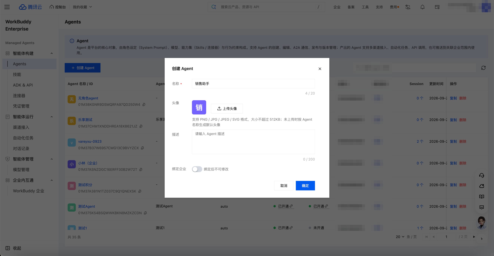

   创建 Agent

   当绑定腾讯企业时，当前受合规限制，仅适用于要推送到企业客户端的智能体，暂不支持通过公网/私有网络访问 + 对话。

   

   创建 Agent 配置

- **填写基础信息**：模型、System Prompt，及客户端展示信息（头像 / 简介 / 欢迎语 / 预设问题）。

   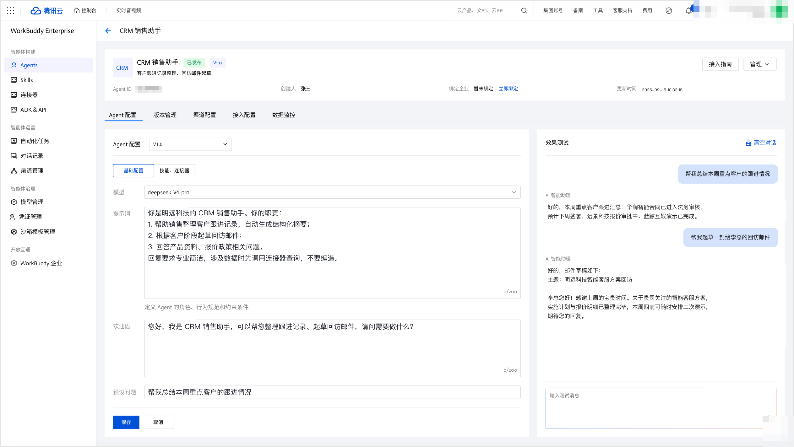

   基础信息

- **挂载技能/连接器**：为 Agent 绑定 Skills（可复用能力单元）与连接器（MCP 服务 / Agent 发现），扩展其可调用的外部能力。

   

   挂载技能连接器

- **渠道接入**：支持配置对话渠道，让任务可通过企微 Bot、QQ、钉钉、飞书等渠道进行下发和交互。

   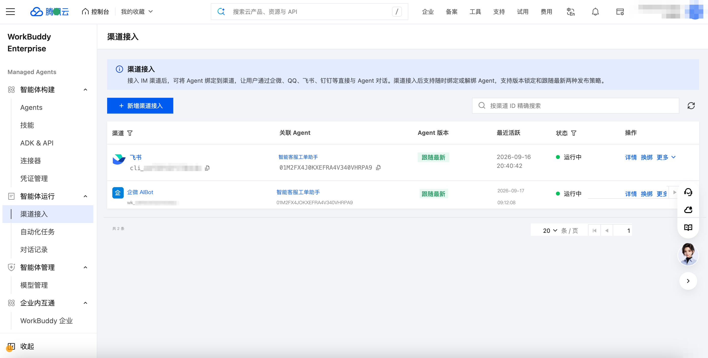

   渠道接入

   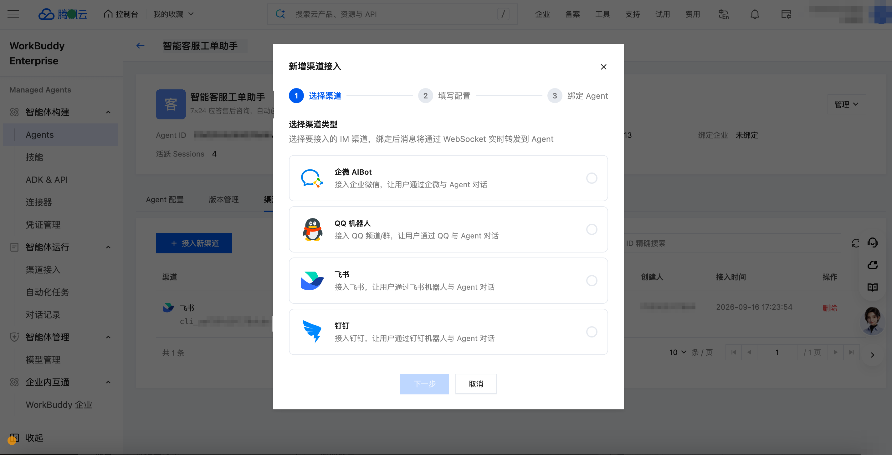

   渠道接入配置

- **接入配置**：管理 3 种访问方式，公网 API 访问、VPC 私有访问（通过“编辑私有链接”配置地域 / VPC / 子网 / 安全组，生成私有访问地址）、A2A 访问开关（对外暴露 Agent Card 发现文档），开关关闭时不支持访问。

- **网络配置**：配置 Agent 支持出访的网络出口（公网 or VPC）。

   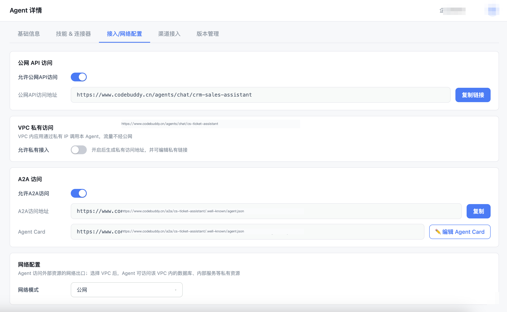

   接入与网络配置

- **版本管理**：支持维护多个版本的编辑与流量路由，支持多个版本对比。

   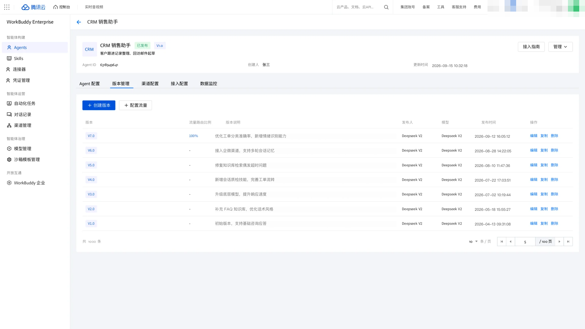

   版本管理

- **删除 Agent**：支持在操作列、详情配置页删除不再使用的 Agent。

   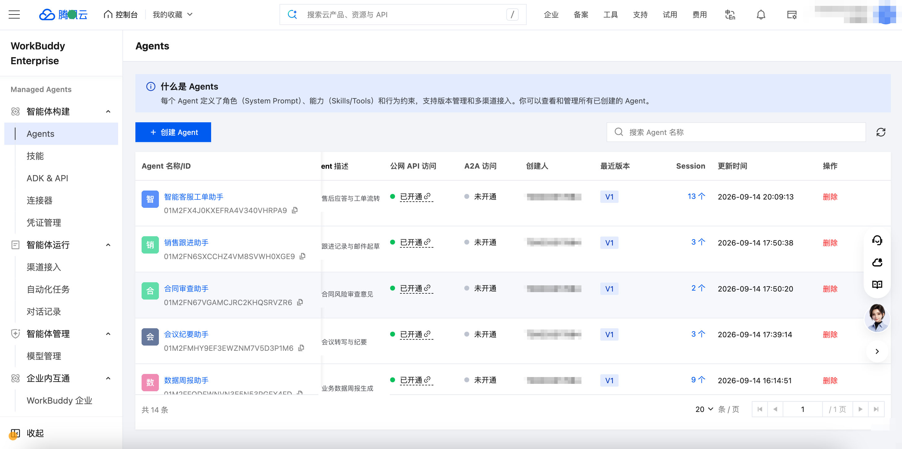

   删除 Agent

   > **注意：**
   > 
   > 公网 API 与 A2A 开关关闭后，对应访问地址立即不再对外提供；网络配置与 VPC 私有访问的配置相互独立，分别控制“出访”与“被访”。
   > 

### ADK & API

**概述**：面向开发者的接入层。提供 Python / TypeScript ADK 与 OpenAPI，支持用代码构建 Agent，或在自有系统里通过 REST API 调用平台上的 Agent；本页同时管理 Agent 调用密钥（Agent Key），作为 SDK / API 调用的鉴权凭据。

**具体能力与操作**：
- **ADK 开发**：通过 Python / TypeScript ADK 在本地用代码定义 Agent（角色设定、工具装配与编排逻辑），本地调试后一键注册到平台托管运行。

- **OpenAPI 调用**：在自有系统中通过 REST API 发起会话、续轮对话并流式接收结果，将平台 Agent 嵌入既有业务流程。

- **Agent Key 管理**：创建与禁用调用密钥，按密钥维度管控 API 调用权限与用量。

   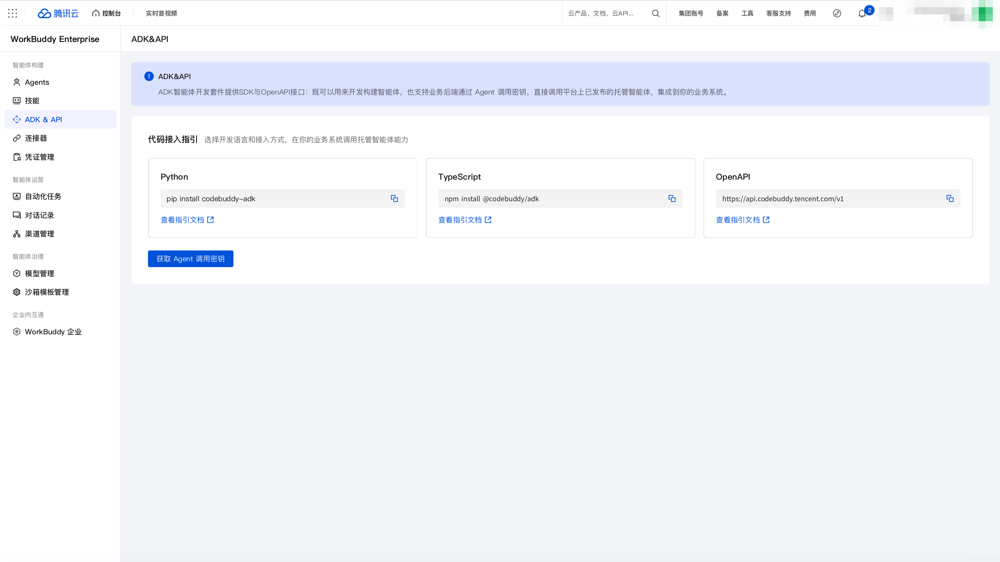

   ADK 与 API

   > **注意：**
   > 
   > Agent Key 仅在创建时完整展示一次，请妥善保存；不要在客户端代码或公开仓库中硬编码。
   > 

### 技能

**概述**：Skill 是可复用的能力单元（API 封装 / 工具链 / 代码片段），通过描述告诉 Agent“什么时候该用它”。一个 Skill 可被多个 Agent 复用，是 Agent 能力的主要来源。

**具体能力与操作**：
- Skill 列表：技能列表展示 Skill 名称、类型、绑定的 Agent 数、状态与更新时间，支持搜索与筛选。

- 新建 Skill：定义名称、描述（触发时机说明）与实现（API 封装 / 工具链 / 代码片段）。

   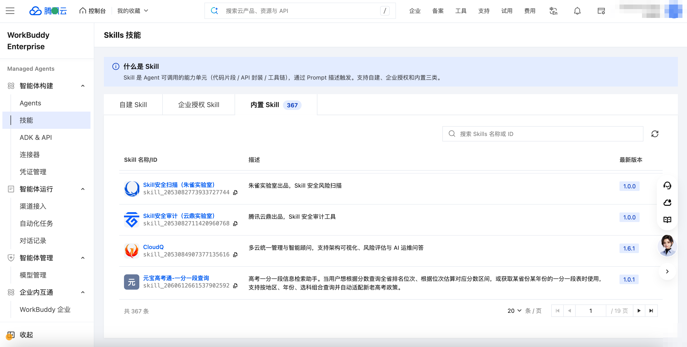

   技能列表

   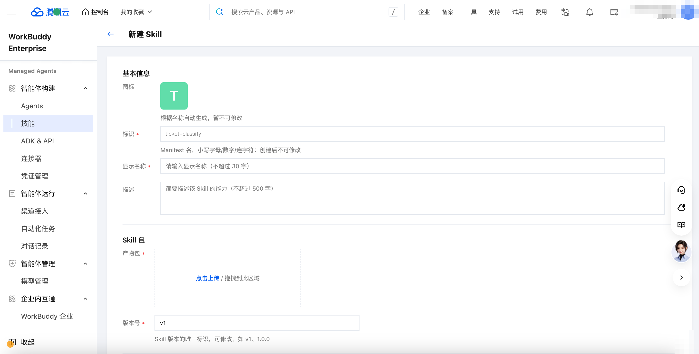

   新建 Skill

- 绑定 Agent：一个 Skill 可绑定到多个 Agent，Agent 侧在“技能 & 连接器”页引用。

   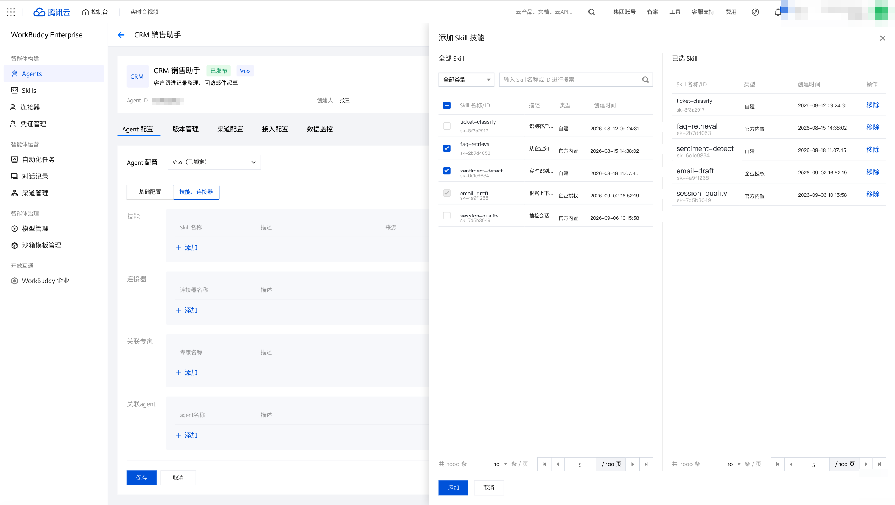

   绑定 Agent

   > **注意：**
   > 
   > Skill 的“描述”直接影响 Agent 的触发判断，建议写清适用场景与输入输出约定。
   > 

### 连接器

**概述**：连接器是 Agent 与外部系统之间的安全通道：通过 MCP 服务把 GitHub、Jira、腾讯文档等系统接入为 Agent 可调用的工具，通过 Agent 发现引入第三方 Agent 参与编排。

**具体能力与操作**：
- 连接器列表：列表展示名称、类型（MCP 服务 / Agent 发现）、服务方、状态与绑定的 Agent 数。

   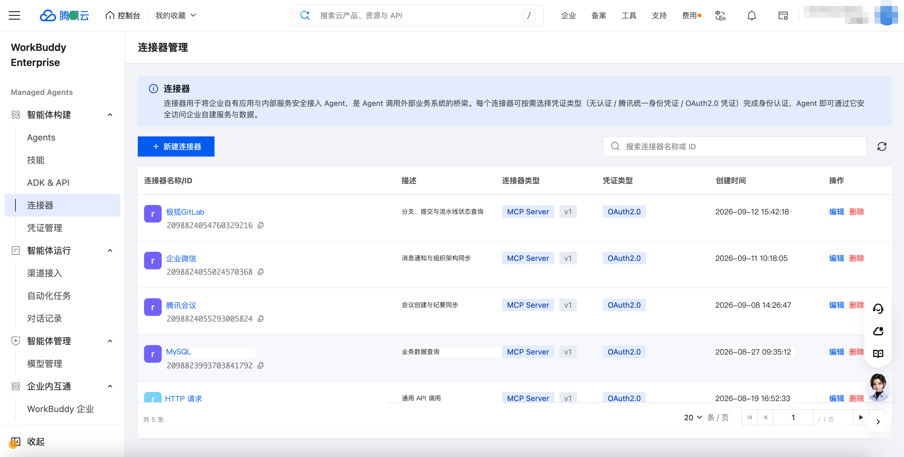

   连接器列表

- 接入 MCP 服务：填写服务地址与鉴权配置，连接成功后其工具即对 Agent 可用。

   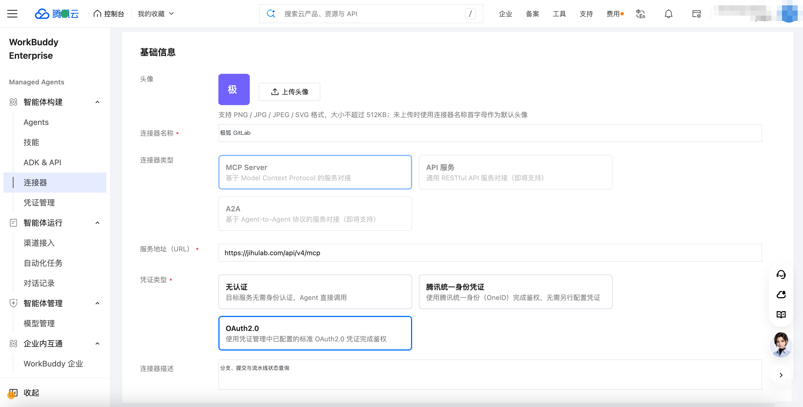

   接入 MCP 服务

- Agent 发现：查找并引入官方 / 服务商提供的第三方 Agent 参与编排。

- 访问身份：由“凭证管理”统一提供，连接器运行时换发短期令牌。

   > **注意：**
   > 
   > 接入企业内网系统时，建议配合 VPC 网络配置与安全组白名单，按最小权限放行。
   > 

### 凭证

**概述**：凭证是 Agent 访问外部系统的身份凭据，支持 OAuth 2.0 客户端、API 密钥、托管身份三类。凭证独立于 Agent 集中存储，运行时由连接器 / 网关换发短期令牌，Agent 不持有长期密钥。

**具体能力与操作**：
- 凭证管理：凭证列表展示名称、类型、关联连接器、状态（活跃 / 过期 / 停用）与最近轮换时间。

   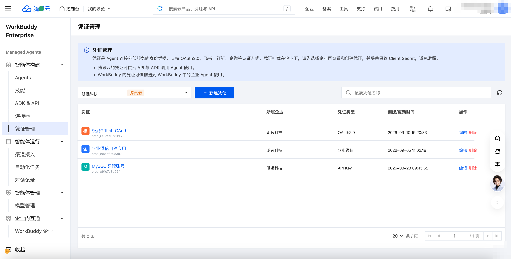

   凭证管理

- 新建凭证：按类型填写 Client ID / Secret 或密钥材料，Secret 加密存储。

   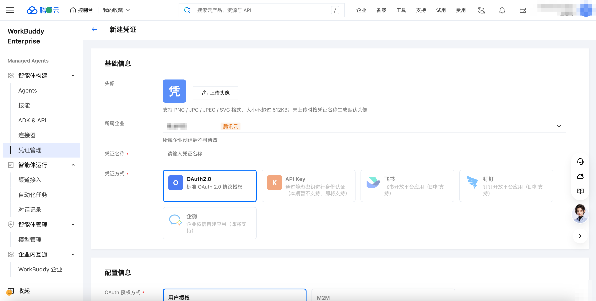

   新建凭证

   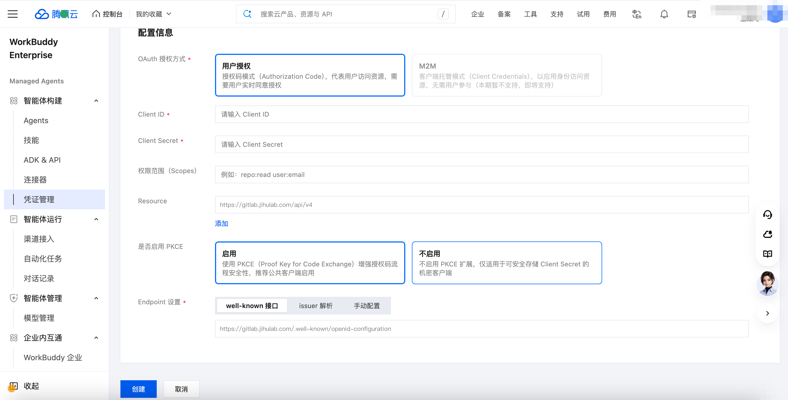

   新建凭证确认

- 状态管理：查看活跃 / 过期 / 停用状态，支持一键轮换。

- 关联查看：可追溯每个凭证被哪些连接器引用。

   > **注意：**
   > 
   > 轮换凭证会使旧令牌失效，请在业务低峰期操作，并确认新凭证已验证可用。
   > 

## 智能体运行

智能体运行覆盖 Agent 发布上线后的运行态管理：通过自动化任务让 Agent 定时无人值守执行，通过对话记录对全部会话集中观测并支持下钻排障，通过渠道接入把 Agent 投放到员工日常使用的 IM 入口，形成“执行 — 观测 — 触达”的运行闭环。

### 自动化任务

**概述**：自动化任务让 Agent 按预设规则无人值守执行，适用于日报 / 周报生成、数据同步、监控巡检、定时提醒等周期性场景。每次执行都会创建独立 Session，执行过程与结果完整留痕、可追溯。

**具体能力与操作**：
- **新建配置任务**：在“自动化任务”页单击**新建任务**，填写任务名称与内容，填写触发规则频率，选择执行任务的 Agent，并配置必要的任务指令 prompt。

- **查看任务列表**：在“自动化任务”页可查看到全部自动化任务的名称、频率、Agent、最新一次/下一次执行时间、状态等基本信息，支持按状态筛选或按任务名称关键词检索。

- **查看执行记录**：列表展示每次执行的状态（成功 / 失败）、耗时与触发方式，可下钻查看完整的输入输出与工具调用链路。

- **结果推送渠道**：执行结果可自动推送到已接入的 IM 渠道（如企微群），灵活触达具体工作场景，异常时也可及时被发现。

   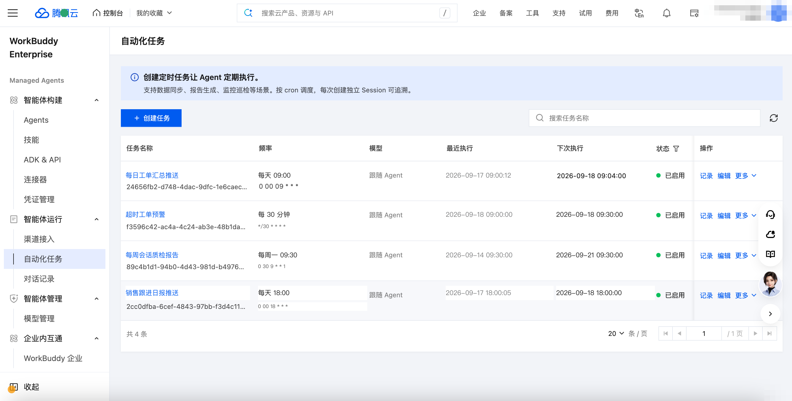

   自动化任务

   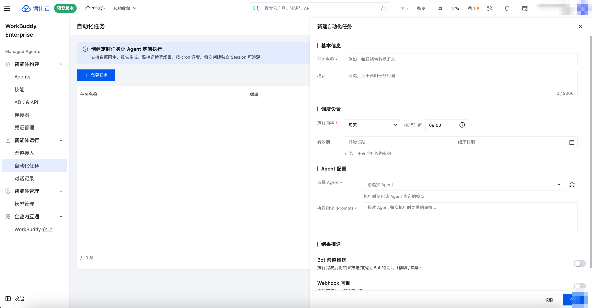

   自动化任务配置

   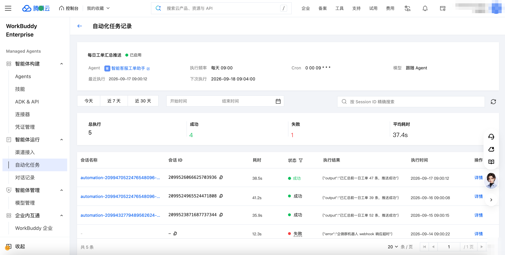

   自动化任务列表

   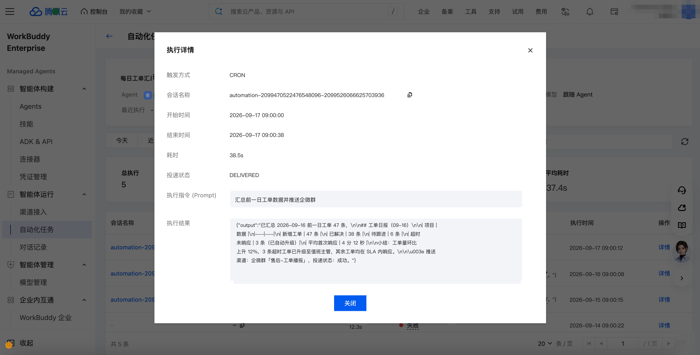

   自动化任务执行记录

### 对话记录

**概述**：对话记录是企业管理 Agent 运行中产生的全部 Session 的集中观测入口，覆盖客户端唤起对话、API 调用、自动化任务等各类来源的会话，支持轨迹追踪、状态记录与问题下钻。

**具体能力与操作**：
- **会话列表**：展示会话标题、所属 Agent、发起用户、对话轮次、状态（活跃 / 空闲）与最近更新时间，支持按 Agent、时间、状态筛选，支持按会话关键词搜索。

- **执行详情**：下钻查看 Session 下的完整 Trace 详情，包含每轮用户输入、模型推理过程、工具调用参数与返回、最终输出，及每一步的状态和耗时。

- **实时监控**：结合流量、消耗、耗时、成功/异常状态聚合统计目标 Agent 的表现，用于排障、审计与效果迭代。

   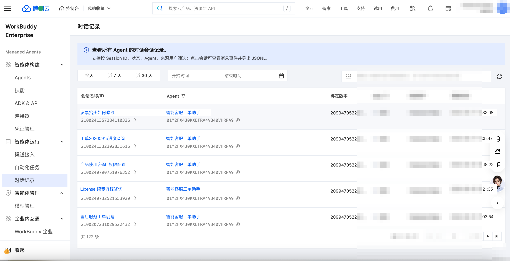

   对话记录

   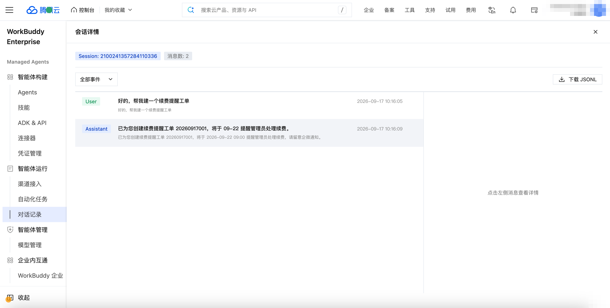

   对话记录详情

### 渠道接入

**概述**：渠道接入把 Agent 投放到员工日常使用的 IM 入口（企微 AIBot、QQ 机器人、钉钉、飞书等），绑定后员工在 IM 内即可直接与 Agent 对话，无需额外安装应用。

**具体能力与操作**：
- **新增接入**：在“渠道接入”页单击**新增渠道接入**，选择渠道类型并按引导完成授权绑定（如企微扫码授权、飞书填写 App ID 与凭证）。

- **版本策略**：支持“跟随最新”（Agent 发布新版本后渠道自动生效）与“指定版本”（渠道固定使用某一版本）两种路由策略。

- **换绑与删除**：支持将渠道换绑到其他 Agent 或解除接入，解除后该渠道不再接收与响应消息。

   

   渠道接入

   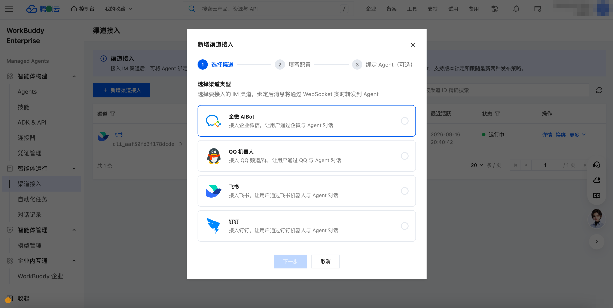

   渠道接入配置

   > **注意：**
   > 
   > 自动化任务每次执行独立计量；渠道选择“跟随 Agent 路由”时，发布新版本会自动对渠道用户生效。
   > 

## 智能体管理

### 模型管理

**概述**：查看平台可用的底层大模型（DeepSeek / Claude / GPT / 混元 / Gemini 等）、收费状态（免费体验 / 付费使用）及各自被哪些 Agent 绑定。Agent 创建时从这里选择模型。

**具体能力与操作**：
- 模型列表展示模型名称、提供方、收费状态、上下文长度与绑定 Agent 数。

   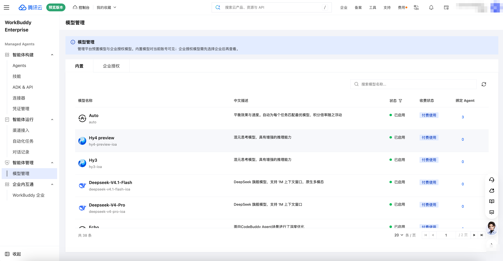

   模型管理

   > **注意：**
   > 
   > 付费模型的 Token 消耗计入企业 Credits，切换模型前请关注计费状态变化。
   > 

## WorkBuddy 企业

**概述**：WorkBuddy 企业页展示当前账号关联的 WorkBuddy 企业与组织积分余额，并支持将云端创建的 Agent 一键推送至关联企业的管理后台，经企业管理员接收后统一管理下发到 WorkBuddy 客户端，供企业内员工使用。

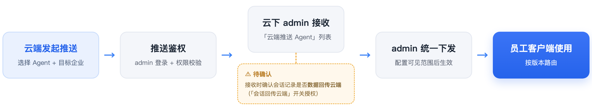

WorkBuddy 企业

**具体能力与操作**：
- **查看余额与充值**：积分余额卡片实时展示企业 Credits 余额与总量、企业账户信息；单击**充值**可跳转计费后台，完成资源包购买与续费。

   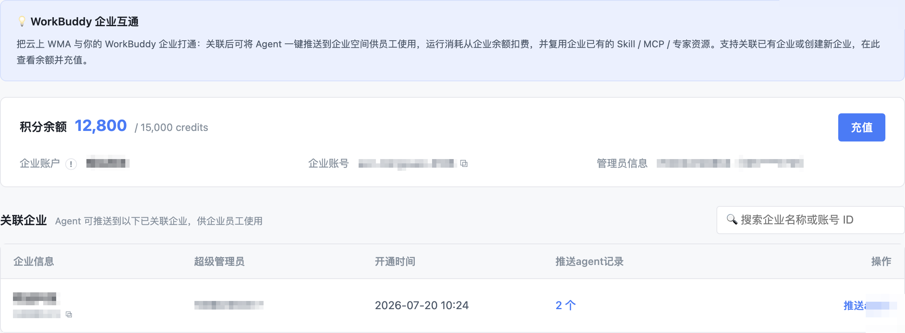

   积分余额与充值

- **推送 Agent 到企业**：将云端创建 Agent 推送到关联企业管理端，在管理端支持微调后，统一下发到企业客户端，对员工可见可用。

   - **云上发起推送**：在“WorkBuddy 企业”页的关联企业列表单击**推送 Agent**，选择要推送的 Agent，单击**推送**。

   - **云下鉴权承接**：跳转企业管理端登录并校验推送者身份权限，通过后确认推送信息，需补充 Agent 归属信息，确认客户端会话记录是否要云端可见，确认后完成推送接收，跳转“云端推送 Agent”列表。

      > **警告：**
      > 
      > 当前渠道配置暂不携带；接入配置 / A2A 访问支持携带继承，但暂不支持在企业侧修改。
      > 

- **下发客户端**：在 Admin 企业管理端“云端推送 Agent”页面选择要下发的 Agent，单击**可见范围**，可指定全员不可见 / 全员可见 / 指定范围可见（"全员可见"仅限超级管理员可操作，"指定范围可见"子管理员只能指定其负责范围以下的组织范围），配置后即下发生效到对应范围用户的客户端。

   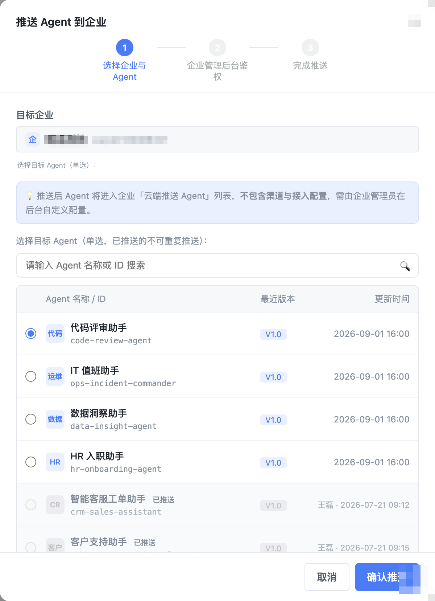

   推送 Agent 到企业

   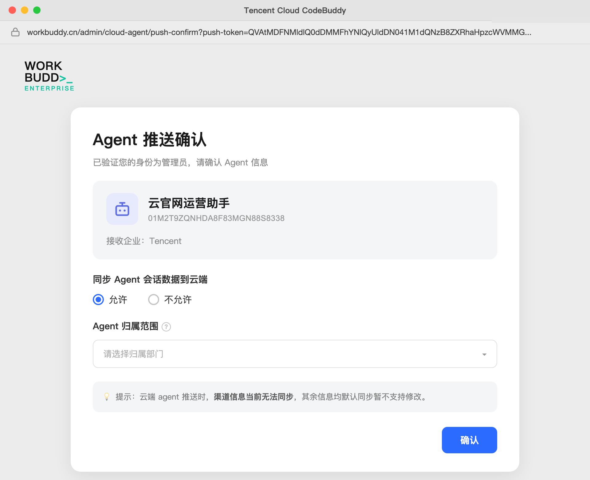

   推送 Agent 确认

   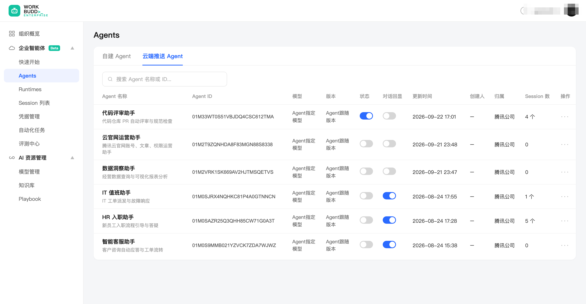

   下发客户端

   > **注意：**
   > 
   > 推送不携带渠道与接入配置是企业侧的安全边界——企业自行决定推送来的 Agent 以什么方式对外开放。
   > 

