> **说明：**
> 
> WorkBuddy Managed Agents 已在腾讯云侧上线，当前在白名单内测阶段，用户可前往 [WorkBuddy Enterprise](https://console.cloud.tencent.com/workbuddy-enterprise) 申请内测开通并体验。同时，预计10月份完成 WMA 在 WorkBuddy 企业管理端的升级。
> 

## 开通指南

开通 WMA 服务需绑定 WorkBuddy 企业版席位（Credits 资源包是运行计量的扣费载体）。开通流程如下：

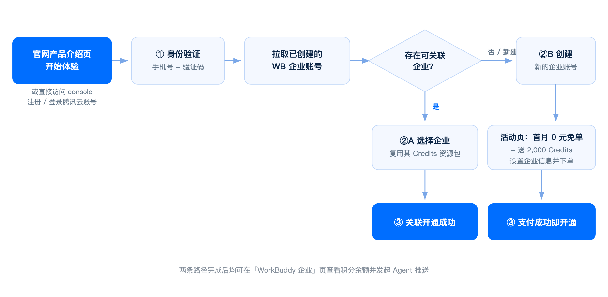

企业开通流程

1. 访问腾讯云 [WorkBuddy Managed Agent 控制台](https://console.cloud.tencent.com/workbuddy-enterprise)，完成登录，单击**立即开通**。

   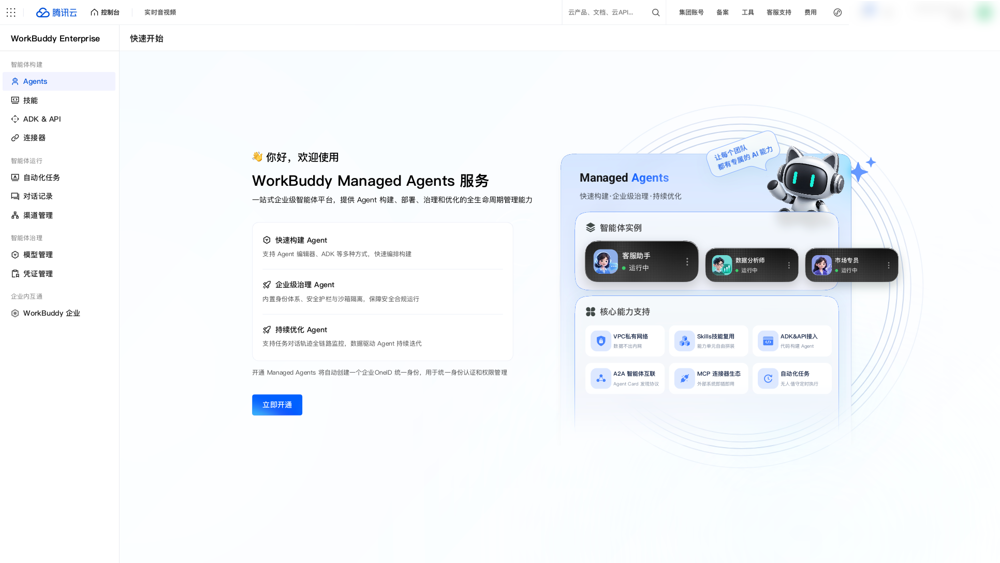

   立即开通

2. **进行身份验证**：输入手机号，通过验证码验证，识别用户身份及关联企业情况。

   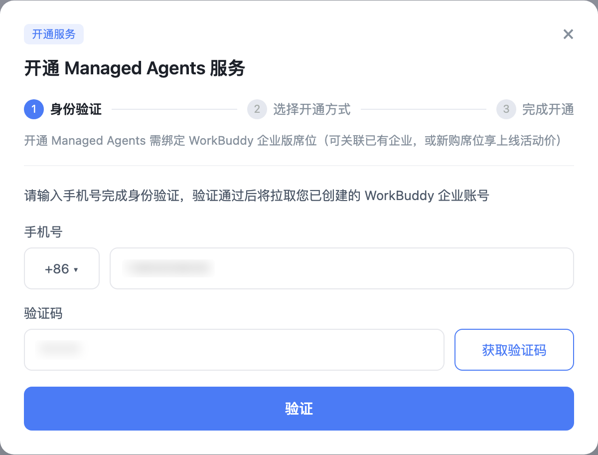

   身份验证

   - **路径 A：关联已有企业（零支付）**

      身份验证通过后，系统拉取当前账号已创建的 WorkBuddy 企业账号。已创建 Credits 资源包的企业直接外显供选择，单击即完成关联开通：复用该企业 Credits 资源包扣费，并可向该企业推送 Agent。

      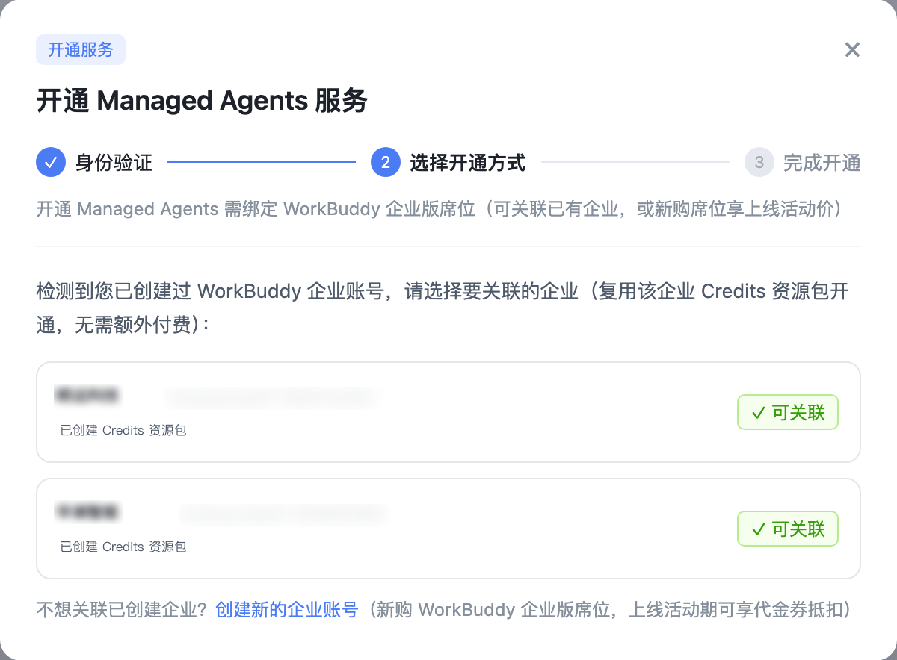

      关联已有企业

   - **路径 B：创建新企业（活动价下单）**

      未检测到已创建企业，或选择“创建新的企业账号”时，进入合并开通页：左侧为上线限时活动，右侧填写企业名称（超级管理员手机号默认转入已验证手机号）。“暂不开通”即结束流程；“确认开通”进入收银台完成订单，支付成功即完成开通。

      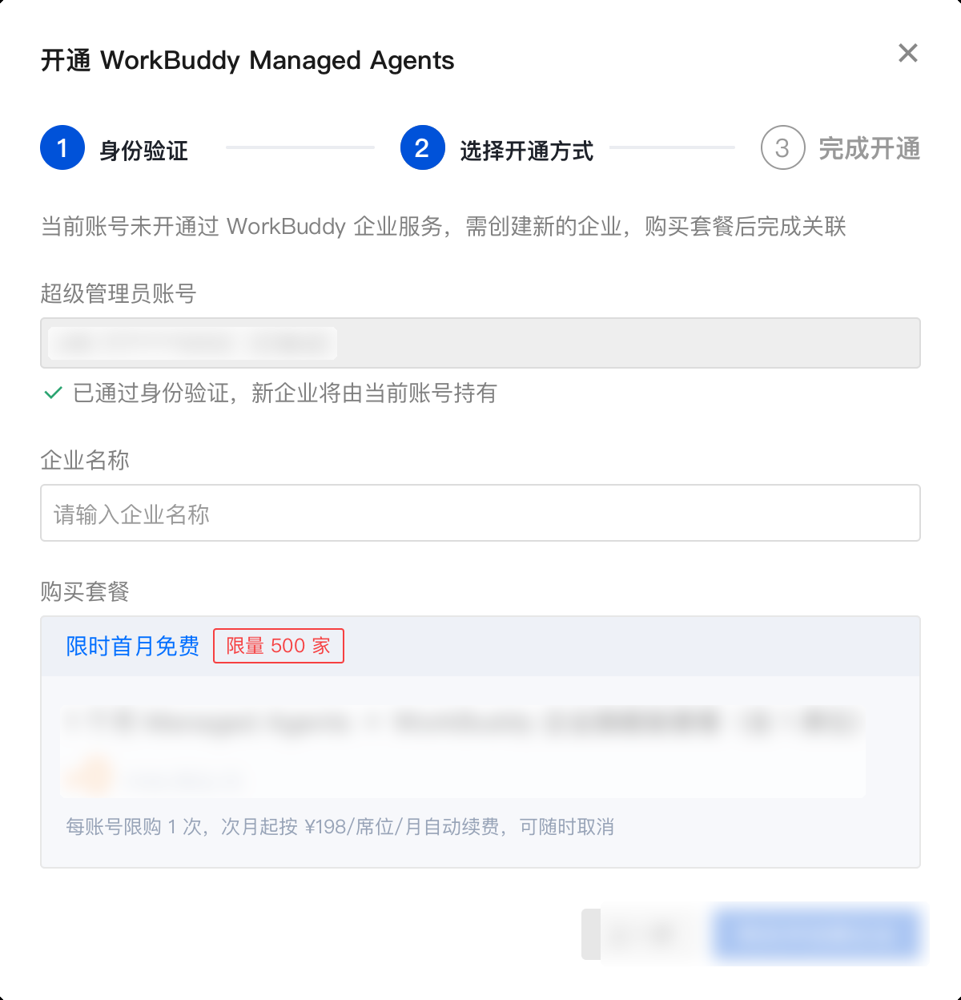

      创建新企业

      > **说明：**
      > 
      > 上线限时活动规则：首月 ¥0 免单，再送 2,000 Credits 积分；限量 500 家，每账号限享 1 次；次月起按 ¥198/席位/月 续费，可随时取消。活动名额用尽后按定价下单。
      > 

## 快速入门

开通完成后，按以下六步完成第一个 Agent 从创建到监控的完整闭环：

### **步骤1：**创建 Agent

在 Agents 页单击“**+ 创建 Agent**”，支持多种构建方式：
- 控制台可视化创建：填写名称、选择模型、编写 System Prompt（角色设定与行为约束）。

- ADK 开发智能体：通过 Python / TypeScript ADK 用代码定义并注册 Agent。

- 对话构建智能体（待上线）：通过自然语言对话快速生成 Agent 草稿。

   > **说明：**
   > 
   > 如果创建的 Agent 希望能关联企业授权的模型、Skill 和其他 Agent，并希望推送到企业，需在创建时勾选绑定企业；当绑定腾讯企业时，当前受合规限制，仅适用于要推送到企业客户端的智能体，暂不支持通过公网/私有网络访问 + 对话。
   > 

   

   创建 Agent

   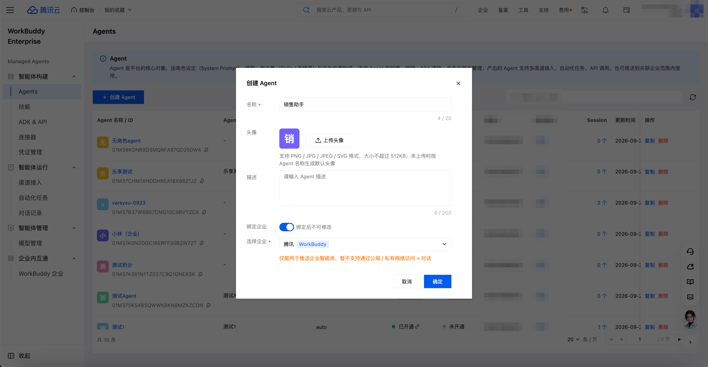

   创建 Agent 配置

   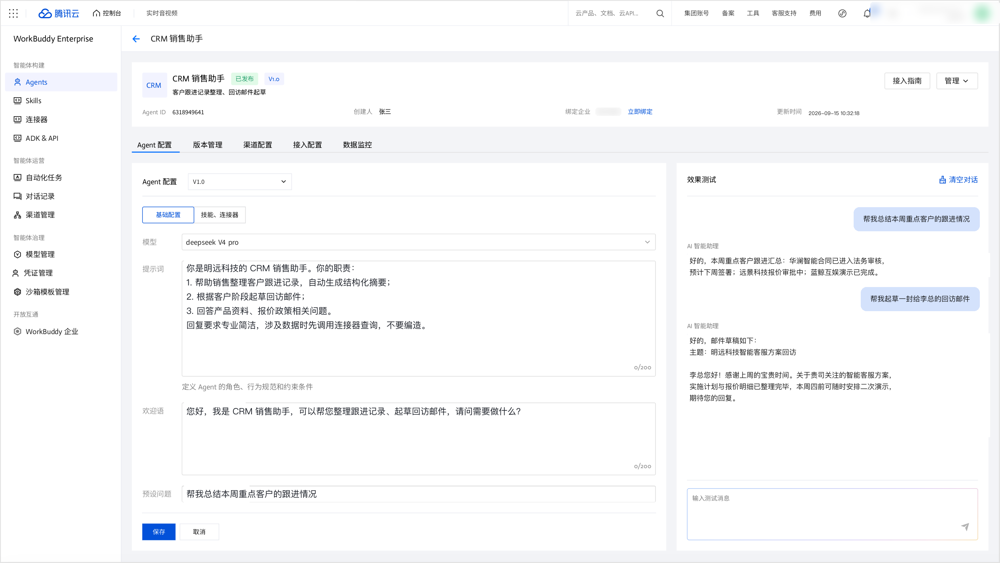

   创建 Agent 确认

   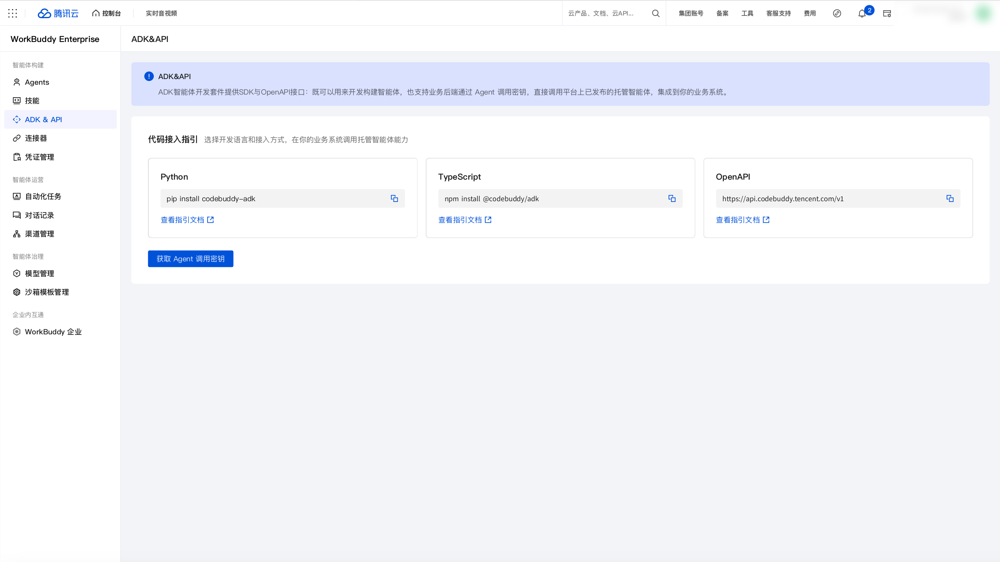

   创建 Agent 完成

### **步骤2：**装配能力

在“技能 & 连接器”页为 Agent 扩展可调用的外部能力：
- 绑定 Skills：选用官方 20+ 预置 Skill 或自建 Skill，一个 Skill 可绑定多个 Agent。

- 接入连接器：通过 MCP 服务接入 GitHub、Jira、腾讯文档等外部系统。

- 配置凭证：在凭证管理统一配置 OAuth / API 密钥等访问身份，Agent 不持有长期密钥。

   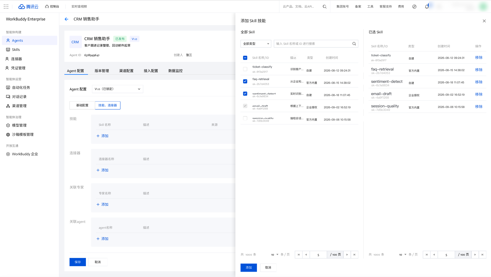

   装配能力

### **步骤3：**调试验证

发布前先在 Test Run 中验证行为：
- 用真实业务问题试跑，观察模型推理、工具调用与最终输出是否符合预期。

- 不符合预期时迭代 System Prompt 与能力配置，重新验证直至达标。

   

   调试验证

### **步骤4：**接入触达

在“接入/网络配置”选择 Agent 的触达方式：
- 系统接入：公网 API / VPC 私有访问 / A2A（供其他 Agent 发现调用）。

- 人的触达：绑定企微等 IM 渠道让员工直接对话，或配置 cron 自动化任务定时执行。

   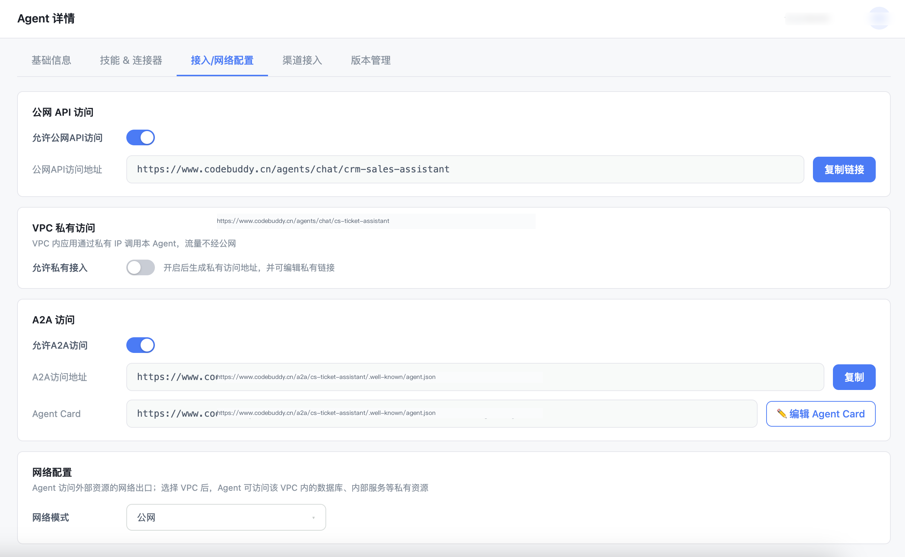

   接入触达

### **步骤5：**发布与推送
- 保存/新建版本：支持保存发布，也支持新建一个版本迭代，支持多版本并存。

- 推送 Agent 到企业：将 Agent 推送到关联的 WorkBuddy 企业供员工使用，运行消耗将从企业 Credits 资源包余额扣费。

   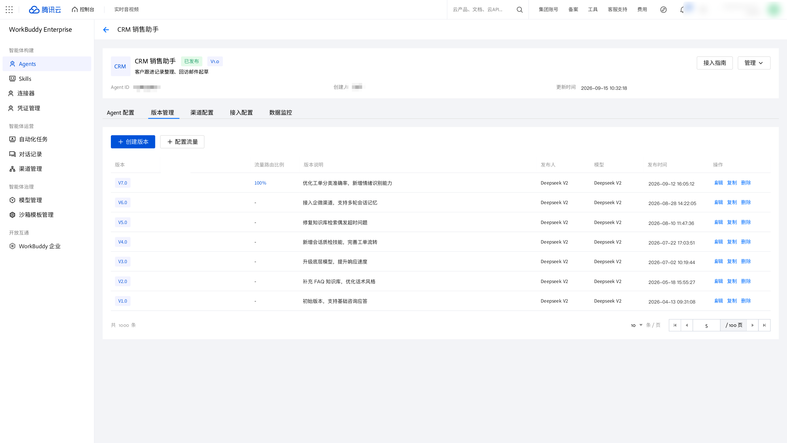

   发布与推送

   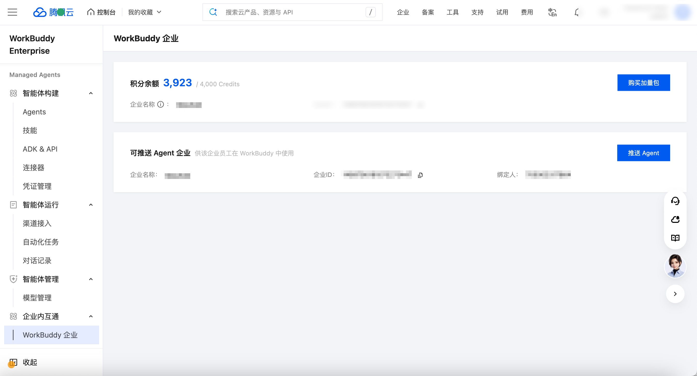

   推送 Agent

   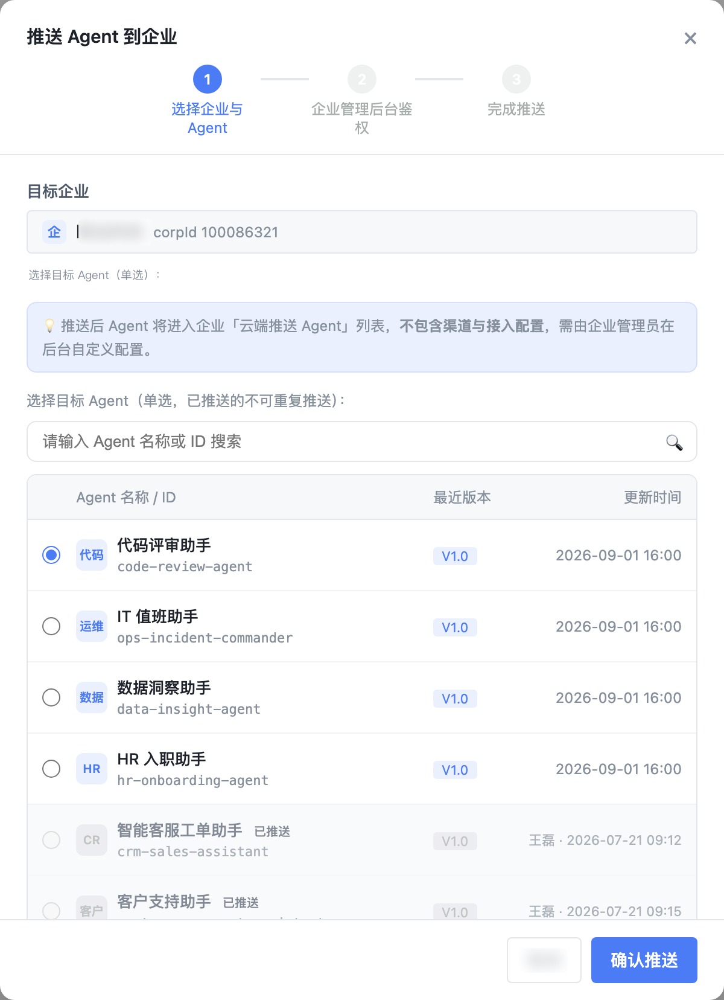

   推送完成

### **步骤6：**会话记录监控
- 在“对话记录”查看所有 Session 的执行状态、耗时与发起方。

- 下钻单条 Session 的完整 Trace，逐步排查工具调用，持续跟踪线上质量。

   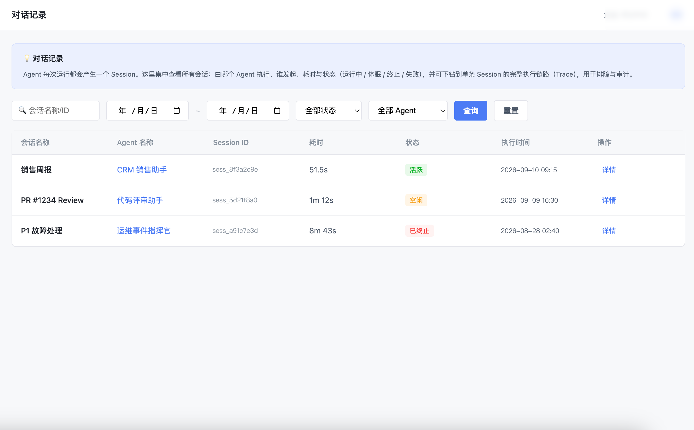

   会话记录监控

   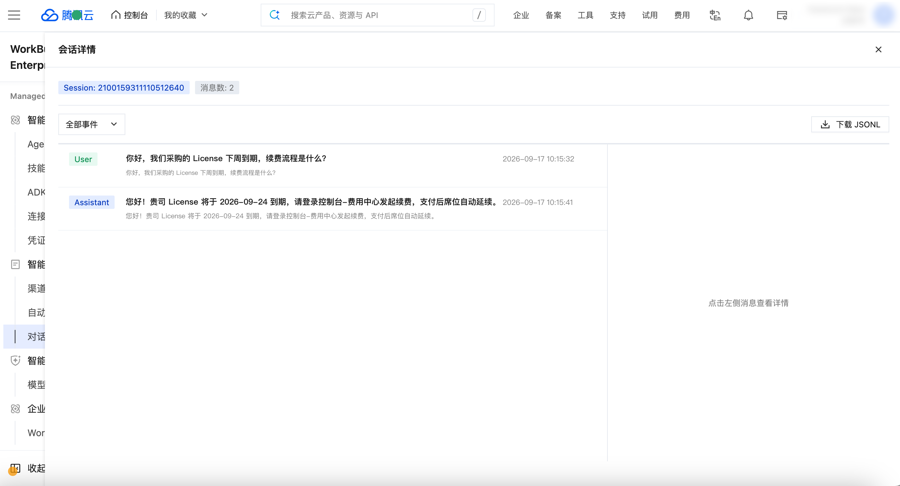

   会话 Trace

