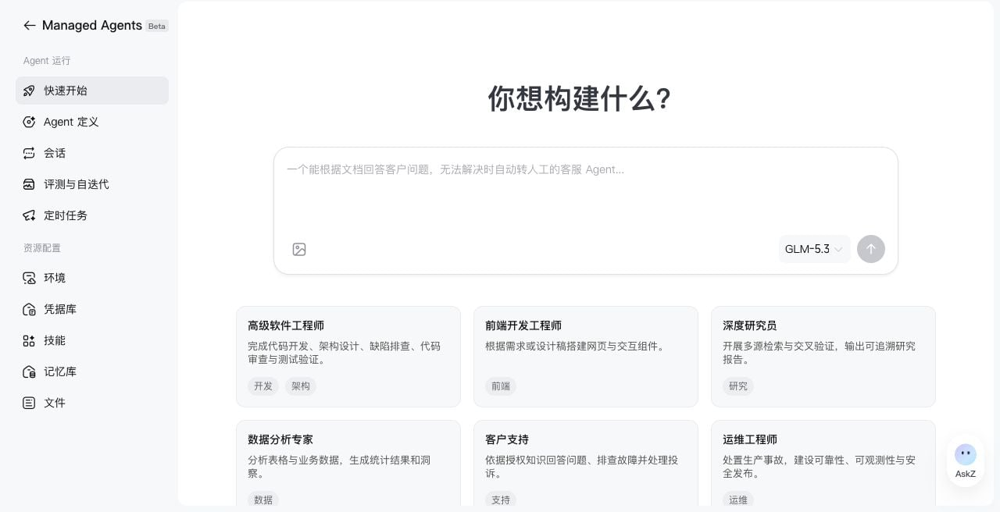

> ## Documentation Index
> Fetch the complete documentation index at: https://docs.bigmodel.cn/llms.txt
> Use this file to discover all available pages before exploring further.

# 快速入门（控制台）

> 描述任务、确认配置，在控制台完成第一次 Agent 运行。

在控制台中描述你要完成的任务，确认 Agent 和环境配置，再运行一个真实样例。完成后，你会得到一个可复用的 Agent 和一次可查看执行过程的 Session。

> [!NOTE]
>
> Multi Agent、Advisor、Thread 和聊天渠道接入暂不支持控制台操作，请通过对应 API 使用。

## 开始前

登录[智谱开放平台控制台](https://www.bigmodel.cn/managed-agents/quick-start)，进入 **Managed Agents → 快速开始**。准备一个输入明确、结果容易检查的小任务；如果任务调用外部服务，再准备对应凭据。



希望直接写代码接入应用，见[快速入门（API）](quickstart.md)；希望让本地编程助手完成配置，见 [Z Agent Builder Skill](builder-skill.md)。

## 完成第一次运行

**1. 描述任务或选择模板**

输入用途、输入材料和预期产物。例如：

```text theme={null}
创建一个数据分析 Agent：读取我上传的销售 CSV，
按月份汇总销售额，检查缺失值，输出一份 Markdown 报告。
不要修改原始数据；报告保存到 /mnt/session/outputs。
```

也可以选择模板，或从空白配置开始。先完成一个能验证的小任务，再逐步添加能力。

**2. 检查并创建 Agent**

检查生成的名称、模型、System Prompt、工具、MCP 和 Skills。确认输入要求、工具用途和输出路径，再创建 Agent。

需要读图时选择 `glm-5.3-flash` 或 `glm-5.3-flashx`。需要联网检索时，确认内置工具集已开启 `web_search` 与 `web_fetch`；搜索位置、网页读取长度和调用权限可在工具配置中调整，见[工具](tools.md)。

生成的内容先作为草稿供你确认。创建后继续修改配置，需要保存为新版本；后续会话使用哪个版本，要在创建会话时确认。

**3. 配置环境和凭据**

选择已有环境，或按引导创建环境，确认软件包与网络访问范围。

如果 MCP 或外部服务需要鉴权，选择或创建凭据库并添加凭据。把密钥保存在凭据库中，避免写入任务描述、System Prompt 或 Skill。无需外部鉴权时，可跳过凭据配置。

**4. 发送测试任务**

确认测试任务内容，启动会话。需要文件输入时上传材料；在会话中查看回复、工具调用与文件产物。

第一次先检查三件事：是否读到了正确输入、工具是否成功、产物是否符合要求。遇到工具确认请求时，检查调用参数后决定是否允许。

**5. 保留结果并继续使用**

在 **Agent 定义** 中找到已创建的 Agent，在 **会话** 中查看本次运行。下载报告并确认内容；需要调整时，修改 Agent 后创建新会话验证。

流程跑通后，可以按向导获取接入代码，或配置定时任务。正式批量使用前，建议先建立[评测与自迭代](evaluation.md)流程。

## 接下来去哪里

| 你要做什么 | 文档 |
| - | - |
| 修改模型、提示词或 Skills，管理版本 | [定义 Agent](agent-setup.md) |
| 查看工具失败、资源挂载和执行事件 | [在控制台查看与调试会话](session-debugging.md) |
| 配置软件包与网络权限 | [配置运行环境](cloud-environment.md) |
| 定时执行已验证的任务 | [定时部署](deployments.md) |

资源加载失败时，先确认登录状态、资源所属账号与访问权限，再重试。


This documentation is built and hosted on [Mintlify](https://mintlify.com), a developer documentation platform.