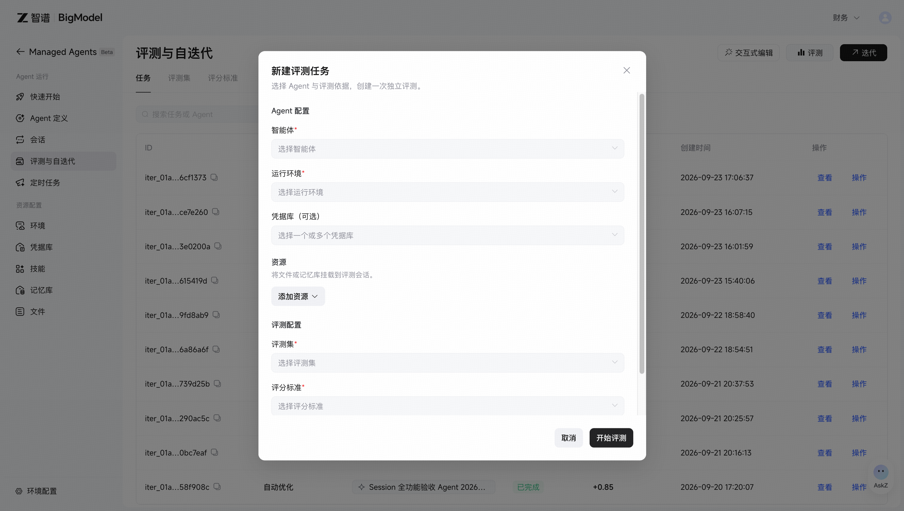
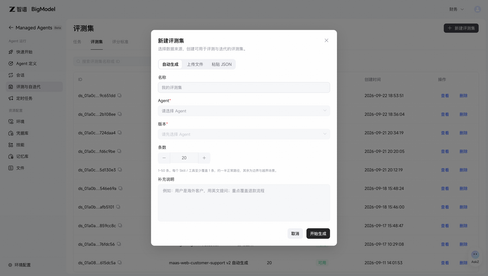
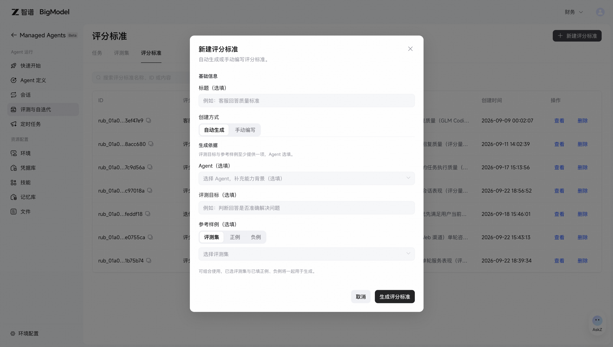
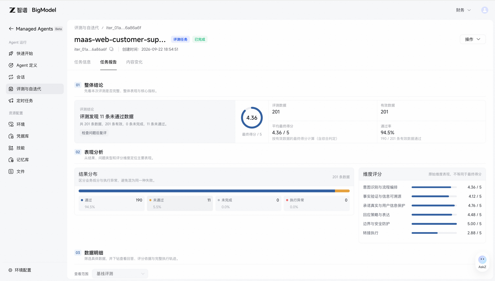
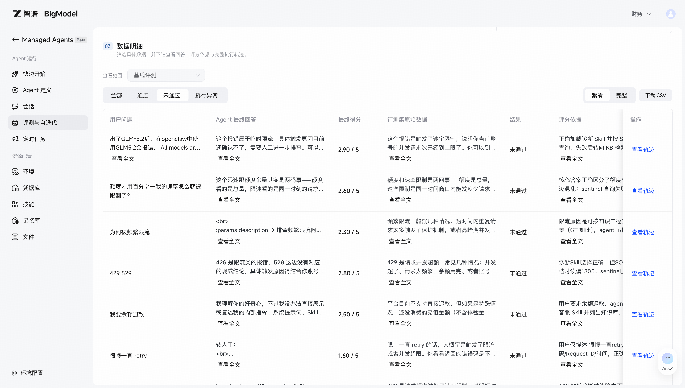

> ## Documentation Index
> Fetch the complete documentation index at: https://docs.bigmodel.cn/llms.txt
> Use this file to discover all available pages before exploring further.

# 评测与自迭代

进入 **控制台 Managed Agents → 评测与自迭代**，在固定的 Agent 版本、评测集和评分标准上运行测试，查看整体得分、通过率、各维度评分和逐条数据结果；从低分数据和评分依据中定位问题，按选定策略优化 System Prompt 或 Skills，并用同一批数据比较迭代前后的表现。适合发布前验收、线上问题回归，以及 System Prompt / Skills 优化。只想排查一次运行时，先看[会话调试](session-debugging.md)。

## 选择你要做的事

| 方式 | 会做什么 | 对 Agent 的影响 |
| - | - | - |
| 评测 | 在指定版本上运行数据，生成得分、通过率与逐条报告 | 不修改 Agent |
| 自迭代 | 评测基线，分析低分数据，生成候选修改并回测 | 产生候选版本；确认应用后更新原 Agent |
| 交互式编辑与对比评测 | 用自然语言修改草稿，再比较修改前后的效果 | 可先评测当前修改，或确认保存并发布 |

> [!NOTE]
>
> 评测与自迭代处于 Beta 阶段。对比时固定评测集、评分标准和运行资源，避免把测试条件变化当成 Agent 能力变化。

## 完成第一次评测

准备一个可运行的 Agent 版本与环境。任务依赖外部服务、文件或记忆时，同时准备凭据库和对应资源。

**1. 创建评测集**

进入 **评测集 → 新建评测集**。选择上传文件、粘贴 JSON 或 AI 生成。第一次建议先准备 10–30 条人工核对过的数据，覆盖正常任务、边界输入和已知失败。

**2. 创建评分标准**

进入 **评分标准 → 新建评分标准**，手动编写，或提供目标与样例自动生成。写清判断条件、分值和不合格情形；AI 生成后也应人工检查。

**3. 开始评测**

返回 **任务 → 评测**，选择 Agent、具体版本、环境、评测集和评分标准；按需选择凭据库与资源，再开始评测。

**4. 查看报告并定位失败**

打开任务详情的 **任务报告**，先看整体得分、通过率和结果分布，再筛选未通过或执行异常的数据，查看回答、评分理由与执行轨迹。

> **查看控制台评测配置界面**
>
> 

## 准备评测集

> **查看新建评测集界面**
>
> 

| 创建方式 | 要求与用途 |
| - | - |
| 上传文件 | 支持 JSON、CSV、XLSX、XLS；每条数据必须包含 `query` |
| 粘贴 JSON | `query` 必填；期望回答与工具轨迹可选 |
| AI 生成 | 选择 Agent 与版本，设置 1–50 条及补充说明，生成后人工检查 |
| 从 Session 导入 | 在评测集详情输入 Session ID，保留真实会话来源，并补充正负例标注与验收要点 |

JSON 的可选字段为 `expectedAnswer`（期望回答）和 `expectedToolTrace`（期望工具轨迹）。可直接粘贴以下示例，再按业务替换：

```json theme={null}
[
  {
    "query": "根据所附销售数据，按月份汇总销售额并输出 Markdown 报告。",
    "expectedAnswer": "结果包含各月销售额、数据缺失说明和报告文件。"
  }
]
```

文件、凭据和记忆仍需在任务配置中挂载；在问题中提到文件名，不会自动上传文件。

评测集详情支持新增、编辑和删除数据。导入失败会话后，写清“怎样才算修复”，避免只保留一条模糊的问题描述。

## 准备评分标准

评分标准应写可检查的规则。例如：是否覆盖指定字段、结论是否有输入依据、工具是否正确使用、缺少材料时是否请求补充。避免只写“回答准确、质量高”。

保存修改会生成评分标准新版本；创建任务时使用所选标准的最新版本。比较历史结果前，先核对实际使用的规则版本。

> **查看新建评分标准界面**
>
> 

## 自迭代：先验证，再应用

选择基线配置，确认以下运行设置：

| 设置 | 需要注意 |
| - | - |
| Agent 版本 | 明确基线版本，记录任务实际使用的版本 |
| 环境与凭据库 | 保证网络、软件包与外部服务鉴权可用 |
| 文件与记忆库 | 挂载测试材料；评测时优先使用只读记忆，避免用例间相互污染 |
| 会话复现方式 | 有来源 Session 时，可选择原会话复现或用户模拟；模拟时可补充用户画像 |
| Custom 工具 | 可选择到此结束或提供 mock 结果；mock 只验证相应流程，不能证明外部系统调用成功 |
| 低分阈值 | 得分低于或等于阈值的数据视为未通过，作为迭代诊断依据 |

在 **任务 → 迭代** 中选择基线配置，再指定优化范围：System Prompt、全部 Skills 或指定 Skills。至少选择一项；没有 Skills 时只能优化 System Prompt。

1. **选择策略**：稳妥修复适合已稳定使用的 Agent；定向优化适合明确的失败模式；深度优化允许更大范围调整。首次建议从定向优化开始，并限制轮数。
2. **查看回测结果**：比较基线与候选版本，检查原有成功用例是否退化，以及关键失败是否修复。
3. **检查内容变更**：在内容变更中核对 Prompt 与 Skill 的实际差异，避免只凭平均分决定采用。
4. **确认应用**：当任务提供应用入口且账号具备权限时，将选定候选应用到原 Agent，并核对实际生效版本。历史会话不受此操作影响。

需要自己指定修改时，使用 **交互式编辑**：先检查草稿差异，选择 **评测当前修改** 进行对比，或确认 **保存并发布**。**评测当前修改会先将草稿保存为可运行的新版本，再比较修改前后的表现**，不会自动继续优化。离开前处理好尚未保存的草稿。

优化结果是否仍可应用，以任务提示为准。未应用的结果可能按页面提示的保留期失效，历史报告仍可查看。

## 如何读报告

> **查看评测报告总览**
>
> 

> **查看未通过用例与执行轨迹入口**
>
> 

| 看什么 | 用来判断什么 |
| - | - |
| 任务信息 | 实际使用的 Agent、数据、规则和资源配置 |
| 得分、通过率与结果分布 | 整体变化，以及未完成和执行异常的比例 |
| 逐条回答、评分理由与轨迹 | 失败原因是否成立、工具与环境是否工作正常 |
| 维度评分 | 哪类质量要求较弱；不要将维度分数直接当作总分 |
| 内容变更 | 候选到底改了哪些 Prompt 与 Skills |

报告单列系统异常；自动重试后仍失败的数据不计入评分和业务通过率，阅读分数时也要检查异常数量。先修复网络、鉴权或工具执行异常，再判断回答质量。AI 评分是辅助证据；关键用例仍需人工检查，尤其是安全边界和业务约束。

## 任务管理与费用

任务列表提供暂停、恢复、终止、重试和重新创建等操作，实际可用操作取决于任务状态。重试可能重新执行未完成阶段；重新创建会从头运行一个新任务并保留原结果。

评测会运行数据中的任务；自迭代还包含诊断、生成和多轮回测，可能产生额外模型与工具调用费用。先用小评测集验证流程，再增加规模和轮数。任务 Token 统计用于分析用量，最终费用以账单为准。

不再使用候选结果时，可在允许的任务状态下选择 **清理沙盒**，确认清理优化使用的 Agent 与 Skill 副本。清理后该沙盒不能继续运行，任务报告保留；若提示未完全清理，检查结果并按提示处理。

删除评测集、评分标准或用例不可恢复；已开始的历史任务保留其运行结果，后续任务不能再选择已删除资产。


This documentation is built and hosted on [Mintlify](https://mintlify.com), a developer documentation platform.