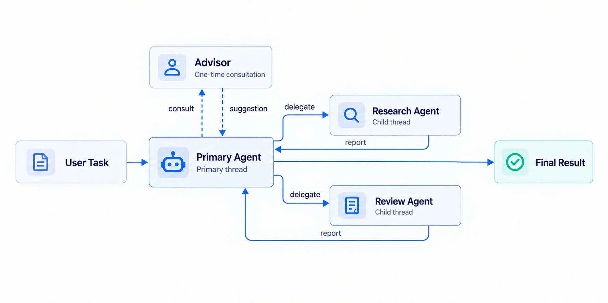

> ## Documentation Index
> Fetch the complete documentation index at: https://docs.bigmodel.cn/llms.txt
> Use this file to discover all available pages before exploring further.

# Multi Agent

当任务可以拆成独立调研、文件处理或专业评审时，配置一个主 Agent（coordinator）把工作交给成员 Agent。客户端仍创建一个 Session；平台在 Session 内生成多个独立上下文的 Thread。

> [!NOTE]
>
> Multi Agent 与 Advisor 暂不支持控制台配置和调试，请通过本页 API 配置，并使用 [Thread API](threads.md) 查看线程状态与事件。



Research Agent 与 Review Agent 各自在独立的 Child thread 中运行，并把报告返回主 Agent。Advisor 接收主 Agent 发起的一次咨询，再返回建议；最终结果由主 Agent 汇总输出。

## 从 self 副本开始

最小配置只增加 `multiagent`：主 Agent 可把独立子任务交给自身的副本。副本保留自己的历史，但不能继续委派。

```bash theme={null}
coordinator=$(curl -sS "$BASE_URL/v1/agents" \
  -H "Authorization: Bearer $ZHIPUAI_API_KEY" \
  -H "zai-version: 2026-05-26" \
  -H "zai-beta: managed-agents-2026-09-22" \
  -H "Content-Type: application/json" \
  -d '{
    "name":"Research lead","model":"glm-5.3",
    "system":"将独立问题委派给副本，提供输入、约束与报告要求，最后核对并综合结果。",
    "tools":[{"type":"agent_toolset_20260601"}],
    "multiagent":{"type":"coordinator","agents":[{"type":"self"}]}
  }')
AGENT_ID=$(jq -r '.id' <<< "$coordinator")
```

随后按[创建会话](create-session.md)引用这个 Agent、建立 SSE，再发送任务。`multiagent` 是 Agent 顶层字段，不放在 `tools[]`，也不能在创建 Session 的 override 里临时增删成员。

## 加入其他专业 Agent

先创建其他专业 Agent，再将它的 ID 加入主 Agent 的 `multiagent.agents`：

```json theme={null}
{
  "multiagent": {
    "type": "coordinator",
    "agents": [
      {"type":"agent","id":"agent_researcher","version":2},
      {"type":"self"}
    ]
  }
}
```

| 条目 | 使用方式 |
| - | - |
| `agent` | 引用已有 Agent；省略 version 时，在保存 coordinator 时固定到成员当时最新版本 |
| `self` | 主 Agent 副本；使用会话当前主 Agent 版本及覆盖配置 |
| `advisor` | 一次性顾问咨询，见下节 |

主线程自动获得 `list_agents`、`send_to_agent`。`send_to_agent` 返回投递确认与 `thread_id`，不等待成员完成。默认复用该成员最新未归档 Thread；可定向 `thread_id` 跟进，或用 `new_thread:true` 创建另一副本。

每次任务消息需写清数据路径、约束、输出要求。子线程看不到主线程完整对话；同一 Session 共享文件系统、资源挂载与 Vault，成员的 model/system/tools/MCP/Skills 则按自己的配置运行。并行写文件时分配不同输出路径。

## Advisor：给主 Agent 一个顾问

在成员名单里增加 `{"type":"advisor","model":"glm-5.3"}`，主线程会获得无参 `advisor` 工具。平台根据主线程当前对话组装咨询输入，执行一次模型调用，把建议交回主线程；无需客户端另写工具 handler。

Advisor 配置在 Agent 列表 里，但不出现在 `list_agents` 的可委派名单，不能被 `send_to_agent` 派活。只有 primary thread 可以咨询；一次性咨询完成后线程终止，不保留可 follow-up 的顾问对话。

客户端不会看到普通 advisor `agent.tool_use/tool_result`；通过线程生命周期和 `agent.thread_message_received` 观察建议。成功建议在客户事件中可为 redacted 占位，主 Agent 仍能读到；Thinking 不对外展示。失败时主 Agent 收到失败提示后继续任务。Advisor 按其自身模型计费，用量进入顾问 Thread 和 Session。

## 状态、限制与版本

* 只允许一层委派。成员 Agent 自身带 multiagent 时，保存 coordinator 返回 400；self 副本没有委派工具。
* 最多引用 20 个不同 Agent ID；一个成员可有多个 Thread。Session 的未归档普通线程（含主线程）上限为 25，Advisor 豁免。
* `session.thread_status_idle` 表示该线程本轮停止；查看 stop\_reason 判断完成还是等待审批。收到报告不等于整个 Session 已完成。
* 修改 Agent 的 multiagent 会生成新版本；传 null 清空。已有 API Session 仍使用创建时配置，新 Session 才使用新版本。
* 当前没有 Session budget 或多层嵌套编排；不要把 `budget:null` 当作已启用消费上限。

调试子 Agent、查看报告与线程状态见[会话线程](threads.md)。


This documentation is built and hosted on [Mintlify](https://mintlify.com), a developer documentation platform.