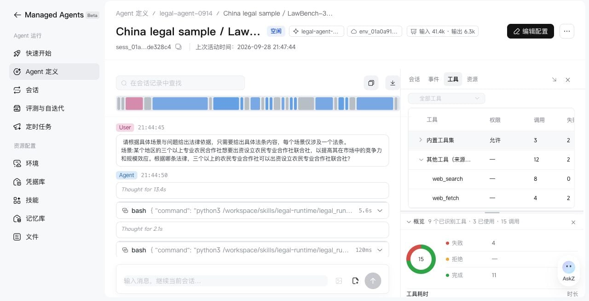
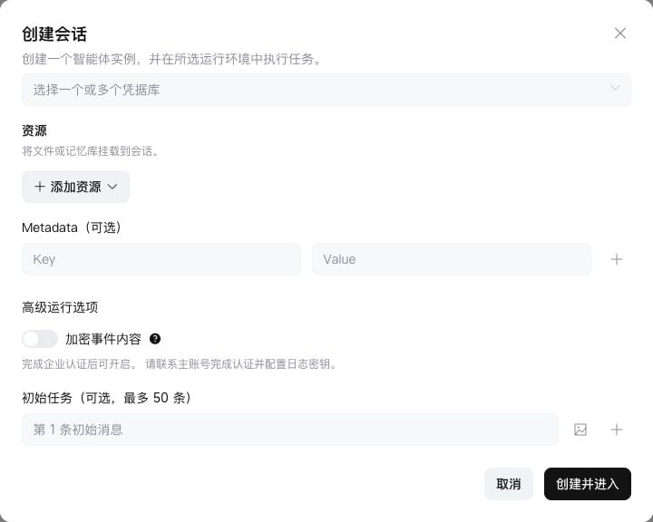
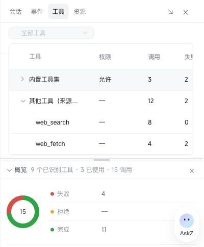
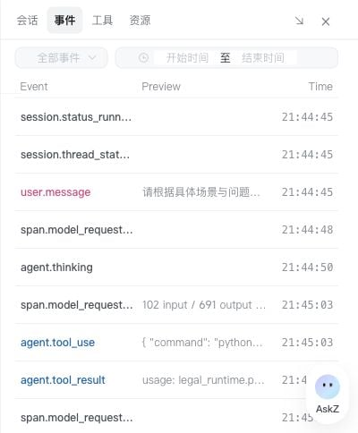

> ## Documentation Index
> Fetch the complete documentation index at: https://docs.bigmodel.cn/llms.txt
> Use this file to discover all available pages before exploring further.

# 在控制台查看与调试会话

> 从任务结果追溯工具、事件和资源，定位会话执行问题。

一次 Session 对应一次实际运行。进入 **Managed Agents → 会话**，选择目标会话并打开详情，即可查看对话、执行过程、工具与资源。

## 先确认本次运行用的配置

新建会话时，在 **会话 → 创建会话** 中选择 Agent 版本与环境，按需添加凭据库、文件、记忆和初始任务。高级选项可设置事件加密。

> **查看创建会话的资源与初始任务配置**
>
> 

在会话详情的 **会话** 面板检查 Session ID、状态、Agent 版本和环境。需要排查外部服务或文件问题时，再检查凭据库和资源挂载。

**先看实际使用的版本。** 更新 Agent 不会自动改写已有会话；修改配置后，应创建新会话验证，避免用旧会话判断新版本效果。

## 按问题选择面板

| 面板 | 看什么 | 适合定位什么 |
| - | - | - |
| 对话与执行过程 | 用户输入、Agent 回复、工具调用与返回 | 哪一步偏离预期、任务是否完成 |
| 会话 | 状态、配置引用、Token 用量 | 是否选错版本或环境、是否仍在执行 |
| 事件 | 事件正文与增量数据 | 事件顺序、调用参数、流式输出问题 |
| 工具 | 可用工具、权限、调用次数、失败与耗时 | 工具未启用、权限阻塞或重复失败 |
| 资源 | 文件、记忆库及挂载路径 | 输入缺失、路径错误、读写权限不符 |

工具面板可展开工具集，查看每个工具的调用、失败和耗时。历史调用缺少来源信息时，会列为“其他工具（来源未记录）”。表格较宽时，横向滚动查看其余统计列。

> **查看工具调用统计**
>
> 

> **查看事件列表**
>
> 

执行过程支持搜索；需要进一步排查时，可复制或下载事件。对外分享前检查事件中是否包含用户输入、业务数据或工具返回。

## 常见问题怎么查

**1. 先区分等待与失败**

`running` 表示仍在执行，`requires_action` 表示需要确认工具权限或提交自定义工具结果，`idle` 表示当前一轮已结束、可以继续输入。状态完整定义见[管理会话](session-operations.md)。

`idle` 本身不代表业务验收通过，还需要检查回答与产物。

**2. 找到第一个异常调用**

从执行过程定位失败工具，再查看事件中的输入与返回。优先排查环境网络策略、外部服务鉴权、文件路径与工具权限；修复原因后再重试。

出现权限请求时，在会话中检查工具名称和参数后确认或拒绝。自定义工具需要由调用方执行并提交结果；控制台也可填写测试结果，验证后续流程。

**3. 检查输入和产物**

确认文件已挂载到正确路径。消息中的文档或图片引用，与沙箱文件挂载是不同的输入方式；需要代码读取本地文件时，检查资源面板中的实际挂载。

需要下载的产物应写入 `/mnt/session/outputs`；`/workspace` 中间文件不会自动编目为可下载产物。详见[文件](files.md)。

**4. 修复后验证同一条任务**

临时修改会话工具或权限前，先等待会话空闲，并确认修改范围。需要复用的修复应保存到 Agent 新版本，再新建会话重跑相同输入。

将值得长期回归的问题通过 Session ID 导入[评测集](evaluation.md#准备评测集)，补充验收要点。

## 用量与事件加密

Token 用量可帮助定位重复调用和成本变化，最终费用以账单为准。不要将单次请求成功或工具调用成功等同于任务成功。

创建会话时可以选择加密事件内容。开启前需完成企业认证并配置日志密钥；配置入口、可用权限和生效提示以控制台为准。此开关在创建后不能修改，详见[会话事件数据加密](events.md#会话事件数据加密)。

> [!NOTE]
>
> Thread 的独立查看与管理暂不支持控制台。Multi Agent 场景下，使用 [Thread API](threads.md) 分别查看各线程事件与状态。

This documentation is built and hosted on [Mintlify](https://mintlify.com), a developer documentation platform.